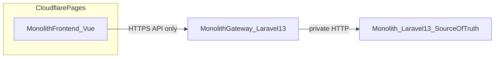

# AI Agent Guide — Monolith Workspace

Canonical guide for AI coding agents. Root entry: [AGENTS.md](../../AGENTS.md). Doc map: [docs/README.md](../README.md).

## Default scope: Monolith only

Daily work stays in **this repository**. Do **not** load, read, or edit Gateway or Frontend unless the prompt contains the exact keyword **`downstream sync session`**.

When Monolith changes affect HTTP contracts, write a [changelog](../changelog/pending/) entry — do not open the other repos in the same task.

### Session lifecycle and keywords

Keywords must appear in the **current user prompt**. Re-loading AGENTS.md alone does not change phase.

| Phase | Trigger | Action |
|-------|---------|--------|
| **1. Open** | Load AGENTS / this guide | Scope: Monolith only. Ready for work. |
| **2. Work** | No special keyword | Implement + test in Monolith. No close-out. |
| **3. Close** | **`upstream documentation session`** | Improve docs for session work; write **one** changelog entry with Delegation. |

| Keyword | Scope | Purpose |
|---------|-------|---------|
| *(none)* | Monolith | Phase 2 |
| **`upstream documentation session`** | Monolith | Phase 3 — docs + changelog |
| **`sync consolidation`** | Monolith docs | Merge conflicting `pending/` (newest wins; else verify code) |
| **`downstream sync session`** | All three repos | Implement `pending/` on Gateway/Frontend; move to `done/` |

Full procedure: [changelog/README.md](../changelog/README.md).

### Delegation glossary

| Label | Meaning |
|-------|---------|
| **Monolith** | This repo — versioned API **and** Blade |
| **Monolith Gateway** | Public BFF (proxy, cookies, aggregates) |
| **Monolith Frontend** | Static Vue on Cloudflare Pages |

## Workspace map



| Project | Path | Role |
|---------|------|------|
| **Monolith** | `c:\laragon\www\monolith` | Private SoT — domain logic, DB, JWT/RBAC, `/api/v1/*`, Blade admin |
| **Gateway** | `c:\laragon\www\monolith-gateway` | Public API bridge — cookies, CORS, transforms, aggregates |
| **Frontend** | `c:\laragon\www\monolith-frontend` | Static Vue consumer — Gateway only, no Pages Functions for BFF |

## Four mandatory principles

### 1. Monolith is the source of truth

- Business rules, validation, Spatie RBAC, persistence, and API contracts live here.
- Gateway/Frontend **follow** Monolith — never the reverse.
- SPA convenience (combined payloads) belongs in **Gateway aggregation**, not extra Monolith endpoints unless domain rules change.
- **Full-stack every Monolith task:** API + Web + Blade + translations (`en`, `id`, `ja`) in the same PR. See root [README.md](../../README.md#living-documentation-required).

### 2. Gateway is the public API connector

- Only public HTTP surface clients should call in production.
- Stateless: no `DB_*` on Gateway.
- Default home for proxying, cookies, CORS, middleware, response transforms (not Frontend edge workers).
- Aggregate multi-fetch UI flows via `MonolithClient::pool()` when useful. Examples: `GET /api/v1/bootstrap`, `users/{user}/edit-context`, `navigation/menus/form-options`, `lookups/*`.
- Programmatic API only: Gateway blocks browser address-bar `GET /api/*`. See gateway docs when in a **downstream sync session**.

### 3. Frontend is a static API consumer

- Cloudflare Pages: static `dist/` only.
- No Pages Functions/Workers for `/api/*` without Gateway-first assessment and explicit approval.
- Production: `VITE_API_BASE_URL` = public Gateway URL. Local: empty (Vite proxies to `monolith-gateway.test`).

### 4. Downstream adaptation contract

Log HTTP impact in `changelog/pending/`; implement consumers only in **`downstream sync session`**.

| Change in Monolith | Changelog? | Downstream work |
|--------------------|------------|-----------------|
| Internal folder / PHP namespace only | No | — |
| Route file split, **same URLs** | No | — |
| API JSON shape / new URL / route name / aggregate / SPA copy | Yes → `pending/` | Gateway + Frontend per entry |

## Request flow

```
Browser → Cloudflare Pages (static)
       → Gateway /api/* (cookie + CORS + transforms + aggregates)
       → Monolith /api/v1/* (X-Gateway-Secret + Bearer JWT)
```

Local wiring: [integration/spa-gateway.md](../integration/spa-gateway.md).

## Where to read (Monolith)

Use [docs/README.md](../README.md) — domain folders under `docs/domains/`, platform under `docs/platform/`. Do **not** load Gateway/Frontend doc trees unless the prompt has **`downstream sync session`**.

## Agent workflow checklist

### Daily Monolith (phase 2)

1. Scope: Monolith only.
2. Read domain/platform docs from [docs/README.md](../README.md).
3. Implement; match existing patterns.
4. Test: `composer test` ([database-safety](../platform/database-safety.md)).
5. Update living docs when behavior changes — **placement:** edit the matching domain/platform/web/integration guide; **never** add a new flat `docs/*.md` subject file. Rules: [docs/README.md — Rules for new documentation](../README.md#rules-for-new-documentation-mandatory).
6. If HTTP contract changes: `changelog/pending/` via [TEMPLATE.md](../changelog/TEMPLATE.md).
7. No close-out without **`upstream documentation session`**.

### Upstream documentation session (phase 3)

1. Confirm exact keyword in prompt.
2. Inventory session work; fix stale Monolith docs (English).
3. One changelog entry with Delegation; `pending/` if Gateway/Frontend open, else `done/`.
4. Do not open Gateway/Frontend unless **`downstream sync session`** is also present.

### Sync consolidation / Downstream sync

See [changelog/README.md](../changelog/README.md). Downstream: start from `pending/`, prefer consolidation first, Gateway-first before Frontend edge features, archive to `done/`.

## What not to do

- Open Gateway/Frontend without **`downstream sync session`**.
- Close-out or consolidate without exact keywords.
- Treat AGENTS reload as session close.
- Apply conflicting `pending/` blindly — consolidate first.
- Business logic or DB on Gateway.
- Frontend Workers for BFF without approval.
- `migrate:fresh` / `db:wipe` on non-sqlite without `ALLOW_DESTRUCTIVE_DB=true`.
- Assume Blade has hosted Snap checkout — **Vue only**; Blade is channel-only ([payment-gateway](../domains/payment-gateway/README.md)).
- Create new documentation as a subject file at `docs/*.md` root — always place under `domains/`, `platform/`, `web/`, `integration/`, `agents/`, `changelog/`, or `archive/` per [docs/README.md](../README.md#rules-for-new-documentation-mandatory).
