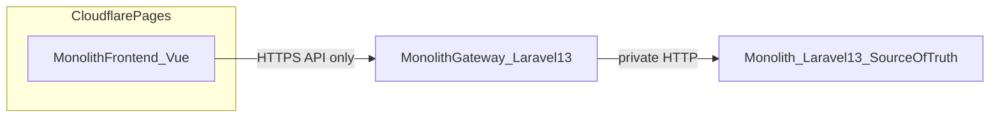
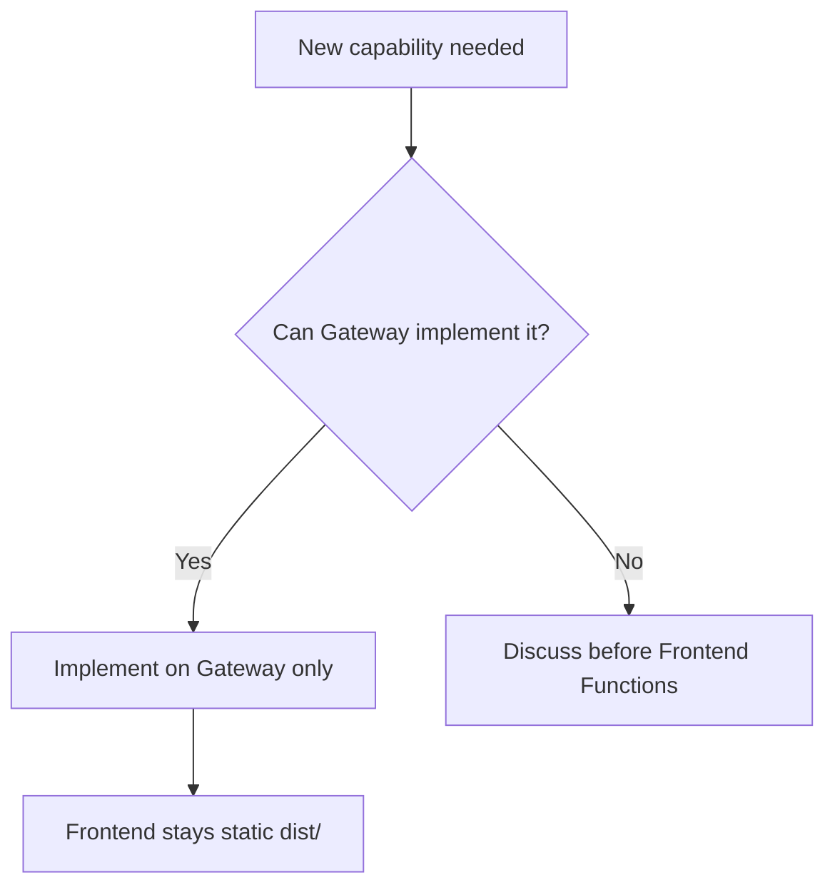

# AI Agent Guide — Monolith Workspace

This document is the **canonical guide** for AI coding agents (Cursor, Copilot, etc.) working in the three-project Monolith workspace. Read it **before** implementing features, refactors, session close-out, or downstream sync work.

Entry points in each repository: `AGENTS.md` at the project root.

---

## Default scope: Monolith only

**Daily tasks focus on Project Monolith only** to limit token use. Gateway and Frontend are separate git repositories; do **not** load, read, or edit them unless the user's prompt contains the exact keyword **`downstream sync session`**.

That keyword is the **only** trigger for a downstream sync session. Paraphrases or implied permission do **not** qualify — the literal phrase must appear in the prompt.

When Monolith changes affect HTTP contracts (see [adaptation contract](#4-downstream-adaptation-contract)), **write a changelog entry** under [changelog/pending/](./changelog/pending/) — do **not** open the other repos in the same task.

`AGENTS.md` remains the entry point on every task. This guide provides architecture context; implementation stays in Monolith unless the prompt contains **`downstream sync session`**.

### Session lifecycle and keywords

Monolith sessions have three phases. Loading [AGENTS.md](../AGENTS.md) is common at open and close; **keywords in the current prompt** decide the phase — not merely re-attaching the file.

| Phase | Trigger | Agent action |
|-------|---------|--------------|
| **1. Open** | User loads AGENTS / this guide at chat start | Read architecture. Scope: Monolith only. Ready for work. |
| **2. Work** | Prompt has **no** special session keyword | Implement and test in Monolith. Do **not** run close-out. |
| **3. Close** | Exact keyword **`upstream documentation session`** | Improve Monolith docs for session work, then write **one** entry under [changelog/](./changelog/README.md) with Delegation. |

| Keyword | Scope | Purpose |
|---------|-------|---------|
| *(none)* | Monolith | Phase 2 — daily implementation |
| **`upstream documentation session`** | Monolith only | Phase 3 — improve docs + write changelog entry (`pending/` or `done/`). Paraphrases do **not** qualify. |
| **`sync consolidation`** | Monolith docs only | Merge conflicting/overlapping `pending/` entries; newest wins, else verify Monolith code |
| **`downstream sync session`** | All three repos | Implement Gateway/Frontend from [changelog/pending/](./changelog/pending/); move completed entries to `done/` |

Without **`upstream documentation session`**, stay in **phase 2** even if AGENTS.md was re-loaded. Full changelog procedure: [changelog/README.md](./changelog/README.md).

### Delegation glossary

| Label | Meaning |
|-------|---------|
| **Monolith** | Fullstack source of truth in this repository — versioned API **and** Blade UI/UX |
| **Monolith Gateway** | Public API layer (proxy, cookies, aggregates, transforms) |
| **Monolith Frontend** | Static Vue view layer (Cloudflare Pages; no Functions for BFF) |

Every changelog entry must split work into these three buckets.

---
---

## Workspace map



| Project | Path | Stack | Role |
|---------|------|-------|------|
| **Project Monolith** | `c:\laragon\www\monolith` | Laravel 13 | **Private source of truth (fullstack)** — domain logic, database, JWT/RBAC, `/api/v1/*`, and Blade admin as API consumer |
| **Project Monolith Gateway** | `c:\laragon\www\monolith-gateway` | Laravel 13 | **Public API bridge / BFF** — only public HTTP surface; proxies private Monolith; cookies, CORS, Vue transforms, aggregates |
| **Project Monolith Frontend** | `c:\laragon\www\monolith-frontend` | Vue 3 + Vite | **Customer-facing view layer** — static Cloudflare Pages build; loads data/logic via Gateway only (no Functions/Workers for BFF) |

These three projects share one logical system. **Monolith is private SoT and lands first**; Gateway and Frontend follow via [changelog](./changelog/README.md) entries (`pending/` → `done/`) and **`downstream sync session`** work — not in every daily task. Daily agent work stays in Monolith only to limit token cost; cross-repo work is keyword-gated.

---

## Four mandatory principles

### 1. Project Monolith is the source of truth

Project Monolith is a **Laravel 13** application and the **authoritative private layer** for the entire stack (API-first, plus optional Blade UI that consumes the same versioned API).

- All business rules, validation, authorization (Spatie RBAC), persistence, and API contracts live here.
- In changelog **Delegation**, **Monolith** means this fullstack repo (API **and** Blade) — not Gateway or the Vue SPA.
- Gateway and Frontend **must follow** Monolith implementations — not the other way around.
- Do not duplicate domain logic in Gateway or Frontend. Gateway may reshape or combine HTTP responses; Frontend may render and orchestrate UX — neither owns business rules.
- Extend Monolith API only when the capability is **genuinely new domain behavior**. SPA convenience (fewer round trips, combined payloads) belongs in **Gateway aggregation**, not new Monolith endpoints unless the data model or rules change.

When in doubt: implement or fix behavior in Monolith first, log impact in [changelog/pending/](./changelog/pending/) with Gateway/Frontend Delegation, then adapt consumers in a **`downstream sync session`**.

**Monolith full-stack (required on every Monolith task):** API + Web + Blade + translations (`en`, `id`, `ja`) in the same task/PR. See [README.md](../README.md#living-documentation-required). This is **not** the same as updating Gateway or Frontend.

### 2. Project Monolith Gateway is the API connector

Project Monolith Gateway is a **Laravel 13** stateless BFF — the **API bridge** between private Monolith and the public internet (and all external clients: Monolith Frontend plus third-party apps).

- It is the **only public HTTP API surface** clients should call in production (even if Monolith were later reachable, public traffic should still use Gateway’s domain).
- It proxies to private Monolith (`MONOLITH_BASE_URL`), manages HttpOnly JWT cookies for the SPA, applies CORS, and rewrites selected JSON for Vue router paths.
- In changelog **Delegation**, **Monolith Gateway** means this API layer only.
- It must remain **stateless**: do not configure `DB_*` on the gateway (see [configuration.md](../../monolith-gateway/docs/configuration.md)).
- It is the **default home** for server-side concerns that might otherwise tempt Cloudflare Pages Functions or Workers on the Frontend (API proxying, aggregation, cookies, CORS, middleware, response transforms). See [static-only-policy.md](../../monolith-frontend/docs/static-only-policy.md).

Cross-region latency (browser → Gateway) is paid per round trip; aggregation reduces browser RTTs without changing Monolith. Gateway VPS region (e.g. Singapore) is a **deployment convention**, not enforced in code.

**Aggregate endpoint assessment (downstream sync / SPA work):** Before shipping UI flows that issue multiple API calls on load (shell bootstrap, form screens, dashboards), **assess whether Gateway should expose a combined endpoint** that fan-outs to Monolith in parallel via `MonolithClient::pool()`. Note the decision in a [changelog](./changelog/README.md) entry when Monolith work triggers it.

| Existing aggregate examples | Purpose |
|----------------------------|---------|
| `GET /api/v1/bootstrap` | Shell: user + navigation trees + notification unread count |
| `GET /api/v1/users/{user}/edit-context` | User edit form data |
| `GET /api/v1/navigation/menus/form-options` | Menu create/edit form data (edit: menu record only) |
| `GET /api/v1/lookups/*` | Paginated form select options — [form-selects.md](./form-selects.md) |

Pattern and contracts: [aggregate-endpoints.md](../../monolith-gateway/docs/aggregate-endpoints.md).

Individual proxied Monolith routes remain available for mutations, polling, and DataTables.

**Programmatic API access only:** `GET /api/*` must not be browsable in the browser address bar. Gateway middleware rejects `GET` with `Sec-Fetch-Dest: document` / `iframe` or without `X-Requested-With: XMLHttpRequest`. `POST`/`PUT`/`PATCH`/`DELETE` and `OPTIONS` are exempt. Frontend Axios sends the header on all requests. See [programmatic-api-access.md](../../monolith-gateway/docs/programmatic-api-access.md).

### 3. Project Monolith Frontend is a static API consumer

Project Monolith Frontend is a **Vue 3** SPA that consumes Gateway only. It is hosted on **Cloudflare Pages** as a **pure static build** so Pages billing stays free of Functions/Workers for app logic.

- Deploy **built static assets only** (`dist/` via `npm run deploy`).
- **Do not add Cloudflare Pages Functions, Workers, or edge API proxying** for `/api/*`. Anything that needs a server function is offloaded to **Gateway**. API traffic must go directly to the Gateway VPS.
- In changelog **Delegation**, **Monolith Frontend** means this static view layer only.
- **Production:** set `VITE_API_BASE_URL` to the public Gateway URL in the Cloudflare Pages build environment. Never ship a production build with an empty API base URL.
- **Local:** leave `VITE_API_BASE_URL` empty; Vite proxies `/api` and `/broadcasting` to `monolith-gateway.test` ([vite.config.ts](../../monolith-frontend/vite.config.ts)).

The Frontend is a thin client: Pinia stores, Axios (`src/api/client.ts`), and views — no duplicated business logic from Laravel.

#### Gateway-first assessment (downstream sync / SPA work)

Before adding **Cloudflare Pages Functions, Workers, or any server-side logic** to the Frontend, assess whether **Gateway** can implement the need instead.



| Outcome | Action |
|---------|--------|
| Gateway can satisfy the need | Implement **only** on Gateway |
| Gateway cannot | **Stop and discuss** — do not add Frontend Functions without explicit approval |

Full policy and examples: [static-only-policy.md](../../monolith-frontend/docs/static-only-policy.md).

### 4. Downstream adaptation contract

When Monolith changes affect HTTP contracts, **log the impact** — do not implement Gateway/Frontend in the same daily task.

| Change in Monolith | Changelog? | Downstream sync session |
|--------------------|------------|-------------------------|
| Internal folder / PHP namespace only | No | — |
| Route file split, **same URLs** | No | — |
| API JSON shape change | Yes → `pending/` | Gateway proxy/transform; Frontend `src/api/*` |
| New or changed URL prefix | Yes → `pending/` | Gateway route proxy; Frontend `src/api/*`, router |
| New Laravel route name (menus / DataTable) | Yes → `pending/` | `config/vue-routes.php`; `src/router/index.ts` |
| New aggregate endpoint | Yes → `pending/` | Gateway implement; Frontend consume |
| User-facing copy (SPA) | Yes → `pending/` | Monolith `lang/{locale}/`; Frontend `src/i18n/` |

Full table: [internal-monorepo-assessment.md](./internal-monorepo-assessment.md#adaptation-contract-gateway--frontend).

Workflow: [changelog/README.md](./changelog/README.md).

Do not leave Monolith documentation behind: update relevant `docs/` and `README.md` in the same Monolith task as code changes (see Monolith README living-documentation policy).

---

## Request flow

```
Browser → Cloudflare Pages (static HTML/JS/CSS only)
       → Gateway /api/* (cookie + CORS + transforms + aggregates)
       → Monolith /api/v1/* (X-Gateway-Secret + Bearer JWT)
```

Laragon local wiring, cookie auth, troubleshooting, and parity matrix: [spa-gateway-integration.md](./spa-gateway-integration.md).

---

## Documentation index — Project Monolith

Read these for daily Monolith work. Do **not** load Gateway or Frontend doc indexes unless the prompt contains **`downstream sync session`**.

| Document | Topic |
|----------|-------|
| [README.md](../README.md) | Living documentation rules, Monolith full-stack requirement, UUID conventions |
| [docs/changelog/README.md](./changelog/README.md) | Session + sync log (`pending/` / `done/`, Delegation, consolidation) |
| [docs/api-routing.md](./api-routing.md) | Global vs versioned API layout |
| [docs/jwt-authentication.md](./jwt-authentication.md) | Auth, 2FA, JWT, permissions |
| [docs/spa-gateway-integration.md](./spa-gateway-integration.md) | Three-project wiring and production |
| [docs/localization.md](./localization.md) | `en` / `id` / `ja` task rules |
| [docs/crud-architecture.md](./crud-architecture.md) | Repository pattern, API resources |
| [docs/domain-modules.md](./domain-modules.md) | Internal `app/Domain/*` layout, core/locked/removable, `domain:list\|make\|remove` |
| [docs/payment-gateways.md](./payment-gateways.md) | Midtrans/iPaymu, invoices, subscriptions, webhooks |
| [docs/database-safety.md](./database-safety.md) | Dev DB wipe prevention, test vs MySQL, recovery |
| [docs/internal-monorepo-assessment.md](./internal-monorepo-assessment.md) | Monorepo scope, Gateway/Frontend contract |
| [docs/internal-monorepo-porting.md](./internal-monorepo-porting.md) | Porting implementation reference (migration order, scripts, gotchas) |
| [docs/environment.md](./environment.md) | `GATEWAY_ENFORCE`, secrets, env vars |
| [docs/user-management-hrbac.md](./user-management-hrbac.md) | Users and role hierarchy |
| [docs/form-selects.md](./form-selects.md) | Select2 + lookup endpoints |
| [docs/navigation-menu.md](./navigation-menu.md) | Menu tree API |
| [docs/notifications.md](./notifications.md) | Notifications and broadcasting |
| [docs/approval-matrix-engine.md](./approval-matrix-engine.md) | Approval workflows |
| [docs/octane-readiness.md](./octane-readiness.md) | Long-lived worker constraints |

---

## Reference — downstream sync sessions only

Load these **only** when the user's prompt contains the exact keyword **`downstream sync session`**. Start from [changelog/pending/](./changelog/pending/).

### Project Monolith Gateway

| Document | Topic |
|----------|-------|
| [README.md](../../monolith-gateway/README.md) | Overview and setup |
| [docs/architecture.md](../../monolith-gateway/docs/architecture.md) | Routes, file map, middleware |
| [docs/programmatic-api-access.md](../../monolith-gateway/docs/programmatic-api-access.md) | Block direct browser API navigation |
| [docs/aggregate-endpoints.md](../../monolith-gateway/docs/aggregate-endpoints.md) | BFF multi-fetch endpoints |
| [docs/auth-cookie.md](../../monolith-gateway/docs/auth-cookie.md) | `auth_token` HttpOnly cookie |
| [docs/monolith-client.md](../../monolith-gateway/docs/monolith-client.md) | Upstream HTTP, `pool()` |
| [docs/vue-route-transforms.md](../../monolith-gateway/docs/vue-route-transforms.md) | `vue-routes.php` rewriting |
| [docs/configuration.md](../../monolith-gateway/docs/configuration.md) | Env vars, stateless rules |
| [docs/testing.md](../../monolith-gateway/docs/testing.md) | PHPUnit |

### Project Monolith Frontend

| Document | Topic |
|----------|-------|
| [README.md](../../monolith-frontend/README.md) | Setup, deploy, env vars |
| [docs/static-only-policy.md](../../monolith-frontend/docs/static-only-policy.md) | Static-only Cloudflare Pages; Gateway-first rule |
| [docs/architecture.md](../../monolith-frontend/docs/architecture.md) | Stack, auth, bootstrap shell, Vite/wrangler |
| [docs/form-selects.md](../../monolith-frontend/docs/form-selects.md) | Select2 fields + lookup client |
| [docs/api-surface.md](../../monolith-frontend/docs/api-surface.md) | All `src/api/*` endpoints |
| [docs/router-and-guards.md](../../monolith-frontend/docs/router-and-guards.md) | Routes, permissions, guards |
| [docs/stores-and-realtime.md](../../monolith-frontend/docs/stores-and-realtime.md) | Pinia stores, Echo, locale |
| [docs/datatable-actions.md](../../monolith-frontend/docs/datatable-actions.md) | DataTable server actions |
| [docs/playground-orders.md](../../monolith-frontend/docs/playground-orders.md) | Playground orders + uploads |
| [docs/payment-gateways.md](../../monolith-frontend/docs/payment-gateways.md) | Payment admin, checkout, Snap.js |
| [docs/async-fetch-ux.md](../../monolith-frontend/docs/async-fetch-ux.md) | Loading and error UX |
| [docs/auth-layout.md](../../monolith-frontend/docs/auth-layout.md) | Guest auth screens |
| [docs/responsive-ui.md](../../monolith-frontend/docs/responsive-ui.md) | Mobile layouts |
| [docs/testing.md](../../monolith-frontend/docs/testing.md) | Vitest and Playwright |

---

## Agent workflow checklist

### Daily Monolith task (phase 2)

1. **Scope** — Monolith only. Do not open Gateway or Frontend without the **`downstream sync session`** keyword in the prompt.
2. **Read** Monolith docs from the index above (start with [AGENTS.md](../AGENTS.md) and domain-specific guides).
3. **Implement** with minimal scope; match existing naming, patterns, and folder layout.
4. **Test** Monolith (`composer test` — see [database-safety.md](database-safety.md)).
5. **Update** Monolith documentation in the same task when behavior changes (living documentation).
6. **Changelog (optional mid-task)** — if the adaptation contract triggers, add an entry under [changelog/pending/](./changelog/pending/) using [TEMPLATE.md](./changelog/TEMPLATE.md). Required on close if still missing.
7. **Do not close out** — skip [changelog/](./changelog/README.md) close-out unless the prompt contains **`upstream documentation session`**.

### Upstream documentation session (phase 3 — close-out)

1. **Confirm** the user's prompt contains the exact keyword **`upstream documentation session`**. If it does not, stay in phase 2 — do not invent a session changelog.
2. **Inventory** work from this session (conversation, git status/diff, related files).
3. **Improve** every Monolith guide made stale by that work (README + `docs/`; English only).
4. **Write one changelog entry** under [changelog/](./changelog/README.md) using [TEMPLATE.md](./changelog/TEMPLATE.md). Fill **Delegation** for Monolith / Gateway / Frontend.
5. **Place correctly** — `pending/` if Gateway or Frontend has open actions; `done/` if both are "None required" (Monolith-only).
6. **Do not** open Gateway or Frontend unless the same prompt also contains **`downstream sync session`**.
7. **Summarize** for the user: docs updated, changelog entry path, pending vs done.

Full procedure: [changelog/README.md](./changelog/README.md).

### Sync consolidation

1. **Confirm** the user's prompt contains the exact keyword **`sync consolidation`**. If it does not, do not merge pending entries.
2. **List** all (or user-named) files under [changelog/pending/](./changelog/pending/).
3. **Group** related entries (same routes, files, feature area).
4. **Resolve conflicts** — later `YYYY-MM-DD` wins; older decisions are stale.
5. **If still ambiguous** — read Monolith code and tests (not Gateway/Frontend) and document actual current behavior.
6. **Output** consolidated `pending/` file(s); set **Supersedes**; mark or remove older entries (`superseded`).
7. **Do not** implement Gateway/Frontend unless the same prompt also contains **`downstream sync session`**.

Full procedure: [changelog/README.md](./changelog/README.md#sync-consolidation-agent).

### Downstream sync session

1. **Confirm** the user's prompt contains the exact keyword **`downstream sync session`**. If it does not, stop — log or update changelog entries in Monolith only.
2. Prefer **`sync consolidation`** first when multiple related `pending/` entries exist.
3. **Read** all `pending/` changelog entries (oldest first unless prioritized).
4. **Assess aggregation** for multi-fetch SPA flows — prefer Gateway fan-out over extra Monolith endpoints.
5. **Assess Gateway first** before any Frontend edge/server feature — see [static-only-policy.md](../../monolith-frontend/docs/static-only-policy.md).
6. **Implement** Gateway and Frontend per each entry's Delegation checklists; use the downstream doc index above.
7. **Test** all three repos (`.\scripts\test-workspace.ps1` from Monolith root, or per-entry test plan).
8. **Archive** completed entries to [changelog/done/](./changelog/done/) and update downstream docs.

---
---

## What not to do

- Load or edit Gateway / Frontend unless the prompt contains the exact keyword **`downstream sync session`**.
- Run an **`upstream documentation session`** close-out (or write [changelog/](./changelog/) entries) without the exact keyword in the prompt.
- Run **`sync consolidation`** without the exact keyword in the prompt.
- Treat re-loading [AGENTS.md](../AGENTS.md) alone as session close — without **`upstream documentation session`**, remain in work phase.
- Apply every `pending/` entry blindly when later entries supersede earlier decisions — run **`sync consolidation`** first when related pending files conflict.
- Rework Monolith architecture without strong justification — it is production-stable source of truth.
- Put business logic or a database on Gateway.
- Add Cloudflare Workers/Functions to Frontend for API proxying or BFF logic without Gateway-first assessment and explicit approval.
- Ship Frontend multi-fetch screens without considering Gateway aggregation (note in changelog during Monolith work; implement in sync session).
- Change public API contracts without a [changelog/pending/](./changelog/pending/) entry and eventual Gateway/Frontend sync.
- Change API behavior in Gateway or Frontend without verifying Monolith is authoritative.
- Run `migrate:fresh`, `migrate:refresh`, or `db:wipe` on Monolith non-sqlite without `ALLOW_DESTRUCTIVE_DB=true` (see [database-safety.md](database-safety.md)).
- Assume Blade admin has hosted Snap/redirect checkout — **Vue only**; Blade is channel-only (see [payment-gateways.md](payment-gateways.md)).
