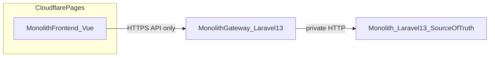

# AI Agent Guide — Monolith Workspace

This document is the **canonical guide** for AI coding agents (Cursor, Copilot, etc.) working in the three-project Monolith workspace. Read it **before** implementing features, refactors, or cross-project changes.

Entry points in each repository: `AGENTS.md` at the project root.

---

## Workspace map



| Project | Path | Stack | Role |
|---------|------|-------|------|
| **Project Monolith** | `c:\laragon\www\monolith` | Laravel 13 | **Source of truth** — domain logic, database, JWT/RBAC, `/api/v1/*` |
| **Project Monolith Gateway** | `c:\laragon\www\monolith-gateway` | Laravel 13 | **API connector / BFF** — public proxy, cookies, CORS, Vue transforms, aggregate endpoints |
| **Project Monolith Frontend** | `c:\Users\Administrator\Documents\npm\monolith-frontend` | Vue 3 + Vite | **API consumer** — static build deployed on Cloudflare Pages |

These three projects are usually opened together in one workspace. A change in one project often must be reflected in the others **in the same task**.

---

## Four mandatory principles

### 1. Project Monolith is the source of truth

Project Monolith is a **Laravel 13** application and the **authoritative** layer for the entire stack.

- All business rules, validation, authorization (Spatie RBAC), persistence, and API contracts live here.
- Gateway and Frontend **must follow** Monolith implementations — not the other way around.
- Do not duplicate domain logic in Gateway or Frontend. Gateway may reshape or combine HTTP responses; Frontend may render and orchestrate UX — neither owns business rules.
- Extend Monolith API only when the capability is **genuinely new domain behavior**. SPA convenience (fewer round trips, combined payloads) belongs in **Gateway aggregation**, not new Monolith endpoints unless the data model or rules change.

When in doubt: implement or fix behavior in Monolith first, then adapt downstream consumers.

### 2. Project Monolith Gateway is the API connector

Project Monolith Gateway is a **Laravel 13** stateless BFF between Monolith and all external clients — internal (Monolith Frontend) and external third-party apps.

- It is the **only public HTTP API surface** clients should call in production.
- It proxies to private Monolith (`MONOLITH_BASE_URL`), manages HttpOnly JWT cookies for the SPA, applies CORS, and rewrites selected JSON for Vue router paths.
- It must remain **stateless**: do not configure `DB_*` on the gateway (see [configuration.md](../../monolith-gateway/docs/configuration.md)).

**Aggregate endpoint assessment (required):** Before shipping UI flows that issue multiple API calls on load (shell bootstrap, form screens, dashboards), **assess whether Gateway should expose a combined endpoint** that fan-outs to Monolith in parallel via `MonolithClient::pool()`. Cross-region latency (browser → Gateway in Singapore) is paid per round trip; aggregation reduces browser RTTs without changing Monolith.

| Existing aggregate examples | Purpose |
|----------------------------|---------|
| `GET /api/v1/bootstrap` | Shell: user + navigation trees + notification unread count |
| `GET /api/v1/users/{user}/edit-context` | User edit form data |
| `GET /api/v1/navigation/menus/form-options` | Menu create/edit form data |

Pattern and contracts: [aggregate-endpoints.md](../../monolith-gateway/docs/aggregate-endpoints.md).

Individual proxied Monolith routes remain available for mutations, polling, and DataTables.

### 3. Project Monolith Frontend is a static API consumer

Project Monolith Frontend is a **Vue 3** SPA that consumes Gateway only. It is hosted on **Cloudflare Pages** as a **pure static build**.

- Deploy **built static assets only** (`dist/` via `npm run deploy`).
- **Do not add Cloudflare Pages Functions, Workers, or edge API proxying** for `/api/*`. API traffic must go directly to the Gateway VPS. Edge functions would invoke Workers billing and blur architecture boundaries.
- **Production:** set `VITE_API_BASE_URL` to the public Gateway URL in the Cloudflare Pages build environment. Never ship a production build with an empty API base URL.
- **Local:** leave `VITE_API_BASE_URL` empty; Vite proxies `/api` and `/broadcasting` to `monolith-gateway.test` ([vite.config.ts](../../monolith-frontend/vite.config.ts)).

The Frontend is a thin client: Pinia stores, Axios (`src/api/client.ts`), and views — no duplicated business logic from Laravel.

### 4. Cross-project consistency

Because all three projects share one workspace, treat them as one system:

| Change in | Also review / update |
|-----------|----------------------|
| Monolith API route or response shape | Gateway proxy/transforms, Frontend `src/api/*`, [spa-gateway-integration.md](./spa-gateway-integration.md) |
| Gateway aggregate or Vue transform | Frontend stores/views, [aggregate-endpoints.md](../../monolith-gateway/docs/aggregate-endpoints.md), PHPUnit tests |
| Frontend screen with multiple parallel fetches | Gateway aggregation assessment **first** |
| New Laravel route name in menus or DataTable actions | [monolith-gateway/config/vue-routes.php](../../monolith-gateway/config/vue-routes.php) |
| User-facing copy | Monolith `lang/{locale}/`, Frontend `src/i18n/` (`en`, `id`, `ja`) |

Do not leave documentation behind: update relevant `docs/` and `README.md` files in the same task as code changes (see Monolith README living-documentation policy).

---

## Request flow

```
Browser → Cloudflare Pages (static HTML/JS/CSS only)
       → Gateway /api/* (cookie + CORS + transforms + aggregates)
       → Monolith /api/v1/* (X-Gateway-Secret + Bearer JWT)
```

Laragon local wiring, cookie auth, troubleshooting, and parity matrix: [spa-gateway-integration.md](./spa-gateway-integration.md).

---

## Documentation index

Use these links to preserve context. Read Monolith docs for domain/API rules before touching Gateway or Frontend.

### Project Monolith

| Document | Topic |
|----------|-------|
| [README.md](../README.md) | Living documentation rules, full-stack requirement, UUID conventions |
| [docs/api-routing.md](./api-routing.md) | Global vs versioned API layout |
| [docs/jwt-authentication.md](./jwt-authentication.md) | Auth, 2FA, JWT, permissions |
| [docs/spa-gateway-integration.md](./spa-gateway-integration.md) | Three-project wiring and production |
| [docs/localization.md](./localization.md) | `en` / `id` / `ja` task rules |
| [docs/crud-architecture.md](./crud-architecture.md) | Repository pattern, API resources |
| [docs/environment.md](./environment.md) | `GATEWAY_ENFORCE`, secrets, env vars |
| [docs/user-management-hrbac.md](./user-management-hrbac.md) | Users and role hierarchy |
| [docs/navigation-menu.md](./navigation-menu.md) | Menu tree API |
| [docs/notifications.md](./notifications.md) | Notifications and broadcasting |
| [docs/approval-matrix-engine.md](./approval-matrix-engine.md) | Approval workflows |
| [docs/octane-readiness.md](./octane-readiness.md) | Long-lived worker constraints |

### Project Monolith Gateway

| Document | Topic |
|----------|-------|
| [README.md](../../monolith-gateway/README.md) | Overview and setup |
| [docs/architecture.md](../../monolith-gateway/docs/architecture.md) | Routes, file map, middleware |
| [docs/aggregate-endpoints.md](../../monolith-gateway/docs/aggregate-endpoints.md) | BFF multi-fetch endpoints |
| [docs/auth-cookie.md](../../monolith-gateway/docs/auth-cookie.md) | `auth_token` HttpOnly cookie |
| [docs/monolith-client.md](../../monolith-gateway/docs/monolith-client.md) | Upstream HTTP, `pool()` |
| [docs/vue-route-transforms.md](../../monolith-gateway/docs/vue-route-transforms.md) | `vue-routes.php` rewriting |
| [docs/configuration.md](../../monolith-gateway/docs/configuration.md) | Env vars, stateless rules |
| [docs/testing.md](../../monolith-gateway/docs/testing.md) | PHPUnit |

### Project Monolith Frontend

| Document | Topic |
|----------|-------|
| [README.md](../../monolith-frontend/README.md) | Setup, deploy, env vars |
| [docs/architecture.md](../../monolith-frontend/docs/architecture.md) | Stack, auth, bootstrap shell |
| [docs/async-fetch-ux.md](../../monolith-frontend/docs/async-fetch-ux.md) | Loading and error UX |
| [docs/auth-layout.md](../../monolith-frontend/docs/auth-layout.md) | Guest auth screens |
| [docs/responsive-ui.md](../../monolith-frontend/docs/responsive-ui.md) | Mobile layouts |
| [docs/testing.md](../../monolith-frontend/docs/testing.md) | Vitest and Playwright |

---

## Agent workflow checklist

1. **Identify** which project(s) are affected.
2. **Read** the relevant docs from the index above (start with Monolith for API/domain changes).
3. **Assess aggregation** if the Frontend would issue multiple parallel API calls on load — prefer Gateway fan-out over extra Monolith endpoints.
4. **Implement** with minimal scope; match existing naming, patterns, and folder layout in each repo.
5. **Test** in every touched project (`php artisan test`, `npm run test:unit -- --run`, `npm run build` as applicable).
6. **Update documentation** in the same task so code and docs do not drift.

---

## What not to do

- Rework Monolith architecture without strong justification — it is production-stable source of truth.
- Put business logic or a database on Gateway.
- Add Cloudflare Workers/Functions to Frontend for API proxying.
- Ship Frontend multi-fetch screens without considering Gateway aggregation.
- Change API contracts in Gateway or Frontend without verifying Monolith behavior and updating integration docs.
