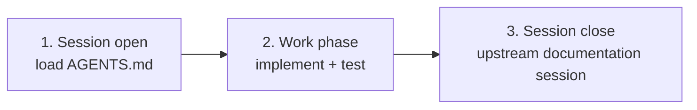
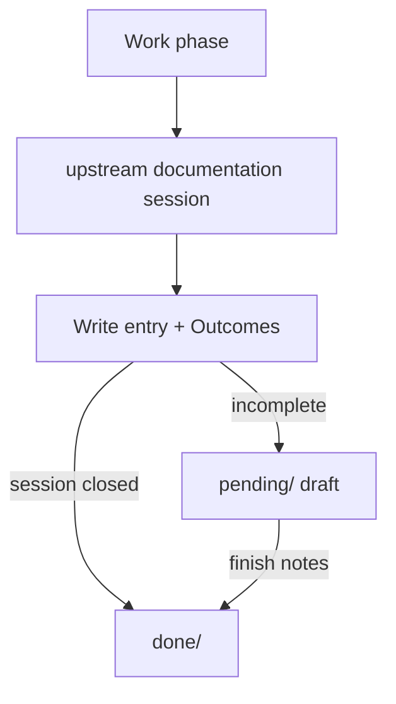

# Changelog

Session log for **Monolith**. Entries record what agents changed in this repository and why.

Canonical agent context: [agents/guide.md](../agents/guide.md).

> **Historical note:** Entries dated before 2026-07-19 may still mention Gateway/Frontend Delegation, `downstream sync session`, or three-repo handoff. That workflow is dissolved. Ignore those sections for agent behavior; use this README and [TEMPLATE.md](./TEMPLATE.md) for new entries.

---

## Session lifecycle

Monolith agent work follows three phases. Only phases 1 and 3 commonly load [AGENTS.md](../../AGENTS.md) as the ritual entry/exit document; phase 2 is normal implementation.



| Phase | Trigger | Agent action |
|-------|---------|--------------|
| **1. Session open** | User loads [AGENTS.md](../../AGENTS.md) / this guide at chat start | Read architecture context. Scope: **this repository**. Stay ready for work. |
| **2. Work phase** | Any prompt **without** a special session keyword | Implement features/fixes. Update docs when behavior changes if practical. **Do not** run the close-out ritual. |
| **3. Session close** | User prompt contains the exact keyword **`upstream documentation session`** | Improve documentation for work done in this session, then write **one** entry under this folder (see [placement rules](#entry-placement)). |

---

## Keywords (exact phrase only)

Paraphrases never qualify. Keyword must appear in the **current user prompt**.

| Keyword | Purpose |
|---------|---------|
| *(none)* | Phase 2 — daily implementation |
| **`upstream documentation session`** | Phase 3 — improve docs + write one changelog entry (Monolith outcomes only) |

Without **`upstream documentation session`**, treat the session as still in **phase 2** even if [AGENTS.md](../../AGENTS.md) was re-loaded.

---

## Directory layout

```
docs/changelog/
├── README.md       # This file
├── TEMPLATE.md     # Copy for each new entry
├── pending/        # Incomplete / draft session notes
└── done/           # Closed session records
```

**Entry filename:** `YYYY-MM-DD-<slug>.md` (example: `2026-07-15-css-counterpart-parity.md`).

### Entry placement

| Situation | Folder |
|-----------|--------|
| Session closed; work complete | **`done/`** (default) |
| Draft notes or incomplete close-out | **`pending/`** until finished, then move to `done/` |

`pending/` is **not** a downstream handoff queue. It is only for incomplete session notes inside this repository.

---

## When to write an entry

Write an entry **during** an **`upstream documentation session`** (required for meaningful work).

| Situation | Entry? | Folder |
|-----------|--------|--------|
| Feature, fix, refactor, or docs-only work completed in the session | **Yes** | `done/` (or `pending/` if still draft) |
| Session opened but no meaningful work landed | **No** — say so and skip the file |
| Pure exploratory Q&A with no code/doc changes | **No** |

If unsure whether the work is "meaningful," write a short entry. False positives cost less than lost session context.

---

## Upstream documentation session (agent)

Start **only** when the user's prompt contains the exact keyword **`upstream documentation session`**. Paraphrases do not qualify.

1. **Confirm keyword** — if absent, stay in work phase; do not invent a close-out.
2. **Inventory session work** — from conversation history, git status/diff, and related files: what changed and why.
3. **Improve documentation** — update every guide that the session made stale or incomplete:
   - [README.md](../../README.md) living-documentation policy when setup/conventions change
   - Domain / platform / web / integration guides under [docs/](../) — place updates by domain, **never** a new flat `docs/*.md` subject file ([placement rules](../README.md#rules-for-new-documentation-mandatory))
   - [AGENTS.md](../../AGENTS.md) / [agents/guide.md](../agents/guide.md) when agent workflow itself changed
   - English only (project rule)
4. **Write one changelog entry** — copy [TEMPLATE.md](./TEMPLATE.md) to `done/YYYY-MM-DD-<slug>.md` (or `pending/` if draft) and fill every section that applies, including **Outcomes**.
5. **Place correctly** — closed sessions go in **`done/`** with Status `done`. Incomplete notes stay in **`pending/`**.
6. **Summarize for the user** — list docs updated and changelog entry path.

### What "improve documentation" means

- Prefer **accurate, scannable updates** to existing guides over dumping raw chat notes.
- Fix contradictions between code and docs discovered during the session.
- Add missing conventions, env vars, routes, or UI behavior the session introduced.
- Do **not** rewrite unrelated docs for vanity. Scope = work from this session + adjacent drift it exposed.

---

## Entry lifecycle



---

## Related docs

- [agents/guide.md](../agents/guide.md) — scope, session keywords, checklists
- [AGENTS.md](../../AGENTS.md) — agent entry point
