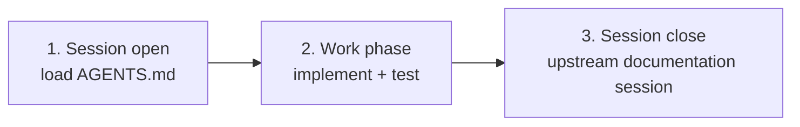
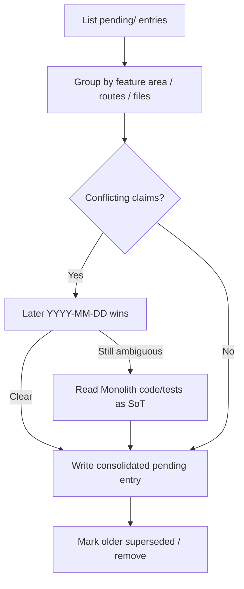
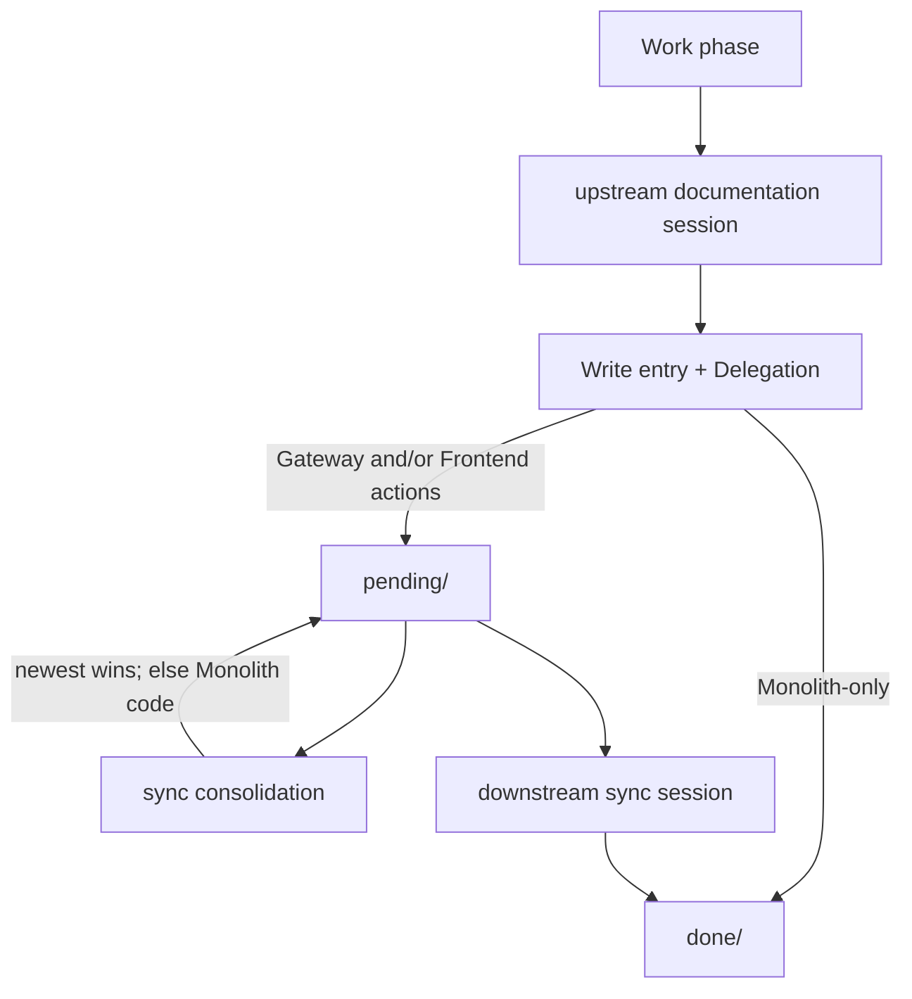

# Changelog

Single session and sync log for **Project Monolith**. Entries record what Monolith decided is correct, which layers still need work (Delegation), and whether Gateway / Frontend have caught up (`pending/` vs `done/`).

This replaces the former split between `upstream-changelog/` (session archive) and `downstream-changelog/` (handoff). One entry shape, one folder tree, status by subfolder.

Canonical workspace context: [ai-agent-guide.md](../ai-agent-guide.md).

---

## Session lifecycle

Monolith agent work follows three phases. Only phases 1 and 3 commonly load [AGENTS.md](../../AGENTS.md) as the ritual entry/exit document; phase 2 is normal implementation.



| Phase | Trigger | Agent action |
|-------|---------|--------------|
| **1. Session open** | User loads [AGENTS.md](../../AGENTS.md) / this guide at chat start | Read architecture context. Default scope: **Monolith only**. Stay ready for work. |
| **2. Work phase** | Any prompt **without** a special session keyword | Implement features/fixes in Monolith. Update docs when behavior changes if practical. **Do not** run the close-out ritual. |
| **3. Session close** | User prompt contains the exact keyword **`upstream documentation session`** | Improve Monolith documentation for work done in this session, then write **one** entry under this folder (see [placement rules](#entry-placement)). |

---

## Keywords (exact phrase only)

Paraphrases never qualify. Keyword must appear in the **current user prompt**.

| Keyword | Scope | Purpose |
|---------|-------|---------|
| *(none)* | Monolith | Phase 2 — daily implementation |
| **`upstream documentation session`** | Monolith only | Phase 3 — improve docs + write changelog entry with Delegation |
| **`sync consolidation`** | Monolith docs only | Merge conflicting/overlapping `pending/` entries before sync; newest wins, else verify Monolith code |
| **`downstream sync session`** | Monolith + Gateway + Frontend | Implement `pending/` on Gateway/Frontend; move completed entries to `done/` |

Without **`upstream documentation session`**, treat the session as still in **phase 2** even if [AGENTS.md](../../AGENTS.md) was re-loaded.

---

## Delegation glossary

Use these labels in every entry so agents know **where** work already landed and **where** it still must land.

| Label | Meaning |
|-------|---------|
| **Monolith** | Fullstack source of truth in this repository — versioned API **and** Blade UI/UX (AdminLTE). Already implemented when the entry is written. |
| **Monolith Gateway** | Public API layer (proxy, cookies, CORS, aggregates, Vue route transforms). Checklist of remaining work for a downstream sync. |
| **Monolith Frontend** | Static Vue view layer (Cloudflare Pages; no Functions/Workers for BFF). Checklist of remaining work for a downstream sync. |

Close-out **must** fill all three Delegation sections. Write `None required.` with a short reason when a layer has no work.

---

## Directory layout

```
docs/changelog/
├── README.md       # This file
├── TEMPLATE.md     # Copy for each new entry
├── pending/        # Monolith truth not yet on Gateway and/or Frontend
└── done/           # Synced downstream, or Monolith-only (no GW/FE actions)
```

**Entry filename:** `YYYY-MM-DD-<slug>.md` (example: `2026-07-15-css-counterpart-parity.md`).

### Entry placement

| Situation | Folder |
|-----------|--------|
| Gateway and/or Frontend Delegation has open actions | **`pending/`** |
| Both Gateway and Frontend are "None required" (Monolith-only) | **`done/`** immediately |
| After a successful **`downstream sync session`** | Move from `pending/` → **`done/`**, set Status `done` + sync date |
| After **`sync consolidation`** supersedes an older entry | Older file: Status `superseded` then delete or leave a one-line stub; newer consolidated file stays in `pending/` |

---

## When to write an entry

Write an entry **only** during an **`upstream documentation session`** (required), or earlier during phase 2 if the [adaptation contract](../internal-monorepo-assessment.md#adaptation-contract-gateway--frontend) clearly fires (optional early write; still required on close if missing).

| Situation | Entry? | Folder |
|-----------|--------|--------|
| Feature, fix, refactor, or docs-only work completed in the session | **Yes** | `pending/` or `done/` per placement rules |
| Session opened but no meaningful work landed | **No** — say so and skip the file |
| Adaptation contract triggers (API/URL/route name/i18n SPA parity) | **Yes** | usually `pending/` |
| Pure exploratory Q&A with no code/doc changes | **No** |
| Cross-repo desync audit (gap vs current Monolith) | **Yes** | `pending/` |

If unsure whether the work is "meaningful," write a short entry. False positives cost less than lost session context.

### Adaptation contract (when Gateway/Frontend care)

| Change in Monolith | Changelog entry? |
|--------------------|------------------|
| Internal folder / PHP namespace only | **No** (unless close-out still wants a Monolith-only `done/` note) |
| Route file split, **same URLs** | **No** |
| API JSON shape change | **Yes** → `pending/` |
| New or changed URL prefix | **Yes** → `pending/` |
| New Laravel route name (menus / DataTable actions) | **Yes** → `pending/` |
| New Gateway aggregate endpoint needed | **Yes** → `pending/` |
| User-facing copy (SPA parity) | **Yes** → `pending/` — note Monolith `lang/{locale}/` keys; Frontend `src/i18n/` |

Full table: [internal-monorepo-assessment.md](../internal-monorepo-assessment.md#adaptation-contract-gateway--frontend).

---

## Upstream documentation session (agent)

Start **only** when the user's prompt contains the exact keyword **`upstream documentation session`**. Paraphrases do not qualify.

1. **Confirm keyword** — if absent, stay in work phase; do not invent a close-out.
2. **Inventory session work** — from conversation history, git status/diff, and related files: what changed and why.
3. **Improve documentation** — update every Monolith guide that the session made stale or incomplete:
   - [README.md](../../README.md) living-documentation policy when setup/conventions change
   - Domain guides under [docs/](../) (API, web frontend, auth, payments, etc.)
   - [AGENTS.md](../../AGENTS.md) / [ai-agent-guide.md](../ai-agent-guide.md) when agent workflow itself changed
   - English only (project rule)
4. **Write one changelog entry** — copy [TEMPLATE.md](./TEMPLATE.md) to `pending/YYYY-MM-DD-<slug>.md` or `done/YYYY-MM-DD-<slug>.md` and fill every section that applies, including **Delegation** for Monolith / Gateway / Frontend.
5. **Place correctly** — if Gateway and Frontend are both "None required," put the file in **`done/`** with Status `done`. Otherwise leave it in **`pending/`**.
6. **Do not** open Gateway or Frontend unless the same prompt also contains **`downstream sync session`** (unusual; normally separate sessions).
7. **Summarize for the user** — list docs updated, changelog entry path, and whether the entry is pending or done.

### What "improve documentation" means

- Prefer **accurate, scannable updates** to existing guides over dumping raw chat notes.
- Fix contradictions between code and docs discovered during the session.
- Add missing conventions, env vars, routes, or UI behavior the session introduced.
- Do **not** rewrite unrelated docs for vanity. Scope = work from this session + adjacent drift it exposed.

---

## Sync consolidation (agent)

Start **only** when the user's prompt contains the exact keyword **`sync consolidation`**. Paraphrases do not qualify.

**Why:** Multiple `pending/` entries can disagree over time (e.g. Jan 1 says "A is good"; Jan 2 says "replace A with B"). Naive **`downstream sync session`** that applies every entry in order ships stale decisions.



### Rules

1. List all files under `pending/` (or the subset the user names).
2. Group related entries (same routes, files, feature area, or slug theme).
3. For conflicting claims: **later `YYYY-MM-DD` in the filename/date field wins**. Older decisions are stale.
4. If consolidation is still ambiguous: **open Monolith code and tests** (not Gateway/Frontend) and document actual current behavior. Monolith is always the source of truth.
5. Output: one (or fewer) consolidated `pending/` file(s). Set **Supersedes** to the older filenames. Older files: set Status `superseded` and delete, or leave a one-line stub pointing at the winner.
6. Do **not** implement Gateway or Frontend during consolidation alone unless the same prompt **also** contains **`downstream sync session`**.

---

## Downstream sync session (agent)

Start **only** when the user's prompt contains the exact keyword **`downstream sync session`**. Paraphrases do not qualify.

1. Prefer running **`sync consolidation`** first when multiple related `pending/` entries exist (or confirm the user wants them applied as-is).
2. List `pending/` entries (oldest first unless the user prioritizes).
3. Read Monolith references in each entry (routes, resources, commits) and the **Delegation** checklists.
4. Implement Gateway and Frontend changes described in the entry.
5. Run tests in all three repos (`.\scripts\test-workspace.ps1` from Monolith root, or per-entry test plan).
6. Move the entry from `pending/` to `done/` and set **Status** to `done` with the sync date.
7. Update integration docs in the touched downstream repos if needed.

## Entry lifecycle



---

## Related docs

- [ai-agent-guide.md](../ai-agent-guide.md) — default scope, session keywords, checklists
- [AGENTS.md](../../AGENTS.md) — Monolith agent entry point
- [spa-gateway-integration.md](../spa-gateway-integration.md) — three-project wiring
- [internal-monorepo-assessment.md](../internal-monorepo-assessment.md) — adaptation contract
