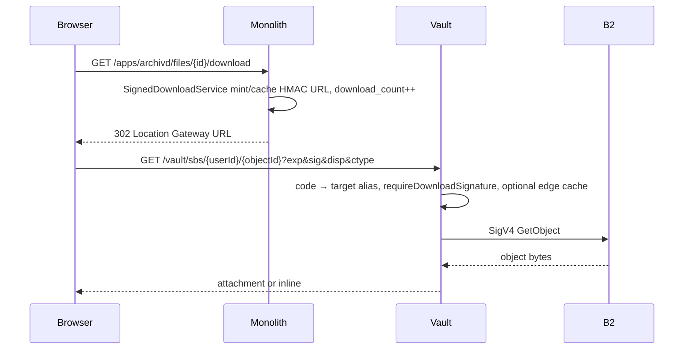

# Archivd - upload pipeline & storage

> Part of the Archivd deep dive. Siblings: [reference.md](reference.md) - concepts, visibility, permissions, quota · [reference-realtime.md](reference-realtime.md) - live listing channels, SPA shell, soft-nav rules.

## API

### Authenticated — `/api/v1/archivd/*` (`auth:api`)

Middleware stack: `auth:api` -> `product.active:Archivd` (runtime activation gate, see [Product Activations](../product-activations/README.md)) -> `permission:<perm>` (Spatie RBAC). A user with a suspended Archivd activation gets 403 before any permission check runs.

**Sidebar menu:** Products → **Archivd** stores `archivd.index` on the parent in the DB (Domain Access + activation ancestor gates) and exposes **My Files**, **Trash**, and **DMCA Blocklist** children. While those children are visible, the presented tree masks the parent to `#` (expand-only); if every child is pruned, the stored route is shown again as a navigable leaf. DMCA Blocklist is limited to Root, Admin, Moderator, Management, and Archivd Admin. See [Navigation — Visibility](../navigation/reference.md#visibility-navigation-tree).

| Area | Endpoints |
|------|-----------|
| Browse | `GET browse?folder_id=&user_id=&workspace_id=` |
| Folders | create, rename, move, **visibility**, soft/force delete, restore (optional `workspace_id`) |
| Files | show (view++), rename, move, **visibility**, soft/force delete, restore (optional `workspace_id`) |
| Bulk | `POST files/bulk-visibility` + `POST folders/bulk-visibility` (`ids[]`, `visibility`); `DELETE files/bulk` + `DELETE folders/bulk` (`ids[]`) — owner/workspace-scoped, max 100 ids |
| Download | `GET files/{id}/download` -> `{ url, expires_at }` (download++; cache Worker HMAC URL or S3 temp URL) |
| Upload | init (optional `disk`, `workspace_id`), status, sign-parts, complete (auto-renames duplicate display name; dispatches post-upload sha256 job), abort. No resume: a dead upload restarts from scratch. |
| Workspaces | `GET/POST workspaces`, show, archive, members, invite, accept invite, update/remove member, activity |
| Search / trash / quota | as named (trash/search accept `workspace_id`) |

### Direct upload/download (S3 engine + optional Worker proxy)

Control plane (init / sign-parts / complete / abort / mint download URL) always stays on Monolith. Browser **byte** path is either:

| Mode | When | Browser data plane |
|------|------|--------------------|
| **Direct S3** (default) | `ARCHIVD_UPLOAD_PROXY_URL` empty | Presigned S3 PUT/UploadPart + S3 temporary GET URL |
| **Hybrid proxy** | base URL + token + disk->alias set | Upload: Gateway Uploader `/uploader/{alias}/{key}` (+ multipart query) + Bearer. Download: same path + HMAC query (`exp`, `sig`, optional `disp`/`ctype`) — no raw token |

Shared kernel pieces (not duplicated per domain):

| Piece | Role |
|-------|------|
| `App\Support\Storage\S3DirectUploadEngine` | Strategy, direct presign **or** Worker proxy URLs, merge/assert parts, create/complete/abort multipart, `listParts` (with `last_modified` - orphan-prune activity truth), size/mime guards |
| `App\Support\Storage\SerializesDirectUploadSession` | Shared JSON session shape for init/status (`upload_id`, `strategy`, `parts`, …) |
| `DirectUploadService` | Domain adapter: ownership, quota, folder, multi-region disk, **auto display-name allocation** on complete, promote -> `HostedFile` |
| `SignedDownloadService` | Caches download URL: Worker HMAC GetObject when proxy on (B2 **Bandwidth Alliance**), else S3 `temporaryUrl`; remints when cached host disagrees with proxy mode |

**Bandwidth Alliance:** client-direct B2 temporary URLs bill B2 egress after free tier. With proxy on, the browser only hits the Worker origin; the Worker streams GetObject from B2 over Cloudflare. Monolith never streams file bytes.

**Why `signed_download_url` stores a Worker URL, not a B2 URL (by design):** the older idea was for Monolith to presign a B2 temporary URL and have the Worker blindly proxy it. The current design wins for three reasons. (a) A presigned B2 URL embeds the B2 endpoint + bucket + `X-Amz-Signature`; if that reaches the browser it can bypass the Worker and hit B2 directly, billing B2 egress and defeating Bandwidth Alliance. Only the Worker URL ever reaches the browser. (b) The Worker needs the explicit object key to build its edge cache key — a B2 presigned URL changes on every mint, so it cannot key a cache. (c) The Worker verifies the HMAC on every request instead of trusting a bearer URL. The S3 `temporaryUrl` mode (proxy **off**) still uses the B2-URL pattern, so the old idea is not wrong — it is only the right shape when no Worker is involved.

**Role of `signed_download_expires_at` (changed):** the column and the `exp` query in the Worker URL are two copies of the same timestamp, stamped together in `mint()`. Final expiry authority moved to the Worker — `requireDownloadSignature` rejects a request once `exp` (+60s grace) passes. The DB column is now only a **cache-validity hint** for Monolith's reuse-vs-remint decision in `resolve()` / `hasUsableSignedDownloadUrl()`. It stays a real column (rather than parsing `exp` back out of the URL) so it is queryable and a single source for cache logic.

**Download edge caching (Worker):** object keys are random and immutable, so after the HMAC is verified the Worker caches object bytes at the Cloudflare edge keyed on bucket+object (never the signed query). Repeat downloads of a hot object in the same region are served from edge (`X-Cache: HIT`) instead of a fresh B2 stream. Auth is never bypassed — every request is HMAC-checked first. Range requests bypass the cache (no 206 poisoning); objects >512 MB stream from origin (`X-Cache: SKIP`).

**Download hot path (Monolith):** `GET /api/v1/archivd/files/{file}/download` calls `FileService::download` directly. `issueDownload` increments `download_count` atomically and skips the redundant `refresh()`. Signed download URLs default to **60 min** TTL (`signed_download_ttl_minutes`) to cut remints on repeat downloads.

**Preview (`?preview=1`):** download endpoints (auth API, guest `/s/f/{id}/download`) accept `preview=1`. For in-browser-safe MIME (`image/*`, `application/pdf`, `audio/*`, `video/*`, `text/*`) the Content-Disposition becomes `inline` so the browser previews instead of downloading; other types stay `attachment`. Preview URLs are minted on demand (not written to the cache columns). The HMAC payload already covers `disp`/`ctype`, so a tampered disposition fails signature verification.

Config for thresholds/TTL/proxy: `config/archivd.php`.

#### Display name uniqueness (auto-rename)

Shared helper: `App\Domain\Archivd\Support\UniqueDisplayNameAllocator` (used by upload complete, **file move**, **folder move**). Soft-deleted siblings are ignored.

Upload **init** does not reject a display name that already exists in the same owner+folder. On **complete** / **move**, the allocator picks the DB `name`:

| Active siblings (soft-deleted ignored) | Preferred | Result |
|----------------------------------------|-----------|--------|
| none | `A.zip` | `A.zip` |
| `A.zip` | `A.zip` (upload or move into folder) | mover/upload becomes `A (2).zip` |
| `A.zip` + `A (3).zip` | `A.zip` | `A (4).zip` (max index + 1; holes not reused) |
| base soft-deleted, `A (3).zip` remains | `A.zip` | `A.zip` (base free again) |
| folder sibling `Docs` | move folder `Docs` into same parent | mover becomes `Docs (2)` |

S3 object keys stay unique (`archivd/{user_id}/{objectId}`) and are never renamed or moved when the display name / folder changes. **Manual rename** still enforces exact sibling uniqueness (422). Clients must show **`file.name` from complete/move response**, not the original client filename. API `path` is the object id only.

#### Hybrid proxy env (Tier A)

| Env | Role |
|-----|------|
| `ARCHIVD_UPLOAD_PROXY_URL` | Gateway Uploader origin (no trailing slash). Empty = direct S3 for **upload + download**. Example: `https://gateway.silverspoon.me` |
| `ARCHIVD_UPLOAD_PROXY_TOKEN` | Same value as Gateway `S3_TARGETS.uploadToken` — upload **Bearer** + download **HMAC secret** (never put raw token in download URLs) |
| `ARCHIVD_UPLOAD_PROXY_TARGET_CE` | Uploader target **alias** for disk `s3ArchivdCe` (must match a key under Gateway `S3_TARGETS.targets`, e.g. `sbs`) |
| `ARCHIVD_UPLOAD_PROXY_TARGET_US` | Alias for disk `s3ArchivdUs` (optional) |

**Vault download path (Tier B):** `archivd.download_vault.enabled` in **Settings → Archivd** (`/apps/archivd/settings`). When enabled, download URLs use `/vault/{alias}/{userId}/{objectId}` (vault code = upload alias; `archivd/` prefix stripped from path). Gateway must have matching `vaultOrigins.{alias}` with `keyPrefix`. Local dev default `true` via [`config/settings-local.php`](../../../config/settings-local.php).

**Upload vs download paths (hybrid proxy on):**

- Upload: `{PROXY}/uploader/{alias}/archivd/{userId}/{objectId}?partNumber=&uploadId=` + Bearer / `X-S3-Target`
- Download (vault enabled): `{PROXY}/vault/{alias}/{userId}/{objectId}?exp=&disp=&ctype=&sig=`
- Download (vault disabled — legacy): `{PROXY}/uploader/{alias}/archivd/{userId}/{objectId}?exp=&disp=&ctype=&sig=`

#### Upload proxy — production (2026-07-30)

| Item | Value |
|------|-------|
| Production URL | `https://gateway.silverspoon.me` — upload **and** vault download on one domain |
| Part size / concurrency | 8 MB (`archivd.chunk_size_bytes`), 3 parallel parts (`archivd.max_concurrent_parts`) — **Settings → Archivd** |
| Gateway Smart Placement | **Must stay off** — enabling `placement.mode: smart` roughly doubles upload latency per part |
| Dual-host workaround | **Not needed** — pointing upload at `s3.silverspoon.me` while Gateway handles vault was a fallback only; automated benchmark passed with Smart Placement disabled |
| Benchmark / tuning | [gateway/docs/upload-performance.md](../../../../gateway/docs/upload-performance.md) |

HMAC always signs the **full** object key (`archivd/{userId}/{objectId}`) and upload **alias** (`sbs`). Gateway reassembles the key from `keyPrefix` + short vault path.

**Where does `/uploader/{alias}/…` come from?** Monolith maps disk → alias via `upload_proxy.disk_targets`. Upload always uses the full object key in the path. Download uses Vault when vault download is enabled in **Settings → Archivd** (`archivd.download_vault.enabled`).

**Proxy URL path = S3 object key (keep `archivd` prefix)**

The `archivd` segment you see in browser Network (e.g. `…/uploader/sbs/archivd/{userId}/{objectId}`) is **not** a Gateway folder or route — it is the first segment of the **S3 object key** in the bucket.

| Point | Detail |
|-------|--------|
| What `archivd` is | Key prefix from `ARCHIVD_DIRECTORY` (default `archivd`). Config only — not stored in DB `path`. |
| Full key shape | `{directory}/{user_id}/{objectId}` via `ObjectKeyResolver` (e.g. `archivd/019fa89c-…/l8hft9wi…`) |
| Hybrid proxy URL | `{PROXY}/uploader/{alias}/` + **entire** object key, each path segment URL-encoded |
| Control vs data plane | Monolith SDK (create / complete / abort) and Gateway (PUT parts / GET bytes) must target the **same** key |
| Do not shorten the URL | `/uploader/sbs/{userId}/{objectId}` without Gateway key remapping writes parts to the wrong object vs `CreateMultipartUpload` on `archivd/…` — upload breaks |
| Download HMAC | Signed with the **full** `objectKey`; path after `{alias}` must match the payload |

Example (local):

```text
http://127.0.0.1:8787/uploader/sbs/archivd/{userId}/{objectId}?partNumber=1&uploadId=…
                                      └─ S3 key prefix (ARCHIVD_DIRECTORY), not a Gateway module
```

Shorter **download** URLs are supported via Vault `keyPrefix` remapping (`/vault/sbs/{userId}/{objectId}`). **Upload** URLs must still carry the full object key — do not shorten upload paths without coordinated Gateway remapping.

The alias is not the B2 bucket name and **not** part of the S3 key; it only selects credentials/endpoint inside the Worker. The browser never receives B2 application keys or the raw upload token on download links.

**Fail closed:** if base URL is set but token or disk alias is missing -> init/sign-parts error (`proxy_misconfigured`), not silent fall-back to direct S3. Upstream S3 failures map to `upstream_failed` where applicable.

**Debug upstream failures:** set `ARCHIVD_DEBUG_LOG_REQUESTS=true` to log the full AWS command name, params, and response headers to `storage/logs/laravel.log` when an `upstream_failed` exception fires. Never enable in production — headers may contain sensitive values.

**B2 / path-style:** Monolith Archivd disk `s3ArchivdCe` must use path-style endpoints (`ARCHIVD_S3_CE_USE_PATH_STYLE`, default true in `config/filesystems.php`) so CreateMultipart / Complete on the server hit the same path-style host as the Worker (`forcePathStyle: true` in `S3_TARGETS`). Virtual-hosted Create + path-style UploadPart can look fine until complete fails with `NoSuchUpload`.

**Disk config contract (env-name, not env-value):** in `config/filesystems.php` the `$s3CompatibleDisk` helper receives the **names** of env vars (e.g. `'bucket' => 'ARCHIVD_S3_CE_BUCKET'`) and resolves them lazily through `$envFirst`. Passing pre-resolved values (`env('ARCHIVD_S3_CE_BUCKET')`) breaks the contract — the helper then calls `env('silverspoon')`, gets `null`, and falls back to `''` bucket, which surfaces at upload time as `unsupported_disk` ("Configured storage disk does not support direct uploads"). Keep both `s3ArchivdCe` and `s3ArchivdUs` on the env-name form.

**Gateway project:** `c:\laragon\www\gateway` — Wrangler name **`gateway`**, Uploader at `/uploader/<alias>/…`. Supersedes standalone `cf-workers-s3-proxy` (`workers` repo). See [gateway/docs/projects/uploader.md](../../../../gateway/docs/projects/uploader.md).

**Deploy / secrets (ops):**

| Step | Note |
|------|------|
| Runtime secret | `S3_TARGETS` is a **Gateway Worker secret**, not git, not `.dev.vars` on CF. Set with `npx wrangler secret put S3_TARGETS --name gateway` (name must match deployed Worker). |
| Dashboard Variables | Must be on the **same** Worker that serves the public hostname (`gateway`). UI “Variables” on another Worker / build env only → `/uploader/health` returns config missing. |
| Alias rename | Change key + `defaultTarget` in Gateway `S3_TARGETS` **first**, then Monolith `ARCHIVD_UPLOAD_PROXY_TARGET_*`, then `php artisan config:clear`. In-flight sessions still using an old path may 400. |
| Error bodies | Production Worker returns generic messages only (`Configuration invalid or missing`, `Internal server error`). Details stay in Workers Logs (`console.error`). |

**Hybrid protocol (parts[] response):**

- `url` = `{proxy}/uploader/{alias}/{encoded-key}` or with `?partNumber=&uploadId=` for multipart
- `headers` = multi-value map: `Authorization: Bearer …`, `X-S3-Target`, `Content-Type`
- Create/complete/abort still use Monolith disk credentials against real S3 (not the Worker)
- Client `direct-upload.js` accepts header values as string or single-element array

**Hybrid protocol (download URL in `signed_download_url`):**

- Proxy on + vault enabled: `{proxy}/vault/{alias}/{userId}/{objectId}?exp=&disp=&ctype=&sig=`
- Proxy on, no vault code (legacy): `{proxy}/uploader/{alias}/{encoded-key}?exp=&disp=&ctype=&sig=`
- Proxy off: S3 temporary URL from disk `temporaryUrl`
- Cache reminted if host disagrees with current proxy mode (stale B2 URL after enabling proxy, or stale Worker URL after disabling)

**Download retrieve flow (HMAC)**

When `ARCHIVD_UPLOAD_PROXY_URL` is set, Monolith never streams file bytes. It mints a time-limited Gateway URL; the browser follows a **302** (web) or uses `{ url, expires_at }` (API), then Gateway verifies HMAC and streams from B2.



When `archivd.download_vault.enabled` is off, the Gateway hop is **Uploader** (`GET /uploader/{alias}/…`) with the same HMAC — backward compatible.

| Query param | Role |
|-------------|------|
| `exp` | Unix expiry (seconds). **Enforced by Gateway** (`exp` + 60s grace). `signed_download_expires_at` in DB is only Monolith's cache hint for reuse vs remint. |
| `sig` | Hex HMAC-SHA256 over LF-separated payload below. Secret = `uploadToken` / `ARCHIVD_UPLOAD_PROXY_TOKEN`. Raw token never appears in the URL. |
| `disp` | `Content-Disposition` passed to S3 as `response-content-disposition` (human filename from DB `name`). |
| `ctype` | `Content-Type` passed to S3 as `response-content-type`. |

HMAC payload (must match Gateway `buildDownloadSignaturePayload`):

```text
GET
{alias}
{objectKey}
{exp}
{disposition}
{contentType}
```

Entry points (all end at the same storage URL shape when proxy is on):

| Route | Hop |
|-------|-----|
| `GET /apps/archivd/files/{id}/download` | Auth web → `FileService::issueDownload` → 302 |
| `GET /api/v1/archivd/files/{id}/download` | Auth API → JSON `{ url, expires_at }` |
| `GET /s/f/{id}/download` | Laravel signed hop (short TTL) → then same HMAC storage URL |
| `GET /api/v1/archivd/public/files/{id}/download` | Guest API → same mint path |

**Not used for download:** Bearer / `X-Upload-Token` (browser navigation cannot set headers on a 302 follow). Upload ops still use Bearer.

**Preview (`?preview=1`):** safe MIME types get `inline` disposition → different `disp` in payload → different `sig`. Preview URLs are minted on demand and not cached in `signed_download_url`.

**Parity verification (workers → gateway port):** automated — Gateway `test/uploader.spec.ts` (40 tests: HMAC accept/reject/expiry, GetObject cache HIT/MISS/Range/SKIP); Monolith `SignedDownloadServiceTest` (11 tests: mint, sig match, cache remint). Manual smoke: tampered `sig` → Gateway **401**; repeat download → `X-Cache: HIT` on small objects.

### Orphan multipart cleanup + post-upload checksum

Big uploads that die mid-flight (crowded network, tab close, cancel) leave S3 multipart parts sitting on storage. Backblaze B2 exposes **no** S3 lifecycle rule for incomplete multiparts, so parts persist until we abort them. There is **no resume**: a dead upload restarts from scratch. Two mechanisms keep storage clean and files accountable: the **prune scheduler** (reclaim what is truly abandoned) and the **post-upload sha256 + hash blocklist** (dedup + DMCA).

**Prune — `archivd:prune-stale-uploads` (multipart-only, error-swallowing):**

1. **Expired + past grace** — `expires_at` in the past beyond `stale_upload_grace_hours` → abort directly (no S3 check needed; the session is contractually dead).
2. **Orphan-by-inactivity (S3-truth)** — for each pending multipart candidate, call `S3DirectUploadEngine::listParts()`; abort only when **no part has `LastModified >= now - orphan_inactivity_minutes`** (or `ListParts` is empty). This is the source of truth for "no new multipart data received". A `ListParts` **error skips the candidate** — never abort blind. Providers without `ListParts` make arm 2 a no-op (arm 1 still runs).

`listParts()` returns each part's `last_modified` (ISO) from S3 `Parts[].LastModified`; `latestPartModifiedAt()` collapses it to the newest timestamp. Default inactivity window is **180 minutes** — **Settings → Archivd** (`archivd.orphan_inactivity_minutes`).

**Concurrent-slot fairness:** `max_concurrent_uploads` is enforced on the fresh-init path. With resume removed there is exactly one init path, so the cap is checked on every `initiate()`.

**Microstock collection gate:** in a `WorkspaceKind::Microstock` workspace, `initiate()` rejects (422) an upload with no `folder_id` (`web/archivd.microstock.error_requires_folder`) or into a folder whose `collection_status` is locked-for-upload (`web/archivd.microstock.error_collection_locked`). Microstock assets must live inside a folder (collection), and a locked collection no longer accepts files — see [Microstock — Collections](../microstock/reference-pipeline.md#collections-folder-as-collection-lifecycle). The dropzone mirrors this client-side via `data-workspace-kind` / `data-collection-locked`. During batch uploads the client re-checks the gate per queued file (`assertMicrostockUploadAllowed`) and infers MIME from extension when `file.type` is empty (`resolveMimeType`).

**Abort preserves single-PUT bytes:** `abort()` / `forceAbortPending()` call S3 `AbortMultipartUpload` for multipart sessions, but for a `single` strategy session they only mark the row `aborted` and **leave the object on S3**. A single PUT has no dangling multipart to clean, and the prune scheduler can fire while the client is mid-flight — deleting the object would destroy bytes a late `complete()` could still promote.

**Client abort-on-failure (slot hygiene):** a leaked `pending` row holds a `max_concurrent_uploads` slot until TTL/prune — after enough orphans, init is rejected with `too_many_concurrent` and no upload can start. `uploadFile()` **awaits** a best-effort `DELETE` abort (`abortUploadSession`) before rethrowing so the slot is released before the queue starts the next file. Init retries up to 3× with backoff when the server returns `too_many_concurrent`. Batch uploads snapshot folder/workspace context at `startBatch` so SPA navigation mid-batch cannot retarget files. Storage PUT retries transient network/5xx errors (and re-signs on 403). Tab-close orphans (no error path) are still reclaimed by the prune scheduler above.

### Content checksum (sha256) + hash blocklist (DMCA)

Resume upload was removed — its client-side fingerprint was a major throughput regression — so the checksum is now computed **after the file is fully uploaded**, off the request path. Purpose: **dedup + DMCA hash blocklist**, not resume identity.

**Post-upload checksum (queued):**

- `ComputeHostedFileChecksum` (queued job) is dispatched from `DirectUploadService::complete()` after commit, so a failure can never block or roll back the upload.
- The job streams the object (`ObjectStorage::readStream`) through `hash_init('sha256')` + `hash_update_stream` and stores the hex on `HostedFile.checksum`.
- **Idempotent**: skips a file that already has a checksum (safe to re-dispatch). `tries = 3`, `backoff = 30`; terminal failures are only `report()`ed — checksum is best-effort metadata, never worth alarming on the upload path.
- `ARCHIVD_files.checksum` has an index for fast exact-match lookups.

**Hash blocklist (DMCA):**

- Table `ARCHIVD_hash_blocklist`: `id` uuid, `sha256` (64) unique-indexed, `reason` nullable, `created_by` uuid nullable, timestamps. Model `ArchivdHashBlocklist`; `HashBlocklistService` exposes `isBlocked` / `isFileBlocked` / `blockedSet` / `block` / `unblock`. Single-file paths (`isBlocked`) query the unique index directly — no `Cache`, no service-instance or static memo (Octane-safe). Browse / trash / search prime a **request-attribute** lookup via `blockedSet` (`whereIn` once per page) through `HostedFileResourceCollection`.
- **Enforcement:** `VisibilityService::assertCanEnableLinkShare` / `assertVisibilityChangeAllowed` (via `FileService::setVisibility` and `bulkSetVisibility`) reject enabling `anyone_with_link` for a blocked checksum with **422 `public_share_blocked_hash`**; bulk share is rejected when **any** targeted file is blocked. Guest show/download (`fileAccessible`) returns **404** for a blocked checksum even if the file was already public.
- **Manage:** Artisan `archivd:blocklist-hash {sha256} {--reason=} {--remove}` and an admin page (`archivd.blocklist.*` routes, gated by `manage any Archivd resource`) to list/add/remove entries. Query-mode list rows emit `actions[]` (`remove`); the labeled trash control maps that key.
- `HostedFileResource` exposes `is_hash_blocked` so the UI can badge blocked files.

**Background processes (must be running):**

This feature leans on two always-on Laravel processes. If either is down, the corresponding behavior silently stops.

| Process | Command | Drives | If it stops |
|---------|---------|--------|-------------|
| Queue worker | `php artisan microstock:queue-work` (see [microstock reference — Operations](../microstock/reference-api.md#operations-queue-worker)) | `ComputeHostedFileChecksum` (post-upload sha256); Microstock AI jobs (`ProcessCollection`, `AnalyzeAssetVision`, `AnalyzeAssetThinking`, `AnalysisWatchdog`) | `checksum` stays `null` → blocklist never matches new files; Microstock analysis stalls until workers run on the correct queues |
| Scheduler | `php artisan schedule:work` (dev) or cron/Task Scheduler `php artisan schedule:run` every minute (prod) | `archivd:prune-stale-uploads` (hourly, `withoutOverlapping`) | Orphaned multipart uploads are never aborted → parts pile up on storage |

- Queue connection defaults to `database` (`QUEUE_CONNECTION` unset in `.env` → `config/queue.php` fallback). Set `QUEUE_CONNECTION=redis` in production if you run Redis.
- Windows/Laragon note: `php artisan queue:work` exits after a job instead of staying alive (Windows PHP lacks `pcntl`/`posix`) — use `php artisan microstock:queue-work --listen` for local dev. See [microstock/reference-api.md](../microstock/reference-api.md#operations-queue-worker).
- Schedule entries live in `routes/console.php` (`archivd:prune-stale-uploads` hourly). Verify with `php artisan schedule:list`.
- A quick liveness check for the checksum path: upload a file, then confirm `ARCHIVD_files.checksum` is populated shortly after and `jobs` is not backing up.

### Throughput + 520 troubleshooting (large uploads)

Why a large upload used to start ~20 MB/s then sag to 10 then ~1 MB/s, and why ~1 GB files sporadically failed (Cloudflare **520**):

| Cause | Fix |
|-------|-----|
| **Sequential single-stream parts** — one XHR at a time, no pipelining, collapses to per-connection throughput | Parts upload **in parallel** (`max_concurrent_parts`, default 3) via `uploadPartsParallel` |
| **Presigned URL expired mid-upload** — init signs every part upfront with `presign_ttl_minutes`; a slow upload outlived the TTL and late parts 403'd with no recovery | TTL raised to **60 min**; a **403** PUT is re-signed via `sign-parts` and retried once per part. **Single-PUT sessions skip the re-sign** — `sign-parts` is multipart-only (`multipart_only`), so the SPA surfaces the original 403 instead of retrying. Each part PUT has a **90s XHR timeout** (fail-fast; the Worker's own UploadPart deadline is 60s, so it retries first) |
| **Worker had no error-handling/timeout/retry on the streamed fetch** — a mid-transfer B2 reset / edge timeout tore the response into a Cloudflare **520** with no log | `signedFetchToS3` now retries transient 5xx/network errors on **bodyless** requests (GetObject/create/complete/abort) and returns a **graceful 502 + `upstream_error` log** instead of throwing; **UploadPart stream is not retried** (single-use body) — the client re-PUTs the part |
| **Speed meter was a cumulative average** — one stall dragged the displayed rate down for the rest of the upload | Speed is now a **sliding-window (5s) instantaneous rate** (`createRateSampler`) |

Gateway Uploader changes go live after `wrangler deploy` on the `gateway` Worker; Monolith changes only need `php artisan config:clear` (and `npm run build` if Blade/JS touched).

### S3 provider CORS (browser-direct multipart)

When proxy is **off**, browser uploads **directly** to the S3-compatible endpoint (presigned PUT / UploadPart). That is a cross-origin request from the SPA origin (or server public-share endpoints) to the bucket host. Without bucket CORS, the browser blocks the PUT and may hide `ETag` — multipart **complete** then cannot send part ETags.

When proxy is **on**, browser upload PUTs talk to the **Worker** origin — Worker CORS must allow app origin(s) and **expose `ETag`**. Full-page download navigation does not need CORS (302 → Worker GET with HMAC). Bucket CORS is still needed for **direct** mode (upload + download) and any client that talks to B2 without the Worker.

| Requirement | Why |
|-------------|-----|
| Allow app origin(s) | Preflight + actual PUT/GET from browser |
| Methods include `PUT`, `GET`, `HEAD` (and `DELETE` if abort/cleanup uses it) | Match presign strategy |
| Allow `Content-Type` (or `*`) | Signed part uploads send a content type |
| **Expose `ETag`** | JS must read part ETag after each PUT to finish multipart |

Replace origin placeholders with real front-end hosts (e.g. admin URL, SPA URL). Do **not** leave a bare `"https"` in production — that is not a valid browser origin.

#### Cloudflare R2

R2 supports paste-in CORS under the bucket **CORS Policy** setting.

```json
[
  {
    "AllowedOrigins": [
      "https://your-app.example"
    ],
    "AllowedMethods": [
      "PUT",
      "GET",
      "HEAD",
      "DELETE"
    ],
    "AllowedHeaders": [
      "Content-Type"
    ],
    "ExposeHeaders": [
      "ETag"
    ],
    "MaxAgeSeconds": 3600
  }
]
```

Add every origin that performs browser-direct upload (Blade `APP_URL`, Vue-Workers `SPA_URL`, local Vite). Multiple origins = multiple entries in `AllowedOrigins`. Production SPA cutover: the Worker origin must be listed **and** `ETag` must stay in `ExposeHeaders`.

#### Backblaze B2

B2 bucket CORS is not a simple dashboard paste for all setups — use the [B2 CLI](https://www.backblaze.com/b2/docs/quick_command_line.html).

1. Install the B2 CLI.
2. Authenticate (`b2 account authorize` / equivalent for your CLI version).
3. Apply CORS rules on the bucket (replace `replaceWithBucketName` and origins). Windows example with `b2.exe`:

```bash
b2.exe bucket update --cors-rules "[{\"corsRuleName\":\"ETagUploader\",\"allowedOrigins\":[\"https://your-app.example\"],\"allowedHeaders\":[\"*\"],\"allowedOperations\":[\"b2_download_file_by_id\",\"b2_download_file_by_name\",\"b2_upload_file\",\"b2_upload_part\",\"s3_put\",\"s3_post\",\"s3_get\",\"s3_head\"],\"exposeHeaders\":[\"ETag\",\"x-bz-content-sha1\"],\"maxAgeSeconds\":3600}]" replaceWithBucketName allPublic
```

| Field | Notes |
|-------|--------|
| `corsRuleName` | Label only (`ETagUploader`) |
| `allowedOrigins` | Real app origin(s); JSON array inside the escaped string |
| `allowedOperations` | Native B2 + S3-compatible ops used by download and multipart upload |
| `exposeHeaders` | `ETag` required for multipart; `x-bz-content-sha1` is B2-specific |

CLI version, auth subcommand names, and bucket visibility flags differ by install — if the update fails, check `b2 bucket update --help` for your binary. Success = browser multipart PUT returns readable `ETag`; failure usually surfaces as CORS preflight errors or missing `ETag` in JS.

Other S3-compatible vendors (Wasabi, MinIO, custom): same idea — allow origin + PUT/GET/HEAD + expose `ETag`. Exact JSON/CLI shape is vendor-specific.

### Public — no auth

| Method | Path |
|--------|------|
| GET | `/api/v1/archivd/public/files/{id}` |
| GET | `/api/v1/archivd/public/files/{id}/download` |
| GET | `/api/v1/archivd/public/folders/{id}` |

## Vue-Workers SPA consumer

The sibling Vue-Workers SPA **is** the Archivd UI. It consumes `/api/v1/archivd/*` and uses `useArchivdHydrate` for initial reads. `hydrateArchivd()` batches browse, quota, workspaces, and Microstock slots; `hydrateWorkspaceDetail()` batches workspaces plus members and activity for workspace detail. Per-entry failures fall back to the individual loaders. Public share routes are `/s/f/:id` and `/s/d/:id`. Admin DMCA blocklist is Vue route `archivd.blocklist.index.view` so MenuSeeder `archivd.blocklist.index` resolves in `NavTree`. See [vue-workers-spa.md — Invocation budget controls](../../integration/reference-vue-workers-spa.md#invocation-budget-controls).

