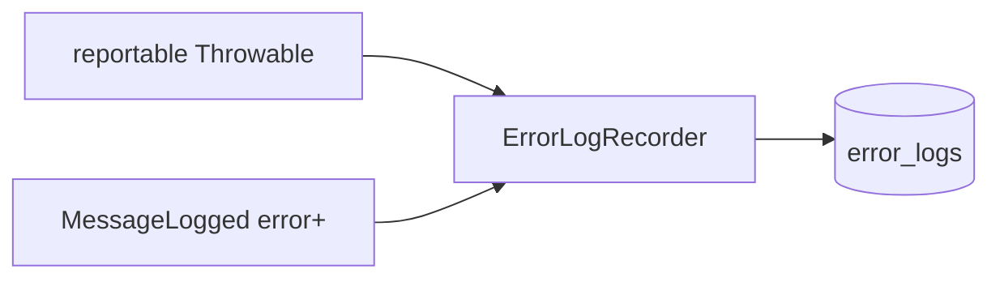

# ErrorLog — persistent grouped application errors

Stores **reportable exceptions** and **`Log::error` / `critical` / `alert` / `emergency`** in the database, **grouped by fingerprint**. Built for administrators and AI agents who need a browsable error surface without reading a single giant `laravel.log`.

| System | Table / store | Purpose |
|--------|---------------|---------|
| **ErrorLog (this domain)** | `error_logs` | Grouped runtime failures |
| Spatie activitylog | `activity_log` | Immutable audit of domain mutations |
| Notifications | `activity_notifications` | In-app bell |
| Laravel Monolog | `storage/logs/*` | File log (unchanged dual-write) |

| Piece | Path |
|-------|------|
| Code | `app/Domain/ErrorLog/` |
| Config | `config/errorlog.php` |
| Provider | `app/Providers/Domain/ErrorLogServiceProvider.php` |
| Registry | `kind => core` in `config/domains.php`; `DomainManager::PLATFORM_CORE` |

## Why not ActivityLog / Sentry / Telescope?

| Option | Why not here |
|--------|----------------|
| Spatie ActivityLog | Audit of intentional mutations — not exception storage |
| Sentry / Flare | External SaaS; not in-system for admin/Agent without leaving the app |
| Laravel Telescope | Dev-oriented, not JWT/RBAC admin product UI |

## Capture pipeline



1. **Exceptions** — `bootstrap/app.php` `reportable` → `ErrorLogRecorder::recordException()`.
2. **Log facade** — `Illuminate\Log\Events\MessageLogged` listener in `ErrorLogServiceProvider` → `recordLog()` for levels ≥ `error` (works under PHPUnit; no custom Monolog handler required).
3. **Double-count guard** — log records whose context contains a `Throwable` are skipped (Laravel’s default exception report also writes `Log::error` with the exception).

### Not stored

- Laravel’s default non-reportable 4xx (validation, auth, etc.)
- `BusinessRuleException` (`dontReport` + recorder filter) — intentional API errors, not bugs
- Anything while `platform.errorlog.enabled` is off (Settings → Platform)
- Nested writes while the recorder is already active (recursion guard)

Domains may still call `ErrorLogRecorder::recordLog()` for **intentional ops signals** that are not thrown as reportable exceptions — e.g. vTual `PlatformErrorLogger` for platform HTTP / credential Test failures (`PlatformApiException` is a BRE and would be skipped by `recordException`).

## Fingerprint grouping

```
sha1(type|level|exception_class|normalized_message|file|line)
```

Message normalization strips UUIDs, emails, long hex hashes, and standalone numbers so the same bug with different IDs collapses to one row.

Each new hit:

- increments `occurrence_count`
- refreshes `message`, `trace`, `context`, `last_seen_at`
- reopens `resolved` / `ignored` → `open`

## Schema (`error_logs`)

| Column | Notes |
|--------|--------|
| `id` | UUID v7 |
| `fingerprint` | unique group key |
| `type` | `exception` \| `log` |
| `level` | `error`…`emergency` |
| `exception_class`, `message`, `file`, `line`, `trace` | latest sample |
| `context` | JSON (request + log context), **redacted** |
| `occurrence_count`, `first_seen_at`, `last_seen_at` | grouping stats |
| `status` | `open` \| `resolved` \| `ignored` |
| `resolved_at`, `resolved_by` | admin status audit (`users.id`) |

## Config / settings

Operational knobs live in **Settings → Platform** (`system_settings`). See [configuration-policy.md](../../platform/configuration-policy.md).

| Registry key | Config path | Default | Role |
|--------------|-------------|---------|------|
| `platform.errorlog.enabled` | `errorlog.enabled` | `true` | Kill-switch |
| `platform.errorlog.clean_after_days` | `errorlog.clean_after_days` | `90` | Retention for `errorlog:clean` |
| `platform.errorlog.max_message_length` | `errorlog.max_message_length` | — | Truncate stored message |
| `platform.errorlog.max_trace_length` | `errorlog.max_trace_length` | — | Truncate stored trace |
| `platform.errorlog.max_context_json_length` | `errorlog.max_context_json_length` | — | Truncate stored context JSON |

Not in registry (bootstrap `config/errorlog.php` literals only): `redact_keys`, `dont_store` — runtime uses `config()` for these.

## API (`/api/v1`)

Requires `auth:api` + `permission:view error log` (Root / Admin via `RoleSeeder`).

| Method | URI | Purpose |
|--------|-----|---------|
| GET | `/error-logs` | Index — filters: `status`, `level`, `type`, `q`, `from`, `to`, `limit` (1–100) |
| GET | `/error-logs/{errorLog}` | Show (UUID) |
| PATCH | `/error-logs/{errorLog}/status` | Body: `{ "status": "open\|resolved\|ignored" }` |

Resource fields: fingerprint, type, level, exception_class, message, file, line, trace, context, occurrence_count, first/last_seen, status, status_label, resolved_by, timestamps.

i18n: `lang/{en,id,ja,ko,zh_CN,ar,ru}/api/error-log.php`.

## SPA UI

Authenticated screens live in Monolith-Vue-Workers under `/apps/*` (Vue Router names unprefixed). Blade web controllers and views are removed — see [blade-admin.md](../../web/blade-admin.md).

| Piece | Detail |
|-------|--------|
| URI | `/apps/error-logs`, `/apps/error-logs/{errorLog}` |
| SPA routes | `error-logs.index`, `error-logs.show` |
| List `actions[]` | Query-mode `view` → `error-logs.show`; SPA maps into `RowActions` |
| Status | `PATCH /api/v1/error-logs/{errorLog}/status` |
| Menu | Administration → Monitoring → Error log (Root/Admin), `MenuSeeder` |

## Realtime

New recorded errors ping the `logs.errors` private channel (permission `view error log`) as `.log.error.recorded` — payload `{ level, type }` via `ErrorLogRealtime`. SPA: `useLogsRealtime.ts` (list + show views refetch).

## Maintenance

```bash
php artisan errorlog:clean
php artisan errorlog:clean --days=30
```

## Day-2 on an existing database

```bash
php artisan migrate
php artisan db:seed --class=RoleSeeder   # adds view error log + syncs Root/Admin
php artisan db:seed --class=MenuSeeder   # authoritative rebuild; removes custom menus
```

`MenuSeeder` fails fast on missing roles (`RuntimeException` naming them), so seed `RoleSeeder` + `ArchivdRoleSeeder` + `VtualRoleSeeder` first on any database that does not already have the full role catalog.

## Safety

- Writer never throws into the request / log pipeline
- Context keys like `password`, `token`, `authorization`, … redacted
- Message / trace / context hard size limits
- Octane-ready: no static request caches; recursion flag cleared in `finally`

## Tests

```bash
composer test -- --filter=ErrorLog
```

Coverage: fingerprint stability, redaction, grouping, `Log::error`, kill-switch, API RBAC, status update, `errorlog:clean`.

## Related

- [activity-log](../activity-log/README.md) — audit trail (not errors)
- [platform/architecture.md](../../platform/architecture.md)
- [platform/security.md](../../platform/security.md)
- [platform/api-routing.md](../../platform/api-routing.md)
- [platform/environment.md](../../platform/environment.md)
- [web/blade-admin.md](../../web/blade-admin.md)
