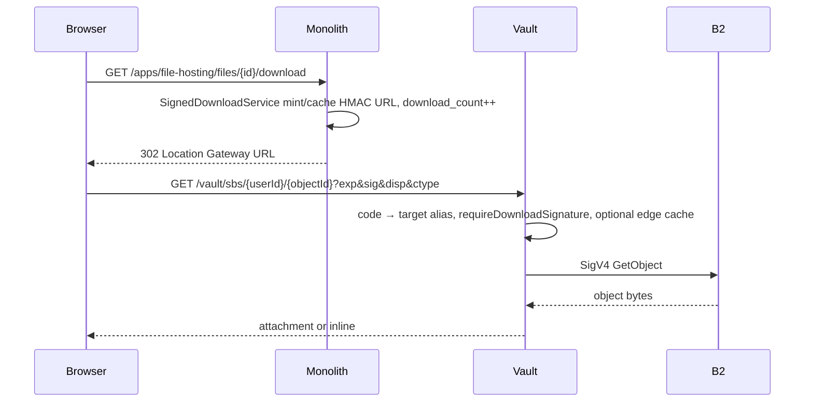

# File Hosting — product domain

Product domain (`kind => product`, `locked => true`) for personal nested folders, S3-compatible chunk upload, Drive-lite link sharing, and **Collaborative Works** (paid team workspaces).

| | |
|--|--|
| Code | `app/Domain/FileHosting/` |
| Config | [`config/file-hosting.php`](../../../config/file-hosting.php) |
| API | `routes/api/v1/file-hosting.php` (`/api/v1/file-hosting/*` — unchanged) |
| Web (auth) | `routes/web/file-hosting.php` under `/apps/*` → **`/apps/file-hosting`** (route names `file-hosting.*`) |
| Web (guest) | `routes/web/file-hosting-public.php` → **`/s/f/{uuid}`**, **`/s/d/{uuid}`** (site root, not under `/apps`) |
| Public landing | Root **`/file-hosting`** reserved for future promo landing (not the logged-in app) |
| Seeder | `FileHostingRoleSeeder` (after core `RoleSeeder`) |
| Product gate | `product.active:FileHosting` middleware (see [Product Activations](../product-activations/README.md)) |
| Menu auto-hide | Products → File Hosting parent (`file-hosting.index`) gates My Files, Trash, and DMCA Blocklist via `config/products.php` `menu_routes`; hidden when user's FH activation is not `active` |
| Analytics | `HostedFile` Eloquent events (`created`/`deleted`/`restored`) + `WorkspaceService::create` + `FolderRepository::restore` write to `product_analytics` via `ProductAnalyticsService` (see [Product Activations § Stored analytics](../product-activations/README.md#stored-analytics-v3)) |

### Current product surface

What FH is **today** (auth browse + guest share). Deep dives live in sections below.

| Surface | Behavior |
|---------|----------|
| Auth UI | Blade SSR first paint + **FH-only client router** + vanilla ES modules — **not** React/Inertia and **not** a monorepo-wide SPA. See [UI architecture / SPA shell](#ui-architecture--spa-shell). |
| Browse gestures | Drive-like select / context menu / drag-move; bulk bar **Move / share / unshare / delete**. Single and bulk stay in lockstep — [Drive-like listing](#drive-like-listing-interactions-browse-only), [Action surface parity](#action-surface-parity-single--bulk). |
| Nested folders | Virtual first row/card **`...`** (parent) + breadcrumb chips as drop targets (`data-fh-drop-folder`). Root has no `...`. |
| Live listing | Dedicated private Echo channels + soft-refetch (listing/quota/trash/show). **Not** the notification bell bus. See [Realtime / live listing](#realtime--live-listing). |
| Display names | Upload complete + **file/folder move** auto-rename on sibling collision (`UniqueDisplayNameAllocator`). Manual rename still rejects exact collisions. |
| Public share | Guest `/s/f` / `/s/d` only when storage owner is **paid** (`QuotaService::ownerCanPublicShare`). Free/grace → 404 even if DB says `anyone_with_link`. See [Visibility](#visibility). |
| Storage regions | Multi-disk `s3FileHosting*`. Region column/badge only when multi-region config **or** historical multi-disk usage. |
| Hard navigation | **Download hops only** (auth + signed public → 302 storage URL: CF Worker when proxy on, else S3). In-shell mutations and folder/file/trash/show soft-nav do **not** rely on `location.reload`. |
| Busy / upload UX | Mutations toggle `.is-fh-busy` spinner overlay; upload queue shows human file size. Successful (**Done**) rows auto-dismiss after ~5s; failed rows stay. |

## Concepts

| Concept | Behavior |
|---------|----------|
| Virtual root | `folder_id = null` = “My Files” (no auto DB folder row) |
| Nested folders | `parent_id` tree per owner; breadcrumb via `FolderAncestorChain` |
| Files | `file_hosting_files` — denormalized `user_id`, optional `folder_id` |
| Upload sessions | `file_hosting_uploads` — init -> browser PUT (direct S3 **or** CF Worker proxy) -> complete promotes row. **Control plane** (init / sign-parts / complete / abort) always Monolith->S3 SDK; **data plane** (part bytes) only is Worker or direct. Seeing B2 host on Create/Complete is expected even when proxy is on. Complete uses row lock (`lockForUpdate`); pending non-expired sizes **reserve** owner quota; `max_concurrent_uploads` enforced server-side on pending owner sessions. Archive aborts pending team uploads. **No resume**: a dead upload restarts from scratch. Chunk/part layout frozen at init (`chunk_size`/`part_count`). **Prune scheduler** aborts orphaned **multipart** sessions past grace or with no recent S3 part activity (Backblaze has no S3 lifecycle for incomplete multiparts). |
| Part size | Default **25 MB** chunk + multipart threshold (`FILE_HOSTING_CHUNK_SIZE=26214400`); safe range **10–50 MB** on Worker proxy (100 MB request body cap). See Gateway [upload-performance.md](../../../gateway/docs/upload-performance.md) for A/B tuning. |
| DB `path` | Object id only: 40 lowercase alnum chars (`Str::random(40)`). **Not** a full S3 key. |
| S3 object key | `file-hosting/{user_id}/{objectId}` — resolved at runtime via `ObjectKeyResolver` from `user_id` + `path` + config `directory`. No `folder_id`, no extension, no upload session id in the key. |
| Display name | Preferred name kept if free in that owner+folder/parent (soft-deleted ignored). If taken on **upload complete** or **file/folder move** → auto DB rename to `{stem} ({maxN+1}).{ext}` (`A.zip` = 1, `A (3).zip` = 3 → next `A (4).zip`; folders without ext → `Docs (2)`). Shared allocator: `UniqueDisplayNameAllocator`. **Manual rename** still rejects exact sibling collisions (user chose the name). S3 object key stays random and is never renamed. Move/rename are **DB-only**. |
| Download bytes | Always **302 (or client follow)** to a storage URL — **not** Monolith streaming. Proxy on → CF Worker HMAC GetObject (B2 **Bandwidth Alliance** path), with **edge caching** of immutable object bytes at Cloudflare (`X-Cache` HIT/MISS/SKIP). Proxy off → direct S3 temporary URL |
| Signed download URL cache | Columns `signed_download_url`, `signed_download_expires_at`; reuse until near expiry **and** URL host matches current proxy mode (stale B2 URL reminted when proxy enabled; stale Worker URL reminted when proxy off). `expires_at` mirrors the `exp` embedded in the URL — final expiry is enforced by the Worker, the column is only the Monolith cache hint. **Cleared on visibility change** (and rename/delete) so private revoke cannot reuse a still-valid link |
| Download filename | `response-content-disposition` (Worker) / `ResponseContentDisposition` (direct S3) from DB `name` (random key stays on object) |
| Stats | `view_count` / `download_count` + last_* timestamps (no event log). `download_count` uses **atomic increment** (no lost-update under concurrent downloads); the realtime stats broadcast is **throttled** to ≤1 per file per 5s while the counter stays exact |
| Visibility | `private` \| `anyone_with_link` on folders and files |
| Link secret | Resource UUID (Drive “anyone with the link”; not world-searchable) |
| Inherit | Folder link-shared -> guest may browse that folder and download files inside even if file is `private` |
| Region | Per-file `disk` storage (Laravel disk name in DB); product region key derived via `RegionResolver::keyForDisk()` (resolves `disk_aliases` first). `disabled_regions` blocks new uploads only — downloads still served. UI region column/badge appears only when configured regions > 1 **or** historical multi-disk usage exists. |
| Ownership | Own resources; cross-user via product “any” + core `RoleService` hierarchy |
| Collaborative Works | Paid perk for **owners**; free users may **join** as members. Blade UX on File Hosting page (not a separate dynamic menu). |

## Storage classification (core vs product)

File Hosting (and its workspace model) is the **base storage layer** for anything
in this project that consumes disk space. Every feature that stores bytes is
classified into exactly one of two storage classes:

| Class | Effect on free-tier base | Rationale | Examples |
|-------|--------------------------|-----------|----------|
| **Core storage** | Does **not** consume the free-tier base | Belongs to a core feature; if it hits a storage limit the core feature risks breaking | User avatar (future) |
| **Product storage** | Consumes the free-tier base | Belongs to a product feature; unrelated to core operation | File Hosting personal/team files, Microstock Management (upcoming) |

Free-tier base today: `config('file-hosting.default_quota_bytes')` (typically 5 GiB) —
see [Quota](#quota). Core storage is exempt from this budget; product storage is
metered against it.

### System workspaces (built-in, standalone slots)

Any consumer that stores bytes is treated as a **built-in system workspace** over
the File Hosting workspace model. A system workspace:

- is provisioned implicitly by the owning feature (not created via the team
  workspace UI),
- is **not counted** toward the paid included team workspace slots
  (`owned_workspace_limit` / `base_owned_workspace_slots`) — it sits outside the
  [owned workspace slots](#owned-workspace-slots) accounting,
- has its **own standalone slot limit** per product (e.g. Microstock slots come
  from `microstock.plan.free` + `microstock.addon.workspace-slot.monthly`
  entitlements, entirely separate from FH team workspace slots),
- is the billing/quota boundary for the feature's bytes: product-class consumers
  meter into the free-tier base, core-class consumers do not.

> Status: **implemented by Microstock** — the Microstock product uses system
> workspaces (`file_hosting_workspaces.kind = 'microstock'`, standalone slots) as
> the first product-class consumer of this model. Microstock activation is opt-in
> via `/apps/services` (free registration + compounding slot addon); its slots never
> overlap with FH team workspace slots. See [Microstock](../microstock/README.md).

**Provisioning trigger:** the Microstock system workspace is **not**
auto-provisioned on File Hosting first paint. It is created on demand —
`GET /apps/microstock` (redirects to `/apps/services` when the user has no Microstock
entitlement) or via the switcher/API — and is gated by
`WorkspaceAccessService::assertCanProvisionMicrostockWorkspace` (slot limit from
the Microstock entitlements). Until activation it simply does not appear in the
switcher.

**Switcher UX (SPA):** `WorkspaceResource` exposes `kind`; workspace items are
rendered **fully client-side** by `file-manager.js` (Blade only provides the
skeleton). `refreshWorkspaceSwitcher()` re-fetches `GET file-hosting/workspaces`
and `renderWorkspaceMenuItems()` rebuilds the items grouped by kind —
**Microstock group first, Team group second, each preceded by its own dynamic
divider** (no stacked/empty dividers) — then re-renders the label/icon
(`bi-images` for `microstock`, `bi-people` for team, `bi-person` for personal),
the `.active` item, and the Microstock slot section, on init and on soft-nav
workspace changes (no hard reload). The **Microstock slot section** fetches
`file-hosting.microstock.slots` and renders the right entry (activate CTA /
"New Microstock workspace" / slots-full note). Creating a Microstock workspace
opens `#fhCreateMicrostockModal` (name input) → POSTs, and the new workspace
appears in its group immediately.

## Collaborative Works (team storage)

Paid owners (active **main or storage addon** FH entitlement, not free-only) may own **multiple** team workspaces. Members invited by email; **free collaborators allowed** if owner is paid. **Multi-membership is first-class:** a user may own several workspaces and simultaneously join others as admin/editor/viewer. Owning does not block joining.

| Role | Capabilities |
|------|----------------|
| Owner | Create/archive workspace, invite/remove, all file ops, full activity |
| Admin | Manage members (invite/role/remove), all file ops, activity |
| Editor | Upload/rename/move/delete; no member mgmt |
| Viewer | Browse + download only |

| Plan state | Can create / own team | Can join team | Personal files | Public link share |
|------------|----------------------|---------------|----------------|------------------|
| Free | No | Yes (invite token) | Yes (free tier) | No (guest 404; enable blocked) |
| Paid | Yes — up to **owned slot limit** | Yes (unlimited joins) | Yes | Yes (`anyone_with_link` + active paid owner) |
| Grace | No new create / collab mutations | Existing membership may still view if owner not grace-blocked | Read; upload blocked | No (same as free; renew first) |

### Owned workspace slots

| Source | Slots |
|--------|-------|
| Base (any active paid **storage** plan — main or storage addon) | `config('file-hosting.base_owned_workspace_slots')` default **10** |
| Addon `file-hosting.addon.workspace-slot.monthly` | **+1 per quantity unit** ($1 USD POC); stackable; `storage_bytes = 0` |
| Formula | `owned_limit = (paid storage ? base : 0) + sum(active/grace slot qty)` |
| Used | Count of **Active** workspaces where `owner_user_id` = user |

Only **Active** workspaces consume slots. **Archive** frees a slot; create always inserts a new row (no reactivate-first-archived). Slot expiry that leaves `used > limit` does **not** auto-archive existing teams — only blocks **new** create (known edge).

Workspace-slot SKU is **not** a storage plan: does not raise GiB quota, does not alone grant “paid” collab (create still needs `hasActivePaidFileHosting`). It participates in the shared addon anniversary stack with storage addons.

| Context | Role source |
|---------|-------------|
| Personal drive (`workspace_id` null) | Owner of own files only |
| Workspace you own | Always `owner` (`roleFor` + member row) |
| Workspace you joined | Invite role (`admin` / `editor` / `viewer`) |

**Switcher:** `GET workspaces` returns **active** workspaces only (owned **or** active member). Payload includes `my_role` and `is_owner` for UI labels (Yours vs Joined). Blade: toolbar **dropdown** (Personal + teams + create/join + slot counter) and **Team** offcanvas when in team context (members, invite, activity, archive). Personal tree never mixes with any team tree.

**Billing / quota:** Team files use **that workspace owner’s** storage pool (`user_id` = owner, `workspace_id` set). S3 key stays `file-hosting/{owner_user_id}/{objectId}`. `created_by` records uploader for audit. When browsing joined B, quota bar still reflects the logged-in user’s personal usage (owner pool for B is separate).

**Paid gate:** `WorkspaceAccessService::assertOwnerEligibleForCollab` — requires `hasActivePaidFileHosting` on the **workspace owner** for **create / invite / accept** only. Create also runs `assertCanCreateOwnedWorkspace` (slot limit). **Upload/content collaboration is not paid-gated** — `DirectUploadService::resolveUploadScope` only requires `assertCanMutate` (owner or active member), so invited free members and free Microstock owners can upload. Joiner need not be paid.

**Quota API flags:** `GET /api/v1/file-hosting/quota` includes `state` (`free`\|`paid`\|`grace`), `collaborative_works`, `can_create_workspace` (paid **and** under slot limit), `owned_workspace_used`, `owned_workspace_limit`, plus raw `used_bytes` / `pending_bytes` / `reserved_bytes` / `quota_bytes` / `remaining_bytes` and matching `*_human` companions (`BytePresenter`). `HostedFileResource` exposes `size` + `size_human` and dual-field timestamps. Blade uses companions only — no view-layer `$formatBytes`.

**Blade UX:** Compact toolbar controls (not a full-width card). Free -> upgrade CTA inside switcher dropdown + accept invite. Paid -> create (while under limit), invite (token flash; no email delivery in MVP), members (owner **or** admin), activity in offcanvas. Web routes: `POST file-hosting/workspaces`, invites accept/store, member remove, archive.

**Activity:** Spatie `log_name = file_hosting.workspace`, properties include `workspace_id`. Explicit recorder (`WorkspaceActivityRecorder`) on membership + file/folder mutations. Download events off in v1. API: `GET /api/v1/file-hosting/workspaces/{id}/activity` (any active member).

**Tables:** `file_hosting_workspaces` (no unique on `owner_user_id`; index `(owner_user_id, status)`; `kind` = `team` user-created team-slot-counted vs `microstock` built-in standalone-slotted), `file_hosting_workspace_members`, `file_hosting_workspace_invites`; nullable `workspace_id` on folders/files/uploads; `created_by` on files.

**Browse:** `GET browse?workspace_id=` for team tree; omit for personal. Never leak personal through workspace.

## Visibility

```
folderLinkShared(folder) =
  folder.visibility == anyone_with_link
  OR any ancestor.visibility == anyone_with_link

fileLinkShared(file) =
  file.visibility == anyone_with_link
  OR (file.folder_id && folderLinkShared(file.folder))

folderAccessible(folder) =
  folderLinkShared(folder)
  AND QuotaService::ownerCanPublicShare(folder.user_id)   // storage owner state === paid

fileAccessible(file) =
  fileLinkShared(file)
  AND QuotaService::ownerCanPublicShare(file.user_id)
```

- Guest public show/download (API + `/s/f` / `/s/d`) uses `fileAccessible` / `folderAccessible`. Free or grace storage owners get **404** `share_not_found` even if DB still says `anyone_with_link` (downgrade kills links without rewriting rows).
- Enabling `anyone_with_link` (single + bulk file/folder) requires paid owner; free/grace → **422** `public_share_requires_paid`. Setting `private` always allowed.
- Mutations never public.
- **Hash blocklist (DMCA):** enabling `anyone_with_link` on a file whose `checksum` is on `file_hosting_hash_blocklist` → **422** `public_share_blocked_hash` (single + bulk; bulk rejected when **any** targeted file is blocked). Guest show/download returns **404** for a blocked checksum even if the file was already public. See [Content checksum (sha256) + hash blocklist (DMCA)](#content-checksum-sha256--hash-blocklist-dmca).
- `share_url` only when **this** item is `anyone_with_link` **and** storage owner is paid.
- Workspace files: paid check is on **storage `user_id`** (quota pool owner), not the guest member’s plan.

## Permissions (`domain_kind = product`)

```
view|create|edit|delete file hosting folder
view|create|edit|delete file hosting file
view any file hosting resource
manage any file hosting resource
```

| Role | Scope |
|------|--------|
| File Hosting Admin / Editor / Viewer | Levels 1100 / 1200 / 1300 (unique with other product roles) |
| Core `User` | Own CRUD |
| Core Root / Admin / Moderator / Management | Own + any (hierarchy still applies) |

## API

### Authenticated — `/api/v1/file-hosting/*` (`auth:api`)

Middleware stack: `auth:api` -> `product.active:FileHosting` (runtime activation gate, see [Product Activations](../product-activations/README.md)) -> `permission:<perm>` (Spatie RBAC). A user with a suspended File Hosting activation gets 403 before any permission check runs.

**Sidebar menu:** Products → **File Hosting** uses `file-hosting.index` on the parent and exposes **My Files**, **Trash**, and **DMCA Blocklist** children. DMCA Blocklist is limited to internal management roles plus File Hosting Admin. The parent route is bound to FileHosting via `config/products.php` `menu_routes`, so ancestor visibility hides the entire branch when activation is not `active` (suspended / expired / pending) — see [Navigation — Visibility](../navigation/README.md#visibility-navigation-tree).

| Area | Endpoints |
|------|-----------|
| Browse | `GET browse?folder_id=&user_id=&workspace_id=` |
| Folders | create, rename, move, **visibility**, soft/force delete, restore (optional `workspace_id`) |
| Files | show (view++), rename, move, **visibility**, soft/force delete, restore (optional `workspace_id`) |
| Bulk | `POST files/bulk-visibility` + `POST folders/bulk-visibility` (`ids[]`, `visibility`); `DELETE files/bulk` + `DELETE folders/bulk` (`ids[]`) — owner/workspace-scoped, max 100 ids |
| Download | `GET files/{id}/download` -> `{ url, expires_at }` (download++; cache Worker HMAC URL or S3 temp URL) |
| Upload | init (optional `disk`, `workspace_id`), status, sign-parts, complete (auto-renames duplicate display name; dispatches post-upload sha256 job), abort. No resume: a dead upload restarts from scratch. |
| Workspaces | `GET/POST workspaces`, show, archive, members, invite, accept invite, update/remove member, activity |
| Search / trash / quota | as named (trash/search accept `workspace_id`) |

### Direct upload/download (S3 engine + optional Worker proxy)

Control plane (init / sign-parts / complete / abort / mint download URL) always stays on Monolith. Browser **byte** path is either:

| Mode | When | Browser data plane |
|------|------|--------------------|
| **Direct S3** (default) | `FILE_HOSTING_UPLOAD_PROXY_URL` empty | Presigned S3 PUT/UploadPart + S3 temporary GET URL |
| **Hybrid proxy** | base URL + token + disk->alias set | Upload: Gateway Uploader `/uploader/{alias}/{key}` (+ multipart query) + Bearer. Download: same path + HMAC query (`exp`, `sig`, optional `disp`/`ctype`) — no raw token |

Shared kernel pieces (not duplicated per domain):

| Piece | Role |
|-------|------|
| `App\Support\Storage\S3DirectUploadEngine` | Strategy, direct presign **or** Worker proxy URLs, merge/assert parts, create/complete/abort multipart, `listParts` (with `last_modified` - orphan-prune activity truth), size/mime guards |
| `App\Support\Storage\SerializesDirectUploadSession` | Shared JSON session shape for init/status (`upload_id`, `strategy`, `parts`, …) |
| `DirectUploadService` | Domain adapter: ownership, quota, folder, multi-region disk, **auto display-name allocation** on complete, promote -> `HostedFile` |
| `SignedDownloadService` | Caches download URL: Worker HMAC GetObject when proxy on (B2 **Bandwidth Alliance**), else S3 `temporaryUrl`; remints when cached host disagrees with proxy mode |

**Bandwidth Alliance:** client-direct B2 temporary URLs bill B2 egress after free tier. With proxy on, the browser only hits the Worker origin; the Worker streams GetObject from B2 over Cloudflare. Monolith never streams file bytes.

**Why `signed_download_url` stores a Worker URL, not a B2 URL (by design):** the older idea was for Monolith to presign a B2 temporary URL and have the Worker blindly proxy it. The current design wins for three reasons. (a) A presigned B2 URL embeds the B2 endpoint + bucket + `X-Amz-Signature`; if that reaches the browser it can bypass the Worker and hit B2 directly, billing B2 egress and defeating Bandwidth Alliance. Only the Worker URL ever reaches the browser. (b) The Worker needs the explicit object key to build its edge cache key — a B2 presigned URL changes on every mint, so it cannot key a cache. (c) The Worker verifies the HMAC on every request instead of trusting a bearer URL. The S3 `temporaryUrl` mode (proxy **off**) still uses the B2-URL pattern, so the old idea is not wrong — it is only the right shape when no Worker is involved.

**Role of `signed_download_expires_at` (changed):** the column and the `exp` query in the Worker URL are two copies of the same timestamp, stamped together in `mint()`. Final expiry authority moved to the Worker — `requireDownloadSignature` rejects a request once `exp` (+60s grace) passes. The DB column is now only a **cache-validity hint** for Monolith's reuse-vs-remint decision in `resolve()` / `hasUsableSignedDownloadUrl()`. It stays a real column (rather than parsing `exp` back out of the URL) so it is queryable and a single source for cache logic.

**Download edge caching (Worker):** object keys are random and immutable, so after the HMAC is verified the Worker caches object bytes at the Cloudflare edge keyed on bucket+object (never the signed query). Repeat downloads of a hot object in the same region are served from edge (`X-Cache: HIT`) instead of a fresh B2 stream. Auth is never bypassed — every request is HMAC-checked first. Range requests bypass the cache (no 206 poisoning); objects >512 MB stream from origin (`X-Cache: SKIP`).

**Download hot path (Monolith):** `FileManagerController@download` calls `FileService::download` directly (no internal HTTP loopback). `issueDownload` increments `download_count` atomically and skips the redundant `refresh()`. Signed download URLs default to **60 min** TTL (`signed_download_ttl_minutes`) to cut remints on repeat downloads.

**Preview (`?preview=1`):** download endpoints (auth API, guest `/s/f/{id}/download`) accept `preview=1`. For in-browser-safe MIME (`image/*`, `application/pdf`, `audio/*`, `video/*`, `text/*`) the Content-Disposition becomes `inline` so the browser previews instead of downloading; other types stay `attachment`. Preview URLs are minted on demand (not written to the cache columns). The HMAC payload already covers `disp`/`ctype`, so a tampered disposition fails signature verification.

Config for thresholds/TTL/proxy: `config/file-hosting.php`.

#### Display name uniqueness (auto-rename)

Shared helper: `App\Domain\FileHosting\Support\UniqueDisplayNameAllocator` (used by upload complete, **file move**, **folder move**). Soft-deleted siblings are ignored.

Upload **init** does not reject a display name that already exists in the same owner+folder. On **complete** / **move**, the allocator picks the DB `name`:

| Active siblings (soft-deleted ignored) | Preferred | Result |
|----------------------------------------|-----------|--------|
| none | `A.zip` | `A.zip` |
| `A.zip` | `A.zip` (upload or move into folder) | mover/upload becomes `A (2).zip` |
| `A.zip` + `A (3).zip` | `A.zip` | `A (4).zip` (max index + 1; holes not reused) |
| base soft-deleted, `A (3).zip` remains | `A.zip` | `A.zip` (base free again) |
| folder sibling `Docs` | move folder `Docs` into same parent | mover becomes `Docs (2)` |

S3 object keys stay unique (`file-hosting/{user_id}/{objectId}`) and are never renamed or moved when the display name / folder changes. **Manual rename** still enforces exact sibling uniqueness (422). Clients must show **`file.name` from complete/move response**, not the original client filename. API `path` is the object id only.

#### Hybrid proxy env

| Env | Role |
|-----|------|
| `FILE_HOSTING_UPLOAD_PROXY_URL` | Gateway Uploader origin (no trailing slash). Empty = direct S3 for **upload + download**. Example: `https://gateway.silverspoon.me` |
| `FILE_HOSTING_UPLOAD_PROXY_TOKEN` | Same value as Gateway `S3_TARGETS.uploadToken` — upload **Bearer** + download **HMAC secret** (never put raw token in download URLs) |
| `FILE_HOSTING_UPLOAD_PROXY_TARGET_CE` | Uploader target **alias** for disk `s3FileHostingCe` (must match a key under Gateway `S3_TARGETS.targets`, e.g. `sbs`) |
| `FILE_HOSTING_UPLOAD_PROXY_TARGET_US` | Alias for disk `s3FileHostingUs` (optional) |
| `FILE_HOSTING_DOWNLOAD_VAULT_ENABLED` | When `true`, download URLs use `/vault/{alias}/{userId}/{objectId}` (vault code = upload alias; `file-hosting/` prefix stripped from path). Gateway must have matching `vaultOrigins.{alias}` with `keyPrefix`. |

**Upload vs download paths (hybrid proxy on):**

- Upload: `{PROXY}/uploader/{alias}/file-hosting/{userId}/{objectId}?partNumber=&uploadId=` + Bearer / `X-S3-Target`
- Download (vault enabled): `{PROXY}/vault/{alias}/{userId}/{objectId}?exp=&disp=&ctype=&sig=`
- Download (vault disabled — legacy): `{PROXY}/uploader/{alias}/file-hosting/{userId}/{objectId}?exp=&disp=&ctype=&sig=`

#### Upload proxy — production (2026-07-30)

| Item | Value |
|------|-------|
| Production URL | `https://gateway.silverspoon.me` — upload **and** vault download on one domain |
| Part size / concurrency | 25 MB (`FILE_HOSTING_CHUNK_SIZE=26214400`), 3 parallel parts (`FILE_HOSTING_MAX_CONCURRENT_PARTS=3`) |
| Gateway Smart Placement | **Must stay off** — enabling `placement.mode: smart` roughly doubles upload latency per part |
| Dual-host workaround | **Not needed** — pointing upload at `s3.silverspoon.me` while Gateway handles vault was a fallback only; automated benchmark passed with Smart Placement disabled |
| Benchmark / tuning | [gateway/docs/upload-performance.md](../../../gateway/docs/upload-performance.md) |

HMAC always signs the **full** object key (`file-hosting/{userId}/{objectId}`) and upload **alias** (`sbs`). Gateway reassembles the key from `keyPrefix` + short vault path.

**Where does `/uploader/{alias}/…` come from?** Monolith maps disk → alias via `upload_proxy.disk_targets`. Upload always uses the full object key in the path. Download uses Vault when `FILE_HOSTING_DOWNLOAD_VAULT_ENABLED=true`.

**Proxy URL path = S3 object key (keep `file-hosting` prefix)**

The `file-hosting` segment you see in browser Network (e.g. `…/uploader/sbs/file-hosting/{userId}/{objectId}`) is **not** a Gateway folder or route — it is the first segment of the **S3 object key** in the bucket.

| Point | Detail |
|-------|--------|
| What `file-hosting` is | Key prefix from `FILE_HOSTING_DIRECTORY` (default `file-hosting`). Config only — not stored in DB `path`. |
| Full key shape | `{directory}/{user_id}/{objectId}` via `ObjectKeyResolver` (e.g. `file-hosting/019fa89c-…/l8hft9wi…`) |
| Hybrid proxy URL | `{PROXY}/uploader/{alias}/` + **entire** object key, each path segment URL-encoded |
| Control vs data plane | Monolith SDK (create / complete / abort) and Gateway (PUT parts / GET bytes) must target the **same** key |
| Do not shorten the URL | `/uploader/sbs/{userId}/{objectId}` without Gateway key remapping writes parts to the wrong object vs `CreateMultipartUpload` on `file-hosting/…` — upload breaks |
| Download HMAC | Signed with the **full** `objectKey`; path after `{alias}` must match the payload |

Example (local):

```text
http://127.0.0.1:8787/uploader/sbs/file-hosting/{userId}/{objectId}?partNumber=1&uploadId=…
                                      └─ S3 key prefix (FILE_HOSTING_DIRECTORY), not a Gateway module
```

Shorter **download** URLs are supported via Vault `keyPrefix` remapping (`/vault/sbs/{userId}/{objectId}`). **Upload** URLs must still carry the full object key — do not shorten upload paths without coordinated Gateway remapping.

The alias is not the B2 bucket name and **not** part of the S3 key; it only selects credentials/endpoint inside the Worker. The browser never receives B2 application keys or the raw upload token on download links.

**Fail closed:** if base URL is set but token or disk alias is missing -> init/sign-parts error (`proxy_misconfigured`), not silent fall-back to direct S3. Upstream S3 failures map to `upstream_failed` where applicable.

**B2 / path-style:** Monolith FH disk `s3FileHostingCe` must use path-style endpoints (`FILE_HOSTING_S3_CE_USE_PATH_STYLE`, default true in `config/filesystems.php`) so CreateMultipart / Complete on the server hit the same path-style host as the Worker (`forcePathStyle: true` in `S3_TARGETS`). Virtual-hosted Create + path-style UploadPart can look fine until complete fails with `NoSuchUpload`.

**Gateway project:** `c:\laragon\www\gateway` — Wrangler name **`gateway`**, Uploader at `/uploader/<alias>/…`. Supersedes standalone `cf-workers-s3-proxy` (`workers` repo). See [gateway/docs/projects/uploader.md](../../../gateway/docs/projects/uploader.md).

**Deploy / secrets (ops):**

| Step | Note |
|------|------|
| Runtime secret | `S3_TARGETS` is a **Gateway Worker secret**, not git, not `.dev.vars` on CF. Set with `npx wrangler secret put S3_TARGETS --name gateway` (name must match deployed Worker). |
| Dashboard Variables | Must be on the **same** Worker that serves the public hostname (`gateway`). UI “Variables” on another Worker / build env only → `/uploader/health` returns config missing. |
| Alias rename | Change key + `defaultTarget` in Gateway `S3_TARGETS` **first**, then Monolith `FILE_HOSTING_UPLOAD_PROXY_TARGET_*`, then `php artisan config:clear`. In-flight sessions still using an old path may 400. |
| Error bodies | Production Worker returns generic messages only (`Configuration invalid or missing`, `Internal server error`). Details stay in Workers Logs (`console.error`). |

**Hybrid protocol (parts[] response):**

- `url` = `{proxy}/uploader/{alias}/{encoded-key}` or with `?partNumber=&uploadId=` for multipart
- `headers` = multi-value map: `Authorization: Bearer …`, `X-S3-Target`, `Content-Type`
- Create/complete/abort still use Monolith disk credentials against real S3 (not the Worker)
- Client `direct-upload.js` accepts header values as string or single-element array

**Hybrid protocol (download URL in `signed_download_url`):**

- Proxy on + vault enabled: `{proxy}/vault/{alias}/{userId}/{objectId}?exp=&disp=&ctype=&sig=`
- Proxy on, no vault code (legacy): `{proxy}/uploader/{alias}/{encoded-key}?exp=&disp=&ctype=&sig=`
- Proxy off: S3 temporary URL from disk `temporaryUrl`
- Cache reminted if host disagrees with current proxy mode (stale B2 URL after enabling proxy, or stale Worker URL after disabling)

**Download retrieve flow (HMAC)**

When `FILE_HOSTING_UPLOAD_PROXY_URL` is set, Monolith never streams file bytes. It mints a time-limited Gateway URL; the browser follows a **302** (web) or uses `{ url, expires_at }` (API), then Gateway verifies HMAC and streams from B2.



When `FILE_HOSTING_DOWNLOAD_VAULT_ENABLED` is false, the Gateway hop is **Uploader** (`GET /uploader/{alias}/…`) with the same HMAC — backward compatible.

| Query param | Role |
|-------------|------|
| `exp` | Unix expiry (seconds). **Enforced by Gateway** (`exp` + 60s grace). `signed_download_expires_at` in DB is only Monolith's cache hint for reuse vs remint. |
| `sig` | Hex HMAC-SHA256 over LF-separated payload below. Secret = `uploadToken` / `FILE_HOSTING_UPLOAD_PROXY_TOKEN`. Raw token never appears in the URL. |
| `disp` | `Content-Disposition` passed to S3 as `response-content-disposition` (human filename from DB `name`). |
| `ctype` | `Content-Type` passed to S3 as `response-content-type`. |

HMAC payload (must match Gateway `buildDownloadSignaturePayload`):

```text
GET
{alias}
{objectKey}
{exp}
{disposition}
{contentType}
```

Entry points (all end at the same storage URL shape when proxy is on):

| Route | Hop |
|-------|-----|
| `GET /apps/file-hosting/files/{id}/download` | Auth web → `FileService::issueDownload` → 302 |
| `GET /api/v1/file-hosting/files/{id}/download` | Auth API → JSON `{ url, expires_at }` |
| `GET /s/f/{id}/download` | Laravel signed hop (short TTL) → then same HMAC storage URL |
| `GET /api/v1/file-hosting/public/files/{id}/download` | Guest API → same mint path |

**Not used for download:** Bearer / `X-Upload-Token` (browser navigation cannot set headers on a 302 follow). Upload ops still use Bearer.

**Preview (`?preview=1`):** safe MIME types get `inline` disposition → different `disp` in payload → different `sig`. Preview URLs are minted on demand and not cached in `signed_download_url`.

**Parity verification (workers → gateway port):** automated — Gateway `test/uploader.spec.ts` (40 tests: HMAC accept/reject/expiry, GetObject cache HIT/MISS/Range/SKIP); Monolith `SignedDownloadServiceTest` (11 tests: mint, sig match, cache remint). Manual smoke: tampered `sig` → Gateway **401**; repeat download → `X-Cache: HIT` on small objects.

### Orphan multipart cleanup + post-upload checksum

Big uploads that die mid-flight (crowded network, tab close, cancel) leave S3 multipart parts sitting on storage. Backblaze B2 exposes **no** S3 lifecycle rule for incomplete multiparts, so parts persist until we abort them. There is **no resume**: a dead upload restarts from scratch. Two mechanisms keep storage clean and files accountable: the **prune scheduler** (reclaim what is truly abandoned) and the **post-upload sha256 + hash blocklist** (dedup + DMCA).

**Prune — `file-hosting:prune-stale-uploads` (multipart-only, error-swallowing):**

1. **Expired + past grace** — `expires_at` in the past beyond `stale_upload_grace_hours` → abort directly (no S3 check needed; the session is contractually dead).
2. **Orphan-by-inactivity (S3-truth)** — for each pending multipart candidate, call `S3DirectUploadEngine::listParts()`; abort only when **no part has `LastModified >= now - orphan_inactivity_minutes`** (or `ListParts` is empty). This is the source of truth for "no new multipart data received". A `ListParts` **error skips the candidate** — never abort blind. Providers without `ListParts` make arm 2 a no-op (arm 1 still runs).

`listParts()` returns each part's `last_modified` (ISO) from S3 `Parts[].LastModified`; `latestPartModifiedAt()` collapses it to the newest timestamp. Default inactivity window is **180 minutes** (config `orphan_inactivity_minutes`, env-tunable).

**Concurrent-slot fairness:** `max_concurrent_uploads` is enforced on the fresh-init path. With resume removed there is exactly one init path, so the cap is checked on every `initiate()`.

**Microstock collection gate:** in a `WorkspaceKind::Microstock` workspace, `initiate()` rejects (422) an upload with no `folder_id` (`web/file-hosting.microstock.error_requires_folder`) or into a folder whose `collection_status` is locked-for-upload (`web/file-hosting.microstock.error_collection_locked`). Microstock assets must live inside a folder (collection), and a locked collection no longer accepts files — see [Microstock — Collections](../microstock/README.md#collections-folder-as-collection-lifecycle). The dropzone mirrors this client-side via `data-workspace-kind` / `data-collection-locked`. During batch uploads the client re-checks the gate per queued file (`assertMicrostockUploadAllowed`) and infers MIME from extension when `file.type` is empty (`resolveMimeType`).

**Abort preserves single-PUT bytes:** `abort()` / `forceAbortPending()` call S3 `AbortMultipartUpload` for multipart sessions, but for a `single` strategy session they only mark the row `aborted` and **leave the object on S3**. A single PUT has no dangling multipart to clean, and the prune scheduler can fire while the client is mid-flight — deleting the object would destroy bytes a late `complete()` could still promote.

**Client abort-on-failure (slot hygiene):** a leaked `pending` row holds a `max_concurrent_uploads` slot until TTL/prune — after enough orphans, init is rejected with `too_many_concurrent` and no upload can start. `uploadFile()` **awaits** a best-effort `DELETE` abort (`abortUploadSession`) before rethrowing so the slot is released before the queue starts the next file. Init retries up to 3× with backoff when the server returns `too_many_concurrent`. Batch uploads snapshot folder/workspace context at `startBatch` so SPA navigation mid-batch cannot retarget files. Storage PUT retries transient network/5xx errors (and re-signs on 403). Tab-close orphans (no error path) are still reclaimed by the prune scheduler above.

### Content checksum (sha256) + hash blocklist (DMCA)

Resume upload was removed — its client-side fingerprint was a major throughput regression — so the checksum is now computed **after the file is fully uploaded**, off the request path. Purpose: **dedup + DMCA hash blocklist**, not resume identity.

**Post-upload checksum (queued):**

- `ComputeHostedFileChecksum` (queued job) is dispatched from `DirectUploadService::complete()` after commit, so a failure can never block or roll back the upload.
- The job streams the object (`ObjectStorage::readStream`) through `hash_init('sha256')` + `hash_update_stream` and stores the hex on `HostedFile.checksum`.
- **Idempotent**: skips a file that already has a checksum (safe to re-dispatch). `tries = 3`, `backoff = 30`; terminal failures are only `report()`ed — checksum is best-effort metadata, never worth alarming on the upload path.
- `file_hosting_files.checksum` has an index for fast exact-match lookups.

**Hash blocklist (DMCA):**

- Table `file_hosting_hash_blocklist`: `id` uuid, `sha256` (64) unique-indexed, `reason` nullable, `created_by` uuid nullable, timestamps. Model `FileHostingHashBlocklist`; `HashBlocklistService` exposes `isBlocked` / `isFileBlocked` / `block` / `unblock` (queries the DB directly — Octane-safe).
- **Enforcement:** `VisibilityService::assertCanEnableLinkShare` / `assertVisibilityChangeAllowed` (via `FileService::setVisibility` and `bulkSetVisibility`) reject enabling `anyone_with_link` for a blocked checksum with **422 `public_share_blocked_hash`**; bulk share is rejected when **any** targeted file is blocked. Guest show/download (`fileAccessible`) returns **404** for a blocked checksum even if the file was already public.
- **Manage:** Artisan `file-hosting:blocklist-hash {sha256} {--reason=} {--remove}` and an admin page (`file-hosting.blocklist.*` routes, gated by `manage any file hosting resource`) to list/add/remove entries.
- `HostedFileResource` exposes `is_hash_blocked` so the UI can badge blocked files.

**Background processes (must be running):**

This feature leans on two always-on Laravel processes. If either is down, the corresponding behavior silently stops.

| Process | Command | Drives | If it stops |
|---------|---------|--------|-------------|
| Queue worker | `php artisan microstock:queue-work` (see [microstock README — Operations](../microstock/README.md#operations-queue-worker)) | `ComputeHostedFileChecksum` (post-upload sha256); Microstock AI jobs (`ProcessCollection`, `AnalyzeAssetVision`, `AnalyzeAssetThinking`, `AnalysisWatchdog`) | `checksum` stays `null` → blocklist never matches new files; Microstock analysis stalls until workers run on the correct queues |
| Scheduler | `php artisan schedule:work` (dev) or cron/Task Scheduler `php artisan schedule:run` every minute (prod) | `file-hosting:prune-stale-uploads` (hourly, `withoutOverlapping`) | Orphaned multipart uploads are never aborted → parts pile up on storage |

- Queue connection defaults to `database` (`QUEUE_CONNECTION` unset in `.env` → `config/queue.php` fallback). Set `QUEUE_CONNECTION=redis` in production if you run Redis.
- Windows/Laragon note: `php artisan queue:work` exits after a job instead of staying alive (Windows PHP lacks `pcntl`/`posix`) — use `php artisan microstock:queue-work --listen` for local dev. See [microstock/README.md](../microstock/README.md#operations-queue-worker).
- Schedule entries live in `routes/console.php` (`file-hosting:prune-stale-uploads` hourly). Verify with `php artisan schedule:list`.
- A quick liveness check for the checksum path: upload a file, then confirm `file_hosting_files.checksum` is populated shortly after and `jobs` is not backing up.

### Throughput + 520 troubleshooting (large uploads)

Why a large upload used to start ~20 MB/s then sag to 10 then ~1 MB/s, and why ~1 GB files sporadically failed (Cloudflare **520**):

| Cause | Fix |
|-------|-----|
| **Sequential single-stream parts** — one XHR at a time, no pipelining, collapses to per-connection throughput | Parts upload **in parallel** (`max_concurrent_parts`, default 3) via `uploadPartsParallel` |
| **Presigned URL expired mid-upload** — init signs every part upfront with `presign_ttl_minutes`; a slow upload outlived the TTL and late parts 403'd with no recovery | TTL raised to **60 min**; a **403** PUT is re-signed via `sign-parts` and retried once per part |
| **Worker had no error-handling/timeout/retry on the streamed fetch** — a mid-transfer B2 reset / edge timeout tore the response into a Cloudflare **520** with no log | `signedFetchToS3` now retries transient 5xx/network errors on **bodyless** requests (GetObject/create/complete/abort) and returns a **graceful 502 + `upstream_error` log** instead of throwing; **UploadPart stream is not retried** (single-use body) — the client re-PUTs the part |
| **Speed meter was a cumulative average** — one stall dragged the displayed rate down for the rest of the upload | Speed is now a **sliding-window (5s) instantaneous rate** (`createRateSampler`) |

Gateway Uploader changes go live after `wrangler deploy` on the `gateway` Worker; Monolith changes only need `php artisan config:clear` (and `npm run build` if Blade/JS touched).

### S3 provider CORS (browser-direct multipart)

When proxy is **off**, browser uploads **directly** to the S3-compatible endpoint (presigned PUT / UploadPart). That is a cross-origin request from the app origin (Blade admin or SPA) to the bucket host. Without bucket CORS, the browser blocks the PUT and may hide `ETag` — multipart **complete** then cannot send part ETags.

When proxy is **on**, browser upload PUTs talk to the **Worker** origin — Worker CORS must allow app origin(s) and **expose `ETag`**. Full-page download navigation does not need CORS (302 → Worker GET with HMAC). Bucket CORS is still needed for **direct** mode (upload + download) and any client that talks to B2 without the Worker.

| Requirement | Why |
|-------------|-----|
| Allow app origin(s) | Preflight + actual PUT/GET from browser |
| Methods include `PUT`, `GET`, `HEAD` (and `DELETE` if abort/cleanup uses it) | Match presign strategy |
| Allow `Content-Type` (or `*`) | Signed part uploads send a content type |
| **Expose `ETag`** | JS must read part ETag after each PUT to finish multipart |

Replace origin placeholders with real front-end hosts (e.g. admin URL, SPA URL). Do **not** leave a bare `"https"` in production — that is not a valid browser origin.

#### Cloudflare R2

R2 supports paste-in CORS under the bucket **CORS Policy** setting.

```json
[
  {
    "AllowedOrigins": [
      "https://your-app.example"
    ],
    "AllowedMethods": [
      "PUT",
      "GET",
      "HEAD",
      "DELETE"
    ],
    "AllowedHeaders": [
      "Content-Type"
    ],
    "ExposeHeaders": [
      "ETag"
    ],
    "MaxAgeSeconds": 3600
  }
]
```

Add every origin that performs browser-direct upload (local dev, staging, production). Multiple origins = multiple entries in `AllowedOrigins`.

#### Backblaze B2

B2 bucket CORS is not a simple dashboard paste for all setups — use the [B2 CLI](https://www.backblaze.com/b2/docs/quick_command_line.html).

1. Install the B2 CLI.
2. Authenticate (`b2 account authorize` / equivalent for your CLI version).
3. Apply CORS rules on the bucket (replace `replaceWithBucketName` and origins). Windows example with `b2.exe`:

```bash
b2.exe bucket update --cors-rules "[{\"corsRuleName\":\"ETagUploader\",\"allowedOrigins\":[\"https://your-app.example\"],\"allowedHeaders\":[\"*\"],\"allowedOperations\":[\"b2_download_file_by_id\",\"b2_download_file_by_name\",\"b2_upload_file\",\"b2_upload_part\",\"s3_put\",\"s3_post\",\"s3_get\",\"s3_head\"],\"exposeHeaders\":[\"ETag\",\"x-bz-content-sha1\"],\"maxAgeSeconds\":3600}]" replaceWithBucketName allPublic
```

| Field | Notes |
|-------|--------|
| `corsRuleName` | Label only (`ETagUploader`) |
| `allowedOrigins` | Real app origin(s); JSON array inside the escaped string |
| `allowedOperations` | Native B2 + S3-compatible ops used by download and multipart upload |
| `exposeHeaders` | `ETag` required for multipart; `x-bz-content-sha1` is B2-specific |

CLI version, auth subcommand names, and bucket visibility flags differ by install — if the update fails, check `b2 bucket update --help` for your binary. Success = browser multipart PUT returns readable `ETag`; failure usually surfaces as CORS preflight errors or missing `ETag` in JS.

Other S3-compatible vendors (Wasabi, MinIO, custom): same idea — allow origin + PUT/GET/HEAD + expose `ETag`. Exact JSON/CLI shape is vendor-specific.

### Public — no auth

| Method | Path |
|--------|------|
| GET | `/api/v1/file-hosting/public/files/{id}` |
| GET | `/api/v1/file-hosting/public/files/{id}/download` |
| GET | `/api/v1/file-hosting/public/folders/{id}` |

## Web Blade

| Route name | Auth | Purpose |
|------------|------|---------|
| `file-hosting.index` | yes | Browse + chunk upload; list/grid; Drive-like select/context/drag; bulk **Move**/share/unshare/delete; SPA soft-nav (no hard reload on mutations) |
| `file-hosting.files.show` | yes | Detail, stats tiles, visibility, download CTA |
| `file-hosting.files.download` | yes | Auth download -> **302** storage (Worker or S3). Calls `FileService::download` directly (no HTTP loopback); `?preview=1` yields `inline` disposition for safe MIME |
| `file-hosting.files.rename` | yes | Rename file (AJAX or form) |
| `file-hosting.files.move` | yes | Move file to folder (AJAX) |
| `file-hosting.files.visibility` | yes | Toggle private / anyone_with_link |
| `file-hosting.files.bulk-visibility` | yes | Bulk set visibility (`ids[]`, `visibility`) — AJAX |
| `file-hosting.files.bulk-destroy` | yes | Bulk soft-delete (`ids[]`) — AJAX |
| `file-hosting.files.restore` | yes | Restore from trash |
| `file-hosting.files.force-destroy` | yes | Permanently delete |
| `file-hosting.folders.rename` | yes | Rename folder |
| `file-hosting.folders.move` | yes | Move folder |
| `file-hosting.folders.visibility` | yes | Toggle folder visibility |
| `file-hosting.folders.bulk-visibility` | yes | Bulk set visibility (`ids[]`, `visibility`) — AJAX |
| `file-hosting.folders.bulk-destroy` | yes | Bulk soft-delete (`ids[]`) — AJAX |
| `file-hosting.folders.restore` | yes | Restore from trash |
| `file-hosting.folders.force-destroy` | yes | Permanently delete |
| `file-hosting.trash` | yes | Soft-deleted items + restore / force-delete; JSON when `Accept: application/json` |
| `file-hosting.quota` | yes | JSON soft-refetch for the quota bar (`Accept: application/json`) |
| `file-hosting.workspaces.members.index` | yes | JSON members list for team offcanvas soft-refetch |
| `file-hosting.workspaces.activity` | yes | JSON activity feed for team offcanvas soft-refetch |
| `file-hosting.search` | yes | AJAX JSON search endpoint (`GET ?q=`) |
| `file-hosting.public.files.show` | no | `/s/f/{uuid}` guest page |
| `file-hosting.public.files.download` | no | **Temporary signed** hop -> **302** storage (unsigned **403**); `?preview=1` yields `inline` for safe MIME |
| `file-hosting.public.folders.show` | no | `/s/d/{uuid}` guest folder list |

| `public_download_signature_ttl_minutes` | Laravel signed hop for `/s/f/.../download` (Monolith hop only; storage URL has its own TTL) |

### UI architecture / SPA shell

File Hosting is **not** React/Inertia. Authenticated + public FH pages use a **FH-only client router** (`history.pushState` / `popstate`) on top of Blade SSR first paint + vanilla ES modules + existing Echo.

| Asset | Role |
|-------|------|
| `resources/css/file-hosting/file-hosting.css` | BEM-scoped styles (`.fh-*`), theme-aware via `--fh-*` tokens + `[data-bs-theme="dark"]` |
| `resources/js/file-hosting/router.js` | Client router: parse auth FH paths via `/file-hosting` segment (prefix-agnostic, works under `/apps/…`) + public `/s/*`; `resolveFhBase()` (Blade `fhBase` → `browseUrl` → location → `''`); `joinFhPath()` fail-closed joins (no hard-coded `/apps` base); intercept in-app links, `navigate` + `popstate` |
| `resources/js/file-hosting/file-manager.js` | Auth shell: AJAX CRUD/forms, search, grid/list, move tree, bulk (incl. **Move** → same multi-move modal as context), toast, soft-refetch, SPA panels (`browse`/`trash`/`show`), Echo rebind on workspace switch; Drive-like select/menu/drag; `.is-fh-busy` mutation spinner. On soft-nav, `syncConfigFromRoute` mirrors the current folder/workspace/user onto the dropzone's flat `data-folder-id` / `data-workspace-id` / `data-user-id` (empty → attribute removed = root) so uploads target the folder you soft-navigated into. `updateMicrostockToolbarChrome()` toggles `[data-fh-toolbar-balance]` (always rendered in Blade) on init and workspace switch; `usageUrlBase` from `index.blade.php` preserves `workspace_id` without hard reload |
| `resources/js/file-hosting/selection.js` | Browse listing selection: click = select, Ctrl/Cmd toggle, Shift range, Escape clear; name/icon single-click selects (open on double-click); ignores virtual parent `...` for bulk keys |
| `resources/js/file-hosting/context-menu.js` | Right-click: Open / Rename / Move / Share / Delete (modals + bulk endpoints); multi-move via move modal tree; parent `...` → Open only |
| `resources/js/file-hosting/drag-move.js` | Drag selected onto folder **or** breadcrumb parent/root **or** listing `...` (`data-fh-drop-folder`) → sequential `PATCH …/move` (`application/x-fh-items` so OS file drops still hit upload dropzone); parent row not draggable |
| `resources/js/file-hosting/realtime.js` | Dedicated FH Echo subscribe (user/workspace private channels), health + fallback poll; `page`/`fileId`/`workspaceId` live-read from config |
| `resources/js/file-hosting/listing-ui.js` | Browse JSON → table/grid (incl. virtual parent `...` row/card when nested), breadcrumb soft-update (`data-fh-drop-folder`), light DOM patch, quota bar, show stats |
| `resources/js/file-hosting/trash-ui.js` | Trash JSON → table rows (restore/force-delete actions); **no** `location.reload` |
| `resources/js/file-hosting/show-ui.js` | Soft file detail panel from `GET file-hosting/files/{id}` JSON |
| `resources/js/file-hosting/public-app.js` | Public soft SPA for `/s/f/{id}` + `/s/d/{id}` (no Echo) |
| `resources/js/file-hosting/direct-upload.js` | Chunked upload; queue shows human file size; batch uploads freeze folder/workspace/lock/kind at `startBatch` (`snapshotBatchContext`); per-file Microstock gate + MIME sniff; awaits abort on failure, init retry on `too_many_concurrent`, PUT retry + 403 re-sign; on complete calls `window.fileHostingSoftRefresh` / `fileHostingUpsertFile` (no hard reload). Successful rows auto-dismiss after ~5s (`scheduleDoneRowDismiss`); failed rows stay. Unit tests: `direct-upload-mime.test.js`, `direct-upload-context.test.js`, `direct-upload-dismiss.test.js` |
| `resources/js/file-hosting/microstock-usage.js` | Standalone usage/balance page (`/apps/file-hosting/microstock/usage`): summary cards + ledger / AI usage / platform-overview tabs |
| `resources/js/file-hosting/upload-progress.js` | Pure helpers: transfer rate + byte progress — no DOM |
| `resources/js/file-hosting/upload-queue.js` | Concurrency limiter |
| `resources/views/adminlte4/file-hosting/partials/` | `_file-icon`, `_visibility-badge`, `_quota-bar`, `_move-modal`, `_team-offcanvas`, `_workspace-switcher` |

#### Soft-nav rules (auth)

| Route | View panel | Data |
|-------|------------|------|
| `/apps/file-hosting` (+ `folder_id`, `workspace_id`, `user_id`) | `browse` | `GET file-hosting` Accept JSON (existing browse payload) |
| `/apps/file-hosting/trash` | `trash` | `GET file-hosting/trash` Accept JSON |
| `/apps/file-hosting/files/{uuid}` | `show` | `GET file-hosting/files/{uuid}` Accept JSON (**dual response**) |
| Workspace switcher links | browse + Echo rebind | same browse JSON; channel flips `user.*` ↔ `workspace.*` |

**Always full navigation:** file download hops (`…/download` → signed storage URL: Worker HMAC or S3), non-FH routes, plans/services links, cold load of show/trash when listing shell is missing.

**Mutations:** all FH forms/buttons use `fetch` + `Accept: application/json`. `ConsumesApi::jsonFromApi` forwards API `data` entity so the shell can soft-update. Shell **ignores** `redirect` for same-shell actions. Success path for in-shell FH actions **never depends on** `window.location.reload` — soft-refetch listing/quota/trash/show or soft-nav instead. Post-mutation soft-refetch and [Realtime / live listing](#realtime--live-listing) Echo invalidation share the same paint helpers (`listing-ui` / `trash-ui` / `show-ui` / quota).


#### Drive-like listing interactions (browse only)

| Gesture | Behavior |
|---------|----------|
| Click row/card (not checkbox/actions) | Select only that item |
| Ctrl/Cmd+click | Toggle multi-select |
| Shift+click | Range select in visible list/grid order |
| Click name/icon | Select (does **not** open) |
| Double-click name/icon/row | Open (folder browse / file show via SPA router) |
| Right-click item | Select if needed + context menu (Open, Rename, Move, Share, Delete) |
| Drag selected onto a **folder** row/card | Move into that folder (server auto-renames display-name collisions) |
| Drag selected onto **breadcrumb** parent / root chip | Move up (`data-fh-drop-folder`; root → `folder_id`/`parent_id` null) |
| Nested listing first row/card **`...`** | Virtual parent folder (not a real model): open = go up; drag onto it = move up; no checkbox/bulk/rename/share/delete |
| Escape | Clear selection + close context menu |

Checkbox + bulk bar (**Move** / share / unshare / delete) and per-row toolbar remain. Trash/public pages are out of scope.

#### Action surface parity (single ↔ bulk)

Listing mutations must stay **in lockstep** across surfaces. When shipping a new mutating action, implement **both** per-row/context **and** bulk (bar + multi context) unless the action is inherently single-entity — then mark **N/A** here.

| Action | Single row / context (1 item) | Bulk bar / multi context | Notes |
|--------|-------------------------------|--------------------------|--------|
| Open | yes | N/A | navigation only |
| Rename | yes | N/A | needs one name |
| Move | yes | yes (bar + multi context + drag) | sequential `PATCH …/move`; display-name auto-rename on collision |
| Share / Make private | yes | yes | bulk visibility endpoints |
| Delete | yes | yes | bulk destroy endpoints |

**Agent/dev rule:** do not add a row-only mutator and leave the bulk bar lagging. Open/Rename stay N/A by design; everything else that changes storage state needs a multi-select path (or an explicit table update explaining why not).

**Busy UI:** mutations (move/delete/forms/bulk/context share-delete) toggle `.is-fh-busy` + centered spinner overlay (distinct from soft-nav `.is-fh-loading`).

**Upload queue:** staged rows show human file size next to the name (`File.size` at pick time). Successful (**Done**) rows leave the queue after ~5s (`scheduleDoneRowDismiss` + `.is-dismissing` fade); **failed** rows stay so the user can see what went wrong.

**Manual QA:** single select highlight; ctrl multi; shift range; dblclick open; context rename/move/share/delete; bulk bar Move multi-select; drag file→folder; drag onto parent/root breadcrumb or listing `...` parent row; nested empty still shows `...`; root has no `...`; drag multi; refuse drop on self; spinner on move/delete; upload row shows size; OS file drop still uploads.
**Shell markers:** `[data-file-manager][data-fh-spa]`, panels `[data-fh-panel="browse|trash|show"]`, breadcrumb `[data-fh-breadcrumb]`, trash body `[data-fh-trash-body]`.

#### Soft-nav rules (public)

| Route | Soft? | Notes |
|-------|-------|-------|
| `/s/f/{uuid}` | Yes | `PublicShareController::showFile` dual JSON |
| `/s/d/{uuid}` | Yes | `PublicShareController::showFolder` dual JSON |
| `/s/f/{uuid}/download` | No | signed hop → storage (Worker or S3) |
| Unpaid owner / private | 404 | paid gate stays server-side (`VisibilityService`) |

#### Web BFF JSON contracts

| Endpoint | Accept JSON |
|----------|-------------|
| `GET file-hosting` | `{ data: browse }` |
| `GET file-hosting/trash` | `{ data: trash }` |
| `GET file-hosting/files/{id}` | `{ data: file resource }` |
| `GET file-hosting/workspaces` | `{ data: workspace[] }` (switcher soft rebuild) |
| `GET file-hosting/quota` | `{ data: quota }` |
| Mutations (`POST`/`PATCH`/`DELETE` …) | `{ status, message, data?, redirect? }` — SPA ignores redirect when shell bound |
| `GET /s/f/{id}`, `GET /s/d/{id}` | `{ data: … }` guest payload |

SSR first paint remains correct on hard refresh. After first soft-nav, listing/trash/show prefer **one JS render path** (permissions/labels from Blade `data-config`).

**Upload progress UI (client-only):** Monolith never sees PUT body bytes (direct S3 or Worker). Progress % = `uploadedBytes / file.size` where `uploadedBytes` is the **sum of per-part loaded bytes** (a Map keyed by part number, so parallel re-PUTs and out-of-order completion never double-count). Speed = a **sliding-window (5s) instantaneous rate** via `createRateSampler` — not a cumulative average — so it recovers after a stall instead of drifting down for the rest of the upload. Multipart parts upload **in parallel** (`max_concurrent_parts`, default 3 XHR streams via `uploadPartsParallel` + `runWithConcurrency`) — a strictly sequential single stream collapses to per-connection throughput on long files (the 20→10→1 MB/s decay). Init presigns **every** part upfront (`presign_ttl_minutes`, default 60); a PUT that returns **403 (expired URL)** is re-signed and retried once per part. After the last part PUT, the row shows **Finalizing…** (`upload.completing`) at 100% with speed cleared while the client calls `POST …/complete` (merge parts / promote `HostedFile`) — then **Done**. Successful rows stay ~**5s** (`DONE_ROW_DISMISS_MS` via `scheduleDoneRowDismiss`) with a short fade (`.is-dismissing`), then leave the queue and free the `active` slot so the list stays uncluttered; **failed** rows stay so the user can see what went wrong. Ongoing (pending / uploading / finalizing) rows always stay. API session payloads do not include progress or speed fields.

All mutations go through `FileManagerController` web routes via `fetch`; the controller forwards to the API via `ConsumesApi`. AJAX responses use the standard JSON envelope (`status`, `message`, `data?`, `redirect?`). Successful mutations **do not** hard-reload the page when the SPA shell is bound — they soft-refetch browse/quota/trash/show (and peers update via WebSocket or poll fallback).

File type icons map MIME -> Bootstrap Icons via `_file-icon.blade.php` partial: image, PDF, video, audio, archive, spreadsheet, document, code, fallback — each with a color modifier (`.fh-icon--*`).

Grid/list view toggle persists preference in `localStorage` key `fh-view-mode`. Default: list (table).

Row identity for live patch: `data-fh-entity` (`file`|`folder`) + `data-fh-id` on table rows and grid cards. Quota mount: `[data-fh-quota]`. Show counters: `[data-fh-stat="views|downloads"]`. Team offcanvas: `[data-fh-members-body]`, `[data-fh-activity-list]`.

Menu: **My Files** -> `file-hosting.index`.

## Realtime / live listing

File Hosting listing stays live via **dedicated private channels**. It does **not** use the notification bell, `NotificationType`, or DataTable `table_id` (those remain for `/apps/users` and similar admin lists — see [notification/README.md](../notification/README.md)).

**With the SPA shell:** Echo events invalidate the current view; the client soft-refetches JSON and re-paints via the same helpers as post-mutation success ([UI architecture / SPA shell](#ui-architecture--spa-shell)). Router owns in-app navigation; download hops stay full page.

### Gate

| Check | Behavior |
|-------|----------|
| `BroadcastConnection::isConfigured()` | Pusher/Reverb credentials present -> events may broadcast |
| `APP_NOTIFICATION_TYPE` | **Independent.** FH listing can use websockets while the bell stays on HTTP polling |
| Client config | `BroadcastConnection::socketClientConfig()` / `FileHostingRealtime::clientConfig()` — same public fields as the bell, without requiring notification realtime mode |

When unconfigured, services still complete business work; no broadcast is dispatched. The browser falls back to a visible-tab soft-refetch poll (~60s after ~30s degrade grace), same health shape as the notification docs.

### Channels (`routes/channels.php`)

| Channel | Auth | Payload fan-out |
|---------|------|-----------------|
| `private-file-hosting.user.{userId}` | `$user->id === $userId` | Personal drive listing + storage-owner **quota** pings |
| `private-file-hosting.workspace.{workspaceId}` | `WorkspaceAccessService::canView` (active member/owner/staff view) | Team listing, members, activity, team file stats |

Personal resources (`workspace_id` null) -> user channel of storage owner. Team resources -> workspace channel only (not every member's user channel).

### Events (`app/Domain/FileHosting/Events/`, `ShouldBroadcastNow`)

| Event | `broadcastAs` | Payload (contract) |
|-------|---------------|--------------------|
| `ListingChanged` | `listing.changed` | `action`, `entity_type` (`file`\|`folder`), `entity_id`, `entity_ids[]` (bulk), `owner_user_id`, `workspace_id`, `folder_id`, `from_folder_id`, `actor_id`, optional `resource` snapshot |
| `QuotaChanged` | `quota.changed` | `owner_user_id` (client soft-refetches quota JSON) |
| `WorkspaceMembersChanged` | `members.changed` | `workspace_id`, `action` (`invited`\|`joined`\|`removed`\|`role_changed`\|`archived`), `user_id`, `actor_id` |
| `WorkspaceActivityAppended` | `activity.appended` | `workspace_id`, `actor_id` (invalidation; client refetches activity) |
| `FileStatsChanged` | `file.stats.changed` | `file_id`, `view_count`, `download_count` (show page only) |
| `CollectionAnalysisProgress` (Microstock) | `collection.analysis.progress` | `folder_id`, `workspace_id`, `owner_user_id`, `status`, `phase`, `billing_tier`, `total`, `processed`, `failed`, … |
| `AssetMetadataProgress` (Microstock) | `asset.metadata.progress` | `file_id`, `folder_id`, `microstock` snapshot (`status`, `stages`, `phase`, …) |

**Bulk ops:** one `listing.changed` with `action: bulk_*` + `entity_ids[]` (invalidation / soft-refetch), not N broadcasts.

Helper: `App\Domain\FileHosting\Support\FileHostingRealtime` — single gate + resource snapshot + activity fan. Microstock AI progress uses `App\Domain\Microstock\Support\MicrostockRealtime` on the same channels (throttled ~1 s per folder/asset). Services emit **after successful persist only** (no Eloquent observers for business mutations).

### Emit points (side-effect only; business rules unchanged)

| Service | When |
|---------|------|
| `FileService` | visibility, rename, move, soft/force delete, restore, bulks; view/download -> `FileStatsChanged` only |
| `FolderService` | create, visibility, rename, move, soft/force delete, restore, bulks |
| `DirectUploadService` | initiate/abort -> quota; complete (after commit) -> listing `create` + quota |
| `WorkspaceService` | invite, accept, role change, remove, archive -> members + activity |

### Client strategy

1. Inject `realtime.broadcast` + `userId` on index / trash / show via Blade `data-config` when socket config exists.
2. Prefer **one** browser Echo (`window.__monolithEcho`) shared with the notification bell and payment checkout (`checkout.js` / `PaymentRealtime`) when those surfaces are active.
3. Subscribe to personal or workspace channel based on `workspaceId` / `ownerUserId`.
4. **Apply:** soft-refetch browse JSON for current folder (correctness floor); light DOM patch for delete/rename when `resource` / row identity allow; quota bar via `GET file-hosting/quota`; team members/activity soft-refetch; show page listens for matching `file_id` stats.
5. Replace hard `location.reload()` after mutations/upload complete with soft-refetch when the manager is bound.
6. Health: WS primary -> 30s grace -> visible-tab poll ~60s; reconnect stops poll + one catch-up soft-refetch.

### Not live

- S3 **byte** upload progress (still client-only XHR; peers do not see mid-upload bytes).
- Public share pages (`/s/f`, `/s/d`) — guest SSR, no authenticated Echo.
- Notification bell unread / `table_id` DataTables.

## Config highlights

### Multi-disk storage

| Disk | Role |
|------|------|
| `s3FileHostingCe` | Primary CE region (`FILE_HOSTING_S3_CE_*`) |
| `s3FileHostingUs` | Optional US region (`FILE_HOSTING_S3_US_*`) |

Region keys for new uploads: `ce` (Central European), `us`. Client field name is still `disk` but the **value is the region key**; `DirectUploadService::resolveDiskName()` maps to the Laravel disk name stored in DB.

Region UI (list column, detail badge, soft-refetch): `RegionResolver::shouldDisplayRegion()` — true when `count(configured regions) > 1` **or** historical distinct disks on `HostedFile` (with trashed) > 1 after alias collapse.

| Key | Role |
|-----|------|
| `disk` / `directory` | Default Laravel disk for new uploads (`FILE_HOSTING_DISK`, default `s3FileHostingCe`) + key prefix (`FILE_HOSTING_DIRECTORY`, default `file-hosting`). Prefix is **not** stored in DB `path`. |
| `regions` | Region key -> disk name map (`ce` -> `s3FileHostingCe`, optional `us`); only regions with non-empty disk appear in upload dropdown. Labels: `lang/*/web/file-hosting.php` (`Central European`, etc.). |
| `disk_aliases` | Optional disk name -> canonical disk map for region reverse-lookup and historical multi-disk collapse |
| `disabled_regions` | Comma-separated region keys blocked for new uploads only (downloads still served) |
| `chunk_size_bytes` / `multipart_threshold_bytes` | Upload strategy (default **25 MiB** each) |
| `upload_proxy.*` | Optional CF Worker hybrid byte path for **upload + download** (`base_url`, `token`, `disk_targets`) |
| `default_quota_bytes` | Free-tier base always stacked (typically 5 GiB); also used when no `UserQuota` denorm row |
| `max_concurrent_uploads` | Server-side cap on pending non-expired upload sessions per storage owner (default 2) |
| `stale_upload_grace_hours` | Extra grace after a pending multipart session expires before `file-hosting:prune-stale-uploads` aborts it and reclaims orphaned multipart storage (default 6, `FILE_HOSTING_STALE_UPLOAD_GRACE`) |
| `max_concurrent_parts` | Concurrent part XHR streams within one file (default 3, `FILE_HOSTING_MAX_CONCURRENT_PARTS`). Parallel parts fix single-stream throughput collapse on long files; lower to 2 if 520s increase |
| `presign_ttl_minutes` | Presigned part-URL lifetime (default 60, `FILE_HOSTING_PRESIGN_TTL`). Init signs every part upfront; 60 min + client re-sign-on-403 covers slow multi-GB uploads (was 15, too short) |
| `orphan_inactivity_minutes` | Reclaim a not-yet-expired pending **multipart** session with no recent S3 part activity for this many minutes (cancel/tab-close right after init). `S3DirectUploadEngine::listParts()` `LastModified` is the activity truth; a `ListParts` error skips the candidate (default 180, `FILE_HOSTING_ORPHAN_INACTIVITY_MINUTES`). Single-PUT sessions are never pruned by this arm |
| `signed_download_ttl_minutes` | Cached download URL lifetime (Worker HMAC `exp` or S3 temp URL). Default **60** (`FILE_HOSTING_SIGNED_DOWNLOAD_TTL`; was 15) — cuts remints on repeat downloads |
| `signed_download_cache_margin_seconds` | Treat cache expired early |
| `public_download_signature_ttl_minutes` | Laravel signed hop for `/s/f/.../download` (Monolith hop only; storage URL has its own TTL) |

## Quota

| Source | Behavior |
|--------|----------|
| `config('file-hosting.default_quota_bytes')` | Free tier **always stacked** on paid main + addons (typically 5 GiB) |
| `file_hosting_user_quotas` | Denorm after recompute: `quota_bytes` = free + main + Σ(addon×qty), `source=service_recompute` |
| `FileHostingQuotaRecomputeService` | Single source of truth write on fulfill / expire |

### Effective quota formula

```
effective_bytes =
  free_tier_bytes
  + (active_or_grace paid main.storage_bytes)   # at most one
  + sum(active_or_grace addon.storage_bytes * quantity)
```

| `state` | Condition | Upload |
|---------|-----------|--------|
| `paid` | Any active paid FH main/addon entitlement | OK (numeric cap) |
| `grace` | Any paid FH line in grace | **blocked** (`quota_grace_blocked`); files kept |
| `free` | No paid active/grace lines | free tier only |

Runtime `QuotaService::quotaBytesFor` reads denorm `UserQuota` (written on fulfill/expire). No unlimited short-circuit (`quota_bytes === 0` reserved only if true unlimited is reintroduced later).

**Committed bytes** = `SUM(file_hosting_files.size)` + `SUM(file_hosting_file_variants.size)` where variant `status = ready` (Microstock AI JPEG sidecars `ai_512` / `ai_1024`). Pending/failed variants do not reserve quota until promoted to `ready`.

On paid [Service](../service/README.md) fulfill: main replace / addon quantity + recompute. On grace expire: recompute remaining lines + `EnforceFreeTierQuotaService::enforceToLimit(effective)` (oldest-first; soft-delete DB + hard-delete S3).

**Purge rule (example):** files A 2 GiB (oldest), B 3 GiB, C 5 GiB with limit 5 GiB -> keep A+B (exactly 5 GiB), soft-delete C in DB and hard-delete C object on S3. Under-limit users are no-op. Re-run is idempotent.

Scheduler entry point: `php artisan service:process-entitlements` (hourly).

## Tests

**Production qualification suite (50 IDs, automated):** `tests/Domain/FileHosting/Qualification/FileHostingQualification{Low,Normal,Medium,Hard,Anomaly}Test.php` — method names `test_FH_L01_…` … `test_FH_A10_…`. Run: `composer test -- --filter=FileHostingQualification`.

```bash
composer test -- --filter=FileHosting
npm run test:js
```

| Suite | What it covers |
|-------|----------------|
| PHPUnit `--filter=FileHosting` | API feature tests (`FileHostingTest` — object-id `path`, resolved S3 key on complete/delete, display-name auto-rename), unit tests for `ObjectKeyResolver`, `S3DirectUploadEngine` proxy rewrite + 25 MiB defaults, `AllocateUniqueDisplayNameTest`, web controller tests (`FileManagerControllerTest` — HTML + SPA JSON contracts for index/trash/show/workspaces + mutation `data` forward), `PublicDownloadSignedRouteTest` (unsigned 403, signed 302, public show JSON + paid gate 404). Web controller tests mock API responses via `Http::fake()`. Collab: `WorkspaceCollaborativeWorksTest` (multi-own slots, join, activity). Realtime: `FileHostingRealtimeEventsTest`, `FileHostingRealtimeTest`, `FileHostingRealtimeEmitTest`, `FileHostingChannelAuthTest` (channel routing, gate off when unconfigured, service emit after mutations). |
| Vitest `npm run test:js` | Pure client helpers in `resources/js/file-hosting/upload-progress.test.js` (transfer rate, format, byte percent) and `direct-upload-dismiss.test.js` (Done-row auto-dismiss timer/fade/`active` cleanup). Pattern: `resources/js/**/*.test.js`. |
| Service / Worker | Paid / grace / purge: `composer test -- --filter=Service` and `--filter=EnforceFreeTierQuota`. Gateway uploader tests: `c:\laragon\www\gateway` (`npm test`). |
| Qualification | `composer test -- --filter=FileHostingQualification` — 50 IDs (Low/Normal/Medium/Hard/Anomaly) |

## Related

- [service/README.md](../service/README.md) — main/addon catalog, quantity, grace, recompute
- [microstock/README.md](../microstock/README.md) — first system-workspace consumer (`kind='microstock'`)
- [identity/README.md](../identity/README.md) — H-RBAC / `domain_kind`
- [notification/README.md](../notification/README.md) — bell + DataTable `table_id` (FH listing does **not** use this bus)
- [web/ui-patterns.md](../../web/ui-patterns.md) — admin a11y / responsive patterns (FH dropzone, modals); full browse SPA is domain-local — see [UI architecture / SPA shell](#ui-architecture--spa-shell)
- [platform/architecture.md](../../platform/architecture.md)

FH SPA shell is **product-scoped** (this domain only). It is not a monorepo-wide AdminLTE SPA migration.