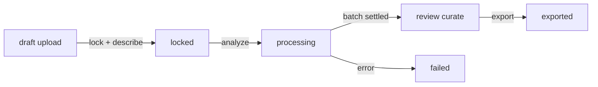
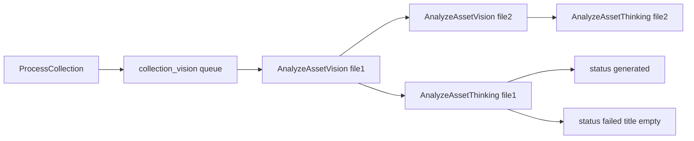

# Microstock — product domain

Product domain (`kind => product`, `locked => true`) for microstock asset management on top of the File Hosting base storage layer. Assets live in built-in **system workspaces** (`file_hosting_workspaces.kind = 'microstock'`, standalone slots) and reuse the entire FH upload/browse/quota/download pipeline. Microstock adds AI metadata (title/description/category/keywords), CSV metadata export, and envelope-encrypted marketplace credentials.

| | |
|--|--|
| Code | `app/Domain/Microstock/` |
| Config | [`config/microstock.php`](../../../config/microstock.php) |
| API | `routes/api/v1/microstock.php` |
| Web | `routes/web/microstock.php` under `/apps/*` → **`/apps/microstock`** (`microstock.index`, export); FH-mounted UI under **`/apps/file-hosting/microstock/*`** |
| Seeder | `MicrostockRoleSeeder` (Beta tester role + Public visibility) |
| Product registry | `activation_type = implicit`; registration creates an active registry row |
| Workspace gate | Active `microstock_workspace_slots` entitlement; `product.active:Microstock` remains middleware defense |
| Menu | **No dynamic sidebar menu** (`menu_routes = []`) — reached via `/apps/services` and the File Hosting workspace switcher |
| Storage class | **Product storage** — consumes the free-tier base (see [File Hosting — Storage classification](../file-hosting/README.md#storage-classification-core-vs-product)) |
| Quota pool | Shared with File Hosting (one `UserQuota` byte pool) |
| Fulfillment target | **`microstock`** (standalone — NOT `file_hosting`; see activation below) |

## Registry activation vs workspace entitlement

Microstock's Product Activation registry entry is **implicit**: registration creates an active `product_activations` row, matching `config/products.php`. That row alone does not provision or unlock a workspace. Usable Microstock access remains **opt-in** through a `microstock_workspace_slots` entitlement purchased from `/apps/services`; workspace creation remains on demand. `menu_routes = []`, so registry activation never creates or reveals a dedicated dynamic-sidebar node.

Two SKUs are seeded by `ServiceCatalogSeeder` (codes in `App\Domain\Service\Support\MicrostockCatalog`):

| code | name | interval | plan_kind | entitlement | storage_bytes | price |
|-----|------|----------|-----------|-------------|---------------|-------|
| `microstock.plan.free` | Microstock Workspace (Free) | `once` | `main` | `microstock_workspace_slots` | 0 | $0 |
| `microstock.addon.workspace-slot.monthly` | Microstock Workspace Slot | `monthly` | `addon` | `microstock_workspace_slots` | 0 | $1 |

- **Free workspace entitlement** (`microstock.plan.free`, $0 one-time): the workspace-access gate. Purchasable **once** (`ServiceCheckoutService` throws 422 `api/services.already_activated` on rebuy; unique `(user_id, service_id)` entitlement key is the backstop). Being $0 it is **zero-charge**: `isZeroCharge()` skips the payment gateway, the purchase is immediately `Paid` (`fx_provider = zero_charge`), and fulfillment runs inline. Grants `quantity = 1`, `ends_at = null` (permanent). With `fulfillment_target = 'microstock'`, fulfillment also ensures the already-implicit registry activation remains active; it does not auto-create a workspace and does not recompute File Hosting quota.
- **Slot addon** (`microstock.addon.workspace-slot.monthly`, $1 monthly): repeatable and **compounding** — each paid unit increments `quantity` on the active entitlement via `activateAddon`. Buying 10 units grants 10 extra Microstock workspace slots. Shares the addon anniversary stack with FH addons (`MainPlanChangeCalculator` / `extendAllAddons` cover both `file_hosting` and `microstock` addon targets).
- **AI credits** (`microstock.addon.ai-credits.5`, $5 once): prepaid analysis balance (`entitlement = microstock_ai_credits`). Fulfillment calls `AiCreditService::creditFromPurchase` — debited only on successful AI analysis (see [Microstock — AI billing](../microstock/README.md#ai-billing-prepaid-credits)).
- **UX**: `/apps/services` shows a dedicated Microstock card with an **Activate free** button for the workspace entitlement (disabled + "Active" badge once entitled) and a **Buy slot** button (visible once entitled) posting to the normal `services.checkout` flow. Here “Active” describes workspace entitlement, not creation of the implicit registry row.

## System workspaces (base storage)

Microstock assets live in `file_hosting_workspaces.kind = 'microstock'` rows — real workspaces, so all FH services (browse, upload, folders, members, activity, realtime) work unchanged. Unlike team workspaces, Microstock slots are **standalone**: they do NOT overlap or interchange with the FH team workspace slots (`file-hosting.addon.workspace-slot.monthly`). Owners may have **multiple** Microstock workspaces when their slot limit allows.

| Rule | Behavior |
|----|----------|
| Slot limit | `WorkspaceAccessService::microstockSlotLimit($ownerId)` = `BASE_WORKSPACE_SLOTS (1)` when `ServiceEntitlementService::hasActiveMicrostockWorkspaceSlot` is true, `+ microstockWorkspaceSlotExtraQuantity` (sum of active/grace slot-addon quantities). **0** when never activated |
| Provisioning gate | `WorkspaceService::systemWorkspaceFor` and `createSystemWorkspace` call `assertCanProvisionMicrostockWorkspace` before creating (`kind->isSystem()` only; team path unchanged). `422 api/microstock.workspace_not_activated` when limit is 0, `422 api/microstock.slot_limit` when full. Resolving an **existing** workspace is never gated |
| Activation gate | `MicrostockService::workspaceFor`/`createWorkspace` additionally throw `MicrostockException` 403 `workspace_not_activated` without an active slot entitlement |
| Slot accounting | `countActiveOwned` counts only `kind = 'team'`; `countActiveOwnedMicrostock` counts `kind = 'microstock'`. Neither pool sees the other, so Microstock never raises `owned_workspace_used` |
| Multi-workspace | Spare slots allow extra workspaces via `POST /api/v1/microstock/workspaces` or the switcher |
| Free users | The Microstock slot is independent of the FH paid/free plan; inviting still requires a paid FH main plan |

### No auto-provision on File Hosting

`FileManagerController@index` does **not** create the Microstock workspace. It appears in the FH switcher only after workspace entitlement and on-demand provisioning via `/apps/services` or Microstock entry points. `GET /apps/microstock` (`microstock.index`) redirects to `/apps/services` with an error flash when the entitlement is missing, even though the Product Activation registry row is already active.

## Usage & limits

| Rule | Behavior |
|----|----------|
| Access | Requires an active Microstock slot entitlement (free registration or slot addon) |
| Public share | **Blocked** — files/folders in a system workspace can never be `anyone_with_link`. `VisibilityService::assertSystemWorkspaceShareAllowed` rejects enable (422 `public_share_not_allowed`); guest `fileAccessible`/`folderAccessible` return false |
| Invite | Only a **paid FH** owner may invite (`WorkspaceService::invite` → `assertOwnerEligibleForCollab`); invitees may be free or paid |
| Upload/browse/download | Reuse File Hosting services as-is. **Content collaboration is NOT paid-gated:** a free Microstock owner can upload into their collections, and an invited member (free or paid) can upload into a shared workspace. Upload only requires mutate access (`assertCanMutate` — owner or active member). The paid gate (`assertOwnerEligibleForCollab`) applies to **sharing** (invite/accept) and **creating workspaces**, never to putting content into one |

## AI billing (prepaid credits)

Upload/storage stays on the shared File Hosting quota. **AI analysis** (vision + thinking metadata) is prepaid and metered per HTTP call.

| Phase | Billable? | Mechanism |
|-------|-----------|-----------|
| Upload into collection | No | FH `UserQuota` bytes |
| `POST …/analyze` / `POST assets/{file}/analyze` | Yes | Prepaid `microstock_ai_balances` |

**Flow:** purchase an AI credit pack via `/apps/services` → `ServiceFulfillmentService` credits `balance_micro_usd` → `AiBillingService::planAnalyze` gates dispatch (daily-free slots first, then prepaid balance for remainder; checks **billing user** = actor who triggered analyze) → each OpenAI-compatible HTTP call records a `microstock_ai_usage_events` row scoped to `analysis_run_id` → `composeResultFromThinking` settles (debit + `ai_billing` snapshot) **before** promoting `status = generated`. Thinking failure after successful vision triggers **partial vision settle**. Full edge-case inventory: [billing-edge-cases.md](billing-edge-cases.md).

### Daily free trial (optional)

Env-gated per-user daily analyses (`MICROSTOCK_DAILY_FREE_ENABLED`). No activation SKU — slots reset lazily by calendar day in `microstock_daily_free_usage`. Daily-first mixed billing: first N files in a collection use `billing_source = daily_free` (no prepaid debit; provider cost still on usage events); remainder use prepaid. Free-tier jobs route to `*-free` queues and may use separate vision/thinking models through `MICROSTOCK_AI_VISION_MODEL_FREE` / `MICROSTOCK_AI_THINKING_MODEL_FREE`; an empty free override inherits the paid/default stage model. Workers should process paid queues first. Details: [daily-free-trial.md](daily-free-trial.md).

**Billing subject:** `microstock_asset_metadata.billing_user_id` is set to the user who called `POST …/analyze` or `POST assets/{file}/analyze` (not the file uploader). Gate, usage events, and debit all use this ID.

**Analysis run:** Each analyze/re-analyze assigns a UUID `analysis_run_id` on metadata and usage events so re-runs do not mix unbilled rows from prior attempts.

**Credit pack SKU** (seeded by `ServiceCatalogSeeder`):

| code | price | entitlement |
|------|-------|-------------|
| `microstock.addon.ai-credits.5` | $5 once | `microstock_ai_credits` |

**Rate card** (`config/microstock.php` → `ai_billing`):

| Model | Input / 1M tokens | Output / 1M tokens |
|-------|-------------------|---------------------|
| `grok-grok-4.5-high` | $3.00 | $15.00 |
| `gpt-5.4` | $2.50 | $15.00 |
| `kimi-k3` | $3.00 | $15.00 |
| `gpt-5.6` / `gpt-5.6-sol` | $5.00 | $30.00 |
| `gpt-5.6-terra` | $2.50 | $15.00 |
| `gpt-5.6-luna` | $1.00 | $6.00 |
| `claude-opus-5` / `anthropic/claude-opus-5` | $5.00 | $25.00 |
| `claude-sonnet-5` / `anthropic/claude-sonnet-5` | $2.00 | $10.00 |
| `default` (unknown slug) | $5.00 | $20.00 |

Sonnet 5 rates above are Anthropic **introductory** pricing through Aug 31, 2026; standard from Sep 1 is $3 / $15 per 1M.

- `markup_multiplier` — env `MICROSTOCK_AI_BILLING_MARKUP` (default **1.35**)
- `estimated_billable_micro_usd_per_asset` — env `MICROSTOCK_AI_BILLING_ESTIMATE_PER_ASSET` (default **150000** = $0.15 buffer for analyze gate)
- `estimate_thinking_attempt_factor` — env `MICROSTOCK_AI_BILLING_ESTIMATE_FACTOR` (default **1.5**; gate = per-asset estimate × factor)
- `http_retries` — env `MICROSTOCK_AI_HTTP_RETRIES` (default **0** for billed stages; each retry can duplicate provider charges)
- Per-model input/output rates under `ai_billing.models` (resolved model from API response; alias from config stored separately)

Amounts are stored as **micro-USD** (1 USD = 1_000_000) end-to-end.

### Usage & balance UI

Transparent prepaid balance and AI usage history for the billing subject (the user who triggered analyze).

| Surface | Route / endpoint |
|---------|------------------|
| **Usage page** (web) | `GET /apps/file-hosting/microstock/usage` (`file-hosting.microstock.usage`) — summary cards + tabs |
| Summary (JSON hop) | `GET /apps/file-hosting/microstock/billing` → `GET /api/v1/microstock/billing` |
| Ledger mutations | `GET /apps/file-hosting/microstock/billing/ledger` → `GET /api/v1/microstock/billing/ledger` |
| Usage detail | `GET /apps/file-hosting/microstock/billing/usage-events` → `GET /api/v1/microstock/billing/usage-events` |

**Page layout**

1. **Summary** — prepaid `balance_usd`, `estimated_per_analysis_usd`, daily free (`remaining/limit` when enabled).
2. **Tab: Balance mutations** — bank-style ledger from `microstock_ai_credit_transactions` (`purchase`, `analysis_debit`, `adjustment`); signed amounts, running `balance_after`.
3. **Tab: AI usage detail** — per HTTP call from `microstock_ai_usage_events` (stage, model, tokens, cost, `billing_source` badge: Free / Prepaid). Daily-free rows appear here only; they do not create ledger debits.
4. **Tab: Platform overview** (Root / Admin / Moderator only) — platform-wide aggregates: provider cost, billable, margin, events, active users, daily-free subsidized cost; breakdown by billing source, stage, and model; cross-user usage event list.

**Admin API**

| Method | Route |
|--------|-------|
| `GET` | `/api/v1/admin/microstock/billing/overview` |
| `GET` | `/api/v1/admin/microstock/billing/usage-events` |

Web hops: `GET /apps/file-hosting/microstock/billing/admin/overview`, `…/admin/usage-events`. Gated by `hasAnyRole(['Root', 'Admin', 'Moderator'])` — Management excluded.

**Navigation**

| Location | Link |
|----------|------|
| File Hosting toolbar (Microstock workspace) | **AI Balance** → usage offcanvas panel (SPA-integrated, no page reload; preserves `workspace_id`; visible on SPA workspace switch without hard reload) |
| Collection describe modal footer | Billing line + **View balance & history** |
| `/apps/services` Microstock card | **Usage & balance** next to balance line |

Implementation: `BillingLedgerService`, `AdminBillingAnalyticsService`, `AdminBillingController`, `BillingLedgerEntryResource`, `BillingUsageEventResource`, `AdminBillingUsageEventResource`, `resources/views/adminlte4/file-hosting/microstock-usage.blade.php` (standalone fallback page), `resources/js/file-hosting/microstock-usage.js` (exports `createMicrostockUsagePanel` factory for SPA offcanvas + standalone page bootstrap). The SPA offcanvas (`#fhMicrostockUsagePanel`) is injected into `index.blade.php` and wired via `file-manager.js`; the standalone page remains for direct access/bookmarks. Daily-free behaviour: [daily-free-trial.md](daily-free-trial.md).

## Collections (folder-as-collection lifecycle)

A **folder** inside a Microstock workspace is a **collection** — the unit the AI processes. Uploads must live inside a collection, never the workspace root. Collection state lives directly on `file_hosting_folders` (migration `2026_07_26_100001`), driven by `App\Domain\FileHosting\Enums\CollectionStatus` and `App\Domain\Microstock\Services\CollectionService`.



| Step | Behavior |
|----|----------|
| Upload gate | `DirectUploadService::initiate` rejects (422) a Microstock workspace upload with no `folder_id` (`microstock.error_requires_folder`) or into a locked collection (`microstock.error_collection_locked`). Client mirrors this via dropzone `data-workspace-kind` / `data-collection-locked` |
| Lock + describe | `POST collections/{folder}/lock` stores the owner's `collection_hint` (single text field, max 2000, nullable) + `collection_billing_mode` (`free`/`paid`) + sets `locked` + `collection_locked_at`. Allowed from draft/failed (re-lock retries a failed run). Uploads stop here. **Web UI:** the Lock & Describe modal collects structured sections (Primary concept, Visible subjects, Buyer intent, Style & mood, Additional notes). All sections are optional; they compose into a multi-line hint before lock. A mandatory **Free / Paid** billing-mode selector appears when `MICROSTOCK_DAILY_FREE_ENABLED=true`; when Free is disabled the selector is hidden and every analysis is forced to `paid`. Submitting with no content triggers a client-side `window.confirm` warning that blind locking usually produces poor, inconsistent AI metadata. |
| Analyze | `POST collections/{folder}/analyze` (requires `locked`, non-empty) sets `processing` and dispatches `ProcessCollection` |
| Pipeline | `ProcessCollection` seeds a pending metadata row per file **directly in the folder (non-recursive)** with decoupled stage columns (`ai_vision`, `ai_thinking`, `ai_result`), then dispatches one `AnalyzeAssetVision` job per file on the **collection vision** queue (FIFO by file name). Each vision persists `ai_vision` and dispatches `AnalyzeAssetThinking` on the **collection thinking** queue. **Dual-lane pipeline:** configurable concurrent vision + thinking jobs per folder (default **3+3**), capped globally by upstream limits (see [Upstream limits](#upstream-limits)); vision file N+1 may run while thinking file N runs. Collection `review` when **all** assets are terminal (watchdog / thinking completion). Sub-folders are separate collections and are NOT processed |
| Curate | Per-file manual edit via `PATCH assets/{file}/metadata` (existing finalize) while in `review` |
| Export | `POST collections/{folder}/export` (requires `review`) renders a CSV of the folder's finalized metadata, persists it to `microstock.csv_disk`, saves `collection_csv_path`, sets `exported`. `GET collections/{folder}/download` streams it |

`collection_status` is NULL for ordinary File Hosting folders — only Microstock collections use these columns. `Folder::isCollectionLocked()` is true for locked/processing/review/exported.

## Metadata (AI: vision → thinking → manual)

Microstock's value is metadata. The owner **hint** (collection description) grounds every file's metadata. Both AI stages follow **Adobe Stock / Shutterstock 2026 contributor standards** — natural-sentence titles, a 4-tier keyword framework, and a fixed marketplace category set.

1. Per collection: `ProcessCollection` resets each `microstock_asset_metadata` row (`status = pending`, stage columns cleared) and dispatches per-file `AnalyzeAssetVision` jobs on `microstock.queues.collection_vision`. On vision success each asset dispatches `AnalyzeAssetThinking` on `microstock.queues.collection_thinking`. Single-asset `POST assets/{file}/analyze` uses the **solo** queue (`microstock.queues.solo`) so re-analyze does not wait behind a large collection.
2. `VisionImageResolver` picks a persisted JPEG variant (`ai_512` / `ai_1024`) or falls back to ephemeral resize from the original. Delivery mode is `base64` (data-URI) or `url` (signed HTTPS to the variant object).
3. **Vision** drafts metadata into `ai_vision.output`. **Thinking** runs in a separate job, reads the vision draft, and on success fills `title`/`keywords`/`description`/`category` with `status = generated`. Thinking failure leaves `title`/`keywords` empty (`status = failed`) but preserves `ai_vision` for inspection/retry. Strict mode: `curateDraft()` returning `raw = null` counts as thinking failure (no vision-draft promotion). `generate()` (probes) still supports monolithic vision→thinking with legacy fallback.
4. Stage snapshots: `ai_vision`, `ai_thinking`, `ai_result` (each with `status`, timestamps, `error`, `output`/`stage_metrics`). Legacy `ai_raw` is aggregated on result composition for API compat. Billing: full settle in `composeResultFromThinking` (transactional, before `generated`); partial vision settle on thinking failure.
5. Final curation is **manual**: user edits title/keywords → `PATCH assets/{file}/metadata` → `status = finalized`.

### Stage decoupling (MVP) — dual-lane pipeline



| Lane | Queue (default) | Concurrency (default) | On success |
|------|-----------------|----------------------|------------|
| Collection vision | `microstock-collection-vision` | **3** per folder + **6** global vision cap | Dispatch thinking on collection thinking queue |
| Collection thinking | `microstock-collection-thinking` | **3** per folder + **10** global thinking cap + 1 per `metadata_id` (`WithoutOverlapping`) | `composeResultFromThinking` + `completeFolderIfReady` |
| Solo re-analyze | `microstock-solo` | **2** vision + **2** thinking (solo pool) | Vision → thinking on same solo queue |

### Upstream limits

Shared Open WebUI / 9Router account empirical ceiling: **~20M tokens / 30 min** (frontier models). Microstock allocates the full window to analysis throughput; enforcement is **concurrency caps** via `LimitAnalysisConcurrency` queue middleware (`config/microstock.php` → `ai.upstream`).

| Reference | Value |
|-----------|-------|
| `token_budget` | 20,000,000 (ops reference; not runtime-enforced in MVP) |
| `window_seconds` | 1800 (30 min) |
| Per-asset typical ceiling | ~20,000 tokens |
| Theoretical burst assets | ~1,000 / 30 min at 20k/asset |

| Env | Default | Purpose |
|-----|---------|---------|
| `MICROSTOCK_AI_UPSTREAM_WINDOW_SECONDS` | `1800` | Sliding window reference (seconds) |
| `MICROSTOCK_AI_UPSTREAM_TOKEN_BUDGET` | `20000000` | Documented upstream token ceiling |
| `MICROSTOCK_AI_UPSTREAM_MAX_CONCURRENT_VISION` | `6` | Global in-flight vision jobs |
| `MICROSTOCK_AI_UPSTREAM_MAX_CONCURRENT_THINKING` | `10` | Global in-flight thinking jobs |
| `MICROSTOCK_AI_COLLECTION_VISION_CONCURRENCY` | `3` | Per-collection folder vision cap |
| `MICROSTOCK_AI_COLLECTION_THINKING_CONCURRENCY` | `3` | Per-collection folder thinking cap |
| `MICROSTOCK_AI_SOLO_VISION_CONCURRENCY` | `2` | Solo re-analyze vision pool |
| `MICROSTOCK_AI_SOLO_THINKING_CONCURRENCY` | `2` | Solo re-analyze thinking pool |
| `MICROSTOCK_AI_UPSTREAM_RELEASE_AFTER` | `15` | Seconds before a blocked job retries |

When a cap is full the job is **released** (not failed). Use **Redis** cache in multi-worker deploys so global counters are cluster-safe. If upstream still rate-limits, lower concurrency env vars — no code change needed.

| Stage column | Job | On failure |
|--------------|-----|------------|
| `ai_vision` | `AnalyzeAssetVision` | `ai_thinking` skipped; `ai_result` failed; row `failed` |
| `ai_thinking` | `AnalyzeAssetThinking` | `ai_result` failed; vision draft kept; row `failed` |
| `ai_result` | composed after thinking ok | — |

Per-stage watchdog grace: `microstock.ai.stage.vision_grace_after` (default 600s), `thinking_grace_after` (default 1800s). `thinking_backlog_after` (default 120s) re-dispatches thinking when vision completed but the thinking job was never queued (worker crash). API exposes `stages: {vision, thinking, result}` on `HostedFileResource` / `AssetMetadataResource`.

### Image variants (persisted derivatives)

Microstock raster uploads in a `kind = microstock` workspace trigger `GenerateFileVariants` after `DirectUploadService::complete`. JPEG sidecars are stored on the same FH disk (`file_hosting_file_variants`):

| Kind | Longest side | Typical use |
|------|--------------|-------------|
| `ai_512` | 512px | Faster vision / lower payload (probe matrix) |
| `ai_1024` | 1024px | Default vision quality |

**Quota:** ready variant `size` bytes count toward the owner's File Hosting `used_bytes` (byte sum with the original `HostedFile.size`). See [File Hosting — Quota](../file-hosting/README.md#quota).

**Vision delivery** (`config/microstock.php` → `ai.vision_image`):

| Env | Default | Purpose |
|-----|---------|---------|
| `MICROSTOCK_AI_VISION_IMAGE_DELIVERY` | `url` | `base64` = data-URI in JSON; `url` = signed HTTPS to variant |
| `MICROSTOCK_AI_VISION_VARIANT` | `ai_1024` | Which persisted kind to prefer |
| `MICROSTOCK_AI_VISION_URL_TTL` | `30` | Signed URL minutes when `delivery=url` |

When the configured variant is not `ready`, analyze logs `microstock.variants.not_ready` and falls back to ephemeral resize (`MICROSTOCK_AI_IMAGE_MAX_PX` / byte cap).

### Production stack (locked 2026-07-28)

Default config + `.env.example` use Open WebUI aliases for paid/prepaid analyses; **9Router** maps them to resolved models (verify in Open WebUI admin):

| Config alias | 9Router resolves to | Role |
|--------------|---------------------|------|
| `internal.vision` | `anthropic/claude-sonnet-5` | Image → draft metadata (conservative gender; strong scene read) |
| `internal.thinking` | `gpt-5.6-luna` | Multimodal VERIFY + SEO curation (`thinking_visual_attempts=2`) |

| Setting | Default | Notes |
|---------|---------|-------|
| Endpoint | `https://ai-chat.spnd.uk/api/chat/completions` | Both stages and tiers |
| Paid vision model | `MICROSTOCK_AI_VISION_MODEL=internal.vision` | Used for `billing_source=prepaid` and calls without billing context |
| Free vision model | `MICROSTOCK_AI_VISION_MODEL_FREE=""` | Empty inherits paid vision; set an Open WebUI alias to differentiate daily-free calls |
| Paid thinking model | `MICROSTOCK_AI_THINKING_MODEL=internal.thinking` | Used for `billing_source=prepaid` and calls without billing context |
| Free thinking model | `MICROSTOCK_AI_THINKING_MODEL_FREE=""` | Empty inherits paid thinking; set an Open WebUI alias to differentiate daily-free calls |
| `delivery` | `url` | Signed HTTPS to `ai_1024` variant (~341 B payload) |
| `thinking_visual_attempts` | `2` | First 2 thinking attempts include image + draft |

Model selection follows each asset's persisted `billing_source`, not the queue name. Mixed collections therefore use free models for daily slots and paid models for prepaid remainder; solo re-analysis follows its daily-first billing allocation. Alias selection is recorded on `microstock_ai_usage_events.alias_model`, while billing rates continue to use the provider response's `resolved_model`. After changing model env values, rebuild Laravel config and restart queue workers so long-lived processes load the new aliases.

`batch_chunk` / `batch_min_files` remain in config for `HttpAiMetadataService::generateBatch()` (probes only); the collection pipeline always uses per-file `analyzeVision()`.

Canonical probe write-up: [`probes/sonnet5_gpt56_combo_summary.md`](probes/sonnet5_gpt56_combo_summary.md) — **3/3** gender accuracy on hint `"Children doing sports"` vs sonnet-only (neutral), luna-both (758girl mis-gender), opus (all boy).

**Probe finding (2026-07-28, decoupled stage E2E, folder `019fa752-…`):** `probe_collection_stages.php` with `--force` after zombie `processing` — **3/3** assets `vision ok` → `thinking ok` → `result ok`, folder → `review`, **~176 s** wall-clock (sync, 3 files). Thinking TPS **~78–110** (Codex path). Default wait timeout **900 s**; use `--force` when `processing` has no metadata rows. Legacy `probe_collection` T6 timings match within ~10–20%. Details: [`probes/decoupled_stages_collection_summary.md`](probes/decoupled_stages_collection_summary.md).

**Probe finding (2026-07-28, sonnet vision + gpt-5.6 thinking combo, folder `019fa66d-…`):** 9Router `internal.vision` → **`anthropic/claude-sonnet-5`**, `internal.thinking` → **`gpt-5.6-luna`**. T0 + **T0t** preflight ok. Full 3-file batch: T3 **3/3** @ **6.3–7.6s** (~469–550 tok/s), T6 **3/3** @ **15.6–18.5s** with per-stage **`stage_metrics`** (vision ~6.1–6.9s, thinking ~9.1–12.4s @ ~540–705 tok/s). **Thinking multimodal on all 3 files** (`thinking_visual_attempts=2` default). Hint `"Children doing sports"` → **3/3 explicit correct gender** (girl/boy) — best balance vs sonnet-only (neutral child), gpt-5.6-luna both (758girl mis-gender), opus (all boy). Details: [`probes/sonnet5_gpt56_combo_summary.md`](probes/sonnet5_gpt56_combo_summary.md).

**Probe finding (2026-07-28, sonnet vision + gpt-5.6 thinking via Codex upstream, folder `019fa66d-…`):** Same resolved models (`anthropic/claude-sonnet-5` + `gpt-5.6-luna`); only `internal.thinking` upstream switched from API to **Codex**. T3 **3/3**, T6 **3/3**, gender **3/3** — quality matches API baseline. Thinking TPS **~89–92** (vs API **~540–705**); T6 wall **~51–58s** (vs **~15.6–18.5s**). Not recommended for production at current Codex TPS. Details: [`probes/sonnet5_gpt56_codex_thinking_summary.md`](probes/sonnet5_gpt56_codex_thinking_summary.md).

**Probe finding (2026-07-28, `anthropic/claude-sonnet-5`, folder `019fa66d-…`):** vision resolves to **`anthropic/claude-sonnet-5`**. Full 3-file batch: T3 **3/3** @ **6.0–7.9s** (~454–577 tok/s), T6 **3/3** @ **13–20s**. No CF 524. Hint `"Children doing sports"` → gender-neutral **child** labels (no mis-gender vs opus; no explicit girl/boy for SEO). Category sometimes `People` instead of `Illustration`. Rate card intro $2/$10 per 1M (standard $3/$15 from Sep 1). Details: [`probes/claude_sonnet5_collection_summary.md`](probes/claude_sonnet5_collection_summary.md).

**Probe finding (2026-07-28, `anthropic/claude-opus-5`, folder `019fa66d-…`):** vision resolves to **`anthropic/claude-opus-5`**. Full 3-file batch: T3 **3/3** @ **7.0–7.9s** (~448–508 tok/s), T6 **3/3** @ **15–17s**. No CF 524. Speed similar to gpt-5.6-luna but lower TPS. Quality: collection hint `"Children doing sports"` caused **boy** labels on all 3 files (758girl + 2808 wrong; only 2119boy correct). Rate card: `claude-opus-5` + `anthropic/claude-opus-5` @ $5/$25 per 1M. Details: [`probes/claude_opus5_collection_summary.md`](probes/claude_opus5_collection_summary.md).

**Probe finding (2026-07-28, `gpt-5.6-luna`, folder `019fa66d-…`):** vision resolves to **`gpt-5.6-luna`** via 9Router. Full 3-file batch with `delivery=url`: T3 **3/3** @ **6.6–9.2s** (~683–928 tok/s), T6 **3/3** @ **17–20s**. No CF 524. ~5–16× faster vision than grok (~46s). One quality issue: 758girl T6 title mis-gendered to boy after thinking (vision T3 had correct girl). Details: [`probes/gpt56_collection_summary.md`](probes/gpt56_collection_summary.md).

**Probe finding (2026-07-28, `kimi-k3`, folder `019fa66d-…`):** vision routed to `dahono/kimi-k3` but upstream returned HTTP **400** — `Model tidak tersedia` on all 3 files (T3/T6 0/3). Rate card `kimi-k3` added ($3/$15 per 1M). Fix 9Router provider availability before comparing TPS/title/keywords. Details: [`probes/kimi_k3_collection_summary.md`](probes/kimi_k3_collection_summary.md).

**Probe finding (2026-07-28, `gpt-5.4`, folder `019fa66d-…`):** persisted `ai_1024` + **`delivery=url`** is required for GPT-5.4 vision on this stack (base64 reliably HTTP **524** @ ~125s). Signed URL payload is ~341 bytes vs ~62KB base64. URL T3 is **intermittent** (~109s when pass, 524 when fail) — run-to-run CF variance, not delivery-mode regression. Full 3-file collection re-probe with config default `url`: T3 0/3, T6 1/3 batch (+ 2119boy T6 ok on spot-check while T3 524'd). Production default is **`url`** (`config/microstock.php`); grok remains faster/more reliable with base64 (~46s). Details: [`probes/gpt54_url_vs_base64_summary.md`](probes/gpt54_url_vs_base64_summary.md), [`probes/collection_url_default_summary.md`](probes/collection_url_default_summary.md).

**Probe scripts:** `php scripts/microstock/probe_ai.php --timeout=300 [--file={uuid}|--folder={uuid}] [--only=T0,T0t,T3,T6] [--label=sonnet5-gpt56]` — **T0** = vision preflight, **T0t** = thinking preflight; **T6** surfaces `stage_metrics` (per-stage `duration_ms`, `resolved_model`, `multimodal`, `tokens_per_second`). Full folder batch: `php scripts/microstock/probe_collection.php {folder_id} [--timeout=300] [--label=sonnet5-gpt56]`. **E2E decoupled pipeline** (persists `ai_vision` / `ai_thinking` / `ai_result`, sync queue): `php scripts/microstock/probe_collection_stages.php {folder_id} [--label=decoupled-probe-e2e] [--wait-timeout=900] [--force]` — use `--force` after zombie `processing` (no metadata rows). Details: [`probes/decoupled_stages_collection_summary.md`](probes/decoupled_stages_collection_summary.md). Matrix: `--matrix`. Requires ready variants (`php scripts/microstock/generate_variants.php {folder_id}` if upload predates worker). JSON artifacts land in `storage/app/probe_results/` (runtime, not committed). Summaries: [`probes/`](probes/).

### Prompt strategy (marketplace-aligned)

`Prompts::marketplaceRules()` is the single source injected into **both** stages so they never drift:

- **Title** — natural descriptive sentence (not a keyword list), 40–70 chars, no commas, no trademark/real-people/camera-spec, no subjective quality adjectives. Cartoon/vector assets → category `Illustration`; title must name **subject + action**, not a clothing inventory.
- **Description** — one factual sentence (who/what/where/action).
- **Category** — exactly one of: People, Lifestyle, Education, Business, Food, Nature, Technology, Health, Holidays, Abstract, Objects, Illustration.
- **Keywords** — **50–60** terms (user curates down to ~50 for Adobe Stock minimum), **ordered by relevance** (the first 10 carry the most search-ranking weight), built across 4 tiers in strict order: **literal** (subject/action/setting) → **contextual** (demographics/season) → **conceptual** (ideas/emotions buyers search: childhood, fitness, teamwork) → **stylistic** (art direction/palette, **max 2**). Top 10 = literal + contextual only. Singular nouns + infinitive verbs, one concept per keyword, no same-word-stem repeats. Ground in **visible content only** — do not invent sports equipment, venues, or activities from the collection hint alone. `KeywordNormalizer` caps AI output at 60 (dedupe + trim); manual finalize is not capped.
- **BAN list** (dropped in both stages): compositional (`front view`, `full length`), background (`white background`, `isolated`), redundant format (`clip art` when `illustration` is already present), subjective (`cute`, `beautiful`, `best`), palette spam unless core to the subject.
- **Hint grounding** — when collection context is set, top-5 keywords should reflect the hint theme **only when the image supports it**.

### Deterministic requests

All three request builders (`vision()`, `thinkingRequest()`, `generateBatch()`) send `temperature = 0.2` + `max_tokens` (2000 single / 4000 batch) so the JSON output is deterministic and never truncated mid-array.

### Prompt-length constraint (verified)

Models behind `internal.vision` / `internal.thinking` **choke on long system prompts when an image is attached** — verified 2026-07-27: a ~1700-char system prompt returns **HTTP 524** (Cloudflare origin timeout) at ~125 s, while ~1050 chars returns **200** in ~107 s. `Prompts::marketplaceRules()` is therefore intentionally dense — keep `Prompts::visionSystem()` and `Prompts::thinkingSystem()` under ~1200 chars (unit-tested in `PromptsTest`). If the upstream model behind an alias never responds acceptably, change the model mapping in Open WebUI admin or override `MICROSTOCK_AI_VISION_MODEL` / `MICROSTOCK_AI_THINKING_MODEL`.

`AiMetadataService` is an interface; the default binding `HttpAiMetadataService` posts to OpenAI-compatible chat-completions endpoints. Each stage is independently configurable in `config/microstock.php` (`ai.vision.*`, `ai.thinking.*`: endpoint, paid/default model, optional free model, API key, timeout; all env-driven). Tests bind a stub.

### Open WebUI response parsing

Production uses **Open WebUI** as the only supported AI surface:

| Setting | Value |
|---------|-------|
| Endpoint | `https://ai-chat.spnd.uk/api/chat/completions` |
| Paid/default vision model | `internal.vision` |
| Free vision model | inherits paid when `MICROSTOCK_AI_VISION_MODEL_FREE` is empty |
| Paid/default thinking model | `internal.thinking` |
| Free thinking model | inherits paid when `MICROSTOCK_AI_THINKING_MODEL_FREE` is empty |
| Auth | JWT Bearer (`MICROSTOCK_AI_*_API_KEY`) |

`HttpAiMetadataService` normalizes upstream quirks before decoding:

| Quirk | Handling |
|-------|----------|
| Streaming default on some upstream models | Every request sends **`stream: false`** explicitly via `chatCompletionPayload()`. |
| Full SSE response body | When the body starts with `data:`, `aggregateSseStream()` assembles `delta.content` chunks into one message before decode. |
| SSE trailer on non-streaming responses | Some upstream paths append `data: [DONE]` after the JSON body, which breaks Laravel's `json()` helper. `parseResponsePayload()` strips the trailer and parses the leading JSON object. |
| Markdown-fenced JSON | `parseMetadataJson()` strips `` ```json ... ``` `` fences before decoding. |
| Anthropic-style content blocks | `extractContent()` concatenates `{type: text, text: "..."}` blocks when `message.content` is an array. |
| Reasoning models | `extractContent()` also checks `message.reasoning`, `reasoning_content`, and root `output`. |
| Batch `response_format: json_object` | `Prompts::batchSystem()` asks for `{"assets": [{id, title, ...}, ...]}` (not a bare array) so the OpenAI JSON-object mode and the prompt agree. `decodeBatch()` also tolerates bare arrays and legacy wrapper shapes. |

Images reach the vision stage via `VisionImageResolver` — **signed HTTPS URL** to a persisted variant (default `delivery=url`) or **base64 data-URI** when overridden (`MICROSTOCK_AI_VISION_IMAGE_DELIVERY`). Variants are JPEG sidecars (`ai_512` / `ai_1024`); ephemeral resize from the original remains the fallback when variants are not ready. The thinking stage receives the same image reference on the first `MICROSTOCK_AI_THINKING_VISUAL_ATTEMPTS` attempts (default **2**) for multimodal VERIFY against the vision draft; probe T6 reports `thinking_multimodal` and per-call `stage_metrics`.

**Stage logging:** each HTTP call logs `microstock.ai.stage` (`start` / `end`, `duration_ms`, `body_prefix`, `finish_reason`) to `storage/logs/laravel.log` — use this to confirm vision completes before thinking starts.

**Troubleshooting — slow vision / thinking not started yet:**

1. Collection pipeline is **dual-lane** — vision and thinking run with configurable per-folder concurrency (default 3+3); check `microstock.ai.stage` logs for per-stage `duration_ms`.
2. Check `microstock.ai.stage` logs in `storage/logs/laravel.log` — compare `vision` `start`/`end` `duration_ms` vs `thinking` `start`/`end`. Multimodal vision at 1024px via Open WebUI commonly takes **40–120s** per call depending on the resolved backend model (grok ~46s verified 2026-07-27; `gpt-5.4` hit HTTP **524** at ~125s on 2026-07-28 probe — see [`probes/gpt54_vs_grok_summary.md`](probes/gpt54_vs_grok_summary.md)).
3. **`cURL error 28: 0 bytes received` = client timeout**, not proof Open WebUI is hung. A probe with timeout **&lt; production** (`MICROSTOCK_AI_VISION_TIMEOUT`, default 300s) can fail while the same request would succeed at 300s.
4. High token usage with a stuck worker usually means **slow inference + retries + repeated re-analyze**, not a dead upstream. Expect ~**5 HTTP calls per asset** (1 vision + up to 4 thinking attempts) × `MICROSTOCK_AI_HTTP_RETRIES`.
5. Run structured diagnosis: `php scripts/microstock/probe_ai.php --timeout=300 [--label=sonnet5-gpt56] [--folder=uuid] [--delivery=base64|url] [--variant=ai_512|ai_1024] [--matrix]` — JSON results in `storage/app/probe_results/` (falls back to first available asset if the default folder is empty). E2E single asset: `php storage/app/verify_e2e_asset.php`. Do **not** conclude "model hang" unless text-only T0 also fails at ≥300s **and** Open WebUI shows no completed request.
6. Tunables if too slow: lower `MICROSTOCK_AI_IMAGE_MAX_PX`, raise `MICROSTOCK_AI_VISION_TIMEOUT`, or set `MICROSTOCK_AI_THINKING_VISUAL_ATTEMPTS=1` (default 2 multimodal thinking attempts).

**Troubleshooting — all metadata `failed`:**

1. Check `microstock_asset_metadata.error` — `AI metadata generation failed.` = HTTP non-2xx; `AI returned an invalid metadata response.` = HTTP 200 but body could not be parsed into title + keywords.
2. Check `storage/logs/laravel.log` for `Microstock AI decode failed` context (stage, truncated content).
3. Verify `internal.vision` and `internal.thinking` exist in Open WebUI (Admin → Models) and the JWT in `.env` is valid (not expired).
4. Probe a single asset synchronously: `AnalyzeAssetMetadata::dispatchSync($metadataId, $hint)` in Tinker after confirming `AssetResizeService` can read the file bytes.
5. On Windows/Laragon, keep the worker alive with `php artisan queue:listen --tries=1` (see Operations below).

**Troubleshooting — keywords off / wrong scene / wrong subject:**

1. Inspect `ai_raw.vision` vs `ai_raw.thinking` — if vision is wrong but thinking corrected it, visual VERIFY worked. If **both** are wrong (e.g. girl asset titled "boy soccer"), the model still misread the image — manual curation in `review` or per-file re-analyze (`POST assets/{file}/analyze`).
2. Pre-fix rows may have a **flat** `ai_raw` (batch vision only, no `thinking` key) — re-run analysis after deploying the batch+thinking pipeline.
3. Multi-image batch cross-assignment (metadata from asset A applied to asset B) — use `MICROSTOCK_AI_BATCH_MIN_FILES=4` (default) so collections with &lt; 4 files never batch; for debugging set `MICROSTOCK_AI_BATCH_CHUNK=1`.
4. Cartoon/illustration detail loss — set `MICROSTOCK_AI_IMAGE_MAX_PX=1024` (recommended for illustrations).
5. Collection hint overfitting (invented soccer/swim gear) — both stages forbid equipment not visible; thinking VERIFY should drop invented terms when the model cooperates.
6. Thinking multimodal fallback — if the gateway rejects images on the `thinking` combo, `HttpAiMetadataService` retries text-only then keeps the vision draft (`raw.thinking = null`).

The review panel surfaces per-file `error` when status is `failed` (`AssetMetadataResource` + `#fhMicrostockPanel`).

### Adaptive timeout & watchdog

The vision/thinking stages run **multi-step reasoning with no predictable duration**, so failure is **not a per-request hard HTTP timeout** — it is a **phase deadline measured from elapsed activity**. A short client timeout aborts an otherwise-valid generation (`cURL error 28: Operation timed out ... 0 bytes received` is the client cutting the connection, not a dead model), and a fixed cap cannot tell "AI is thinking" from "AI is hung".

Instead, each asset moves through three derived phases, measured from when its metadata row was queued (`microstock_asset_metadata.created_at`):

| Phase | Elapsed | Meaning | UI |
|----|----|----|----|
| `analyzing` | `< normal_after` (default 600s) | AI is processing | normal progress |
| `degraded` | `normal_after .. grace_after` (600–1500s) | still waiting, slow | show **degraded performance** warning |
| `failed` | `> grace_after` (1500s) | hung / worker died | marked failed |

`phase` is **presentational/derived** — never persisted. `metadata.status` stays `pending/generated/finalized/failed`; `degraded` only appears in the `phase` field of the collection `status()` payload and the per-file `microstock` resource payload. Budgets are tunable via `MICROSTOCK_AI_PHASE_NORMAL` / `MICROSTOCK_AI_PHASE_GRACE`.

**Watchdog as single failure authority.** `ProcessCollection` dispatches `App\Domain\Microstock\Jobs\AnalysisWatchdog` after enqueueing vision jobs. The watchdog re-dispatches itself every 60s while any collection is `processing` and:
1. marks per-stage timeouts (`vision_grace_after` / `thinking_grace_after`) on stalled `pending` metadata;
2. re-dispatches `AnalyzeAssetThinking` when vision is `ok` but thinking stayed `pending` longer than `thinking_backlog_after` (missed dispatch / worker crash);
3. moves a `processing` folder whose metadata are all terminal → `review` (if some succeeded) or `failed` (if none).

**Constraint:** `grace_after` and `thinking_grace_after` must stay **below** the queue `DB_QUEUE_RETRY_AFTER` (1800s) so the watchdog declares failure *before* the queue re-dispatches still-running jobs.

As a safety net, `HttpAiMetadataService::thinking()` still degrades gracefully if a request genuinely fails:

1. Attempt A: system + multimodal user (image + draft) when preview available.
2. Attempt B: instructions fused into multimodal user (no `system` role).
3. Attempt C: text-only system + user.
4. Attempt D: fused text-only user.
5. Fallback: if all fail, the **vision draft is kept** (`raw.thinking = null`) so the asset still reaches `status = generated`. Each failure is `report()`ed.

`Prompts::thinkingSystem()` is intentionally short (a single dense paragraph). If a gateway model never responds acceptably, point `ai.thinking.model` to a different model via `MICROSTOCK_AI_THINKING_MODEL`.

| Column | Notes |
|----|-------|
| `microstock_asset_metadata` | `file_id` (unique FK to `file_hosting_files`), `user_id`, `title`, `keywords` json, `category`, `description`, `status` (`pending`/`generated`/`finalized`/`failed`), `ai_raw` json (`{vision, thinking, stage_metrics?}` — see above), `error` |

## CSV export

Two scopes, both finalized-only. Columns are config-driven (`microstock.csv.columns`, default `filename,title,description,category,keywords`; `microstock.csv.keywords_separator`). Per-marketplace field mapping is a later iteration.

- **Per collection** (primary): `CsvExportService::buildForCollection($folder)` — finalized metadata of files directly in the folder. Persisted to `microstock.csv_disk` (default `local`) at `microstock/collections/{folder}.csv` on export.
- **Whole workspace**: `CsvExportService::build($owner)` — all finalized metadata in the Microstock workspace (legacy/ad-hoc).

## Marketplace credentials

`microstock_marketplace_credentials` stores per-user marketplace connection secrets (host/username/password/port/…) for the future FTP/API auto-upload. `secret_payload` uses the shared **envelope encryption** cast (`EnvelopeEncryptedArray`, resource type `microstock_marketplace_credentials`) — the same KEK/DEK infra as payment/vTual credentials; plaintext never reaches the DB. MVP only stores/lists/deletes credentials; no auto-upload yet.

## API (`/api/v1/microstock/*`, `auth:api`)

Middleware: `auth:api` → `domain.access:Microstock` → `product.active:Microstock`.

| Method | Path | Purpose |
|------|---------|---------|
| GET | `workspace` | Resolve (lazy-create, gated) the owner's system workspace |
| GET | `slots` | Slot status snapshot (`activated`, `used`, `limit`, `can_create`) |
| GET | `billing` | Prepaid AI credit balance + per-analysis estimate |
| GET | `billing/ledger` | Paginated prepaid ledger (`BillingLedgerService`) |
| GET | `billing/usage-events` | Paginated per-HTTP-call usage detail |
| POST | `workspaces` | Create an additional Microstock workspace (slot-gated) |
| POST | `assets/{file}/analyze` | Queue AI metadata analysis (202) |
| GET | `assets/{file}/metadata` | Read current metadata row |
| PATCH | `assets/{file}/metadata` | Finalize manual curation (`title`, `keywords[]`) |
| GET | `credentials` | List marketplace credentials |
| POST | `credentials` | Store credential (`marketplace`, `label`, `secret{}`) |
| DELETE | `credentials/{id}` | Delete credential |
| POST | `collections/{folder}/lock` | Lock collection + store hint (`hint`) |
| POST | `collections/{folder}/analyze` | Start the per-file AI pipeline (202) |
| GET | `collections/{folder}/status` | Status + progress snapshot (incl. derived `phase`) |
| POST | `collections/{folder}/export` | Render + persist collection CSV |
| GET | `collections/{folder}/download` | Stream the exported collection CSV |

**Admin API** (`routes/api/v1/admin-microstock.php`): `auth:api` + in-controller `authorizePlatformBilling()` (Root / Admin / Moderator; Management excluded). Endpoints: `GET admin/microstock/billing/overview`, `GET admin/microstock/billing/usage-events`. See [Usage & balance UI](#usage--balance-ui).

## Web

| Route name | Purpose |
|----------|---------|
| `microstock.index` | Redirects into the File Hosting SPA pinned to the Microstock system workspace (`/apps/file-hosting?workspace_id=…`); redirects to `/apps/services` when not activated |
| `microstock.export.csv` | Stream-download the finalized metadata CSV |
| `file-hosting.microstock.slots` | Thin web hop → `GET /api/v1/microstock/slots` (for the switcher UI) |
| `file-hosting.microstock.billing` | Thin web hop → `GET /api/v1/microstock/billing` (collection modal + credit pre-flight) |
| `file-hosting.microstock.billing.ledger` | Thin web hop → `GET /api/v1/microstock/billing/ledger` |
| `file-hosting.microstock.billing.usage-events` | Thin web hop → `GET /api/v1/microstock/billing/usage-events` |
| `file-hosting.microstock.billing.admin.overview` / `.admin.usage-events` | Thin web hops → admin billing API (Root / Admin / Moderator) |
| `file-hosting.microstock.usage` | Usage & balance page (`microstock-usage.blade.php` + `microstock-usage.js`) |
| `file-hosting.microstock.workspaces.store` | Thin web hop → `POST /api/v1/microstock/workspaces` (switcher "New Microstock workspace") |
| `file-hosting.microstock.collections.lock` / `.analyze` / `.status` / `.export` | Thin web hops → the matching collection API endpoints (SPA collection toolbar) |
| `file-hosting.microstock.collections.download` | Direct service download of the exported collection CSV |
| `file-hosting.microstock.assets.preview` | Signed inline preview URL `{url}` for the review panel (`SignedDownloadService::resolve($file, inline: true)` after `MicrostockService::resolveAsset`) |
| `file-hosting.microstock.assets.metadata.show` / `.update` / `.analyze` | Thin web hops → `GET`/`PATCH` `assets/{file}/metadata` + `POST assets/{file}/analyze` (review panel) |

### Collection UI (SPA)

Inside a Microstock collection folder the SPA shows a **visual stepper** (`data-fh-collection-stepper`) above the file listing, replacing the former morphing button + status banner. The stepper displays the 5-step collection lifecycle — Upload → Lock & Describe → Analyze → Review → Export — with each step showing `is-pending`/`is-active`/`is-done`/`is-failed` state (CSS-driven circles + connecting lines). The active step is derived from `collection_status` (draft→step 1, locked→step 3, processing→step 3, review→step 4, exported→step 5, failed→step 3 with error). A contextual hint text and progress line (during processing) appear below the stepper. The action button remains in the toolbar but is now anchored by the stepper context — Lock & Describe (draft/failed) → Start analysis (locked) → Export CSV (review) → Download CSV (exported) — driven by `updateCollectionUi()` fed from the browse payload (`folder.collection_status`) and the status endpoint.

The Lock & Describe modal (`#fhCollectionDescribeModal`) uses a compact 2-column grid for the visible-subjects and buyer-intent sections (reducing vertical clutter), with the char count and billing line moved to the modal footer. The structured describe form (`collection-describe.js`) makes all describe sections optional; only a too-short primary concept or hint length over 2000 chars is a hard validation error. A mandatory **Free / Paid** billing-mode radio group is shown when daily free is enabled; the modal resets the selection to empty on open so the user must explicitly choose. Paid mode bypasses the daily-free quota entirely (all slots prepaid), while Free mode uses the daily quota first and falls back to prepaid for any remainder. The billing line in the footer updates live as the user toggles the mode. Re-lock from `failed` pre-fills from `folder.collection_hint`. Upload into a locked collection / workspace root is blocked client-side (dropzone gate) and server-side (`DirectUploadService`).

### Switcher multi-workspace UI

The File Hosting workspace switcher fetches `file-hosting.microstock.slots` at runtime and renders one entry:

- not activated → "Activate Microstock" link to `/apps/services`
- `can_create` → "New Microstock workspace" button → POSTs, then soft-navigates into the new workspace
- full → disabled "Microstock slots full" note

After a successful create (and after every switcher refetch) the SPA rebuilds the whole workspace item list from `lastWorkspaces` (`renderWorkspaceMenuItems`) and re-runs `refreshMicrostockSlotSection`, so the new workspace appears and the button state updates immediately — no hard reload.

### Review UI (curate metadata)

The curate step of the collection lifecycle lives directly in the file-manager listing:

- **Per-file metadata status** — `FolderService::browse` eager-loads `HostedFile::microstockMetadata` when the workspace `kind` is `microstock`, and `HostedFileResource` exposes a `microstock` key (`{title, keywords, status, phase, stages}`, `null` = no row yet). `stages` mirrors decoupled vision/thinking/result (`pending`/`running`/`ok`/`failed`/`skipped`). The listing renders a stage-aware badge (e.g. Vision…, Thinking…, Failed) next to the file name and a **Review** action (`bi-stars`, `data-fh-ms-review`) only when `status` is `generated`, `finalized`, or `failed` — in both JS re-render (`listing-ui.js` + `microstock-ui.js`) and Blade SSR (`_microstock-badge` partial).
- **Side panel** — clicking Review opens a Bootstrap offcanvas (`#fhMicrostockPanel`) driven by `microstock-panel.js`. Compact layout: status badge + stage strip (Vision → Thinking → Result) in the header row, rendered with an icon dot plus a visible text label for each stage; tooltips and `aria-label` remain for accessibility. signed preview image; editable title; keyword chips with a count badge and a **Clear all** button; description/category collapsed under an **AI details** toggle (Bootstrap collapse with chevron rotation). WebSocket-first metadata updates; fallback HTTP poll every 30 s when broadcast is off or degraded. Saves via `PATCH assets/{file}/metadata`; **Re-analyze** POSTs `assets/{file}/analyze` on the solo queue.
- **Progress realtime** — while `collection_status === 'processing'`, the SPA listens on the File Hosting websocket channel for `collection.analysis.progress` (banner counts + phase) and `asset.metadata.progress` (per-file badge/stage patch). Requires broadcast credentials (`BROADCAST_CONNECTION=pusher` or `reverb` + `PUSHER_*`). When broadcast is off or the socket is degraded, fallback HTTP poll runs every 60 s (collection) / 30 s (review panel) instead of the former 3 s burst (`status` + full listing refetch).
- **Collection billing** — `GET file-hosting/microstock/billing` (web hop → `GET /api/v1/microstock/billing`) shows balance + per-file estimate in the Lock & Describe modal footer; submit blocks when balance &lt; `fileCount × estimate`. **View balance & history** opens the SPA usage offcanvas (`#fhMicrostockUsagePanel`). Locked collections expose an enabled **Start analysis** button (`POST …/analyze` without re-lock).
- **Review shortcut** — in `review` state a secondary **Review files** toolbar button opens the panel for the first listed file.

## Tests

`php artisan test --filter="MicrostockTest|CollectionLifecycleTest|CollectionApiTest|AnalysisWatchdogTest|AiBillingServiceTest|AiCreditServiceTest|BillingLedgerServiceTest|BillingLedgerApiTest|BillingAdminApiTest|KeywordNormalizerTest|HttpAiMetadataServiceThinkingFallbackTest|HttpAiMetadataServiceResponseParsingTest|HttpAiMetadataServiceCurateDraftTest|HttpAiMetadataServiceVisualThinkingTest|HttpAiMetadataServiceTierModelTest|MicrostockAiConfigTest|PromptsTest"` —
- `MicrostockTest`: provisioning gated by entitlement (403 without), slot-limit multi-workspace create, public-share block, analyze → generate (stub AI, asserts `title`/`description`/`category`/`keywords`), finalize curation, CSV export finalized-only, credential encrypt/decrypt roundtrip, invite paid-gate. Checkout coverage in `ServiceCheckoutZeroChargeTest`.
- `CollectionLifecycleTest`: root-upload blocked (422), locked-collection upload blocked, lock requires hint + transitions + rejects re-lock + rejects non-microstock folder, analyze requires lock/files + dispatches `ProcessCollection`, non-recursive batching (sub-folder untouched), empty→failed, **multi-file dual-lane pipeline** (all files → `review`), prompt hint threading (`Prompts::visionUser`/`thinkingUser` + the `COLLECTION CONTEXT` block), status progress counts, per-collection CSV filter (incl. `description`/`category` columns), export persists CSV + marks exported.
- `CollectionPipelineTest`: per-file vision dispatch count, solo vs collection queue routing, thinking idempotency, watchdog thinking backlog recovery.
- `CollectionApiTest`: HTTP lock/analyze/status/export/download endpoints (auth, validation, transitions, foreign-collection 403), browse exposes `microstock` key per file in a Microstock workspace (omitted in personal), per-file metadata show/finalize/re-analyze + signed preview web hops (`FileManagerControllerTest`).
- `AnalysisWatchdogTest`: pending metadata past grace → `failed`; recent pending untouched; `processing` folder with all-failed metadata → `failed`; folder with some `generated` → `review`; zombie pending reaped; watchdog self-dispatches only while a collection is `processing`; `status()` returns derived `phase` (`analyzing`/`degraded`/echo).
- `HttpAiMetadataServiceThinkingFallbackTest`: thinking happy path uses curated result; system-prompt hang retries with fused user message; both attempts failing falls back to the vision draft (`raw.thinking = null`) — all asserting `description`/`category` are carried through.
- `HttpAiMetadataServiceResponseParsingTest`: SSE `data: [DONE]` trailer stripping, full SSE delta stream aggregation, `stream: false` on requests, markdown-fenced JSON, Anthropic content blocks, batch `assets` wrapper, unparseable body → `ai_invalid_response`.
- `HttpAiMetadataServiceCurateDraftTest`: `curateDraft()` delegates to thinking stage; curated keywords returned; multimodal request when image provided.
- `HttpAiMetadataServiceVisualThinkingTest`: `generate()` sends image on thinking call; multimodal failure falls back to text-only.
- `HttpAiMetadataServiceTierModelTest`: prepaid/no-context uses paid aliases, daily-free uses free aliases for both stages, empty free overrides inherit paid, and usage events keep the selected alias/source.
- `MicrostockAiConfigTest`: locks paid/default model aliases and nullable free-tier overrides in config.
- `PromptsTest`: `visionSystem()` and `thinkingSystem()` char count under gateway limit (~1200); keyword target 50–60 in thinking prompt.
- `BillingLedgerServiceTest`: ledger pagination, running `balance_after`, signed amounts per transaction type.
- `BillingLedgerApiTest`: user `GET billing/ledger` + `GET billing/usage-events` (auth, pagination, daily-free vs prepaid rows).
- `BillingAdminApiTest`: platform overview aggregates, cross-user usage events, role gate (Root/Admin/Moderator vs Management).
- `KeywordNormalizerTest`: dedupe + cap at 60 keywords.
- `FileManagerControllerTest::test_microstock_usage_page_renders`: usage page Blade smoke.

Upload client unit tests (Vitest): `direct-upload-mime.test.js`, `direct-upload-context.test.js`, `direct-upload-dismiss.test.js` — see [File Hosting — UI architecture / SPA shell](../file-hosting/README.md#ui-architecture--spa-shell).

## Operations: queue worker

Microstock uses **dual-lane pipeline queues** plus a solo lane and daily-free lanes (see `config/microstock.php` → `queues`). Orchestration jobs (`ProcessCollection`, `AnalysisWatchdog`) run on `default`.

| Queue (default name) | Jobs | Workers needed |
|----------------------|------|----------------|
| `microstock-collection-vision` | `AnalyzeAssetVision` (collection) | ≥1 (overlap with thinking lane) |
| `microstock-collection-thinking` | `AnalyzeAssetThinking` (collection) | ≥1 |
| `microstock-solo` | Solo re-analyze vision + thinking | ≥1 |
| `microstock-collection-vision-free` | Daily-free collection vision | ≥1 (same worker process is fine) |
| `microstock-collection-thinking-free` | Daily-free collection thinking | ≥1 |
| `microstock-solo-free` | Daily-free solo re-analyze | ≥1 |
| `default` | `ProcessCollection`, `AnalysisWatchdog`, checksum, etc. | ≥1 |

**Single command (recommended):** runs all Microstock queues in priority order (paid → free → `default`):

```bash
php artisan microstock:queue-work
```

Windows / Laragon (respawn per job):

```bash
php artisan microstock:queue-work --listen
```

Debug one job:

```bash
php artisan microstock:queue-work --once
```

**Split workers (production scale):** run at least two processes (vision + thinking) so vision file N+1 can overlap thinking file N within a collection. `LimitAnalysisConcurrency` enforces per-folder and global caps from `ai.upstream`. Use a **shared cache** (Redis) for counters in multi-server deploys.

```bash
php artisan queue:work --queue=microstock-collection-vision,microstock-solo --tries=3
php artisan queue:work --queue=microstock-collection-thinking,microstock-solo --tries=3
php artisan queue:work --queue=default --tries=3
```

Single-asset runs can be dispatched synchronously in Tinker with `QUEUE_CONNECTION=sync` for a quick check. `AnalysisWatchdog` is dispatched by `ProcessCollection` and re-arms while any collection is `processing`.

### Finding: `queue:work` exits on Windows/Laragon (environment, not a code bug)

On Laragon/Windows, `php artisan queue:work` **exits back to the shell prompt right after a job finishes (`DONE`)** instead of staying alive as a daemon. Consequence: the next queued job is never picked up until you re-run the command manually.

- Cause: the Windows PHP CLI build (ZTS) ships **without `pcntl`/`posix`** (verified `pcntl: False`, `posix: False`), so the daemon's signal-based loop is not stable as a long-running process on Windows. `max_execution_time=0` (no PHP timeout), and no `--once`/`--stop-when-empty` was used.
- Not the app: there is no `shouldQuit` / `stopWhenEmpty` / `queue:restart` / `exit` in `app/`, `bootstrap/`, or `routes/console.php` that would stop the worker. The same `queue:work` stays alive on Linux (which has `pcntl`).
- Production: run the worker on Linux, or keep it alive under Windows with a watchdog — e.g. a restart-loop (`.bat` that re-launches `queue:work` when it exits), Windows Task Scheduler / a service with auto-restart, or for local dev `php artisan microstock:queue-work --listen` (respawns per job) / `composer run dev`.

## Explicitly out of scope (MVP)

- FTP/API auto-upload to marketplaces (CSV-only for now; phpseclib next iteration).
- Concrete AI provider lock-in — interface + HTTP client is enough; tests stub it.
- Per-marketplace metadata field mapping (generic CSV).

## Related

- [file-hosting/README.md](../file-hosting/README.md) — base storage layer, system workspaces, storage classification
- [payment-gateway/encryption.md](../payment-gateway/encryption.md) — envelope encryption infra
- [service/README.md](../service/README.md) — entitlements / quota fulfillment
