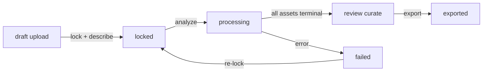

# Microstock — product domain

AI-assisted microstock asset management (`kind => product`, `locked => true`) built on an Archivd **system workspace**. Invariants an agent must obey: [.cursor/rules/microstock.mdc](../../../.cursor/rules/microstock.mdc).

Microstock turns a folder of uploaded images into marketplace-ready metadata. A folder inside a Microstock workspace is a **collection**: it is described once, locked, analyzed by a two-stage AI pipeline (vision → thinking), curated by hand, exported as CSV, and — opt-in, additively — pushed to a marketplace over SFTP. Upload/storage reuses Archivd quota; the AI stages are prepaid and metered per HTTP call. Access is opt-in through a slot entitlement, not through the product activation row. Code lives in `app/Domain/Microstock/`; collections live on `ARCHIVD_folders` columns.

| Need | Path |
|------|------|
| Code | `app/Domain/Microstock/` |
| Config | [`config/microstock.php`](../../../config/microstock.php) · [`config/products.php`](../../../config/products.php) key `Microstock` |
| API | `routes/api/v1/microstock.php` · admin `routes/api/v1/admin-microstock.php` |
| Jobs / commands | `ProcessCollection`, `AnalyzeAssetVision`, `AnalyzeAssetThinking`, `AnalysisWatchdog`; `microstock:queue-work` |
| SPA routes | `archivd.microstock-credentials`, `archivd.microstock-usage`, `settings.microstock` + the collection toolbar inside `archivd.index` |
| Rate card | [inference README](../inference/README.md) — provider rates; Microstock applies `markup_multiplier` |
| Tests | `tests/Domain/Microstock/` |
| Pakem | [.cursor/rules/microstock.mdc](../../../.cursor/rules/microstock.mdc) |
| Deep dive | [reference.md](reference.md) — activation, workspaces, billing · [reference-pipeline.md](reference-pipeline.md) — collections, AI pipeline, prompts, variants · [reference-api.md](reference-api.md) — API, SPA surfaces, CSV export, marketplace upload, ops · [reference-marketplace-upload.md](reference-marketplace-upload.md) — upload decision record |
| Sub-topics | [daily-free-trial.md](daily-free-trial.md) · [billing-edge-cases.md](billing-edge-cases.md) |
| Storage engine | [archivd README](../archivd/README.md) — upload/quota/share behavior is Archivd's |

## Lifecycle

