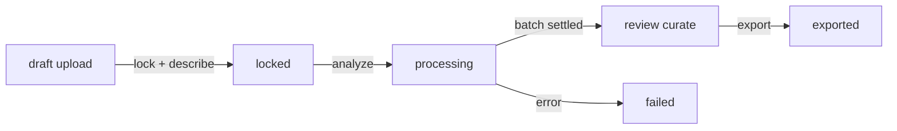

# Microstock — product domain

Product domain (`kind => product`, `locked => true`) for microstock asset management on top of the File Hosting base storage layer. Assets live in built-in **system workspaces** (`file_hosting_workspaces.kind = 'microstock'`, standalone slots) and reuse the entire FH upload/browse/quota/download pipeline. Microstock adds AI metadata (title/keywords), CSV metadata export, and envelope-encrypted marketplace credentials.

| | |
|--|--|
| Code | `app/Domain/Microstock/` |
| Config | [`config/microstock.php`](../../../config/microstock.php) |
| API | `routes/api/v1/microstock.php` |
| Web | `routes/web/microstock.php` |
| Seeder | `MicrostockRoleSeeder` (Beta tester role + Public visibility) |
| Product gate | `product.active:Microstock` middleware |
| Menu | **No dynamic sidebar menu** (removed) — reached via `/services` and the File Hosting workspace switcher |
| Storage class | **Product storage** — consumes the free-tier base (see [File Hosting — Storage classification](../file-hosting/README.md#storage-classification-core-vs-product)) |
| Quota pool | Shared with File Hosting (one `UserQuota` byte pool) |
| Fulfillment target | **`microstock`** (standalone — NOT `file_hosting`; see activation below) |

## Activation model (via `/services`)

Microstock is **opt-in**, activated by purchasing a service catalog SKU from `/services` — it is never auto-provisioned. Two SKUs (seeded by `ServiceCatalogSeeder`, codes in `App\Domain\Service\Support\MicrostockCatalog`):

| code | name | interval | plan_kind | entitlement | storage_bytes | price |
|-----|------|----------|-----------|-------------|---------------|-------|
| `microstock.plan.free` | Microstock Workspace (Free) | `once` | `main` | `microstock_workspace_slots` | 0 | $0 |
| `microstock.addon.workspace-slot.monthly` | Microstock Workspace Slot | `monthly` | `addon` | `microstock_workspace_slots` | 0 | $1 |

- **Free registration** (`microstock.plan.free`, $0 one-time): the activation gate. Purchasable **once** (`ServiceCheckoutService` throws 422 `api/services.already_activated` on rebuy; unique `(user_id, service_id)` entitlement key is the backstop). Being $0 it is **zero-charge**: `isZeroCharge()` skips the payment gateway, the purchase is immediately `Paid` (`fx_provider = zero_charge`), and fulfillment runs inline. Grants `quantity = 1`, `ends_at = null` (permanent). With `fulfillment_target = 'microstock'`, `ProductRegistry::productKeyByFulfillmentTarget` maps it to the `Microstock` product and `ServiceFulfillmentService::ensureProductActive` activates it **implicitly** (no quota recompute — that only happens for `file_hosting` targets).
- **Slot addon** (`microstock.addon.workspace-slot.monthly`, $1 monthly): repeatable and **compounding** — each paid unit increments `quantity` on the active entitlement via `activateAddon`. Buying 10 units grants 10 extra Microstock workspace slots. Shares the addon anniversary stack with FH addons (`MainPlanChangeCalculator` / `extendAllAddons` cover both `file_hosting` and `microstock` addon targets).
- **UX**: `/services` shows a dedicated Microstock card with an **Activate free** button (disabled + "Active" badge once active) and a **Buy slot** button (visible once active) posting to the normal `services.checkout` flow.

## System workspaces (base storage)

Microstock assets live in `file_hosting_workspaces.kind = 'microstock'` rows — real workspaces, so all FH services (browse, upload, folders, members, activity, realtime) work unchanged. Unlike team workspaces, Microstock slots are **standalone**: they do NOT overlap or interchange with the FH team workspace slots (`file-hosting.addon.workspace-slot.monthly`). Owners may have **multiple** Microstock workspaces when their slot limit allows.

| Rule | Behavior |
|----|----------|
| Slot limit | `WorkspaceAccessService::microstockSlotLimit($ownerId)` = `BASE_WORKSPACE_SLOTS (1)` when `ServiceEntitlementService::hasActiveMicrostockWorkspaceSlot` is true, `+ microstockWorkspaceSlotExtraQuantity` (sum of active/grace slot-addon quantities). **0** when never activated |
| Provisioning gate | `WorkspaceService::systemWorkspaceFor` and `createSystemWorkspace` call `assertCanProvisionMicrostockWorkspace` before creating (`kind->isSystem()` only; team path unchanged). `422 api/microstock.workspace_not_activated` when limit is 0, `422 api/microstock.slot_limit` when full. Resolving an **existing** workspace is never gated |
| Activation gate | `MicrostockService::workspaceFor`/`createWorkspace` additionally throw `MicrostockException` 403 `workspace_not_activated` without an active slot entitlement |
| Slot accounting | `countActiveOwned` counts only `kind = 'team'`; `countActiveOwnedMicrostock` counts `kind = 'microstock'`. Neither pool sees the other, so Microstock never raises `owned_workspace_used` |
| Multi-workspace | Spare slots allow extra workspaces via `POST /api/v1/microstock/workspaces` or the switcher |
| Free users | The Microstock slot is independent of the FH paid/free plan; inviting still requires a paid FH main plan |

### No auto-provision on File Hosting

`FileManagerController@index` does **not** create the Microstock workspace. It appears in the FH switcher only after activation (and provisioning) via `/services`. `GET /microstock` (`microstock.index`) redirects to `/services` with an error flash when not yet activated.

## Usage & limits

| Rule | Behavior |
|----|----------|
| Access | Requires an active Microstock slot entitlement (free registration or slot addon) |
| Public share | **Blocked** — files/folders in a system workspace can never be `anyone_with_link`. `VisibilityService::assertSystemWorkspaceShareAllowed` rejects enable (422 `public_share_not_allowed`); guest `fileAccessible`/`folderAccessible` return false |
| Invite | Only a **paid FH** owner may invite (`WorkspaceService::invite` → `assertOwnerEligibleForCollab`); invitees may be free or paid |
| Upload/browse/download | Reuse File Hosting services as-is. **Content collaboration is NOT paid-gated:** a free Microstock owner can upload into their collections, and an invited member (free or paid) can upload into a shared workspace. Upload only requires mutate access (`assertCanMutate` — owner or active member). The paid gate (`assertOwnerEligibleForCollab`) applies to **sharing** (invite/accept) and **creating workspaces**, never to putting content into one |

## Collections (folder-as-collection lifecycle)

A **folder** inside a Microstock workspace is a **collection** — the unit the AI processes. Uploads must live inside a collection, never the workspace root. Collection state lives directly on `file_hosting_folders` (migration `2026_07_26_100001`), driven by `App\Domain\FileHosting\Enums\CollectionStatus` and `App\Domain\Microstock\Services\CollectionService`.

| Step | Behavior |
|----|----------|
| Upload gate | `DirectUploadService::initiate` rejects (422) a Microstock workspace upload with no `folder_id` (`microstock.error_requires_folder`) or into a locked collection (`microstock.error_collection_locked`). Client mirrors this via dropzone `data-workspace-kind` / `data-collection-locked` |
| Lock + describe | `POST collections/{folder}/lock` stores the owner's `collection_hint` + sets `locked` + `collection_locked_at`. Allowed from draft/failed (re-lock retries a failed run). Uploads stop here |
| Analyze | `POST collections/{folder}/analyze` (requires `locked`, non-empty) sets `processing` and dispatches `ProcessCollection` |
| Pipeline | `ProcessCollection` seeds a pending metadata row per file **directly in the folder (non-recursive)**, then dispatches a single `AnalyzeCollectionBatch` carrying `collection_hint`. The batch processes **one chunk per invocation** and **dispatches itself** with the remaining ids (chained) so the whole collection stays long-running without ever exceeding `retry_after`; the final invocation flips the folder to `review`. Sub-folders are separate collections and are NOT processed |
| Curate | Per-file manual edit via `PATCH assets/{file}/metadata` (existing finalize) while in `review` |
| Export | `POST collections/{folder}/export` (requires `review`) renders a CSV of the folder's finalized metadata, persists it to `microstock.csv_disk`, saves `collection_csv_path`, sets `exported`. `GET collections/{folder}/download` streams it |

`collection_status` is NULL for ordinary File Hosting folders — only Microstock collections use these columns. `Folder::isCollectionLocked()` is true for locked/processing/review/exported.

## Metadata (AI: vision → thinking → manual)

Microstock's value is metadata. The owner **hint** (collection description) grounds every file's metadata. Both AI stages follow **Adobe Stock / Shutterstock 2026 contributor standards** — natural-sentence titles, a 4-tier keyword framework, and a fixed marketplace category set.

1. Per collection: `ProcessCollection` (above) creates/resets a `microstock_asset_metadata` row per file (`status = pending`) and dispatches the chained `AnalyzeCollectionBatch` with the hint. Each batch invocation sends one multi-image request per chunk (`microstock.ai.batch_chunk`); assets the batch omits fall back to a per-file `generate`. (Single-asset `POST assets/{file}/analyze` → `MicrostockService::requestAnalysis` still runs a standalone `AnalyzeAssetMetadata`, hint optional.)
2. The job mints an inline signed URL (`SignedDownloadService::resolve($file, inline: true)`) and calls `AiMetadataService::generate($url, $hint)`.
3. **Vision** stage drafts `title` + `description` + `category` + `keywords` from the image (with the hint structured as a `## COLLECTION CONTEXT (commercial ground truth)` block in `Prompts::visionUser`); **thinking** stage curates them against an explicit checklist (`Prompts::thinkingSystem`) — dedupe, drop generic/spam, enforce top-10 ordering, inject missing concepts, validate the category, enforce the marketplace bans. Prompts are hardcoded in `App\Domain\Microstock\Support\Prompts` (English).
4. Result stored with `status = generated`.
5. Final curation is **manual**: user edits title/keywords → `PATCH assets/{file}/metadata` → `status = finalized`.

### Prompt strategy (marketplace-aligned)

`Prompts::marketplaceRules()` is the single source injected into **both** stages so they never drift:

- **Title** — natural descriptive sentence (not a keyword list), 40–70 chars, no commas, no trademark/real-people/camera-spec, no subjective quality adjectives ("cute", "beautiful", "best" — Adobe rejects these).
- **Description** — one factual sentence (who/what/where/action).
- **Category** — exactly one of: People, Lifestyle, Education, Business, Food, Nature, Technology, Health, Holidays, Abstract, Objects, Illustration.
- **Keywords** — 15–35 terms, **ordered by relevance** (the first 10 carry the most search-ranking weight), built across 4 tiers: **literal** (subject/action/setting) → **contextual** (demographics/season) → **conceptual** (ideas/emotions buyers search: childhood, togetherness, fitness, security) → **stylistic** (art direction/palette). Singular nouns + infinitive verbs, one concept per keyword, no same-word-stem repeats.

### Deterministic requests

All three request builders (`vision()`, `thinkingRequest()`, `generateBatch()`) send `temperature = 0.2` + `max_tokens` (2000 single / 4000 batch) so the JSON output is deterministic and never truncated mid-array.

### Prompt-length constraint (verified)

The combo `vision` gateway model **chokes on long system prompts when an image is attached** — verified 2026-07-27: a ~1700-char system prompt returns **HTTP 524** (Cloudflare origin timeout) at ~125 s, while ~1050 chars returns **200** in ~107 s. `Prompts::marketplaceRules()` is therefore intentionally dense — keep the system prompts compact. If a future gateway model never responds acceptably, point `ai.vision.model` to a sturdier model (e.g. `cx/gpt-5.5`, which handled the full verbose prompt in ~97 s) via `MICROSTOCK_AI_VISION_MODEL`.

`AiMetadataService` is an interface; the default binding `HttpAiMetadataService` posts to OpenAI-compatible chat-completions endpoints. Each stage is independently configurable in `config/microstock.php` (`ai.vision.*`, `ai.thinking.*`: endpoint/model/api_key/timeout, env-driven). Tests bind a stub.

### Adaptive timeout & watchdog

The vision/thinking stages run **multi-step reasoning with no predictable duration**, so failure is **not a per-request hard HTTP timeout** — it is a **phase deadline measured from elapsed activity**. A short client timeout aborts an otherwise-valid generation (`cURL error 28: Operation timed out ... 0 bytes received` is the client cutting the connection, not a dead model), and a fixed cap cannot tell "AI is thinking" from "AI is hung".

Instead, each asset moves through three derived phases, measured from when its metadata row was queued (`microstock_asset_metadata.created_at`):

| Phase | Elapsed | Meaning | UI |
|----|----|----|----|
| `analyzing` | `< normal_after` (default 600s) | AI is processing | normal progress |
| `degraded` | `normal_after .. grace_after` (600–1500s) | still waiting, slow | show **degraded performance** warning |
| `failed` | `> grace_after` (1500s) | hung / worker died | marked failed |

`phase` is **presentational/derived** — never persisted. `metadata.status` stays `pending/generated/finalized/failed`; `degraded` only appears in the `phase` field of the collection `status()` payload and the per-file `microstock` resource payload. Budgets are tunable via `MICROSTOCK_AI_PHASE_NORMAL` / `MICROSTOCK_AI_PHASE_GRACE`.

**Watchdog as single failure authority.** `ProcessCollection` dispatches `App\Domain\Microstock\Jobs\AnalysisWatchdog` alongside the first batch. The watchdog re-dispatches itself every 60s while any collection is `processing` and:
1. flips any `pending` metadata older than `grace_after` to `failed` (`error = 'Analysis exceeded the grace period'`) — this covers both a hung AI call and a **zombie** row whose worker died (e.g. Windows `queue:work` exit);
2. a `processing` folder whose metadata are all terminal → `review` (if some succeeded) or `failed` (if none).

**Constraint:** `grace_after` must stay **below** the queue `DB_QUEUE_RETRY_AFTER` (1800s) so the watchdog declares failure *before* the queue re-dispatches the still-running batch job. `HttpAiMetadataService::timeoutSeconds` clamps the per-request client timeout to the same `grace_after` ceiling, so a long-but-valid analysis is never cut before the watchdog decides. `AnalyzeCollectionBatch::$tries` stays `2` so one Laravel retry tolerates a transient failure before the watchdog declares terminal failure.

As a safety net, `HttpAiMetadataService::thinking()` still degrades gracefully if a request genuinely fails:

1. Attempt A: normal `system` + `user` messages.
2. Attempt B: instructions fused into a single `user` message (no `system` role) when A throws/times out.
3. Fallback: if both fail, the **vision draft is kept** (`raw.thinking = null`) so the asset still reaches `status = generated`. Each failure is `report()`ed.

`Prompts::thinkingSystem()` is intentionally short (a single dense paragraph). If a gateway model never responds acceptably, point `ai.thinking.model` to a different model via `MICROSTOCK_AI_THINKING_MODEL`.

| Column | Notes |
|----|-------|
| `microstock_asset_metadata` | `file_id` (unique FK to `file_hosting_files`), `user_id`, `title`, `keywords` json, `category`, `description`, `status` (`pending`/`generated`/`finalized`), `ai_raw` json, `error` |

## CSV export

Two scopes, both finalized-only. Columns are config-driven (`microstock.csv.columns`, default `filename,title,description,category,keywords`; `microstock.csv.keywords_separator`). Per-marketplace field mapping is a later iteration.

- **Per collection** (primary): `CsvExportService::buildForCollection($folder)` — finalized metadata of files directly in the folder. Persisted to `microstock.csv_disk` (default `local`) at `microstock/collections/{folder}.csv` on export.
- **Whole workspace**: `CsvExportService::build($owner)` — all finalized metadata in the Microstock workspace (legacy/ad-hoc).

## Marketplace credentials

`microstock_marketplace_credentials` stores per-user marketplace connection secrets (host/username/password/port/…) for the future FTP/API auto-upload. `secret_payload` uses the shared **envelope encryption** cast (`EnvelopeEncryptedArray`, resource type `microstock_marketplace_credentials`) — the same KEK/DEK infra as payment/vTual credentials; plaintext never reaches the DB. MVP only stores/lists/deletes credentials; no auto-upload yet.

## API (`/api/v1/microstock/*`, `auth:api`)

Middleware: `auth:api` → `domain.access:Microstock` → `product.active:Microstock`.

| Method | Path | Purpose |
|------|---------|---------|
| GET | `workspace` | Resolve (lazy-create, gated) the owner's system workspace |
| GET | `slots` | Slot status snapshot (`activated`, `used`, `limit`, `can_create`) |
| POST | `workspaces` | Create an additional Microstock workspace (slot-gated) |
| POST | `assets/{file}/analyze` | Queue AI metadata analysis (202) |
| GET | `assets/{file}/metadata` | Read current metadata row |
| PATCH | `assets/{file}/metadata` | Finalize manual curation (`title`, `keywords[]`) |
| GET | `credentials` | List marketplace credentials |
| POST | `credentials` | Store credential (`marketplace`, `label`, `secret{}`) |
| DELETE | `credentials/{id}` | Delete credential |
| POST | `collections/{folder}/lock` | Lock collection + store hint (`hint`) |
| POST | `collections/{folder}/analyze` | Start the per-file AI pipeline (202) |
| GET | `collections/{folder}/status` | Status + progress snapshot (incl. derived `phase`) |
| POST | `collections/{folder}/export` | Render + persist collection CSV |
| GET | `collections/{folder}/download` | Stream the exported collection CSV |

## Web

| Route name | Purpose |
|----------|---------|
| `microstock.index` | Redirects into the File Hosting SPA pinned to the Microstock system workspace (`/file-hosting?workspace_id=…`); redirects to `/services` when not activated |
| `microstock.export.csv` | Stream-download the finalized metadata CSV |
| `file-hosting.microstock.slots` | Thin web hop → `GET /api/v1/microstock/slots` (for the switcher UI) |
| `file-hosting.microstock.workspaces.store` | Thin web hop → `POST /api/v1/microstock/workspaces` (switcher "New Microstock workspace") |
| `file-hosting.microstock.collections.lock` / `.analyze` / `.status` / `.export` | Thin web hops → the matching collection API endpoints (SPA collection toolbar) |
| `file-hosting.microstock.collections.download` | Direct service download of the exported collection CSV |
| `file-hosting.microstock.assets.preview` | Signed inline preview URL `{url}` for the review panel (`SignedDownloadService::resolve($file, inline: true)` after `MicrostockService::resolveAsset`) |
| `file-hosting.microstock.assets.metadata.show` / `.update` / `.analyze` | Thin web hops → `GET`/`PATCH` `assets/{file}/metadata` + `POST assets/{file}/analyze` (review panel) |

### Collection UI (SPA)

Inside a Microstock collection folder the SPA toolbar shows a **Lock & Describe** button (`#fhCollectionDescribeModal` → lock + analyze) and a persistent status banner (`collection_status`: locked/processing/review/exported/failed). The button morphs per status — Lock & Describe (draft/failed) → Export CSV (review) → Download CSV (exported) — driven by `updateCollectionUi()` fed from the browse payload (`folder.collection_status`) and the status endpoint. Upload into a locked collection / workspace root is blocked client-side (dropzone gate) and server-side (`DirectUploadService`).

### Switcher multi-workspace UI

The File Hosting workspace switcher fetches `file-hosting.microstock.slots` at runtime and renders one entry:

- not activated → "Activate Microstock" link to `/services`
- `can_create` → "New Microstock workspace" button → POSTs, then soft-navigates into the new workspace
- full → disabled "Microstock slots full" note

After a successful create (and after every switcher refetch) the SPA rebuilds the whole workspace item list from `lastWorkspaces` (`renderWorkspaceMenuItems`) and re-runs `refreshMicrostockSlotSection`, so the new workspace appears and the button state updates immediately — no hard reload.

### Review UI (curate metadata)

The curate step of the collection lifecycle lives directly in the file-manager listing:

- **Per-file metadata status** — `FolderService::browse` eager-loads `HostedFile::microstockMetadata` when the workspace `kind` is `microstock`, and `HostedFileResource` exposes a `microstock` key (`{title, keywords, status}`, `null` = no row yet) via `whenLoaded`. The listing renders a status badge (pending/generating/finalized/no-metadata) next to the file name and a **Review** action button (`bi-stars`, `data-fh-ms-review`) — in both the JS re-render (`listing-ui.js`) and the Blade SSR (`_microstock-badge` partial).
- **Side panel** — clicking Review opens a Bootstrap offcanvas (`#fhMicrostockPanel`) driven by `microstock-panel.js`. It fetches the signed inline preview (`assets/{file}/preview`) into an ``, loads current metadata, renders keywords as removable chips (Enter/comma/blur adds), and saves via `PATCH assets/{file}/metadata` → marks the row finalized and refreshes collection status. **Re-analyze** POSTs `assets/{file}/analyze`. Chip add/remove pure helpers (`normalizeKeywords`, `parseKeywordInput`) are unit-tested in `microstock-panel.test.js`.
- **Progress polling** — while `collection_status === 'processing'` the SPA polls `collections/{folder}/status` every 3 s and the banner shows a spinner + `Analyzed :processed of :total` from the status payload. Polling stops on any other status or when leaving the collection.
- **Review shortcut** — in `review` state a secondary **Review files** toolbar button opens the panel for the first listed file.

## Tests

`php artisan test --filter="MicrostockTest|CollectionLifecycleTest|CollectionApiTest"` —
- `MicrostockTest`: provisioning gated by entitlement (403 without), slot-limit multi-workspace create, public-share block, analyze → generate (stub AI), finalize curation, CSV export finalized-only, credential encrypt/decrypt roundtrip, invite paid-gate. Checkout coverage in `ServiceCheckoutZeroChargeTest`.
- `CollectionLifecycleTest`: root-upload blocked (422), locked-collection upload blocked, lock requires hint + transitions + rejects re-lock + rejects non-microstock folder, analyze requires lock/files + dispatches `ProcessCollection`, non-recursive batching (sub-folder untouched), empty→failed, **chained batch** (chunk → self-dispatch → `review` only after the last chunk), prompt hint threading (`Prompts::visionUser`/`thinkingUser`), status progress counts, per-collection CSV filter, export persists CSV + marks exported.
- `CollectionApiTest`: HTTP lock/analyze/status/export/download endpoints (auth, validation, transitions, foreign-collection 403), browse exposes `microstock` key per file in a Microstock workspace (omitted in personal), per-file metadata show/finalize/re-analyze + signed preview web hops (`FileManagerControllerTest`).

## Operations: queue worker

All Microstock AI jobs (`ProcessCollection`, `AnalyzeCollectionBatch`, `AnalyzeAssetMetadata`, `AnalysisWatchdog`) run on the `default` queue, so a worker must be running for analysis to progress: `php artisan queue:work` (or `queue:listen`). Single-asset runs can be dispatched synchronously in Tinker for a quick check. The `AnalysisWatchdog` is dispatched automatically by `ProcessCollection` and re-arms itself while any collection is `processing` — it is what flips hung/zombie analyses to `failed` past the grace period.

### Finding: `queue:work` exits on Windows/Laragon (environment, not a code bug)

On Laragon/Windows, `php artisan queue:work` **exits back to the shell prompt right after a job finishes (`DONE`)** instead of staying alive as a daemon. Consequence: the next queued job is never picked up until you re-run the command manually.

- Cause: the Windows PHP CLI build (ZTS) ships **without `pcntl`/`posix`** (verified `pcntl: False`, `posix: False`), so the daemon's signal-based loop is not stable as a long-running process on Windows. `max_execution_time=0` (no PHP timeout), and no `--once`/`--stop-when-empty` was used.
- Not the app: there is no `shouldQuit` / `stopWhenEmpty` / `queue:restart` / `exit` in `app/`, `bootstrap/`, or `routes/console.php` that would stop the worker. The same `queue:work` stays alive on Linux (which has `pcntl`).
- Production: run the worker on Linux, or keep it alive under Windows with a watchdog — e.g. a restart-loop (`.bat` that re-launches `queue:work` when it exits), Windows Task Scheduler / a service with auto-restart, or for local dev `php artisan queue:listen --tries=1` (respawns per job) / `composer run dev`.

## Explicitly out of scope (MVP)

- FTP/API auto-upload to marketplaces (CSV-only for now; phpseclib next iteration).
- Concrete AI provider lock-in — interface + HTTP client is enough; tests stub it.
- Per-marketplace metadata field mapping (generic CSV).

## Related

- [file-hosting/README.md](../file-hosting/README.md) — base storage layer, system workspaces, storage classification
- [payment-gateway/encryption.md](../payment-gateway/encryption.md) — envelope encryption infra
- [service/README.md](../service/README.md) — entitlements / quota fulfillment
