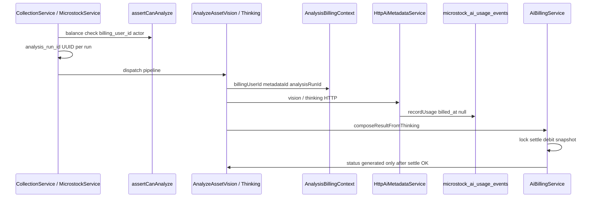

# Microstock AI billing — edge cases and hardening

Companion to [README § AI billing](README.md#ai-billing-prepaid-credits). Documents usage/billing behavior for the vision → thinking pipeline so successful provider work is recorded, settled, and auditable.

**Operator UI:** reconcile `microstock_ai_usage_events` and `microstock_ai_credit_transactions` against the **Usage & balance** page (`GET /apps/archivd/microstock/usage`) — prepaid ledger tab, AI usage detail tab, and (Root / Admin / Moderator) **Platform overview** tab. See [Usage & balance UI](README.md#usage--balance-ui).

## Flow (post-hardening)



## Identity columns

| Column | Table | Purpose |
|--------|-------|---------|
| `billing_user_id` | `microstock_asset_metadata` | User debited and gated at analyze time (actor who triggered analyze) |
| `analysis_run_id` | `microstock_asset_metadata`, `microstock_ai_usage_events` | Segments usage per analyze/re-analyze attempt |
| `attempt_index` | `microstock_ai_usage_events` | Thinking retry sequence within one run |
| `provider_request_id` | `microstock_ai_usage_events` | OpenAI-compatible response `id` for 9Router reconciliation |
| `voided_at` | `microstock_ai_usage_events` | Reserved for future void policy (unused in production path) |
| `consolidated_at` | `microstock_ai_usage_events` | Set when provisional-model consolidation reconciles a settled row |
| `consolidation_adjustment_micro_usd` | `microstock_ai_usage_events` | Prepaid billable delta from consolidation (`adjustment` ledger) |

## Settlement policies

| Outcome | Settle behavior |
|---------|-----------------|
| Thinking succeeds | `composeResultFromThinking`: DB transaction → thinking snapshot → `settleSuccessfulAnalysis` (all unbilled events for current `analysis_run_id`) → `status = generated` |
| Thinking fails, vision OK | `markThinkingFailed` → `settlePartialVisionUsage` (vision-stage events only, `ai_billing.partial = true`) |
| Vision fails | No settle (no successful deliverable stage) |
| `billing_source = daily_free` | Settle records provider cost; **skip** prepaid debit; `ai_billing.source = daily_free`, `billable_micro_usd = 0` |
| Balance below billable at settle | **Settle proceeds** — `AiCreditService::debit` allows negative balance. Metadata promotes to `generated`; events get `billed_at`. New paid analyze is gated at `planAnalyze` (`balance >= 0` and estimate). Top-up via Services restores balance toward zero. |

Partial then full success (retry after vision-only charge): `settleSuccessfulAnalysis` runs when `ai_billing.partial = true`, debiting only remaining unbilled events (typically thinking), and merges totals into a non-partial `ai_billing` snapshot.

## Provisional model consolidation

After ops curates provider rates for a model that was billed provisionally, `UnknownModelBillingConsolidationService` reconciles settled prepaid usage whose snapshot `rate_source = unknown_provisional` (same provider + model slug, `consolidated_at` null). Cheaper curated rate → `adjustment` credit; more expensive → `adjustment` debit (balance may go negative). Daily-free rows update reporting fields only. See [Inference — unknown model workflow](../inference/README.md#unknown-model-workflow) and [README § Provisional model consolidation](README.md#provisional-model-consolidation).

## Idempotency and race guards

| Risk | Mitigation |
|------|------------|
| Vision job retry after `ai_vision = ok` | `AnalyzeAssetVision` skips HTTP; re-dispatches thinking only |
| Watchdog + vision both dispatch thinking | `tryClaimThinkingRunning` (row lock) + `WithoutOverlapping` per `metadata_id` on thinking job |
| Double settle on same asset | `ai_billing` snapshot guard; events marked `billed_at` |
| Re-analyze mixing runs | New `analysis_run_id`; settle filters events by current run |

## Config knobs

Tunable in **Settings → Microstock** — see [configuration-policy.md](../../platform/configuration-policy.md).

| Registry key | Config path | Default | Notes |
|--------------|-------------|---------|-------|
| `microstock.ai_billing.estimated_billable_micro_usd_per_asset` | `microstock.ai_billing.estimated_billable_micro_usd_per_asset` | `150000` | Per-asset gate buffer (~$0.15) |
| `microstock.ai_billing.estimate_thinking_attempt_factor` | `microstock.ai_billing.estimate_thinking_attempt_factor` | `1.5` | Gate multiplier for multi-attempt thinking |
| `microstock.ai.http_retries` | `microstock.ai.http_retries` | `0` | Keep at 0 for billed calls (retries may charge provider without a matching usage row) |
| `microstock.ai.thinking_visual_attempts` | `microstock.ai.thinking_visual_attempts` | `2` | Each attempt with HTTP `usage` creates a separate event |

## Monitoring SQL

```sql
-- Per asset in a collection: HTTP calls vs billed
SELECT asset_metadata_id, stage,
       COUNT(*) AS http_calls,
       SUM(billable_micro_usd) AS billable,
       SUM(CASE WHEN billed_at IS NULL THEN 1 ELSE 0 END) AS unbilled_rows
FROM microstock_ai_usage_events
WHERE folder_id = :folder_id
GROUP BY asset_metadata_id, stage;

-- Generated without billing snapshot (should be empty)
SELECT id, file_id, status, ai_billing
FROM microstock_asset_metadata
WHERE status = 'generated'
  AND (ai_billing IS NULL OR ai_billing = 'null');

-- Failed assets with unbilled vision (partial settle should have run)
SELECT e.asset_metadata_id, e.stage, SUM(e.billable_micro_usd) AS unbilled
FROM microstock_ai_usage_events e
JOIN microstock_asset_metadata m ON m.id = e.asset_metadata_id
WHERE e.billed_at IS NULL
  AND m.status = 'failed'
  AND m.ai_vision->>'$.status' = 'ok'
GROUP BY e.asset_metadata_id, e.stage;

-- Reconcile by analysis run
SELECT analysis_run_id, stage, COUNT(*), SUM(billable_micro_usd)
FROM microstock_ai_usage_events
WHERE asset_metadata_id = :metadata_id
GROUP BY analysis_run_id, stage;
```

## Probes and `generate()`

`HttpAiMetadataService::generate()` and `generateBatch()` do not set `AnalysisBillingContext` — usage is intentionally not recorded unless a probe wraps `AnalysisBillingContext::run`. Production paths always set context in `AnalyzeAssetVision` / `AnalyzeAssetThinking`.

## Provider dashboard vs app events

Production records **one vision HTTP per asset** (`analyzeVision`). A 9Router log showing two `claude-sonnet-5` lines adjacent to one `gpt-5.6-luna` line often reflects dual-lane overlap (two files) or provider-internal logging, not duplicate vision per file in app code. Use `provider_request_id` on usage events to reconcile.

## Tests

`tests/Domain/Microstock/Unit/Services/MicrostockBillingHardeningTest.php` covers settle-before-generated, partial vision settle, run-id filtering, vision idempotency, thinking claim races, and post-hoc settle with negative balance when prepaid funds are insufficient at debit time. `UnknownModelBillingTest` covers provisional notify, consolidation, and `planAnalyze` gate.
