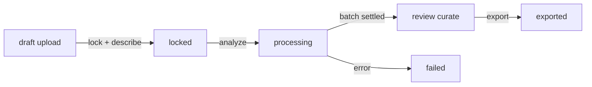
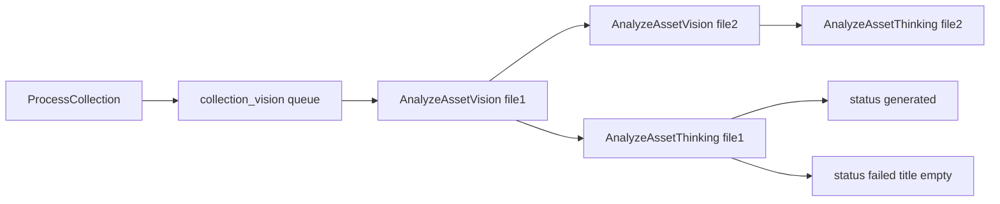

# Microstock - collections & AI metadata pipeline

> Part of the Microstock deep dive. Siblings: [reference.md](reference.md) - activation, workspaces, billing · [reference-api.md](reference-api.md) - API, SPA surfaces, CSV export, credentials, ops.

## Collections (folder-as-collection lifecycle)

A **folder** inside a Microstock workspace is a **collection** — the unit the AI processes. Uploads must live inside a collection, never the workspace root. Collection state lives directly on `ARCHIVD_folders` (the `collection_*` columns of `2026_07_15_100001_create_archivd_tables.php`), driven by `App\Domain\Archivd\Enums\CollectionStatus` and `App\Domain\Microstock\Services\CollectionService`.



| Step | Behavior |
|----|----------|
| Upload gate | `DirectUploadService::initiate` rejects (422) a Microstock workspace upload with no `folder_id` (`microstock.error_requires_folder`) or into a locked collection (`microstock.error_collection_locked`). Client mirrors this via dropzone `data-workspace-kind` / `data-collection-locked` |
| Lock + describe | `POST collections/{folder}/lock` stores the owner's `collection_hint` (single text field, max 2000, nullable) + `collection_billing_mode` (`free`/`paid`) + sets `locked` + `collection_locked_at`. Allowed from draft/failed (re-lock retries a failed run). Uploads stop here. **SPA UI:** `ArCollectionDescribeModal.vue` collects structured sections (Primary concept, Visible subjects, Buyer intent, Style & mood, Additional notes). All sections are optional; they compose into a multi-line hint before lock. A mandatory **Free / Paid** billing-mode selector appears when `microstock.daily_free.enabled` is on; when Free is disabled the selector is hidden and every analysis is forced to `paid`. Submitting with no content warns via `confirmDialog()` that blind locking usually produces poor, inconsistent AI metadata. |
| Analyze | `POST collections/{folder}/analyze` (requires `locked`, non-empty) sets `processing` and dispatches `ProcessCollection` |
| Pipeline | `ProcessCollection` seeds a pending metadata row per file **directly in the folder (non-recursive)** with decoupled stage columns (`ai_vision`, `ai_thinking`, `ai_result`), then dispatches one `AnalyzeAssetVision` job per file on the **collection vision** queue (FIFO by file name). Each vision persists `ai_vision` and dispatches `AnalyzeAssetThinking` on the **collection thinking** queue. **Dual-lane pipeline:** configurable concurrent vision + thinking jobs per folder (default **3+3**), capped globally by upstream limits (see [Upstream limits](#upstream-limits)); vision file N+1 may run while thinking file N runs. Collection `review` when **all** assets are terminal (watchdog / thinking completion). Sub-folders are separate collections and are NOT processed |
| Curate | Per-file manual edit via `PATCH assets/{file}/metadata` (existing finalize) while in `review` |
| Export | `POST collections/{folder}/export` (requires `review`) renders a CSV of the folder's finalized metadata, persists it to `microstock.csv_disk`, saves `collection_csv_path`, sets `exported`. `GET collections/{folder}/download` streams it |

`collection_status` is NULL for ordinary Archivd folders — only Microstock collections use these columns. `Folder::isCollectionLocked()` is true for locked/processing/review/exported.

## Metadata (AI: vision → thinking → manual)

Microstock's value is metadata. The owner **hint** (collection description) grounds every file's metadata. Both AI stages follow **Adobe Stock / Shutterstock 2026 contributor standards** — natural-sentence titles, a 4-tier keyword framework, and a fixed marketplace category set.

1. Per collection: `ProcessCollection` resets each `microstock_asset_metadata` row (`status = pending`, stage columns cleared) and dispatches per-file `AnalyzeAssetVision` jobs on `microstock.queues.collection_vision`. On vision success each asset dispatches `AnalyzeAssetThinking` on `microstock.queues.collection_thinking`. Single-asset `POST assets/{file}/analyze` uses the **solo** queue (`microstock.queues.solo`) so re-analyze does not wait behind a large collection.
2. `VisionImageResolver` picks a persisted JPEG variant (`ai_512` / `ai_1024`) or falls back to ephemeral resize from the original. Delivery mode is `base64` (data-URI) or `url` (signed HTTPS to the variant object).
3. **Vision** drafts metadata into `ai_vision.output`. **Thinking** runs in a separate job, reads the vision draft, and on success fills `title`/`keywords`/`description`/`category` with `status = generated`. Thinking failure leaves `title`/`keywords` empty (`status = failed`) but preserves `ai_vision` for inspection/retry. Strict mode: `curateDraft()` returning `raw = null` counts as thinking failure (no vision-draft promotion). `generate()` (probes) still supports monolithic vision→thinking with legacy fallback.
4. Stage snapshots: `ai_vision`, `ai_thinking`, `ai_result` (each with `status`, timestamps, `error`, `output`/`stage_metrics`). Legacy `ai_raw` is aggregated on result composition for API compat. Billing: full settle in `composeResultFromThinking` (transactional, before `generated`); partial vision settle on thinking failure.
5. Final curation is **manual**: user edits title/keywords → `PATCH assets/{file}/metadata` → `status = finalized`.

### Stage decoupling (MVP) — dual-lane pipeline



| Lane | Queue (default) | Concurrency (default) | On success |
|------|-----------------|----------------------|------------|
| Collection vision | `microstock-collection-vision` | **3** per folder + **6** global vision cap | Dispatch thinking on collection thinking queue |
| Collection thinking | `microstock-collection-thinking` | **3** per folder + **10** global thinking cap + 1 per `metadata_id` (`WithoutOverlapping`) | `composeResultFromThinking` + `completeFolderIfReady` |
| Solo re-analyze | `microstock-solo` | **2** vision + **2** thinking (solo pool) | Vision → thinking on same solo queue |

### Upstream limits

Operational concurrency caps: **Settings → Microstock** (`microstock.ai.upstream.*`). See [configuration-policy.md](../../platform/configuration-policy.md).

Shared Open WebUI / 9Router account empirical ceiling: **~20M tokens / 30 min** (frontier models). Microstock allocates the full window to analysis throughput; enforcement is **concurrency caps** via `LimitAnalysisConcurrency` queue middleware (`config/microstock.php` → `ai.upstream`).

| Reference | Value |
|-----------|-------|
| `token_budget` | 20,000,000 (ops reference; not runtime-enforced in MVP) |
| `window_seconds` | 1800 (30 min) |
| Per-asset typical ceiling | ~20,000 tokens |
| Theoretical burst assets | ~1,000 / 30 min at 20k/asset |

| Registry key | Config path | Default | Purpose |
|--------------|-------------|---------|---------|
| `microstock.ai.upstream.max_concurrent_vision` | `microstock.ai.upstream.max_concurrent_vision` | `6` | Global in-flight vision jobs |
| `microstock.ai.upstream.max_concurrent_thinking` | `microstock.ai.upstream.max_concurrent_thinking` | `10` | Global in-flight thinking jobs |
| `microstock.ai.upstream.collection_vision_concurrency` | `microstock.ai.upstream.collection_vision_concurrency` | `3` | Per-collection folder vision cap |
| `microstock.ai.upstream.collection_thinking_concurrency` | `microstock.ai.upstream.collection_thinking_concurrency` | `3` | Per-collection folder thinking cap |
| `microstock.ai.upstream.solo_vision_concurrency` | `microstock.ai.upstream.solo_vision_concurrency` | `2` | Solo re-analyze vision pool |
| `microstock.ai.upstream.solo_thinking_concurrency` | `microstock.ai.upstream.solo_thinking_concurrency` | `2` | Solo re-analyze thinking pool |
| `microstock.ai.upstream.release_after_seconds` | `microstock.ai.upstream.release_after_seconds` | `15` | Seconds before a blocked job retries |

Reference only (not in registry): `token_budget` 20M, `window_seconds` 1800 — ops documentation, not runtime-enforced.

When a cap is full the job is **released** (not failed). Use **Redis** cache in multi-worker deploys so global counters are cluster-safe. If upstream still rate-limits, lower concurrency in **Settings → Microstock** — no code change needed.

| Stage column | Job | On failure |
|--------------|-----|------------|
| `ai_vision` | `AnalyzeAssetVision` | `ai_thinking` skipped; `ai_result` failed; row `failed` |
| `ai_thinking` | `AnalyzeAssetThinking` | `ai_result` failed; vision draft kept; row `failed` |
| `ai_result` | composed after thinking ok | — |

Per-stage watchdog grace: `microstock.ai.stage.vision_grace_after` (default 600s), `thinking_grace_after` (default 1800s). `thinking_backlog_after` (default 120s) re-dispatches thinking when vision completed but the thinking job was never queued (worker crash). API exposes `stages: {vision, thinking, result}` on `HostedFileResource` / `AssetMetadataResource`.

### Image variants (persisted derivatives)

Microstock raster uploads in a `kind = microstock` workspace trigger `GenerateFileVariants` after `DirectUploadService::complete`. JPEG sidecars are stored on the same Archivd disk (`ARCHIVD_file_variants`):

| Kind | Longest side | Typical use |
|------|--------------|-------------|
| `ai_512` | 512px | Faster vision / lower payload (probe matrix) |
| `ai_1024` | 1024px | Default vision quality |

**Quota:** ready variant `size` bytes count toward the owner's Archivd `used_bytes` (byte sum with the original `HostedFile.size`). See [Archivd — Quota](../archivd/reference.md#quota).

**Vision delivery** — **Settings → Microstock** (`microstock.ai.vision_image.*`):

| Registry key | Config path | Default | Purpose |
|--------------|-------------|---------|---------|
| `microstock.ai.vision_image.delivery` | `microstock.ai.vision_image.delivery` | `url` | `base64` = data-URI in JSON; `url` = signed HTTPS to variant |
| `microstock.ai.vision_image.signed_url_ttl_minutes` | `microstock.ai.vision_image.signed_url_ttl_minutes` | `30` | Signed URL minutes when `delivery=url` |

Variant kind (`ai_1024`) is a config literal (`microstock.ai.vision_image.variant_kind`), not in the registry.

When the configured variant is not `ready`, analyze logs `microstock.variants.not_ready` and falls back to ephemeral resize (`microstock.ai.image_max_px` / `microstock.ai.max_request_image_bytes` settings).

### Production stack (locked 2026-07-28)

Default config + Settings → Microstock (Tier B; local overrides in [`config/settings-local.php`](../../../config/settings-local.php)) use Open WebUI aliases for paid/prepaid analyses; **9Router** maps them to resolved models (verify in Open WebUI admin):

| Config alias | 9Router resolves to | Role |
|--------------|---------------------|------|
| `internal.vision` | `anthropic/claude-sonnet-5` | Image → draft metadata (conservative gender; strong scene read) |
| `internal.thinking` | `gpt-5.6-luna` | Multimodal VERIFY + SEO curation (`thinking_visual_attempts=2`) |

| Setting | Default | Notes |
|---------|---------|-------|
| Endpoint | bound `ai_connections` row | Both stages and tiers — endpoint + API key from the bound connection (empty slug = the default row), managed at Administration → AI connections |
| Vision connection | `microstock.ai.vision.connection` = `""` | Empty = the default `ai_connections` row; set a slug to give vision its own endpoint/key |
| Paid vision model | `microstock.ai.vision.model` = `internal.vision` | Settings → Microstock; used for `billing_source=prepaid` and calls without billing context |
| Free vision model | `microstock.ai.vision.free_model` = `""` | Empty inherits paid vision; set an Open WebUI alias to differentiate daily-free calls |
| Paid thinking model | `microstock.ai.thinking.model` = `internal.thinking` | Settings → Microstock |
| Free thinking model | `microstock.ai.thinking.free_model` = `""` | Empty inherits paid thinking |
| Stage timeouts | `microstock.ai.vision.timeout` / `.thinking.timeout` | Settings → Microstock (seconds); a connection-level `timeout_seconds` overrides both |
| Thinking connection | `microstock.ai.thinking.connection` = `""` | Empty = the default `ai_connections` row |
| `delivery` | `url` | Signed HTTPS to `ai_1024` variant (~341 B payload) |
| `variant_kind` | `ai_1024` | Settings → Microstock (`microstock.ai.vision_image.variant_kind`) |
| `thinking_visual_attempts` | `2` | First 2 thinking attempts include image + draft |

Model selection follows each asset's persisted `billing_source`, not the queue name. Mixed collections therefore use free models for daily slots and paid models for prepaid remainder; solo re-analysis follows its daily-first billing allocation. Alias selection is recorded on `microstock_ai_usage_events.alias_model`, while billing rates continue to use the provider response's `resolved_model`. After changing model settings in the UI (or re-seeding local overrides), restart queue workers so long-lived processes pick up new aliases from the settings snapshot.

`batch_chunk` / `batch_min_files` remain in config for `HttpAiMetadataService::generateBatch()` (probes only); the collection pipeline always uses per-file `analyzeVision()`.

Canonical probe write-up: [`archive/microstock-probes/sonnet5_gpt56_combo_summary.md`](../../archive/microstock-probes/sonnet5_gpt56_combo_summary.md) — **3/3** gender accuracy on hint `"Children doing sports"` vs sonnet-only (neutral), luna-both (758girl mis-gender), opus (all boy).

**Probe finding (2026-07-28, decoupled stage E2E, folder `019fa752-…`):** `probe_collection_stages.php` with `--force` after zombie `processing` — **3/3** assets `vision ok` → `thinking ok` → `result ok`, folder → `review`, **~176 s** wall-clock (sync, 3 files). Thinking TPS **~78–110** (Codex path). Default wait timeout **900 s**; use `--force` when `processing` has no metadata rows. Legacy `probe_collection` T6 timings match within ~10–20%. Details, and the rationale for the shipped `url` default in [`config/microstock.php`](../../../config/microstock.php): [`archive/microstock-probes/decoupled_stages_collection_summary.md`](../../archive/microstock-probes/decoupled_stages_collection_summary.md).

**Probe finding (2026-07-28, sonnet vision + gpt-5.6 thinking combo, folder `019fa66d-…`):** 9Router `internal.vision` → **`anthropic/claude-sonnet-5`**, `internal.thinking` → **`gpt-5.6-luna`**. T0 + **T0t** preflight ok. Full 3-file batch: T3 **3/3** @ **6.3–7.6s** (~469–550 tok/s), T6 **3/3** @ **15.6–18.5s** with per-stage **`stage_metrics`** (vision ~6.1–6.9s, thinking ~9.1–12.4s @ ~540–705 tok/s). **Thinking multimodal on all 3 files** (`thinking_visual_attempts=2` default). Hint `"Children doing sports"` → **3/3 explicit correct gender** (girl/boy) — best balance vs sonnet-only (neutral child), gpt-5.6-luna both (758girl mis-gender), opus (all boy). Details: [`archive/microstock-probes/sonnet5_gpt56_combo_summary.md`](../../archive/microstock-probes/sonnet5_gpt56_combo_summary.md).

**Probe finding (2026-07-28, sonnet vision + gpt-5.6 thinking via Codex upstream, folder `019fa66d-…`):** Same resolved models (`anthropic/claude-sonnet-5` + `gpt-5.6-luna`); only `internal.thinking` upstream switched from API to **Codex**. T3 **3/3**, T6 **3/3**, gender **3/3** — quality matches API baseline. Thinking TPS **~89–92** (vs API **~540–705**); T6 wall **~51–58s** (vs **~15.6–18.5s**). Not recommended for production at current Codex TPS. Details: [`archive/microstock-probes/sonnet5_gpt56_codex_thinking_summary.md`](../../archive/microstock-probes/sonnet5_gpt56_codex_thinking_summary.md).

**Probe finding (2026-07-28, `anthropic/claude-sonnet-5`, folder `019fa66d-…`):** vision resolves to **`anthropic/claude-sonnet-5`**. Full 3-file batch: T3 **3/3** @ **6.0–7.9s** (~454–577 tok/s), T6 **3/3** @ **13–20s**. No CF 524. Hint `"Children doing sports"` → gender-neutral **child** labels (no mis-gender vs opus; no explicit girl/boy for SEO). Category sometimes `People` instead of `Illustration`. Rate card intro $2/$10 per 1M (standard $3/$15 from Sep 1). Details: [`archive/microstock-probes/claude_sonnet5_collection_summary.md`](../../archive/microstock-probes/claude_sonnet5_collection_summary.md).

**Probe finding (2026-07-28, `anthropic/claude-opus-5`, folder `019fa66d-…`):** vision resolves to **`anthropic/claude-opus-5`**. Full 3-file batch: T3 **3/3** @ **7.0–7.9s** (~448–508 tok/s), T6 **3/3** @ **15–17s**. No CF 524. Speed similar to gpt-5.6-luna but lower TPS. Quality: collection hint `"Children doing sports"` caused **boy** labels on all 3 files (758girl + 2808 wrong; only 2119boy correct). Rate card: `claude-opus-5` + `anthropic/claude-opus-5` @ $5/$25 per 1M. Details: [`archive/microstock-probes/claude_opus5_collection_summary.md`](../../archive/microstock-probes/claude_opus5_collection_summary.md).

**Probe finding (2026-07-28, `gpt-5.6-luna`, folder `019fa66d-…`):** vision resolves to **`gpt-5.6-luna`** via 9Router. Full 3-file batch with `delivery=url`: T3 **3/3** @ **6.6–9.2s** (~683–928 tok/s), T6 **3/3** @ **17–20s**. No CF 524. ~5–16× faster vision than grok (~46s). One quality issue: 758girl T6 title mis-gendered to boy after thinking (vision T3 had correct girl). Details: [`archive/microstock-probes/gpt56_collection_summary.md`](../../archive/microstock-probes/gpt56_collection_summary.md).

**Probe finding (2026-07-28, `kimi-k3`, folder `019fa66d-…`):** vision routed to `dahono/kimi-k3` but upstream returned HTTP **400** — `Model tidak tersedia` on all 3 files (T3/T6 0/3). Rate card `kimi-k3` added ($3/$15 per 1M). Fix 9Router provider availability before comparing TPS/title/keywords. Details: [`archive/microstock-probes/kimi_k3_collection_summary.md`](../../archive/microstock-probes/kimi_k3_collection_summary.md).

**Probe finding (2026-07-28, `gpt-5.4`, folder `019fa66d-…`):** persisted `ai_1024` + **`delivery=url`** is required for GPT-5.4 vision on this stack (base64 reliably HTTP **524** @ ~125s). Signed URL payload is ~341 bytes vs ~62KB base64. URL T3 is **intermittent** (~109s when pass, 524 when fail) — run-to-run CF variance, not delivery-mode regression. Full 3-file collection re-probe with config default `url`: T3 0/3, T6 1/3 batch (+ 2119boy T6 ok on spot-check while T3 524'd). Production default is **`url`** (`config/microstock.php`); grok remains faster/more reliable with base64 (~46s). Details: [`archive/microstock-probes/gpt54_url_vs_base64_summary.md`](../../archive/microstock-probes/gpt54_url_vs_base64_summary.md), [`archive/microstock-probes/collection_url_default_summary.md`](../../archive/microstock-probes/collection_url_default_summary.md).

**Probe finding (2026-08-01, billing smoke free vs paid, workspace `019fbc21-9faf-700c-94a4-c981f58796aa`):** paired collections with identical 3 files — free `019fbc21-eff1-72af-b14c-494ecbe14328` vs paid `019fbc22-1585-72f4-86d5-ac33faf984d5`. Paid **3/3** @ **~105 s** wall (vision **323–417** tok/s Sonnet, thinking **232–397** tok/s luna); prepaid debit **$0.09** matches usage events. Free **1/3** (2 vision failures on free aliases); **$0** credit debit; 1 asset **70/79** tok/s luna. `inference_provider_id` + rate snapshots on all billed calls. Details: [`archive/microstock-probes/billing_smoke_free_vs_paid_summary.md`](../../archive/microstock-probes/billing_smoke_free_vs_paid_summary.md).

**Probe scripts:** `php scripts/microstock/probe_ai.php --timeout=300 [--file={uuid}|--folder={uuid}] [--only=T0,T0t,T3,T6] [--label=sonnet5-gpt56]` — **T0** = vision preflight, **T0t** = thinking preflight; **T6** surfaces `stage_metrics` (per-stage `duration_ms`, `resolved_model`, `multimodal`, `tokens_per_second`). Full folder batch: `php scripts/microstock/probe_collection.php {folder_id} [--timeout=300] [--label=sonnet5-gpt56]`. **E2E decoupled pipeline** (persists `ai_vision` / `ai_thinking` / `ai_result`, sync queue): `php scripts/microstock/probe_collection_stages.php {folder_id} [--label=decoupled-probe-e2e] [--wait-timeout=900] [--force]` — use `--force` after zombie `processing` (no metadata rows); preserves `collection_billing_mode` on re-lock; clears delayed watchdog jobs after analyze on sync queue. **Billing regression:** `billing_smoke_preflight.php`, `billing_smoke_compare.php` — see [`archive/microstock-probes/billing_smoke_free_vs_paid_summary.md`](../../archive/microstock-probes/billing_smoke_free_vs_paid_summary.md). Details: [`archive/microstock-probes/decoupled_stages_collection_summary.md`](../../archive/microstock-probes/decoupled_stages_collection_summary.md). Matrix: `--matrix`. Requires ready variants (`php scripts/microstock/generate_variants.php {folder_id}` if upload predates worker). JSON artifacts land in `storage/app/probe_results/` (runtime, not committed). Summaries: [`archive/microstock-probes/`](../../archive/microstock-probes/).

### Prompt strategy (marketplace-aligned)

`Prompts::marketplaceRules()` is the single source injected into **both** stages so they never drift:

- **Title** — natural descriptive sentence (not a keyword list), 40–70 chars, no commas, no trademark/real-people/camera-spec, no subjective quality adjectives. Cartoon/vector assets → category `Illustration`; title must name **subject + action**, not a clothing inventory.
- **Description** — one factual sentence (who/what/where/action).
- **Category** — exactly one of: People, Lifestyle, Education, Business, Food, Nature, Technology, Health, Holidays, Abstract, Objects, Illustration.
- **Keywords** — **50–60** terms (user curates down to ~50 for Adobe Stock minimum), **ordered by relevance** (the first 10 carry the most search-ranking weight), built across 4 tiers in strict order: **literal** (subject/action/setting) → **contextual** (demographics/season) → **conceptual** (ideas/emotions buyers search: childhood, fitness, teamwork) → **stylistic** (art direction/palette, **max 2**). Top 10 = literal + contextual only. Singular nouns + infinitive verbs, one concept per keyword, no same-word-stem repeats. Ground in **visible content only** — do not invent sports equipment, venues, or activities from the collection hint alone. `KeywordNormalizer` caps AI output at 60 (dedupe + trim); manual finalize is not capped.
- **BAN list** (dropped in both stages): compositional (`front view`, `full length`), background (`white background`, `isolated`), redundant format (`clip art` when `illustration` is already present), subjective (`cute`, `beautiful`, `best`), palette spam unless core to the subject.
- **Hint grounding** — when collection context is set, top-5 keywords should reflect the hint theme **only when the image supports it**.

### Deterministic requests

All three request builders (`vision()`, `thinkingRequest()`, `generateBatch()`) send `temperature = 0.2` + `max_tokens` (2000 single / 4000 batch) so the JSON output is deterministic and never truncated mid-array.

### Prompt-length constraint (verified)

Models behind `internal.vision` / `internal.thinking` **choke on long system prompts when an image is attached** — verified 2026-07-27: a ~1700-char system prompt returns **HTTP 524** (Cloudflare origin timeout) at ~125 s, while ~1050 chars returns **200** in ~107 s. `Prompts::marketplaceRules()` is therefore intentionally dense — keep `Prompts::visionSystem()` and `Prompts::thinkingSystem()` under ~1200 chars (unit-tested in `PromptsTest`). If the upstream model behind an alias never responds acceptably, change the model mapping in Open WebUI admin or override `microstock.ai.vision.model` / `microstock.ai.thinking.model` in Settings → Microstock.

`AiMetadataService` is an interface; the default binding `HttpAiMetadataService` posts to OpenAI-compatible chat-completions endpoints. Each stage keeps its Tier B knobs in `config/microstock.php` (`ai.vision.*`, `ai.thinking.*`: paid/default model, optional free model, timeout) and resolves endpoint + API key from the core [Ai domain](../ai/README.md) by binding `microstock.ai.vision.connection` / `microstock.ai.thinking.connection` (empty = the default `ai_connections` row). Tests bind a stub through `Tests\Concerns\BindsAiConnection`.

### Open WebUI response parsing

Production uses **Open WebUI** as the only supported AI surface:

| Setting | Value |
|---------|-------|
| Endpoint | bound `ai_connections` row |
| Paid/default vision model | `internal.vision` |
| Free vision model | inherits paid when `microstock.ai.vision.free_model` is empty |
| Paid/default thinking model | `internal.thinking` |
| Free thinking model | inherits paid when `microstock.ai.thinking.free_model` is empty |
| Auth | JWT Bearer — from the bound `ai_connections` row (Administration → AI connections) |

`HttpAiMetadataService` normalizes upstream quirks before decoding:

| Quirk | Handling |
|-------|----------|
| Streaming default on some upstream models | Every request sends **`stream: false`** explicitly via `chatCompletionPayload()`. |
| Full SSE response body | When the body starts with `data:`, `aggregateSseStream()` assembles `delta.content` chunks into one message before decode. |
| SSE trailer on non-streaming responses | Some upstream paths append `data: [DONE]` after the JSON body, which breaks Laravel's `json()` helper. `parseResponsePayload()` strips the trailer and parses the leading JSON object. |
| Markdown-fenced JSON | `parseMetadataJson()` strips `` ```json ... ``` `` fences before decoding. |
| Anthropic-style content blocks | `extractContent()` concatenates `{type: text, text: "..."}` blocks when `message.content` is an array. |
| Reasoning models | `extractContent()` also checks `message.reasoning`, `reasoning_content`, and root `output`. |
| Batch `response_format: json_object` | `Prompts::batchSystem()` asks for `{"assets": [{id, title, ...}, ...]}` (not a bare array) so the OpenAI JSON-object mode and the prompt agree. `decodeBatch()` also tolerates bare arrays and legacy wrapper shapes. |

Images reach the vision stage via `VisionImageResolver` — **signed HTTPS URL** to a persisted variant (default `delivery=url`) or **base64 data-URI** when overridden (`microstock.ai.vision_image.delivery`). Variants are JPEG sidecars (`ai_512` / `ai_1024`); ephemeral resize from the original remains the fallback when variants are not ready. The thinking stage receives the same image reference on the first `microstock.ai.thinking_visual_attempts` attempts (default **2**) for multimodal VERIFY against the vision draft; probe T6 reports `thinking_multimodal` and per-call `stage_metrics`.

**Stage logging:** each HTTP call logs `microstock.ai.stage` (`start` / `end`, `duration_ms`, `body_prefix`, `finish_reason`) to `storage/logs/laravel.log` — use this to confirm vision completes before thinking starts.

**Troubleshooting — slow vision / thinking not started yet:**

1. Collection pipeline is **dual-lane** — vision and thinking run with configurable per-folder concurrency (default 3+3); check `microstock.ai.stage` logs for per-stage `duration_ms`.
2. Check `microstock.ai.stage` logs in `storage/logs/laravel.log` — compare `vision` `start`/`end` `duration_ms` vs `thinking` `start`/`end`. Multimodal vision at 1024px via Open WebUI commonly takes **40–120s** per call depending on the resolved backend model (grok ~46s verified 2026-07-27; `gpt-5.4` hit HTTP **524** at ~125s on 2026-07-28 probe — see [`archive/microstock-probes/gpt54_vs_grok_summary.md`](../../archive/microstock-probes/gpt54_vs_grok_summary.md)).
3. **`cURL error 28: 0 bytes received` = client timeout**, not proof Open WebUI is hung. A probe with timeout **&lt; production** (`microstock.ai.vision.timeout` in Settings → Microstock, config default 1500s) can fail while the same request would succeed at the production timeout.
4. High token usage with a stuck worker usually means **slow inference + retries + repeated re-analyze**, not a dead upstream. Expect ~**5 HTTP calls per asset** (1 vision + up to 4 thinking attempts) × `microstock.ai.http_retries` (default 0).
5. Run structured diagnosis: `php scripts/microstock/probe_ai.php --timeout=300 [--label=sonnet5-gpt56] [--folder=uuid] [--delivery=base64|url] [--variant=ai_512|ai_1024] [--matrix]` — JSON results in `storage/app/probe_results/` (falls back to first available asset if the default folder is empty). E2E single asset: `php scripts/microstock/verify_e2e_asset.php [--folder=uuid]` — dispatches the real `AnalyzeAssetMetadata` job and writes an `e2e_openwebui_*.json` report into the same directory; the script is versioned (it used to live in the gitignored `storage/app/`). Do **not** conclude "model hang" unless text-only T0 also fails at ≥300s **and** Open WebUI shows no completed request.
6. Tunables if too slow: lower `microstock.ai.image_max_px`, raise `microstock.ai.vision.timeout` in Settings → Microstock, or set `microstock.ai.thinking_visual_attempts=1` (default 2 multimodal thinking attempts).

**Troubleshooting — all metadata `failed`:**

1. Check `microstock_asset_metadata.error` — `AI metadata generation failed.` = HTTP non-2xx; `AI returned an invalid metadata response.` = HTTP 200 but body could not be parsed into title + keywords.
2. Check `storage/logs/laravel.log` for `Microstock AI decode failed` context (stage, truncated content).
3. Verify `internal.vision` and `internal.thinking` exist in Open WebUI (Admin → Models) and the JWT in `.env` is valid (not expired).
4. Probe a single asset synchronously: `AnalyzeAssetMetadata::dispatchSync($metadataId, $hint)` in Tinker after confirming `AssetResizeService` can read the file bytes.
5. On Windows/Laragon, keep the worker alive with `php artisan queue:listen --tries=1` (see Operations below).

**Troubleshooting — keywords off / wrong scene / wrong subject:**

1. Inspect `ai_raw.vision` vs `ai_raw.thinking` — if vision is wrong but thinking corrected it, visual VERIFY worked. If **both** are wrong (e.g. girl asset titled "boy soccer"), the model still misread the image — manual curation in `review` or per-file re-analyze (`POST assets/{file}/analyze`).
2. Pre-fix rows may have a **flat** `ai_raw` (batch vision only, no `thinking` key) — re-run analysis after deploying the batch+thinking pipeline.
3. Multi-image batch cross-assignment (metadata from asset A applied to asset B) — use `microstock.ai.batch_min_files=4` (default) so collections with &lt; 4 files never batch; for debugging set `microstock.ai.batch_chunk=1` in Settings → Microstock.
4. Cartoon/illustration detail loss — set `microstock.ai.image_max_px=1024` (recommended for illustrations).
5. Collection hint overfitting (invented soccer/swim gear) — both stages forbid equipment not visible; thinking VERIFY should drop invented terms when the model cooperates.
6. Thinking multimodal fallback — if the gateway rejects images on the `thinking` combo, `HttpAiMetadataService` retries text-only then keeps the vision draft (`raw.thinking = null`).

The review panel surfaces per-file `error` when status is `failed` (`AssetMetadataResource` + `ArMicrostockReviewModal.vue`).

### Adaptive timeout & watchdog

The vision/thinking stages run **multi-step reasoning with no predictable duration**, so failure is **not a per-request hard HTTP timeout** — it is a **phase deadline measured from elapsed activity**. A short client timeout aborts an otherwise-valid generation (`cURL error 28: Operation timed out ... 0 bytes received` is the client cutting the connection, not a dead model), and a fixed cap cannot tell "AI is thinking" from "AI is hung".

Instead, each asset moves through three derived phases, measured from when its metadata row was queued (`microstock_asset_metadata.created_at`):

| Phase | Elapsed | Meaning | UI |
|----|----|----|----|
| `analyzing` | `< normal_after` (default 600s) | AI is processing | normal progress |
| `degraded` | `normal_after .. grace_after` (600–1500s) | still waiting, slow | show **degraded performance** warning |
| `failed` | `> grace_after` (1500s) | hung / worker died | marked failed |

`phase` is **presentational/derived** — never persisted. `metadata.status` stays `pending/generated/finalized/failed`; `degraded` only appears in the `phase` field of the collection `status()` payload and the per-file `microstock` resource payload. Budgets are tunable via `microstock.ai.phase.normal_after` / `microstock.ai.phase.grace_after` in **Settings → Microstock**.

**Watchdog as single failure authority.** `ProcessCollection` dispatches `App\Domain\Microstock\Jobs\AnalysisWatchdog` after enqueueing vision jobs. The watchdog re-dispatches itself every 60s while any collection is `processing` and:
1. marks per-stage timeouts (`vision_grace_after` / `thinking_grace_after`) on stalled `pending` metadata;
2. re-dispatches `AnalyzeAssetThinking` when vision is `ok` but thinking stayed `pending` longer than `thinking_backlog_after` (missed dispatch / worker crash);
3. moves a `processing` folder whose metadata are all terminal → `review` (if some succeeded) or `failed` (if none).

**Constraint:** `grace_after` and `thinking_grace_after` must stay **below** the queue `DB_QUEUE_RETRY_AFTER` (1800s) so the watchdog declares failure *before* the queue re-dispatches still-running jobs.

As a safety net, `HttpAiMetadataService::thinking()` still degrades gracefully if a request genuinely fails:

1. Attempt A: system + multimodal user (image + draft) when preview available.
2. Attempt B: instructions fused into multimodal user (no `system` role).
3. Attempt C: text-only system + user.
4. Attempt D: fused text-only user.
5. Fallback: if all fail, the **vision draft is kept** (`raw.thinking = null`) so the asset still reaches `status = generated`. Each failure is `report()`ed.

`Prompts::thinkingSystem()` is intentionally short (a single dense paragraph). If a gateway model never responds acceptably, point `microstock.ai.thinking.model` to a different model via Settings → Microstock.

| Column | Notes |
|----|-------|
| `microstock_asset_metadata` | `file_id` (unique FK to `ARCHIVD_files`), `user_id`, `title`, `keywords` json, `category`, `description`, `status` (`pending`/`generated`/`finalized`/`failed`), `ai_raw` json (`{vision, thinking, stage_metrics?}` — see above), `error` |

