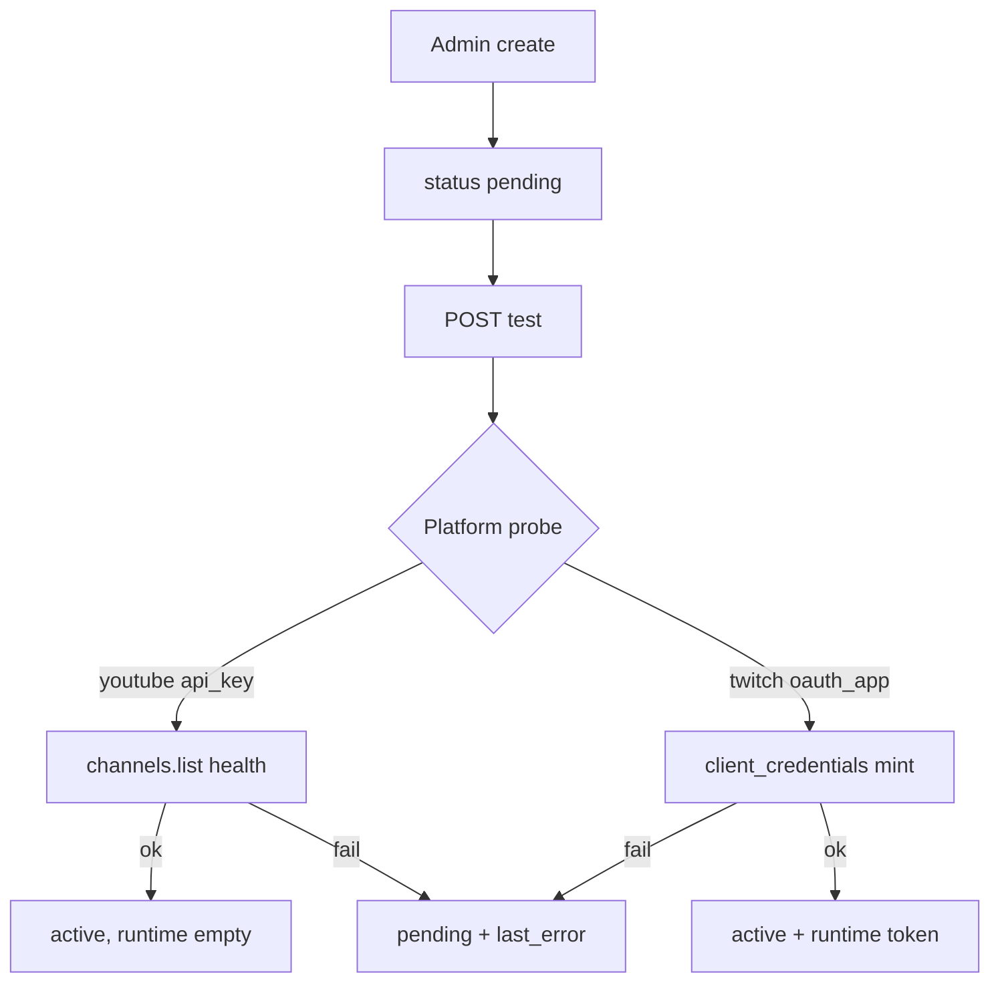

# vTual — product domain

> **UI:** Admin screens live in **Monolith-Vue-Workers** (`/apps/vtual/*`). Blade web controllers and views are removed — see [web/blade-admin.md](../../web/blade-admin.md) and [ui-archive.md](ui-archive.md).

Product domain (`kind => product`, `locked => true`) for **content creator aggregation** (display name **vTual**). Ships creator/management/channel/content schema, claims, platform credentials, **manual** YouTube/Twitch HTTP clients, channel fetch pool (refresh/resync), and API surfaces. **Active SPA screens (authenticated):** staff **orphan** admin (`/apps/vtual/orphans`), **platform credentials** (`/apps/vtual/platform-credentials`, Root/Admin), **owned profiles list + manage** (`/apps/vtual/profiles`, Products menu under File Hosting), **read-only vTuber profile** + interactive claim (`/apps/vtual/vtuber/{slug}`, login required). **Public SPA:** guest landing `/vtual` (directory + content feed) + two-column public profile `/vtual/vtubers/{slug}` (Valkivid3; claim still behind login). The former Blade hub, standalone claims, and registry UIs are gone — history in [ui-archive.md](ui-archive.md). **Scheduled content ingestion** (feed poll, content pool, live CCV) and **YouTube WebSub push** are implemented; **Twitch EventSub** remains deferred — see [implementation-status.md](implementation-status.md).

| | |
|--|--|
| Code | `app/Domain/Vtual/` |
| Config | [`config/products.php`](../../../config/products.php) key `Vtual` · [`config/vtual.php`](../../../config/vtual.php) |
| Registry | [`config/domains.php`](../../../config/domains.php) `Vtual` product locked |
| API | `routes/api/v1/vtual.php` (auth) · `routes/api/v1/vtual-public.php` (guest directory + contents feed + profile) |
| Web | None. vTual has no server `web` routes; all UI is SPA. |
| SPA routes | Vue Router names in [`config/spa-routes.php`](../../../config/spa-routes.php): `vtual.orphans.*` → **`/apps/vtual/orphans`**; `vtual.platform-credentials.*` → **`/apps/vtual/platform-credentials`** (Root/Admin); `vtual.profiles.index` / `vtual.profiles.show` → **`/apps/vtual/profiles`** + **`/apps/vtual/profiles/{slug}`** manage (Products sidebar); `vtual.vtuber.index` → **`/apps/vtual/vtuber`** (product hub) + `vtual.vtuber.show` → **`/apps/vtual/vtuber/{slug}`** (read-only profile); public `vtual.public` / `vtual.public.vtuber` → **`/vtual`**, **`/vtual/vtubers/{slug}`**. Removed Blade history: [ui-archive.md](ui-archive.md) |
| Naming (Management disambiguation) | [naming-conventions.md](naming-conventions.md) — core role `Management` vs `vtual_managements` talent org |
| Seeder | `VtualRoleSeeder` (after core `RoleSeeder`; also seeds platforms) |
| Product gate | `product.active:Vtual` middleware (see [Product Activations](../product-activations/README.md)) |
| Menu visibility | Administration → **vTual** → Orphan vTubers (`vtual.orphans.index`, Root/Admin/Moderator) + Platform credentials (`vtual.platform-credentials.index`, Root/Admin). Mapped in `config/products.php` `menu_routes` |
| Progress tracker | [implementation-status.md](implementation-status.md) — done / not done / next |
| Vue island assessment | [vue-island-assessment.md](vue-island-assessment.md) — claim wizard promoted to Vue island (2026-08-09) |
| Ops assessments | [ops/youtube-stability-assessment-2026-08-07.md](ops/youtube-stability-assessment-2026-08-07.md) |
| Legacy audit | [archive/vtual-legacy-audit.md](../../archive/vtual-legacy-audit.md) |

## Concepts

| Concept | Behavior |
|---------|----------|
| Creator | Public profile separate from Identity `User` (`vtual_creators`). Soft delete + `status` active/archived. |
| Creator membership | `vtual_creator_members`: one user may own/edit/view **many** creators (`owner` \| `editor` \| `viewer`). Self-create inserts actor as `owner`. Staff `createOrphan` seeds **no** members (claimable). |
| Creator claim (phase 1) | `vtual_creator_claims`: claim **orphan** (no owner member) via channel bio token or staff **Accept Anyway**. On success: `CreatorMember` owner + Spatie product role `Vtual vTuber`. Losing pendings stay as audit log (`cancelled` + `closed_reason=superseded`). |
| Channel claim | **Non-staff only:** `vtual_channel_claims` attach via bio token (`vtual-ch-…`) or staff **Accept Anyway** on a pending claim. Channel row only after success. Config: `config/vtual.php` `channel_claim.*`. **API:** live `token` is claim-owner only (`CreatorClaimResource` / `ChannelClaimResource`). Member emails (`CreatorMemberResource` / `ManagementMemberResource`) are owner/manager/staff (`view any` / `manage any` vtual) or the member viewing themselves. |
| Management | Talent org (`vtual_managements`), not core Spatie role `Management`. See [naming-conventions.md](naming-conventions.md). |
| Management staff | `vtual_management_members` (`owner` \| `admin` \| `staff`). |
| Creator assignment | `vtual_management_creators` with `joined_at` / `left_at` (historical leave without hard delete). |
| Platform | Seeded catalog: youtube, twitch, **kick** (kick `enabled = false`). |
| Platform credential | Child table `vtual_platform_credentials`: multi-key per platform, envelope-encrypted `secret_payload`, mask-only API. |
| Channel | External channel on a creator; unique `(platform_id, external_id)`. **`visibility`** `public` \| `private` — public profile, feed poll, and WebSub only include `public`; Discord discovery may bind **private** rows (`discovery_source=discord_connection`) until owner **promote**. **Dual path on** `POST creators/{id}/channels`: (1) **Staff** (`manage any vtual resource`) → `ChannelService::registerPendingForStaff` stores raw `profile_input` as **pending** (no immediate API resolve); batch activation via `ChannelRegistrationFlushService` (50 per platform or 15 min). (2) **Owner/editor** → `ChannelClaimService::start` pending claim + bio token; verify / Accept Anyway → `activateFromDto`. `seedForStaff` remains for instant bind paths (e.g. Accept Anyway). Snapshot: `description`, `avatar_url`, `banner_url`, `platform_created_at`, `subscriber_count` (YouTube). Refresh **enqueues** channel fetch pool (batch 50 / max wait 15m); soft remove = **`archived`** — WebSub + feed poll **continue** (stub ingest only); **restore** → `active` + **WebSub resubscribe** + **`RunChannelStubContentBackfillJob`**; archive/restore **rate-limited** (429). See Archive/Restore in Content ingestion section below. Migration: `2026_08_07_200001_add_discord_discovery_columns_to_vtual`. |
| Channel registration pool | Staff orphan channel adds: pending rows with `profile_input` + placeholder `external_id` (`pending:{uuid}`). Same threshold/wait as fetch pool, per platform. Flushed by `vtual:flush-channel-pool` (registration phase before fetch pool). |
| Content | Canonical platform item (`vtual_contents`): **one row** per `(platform_id, external_id)`. `channel_id`/`creator_id` = **primary host** (API truth). Extra channels via **appearances** — not multi-ownership. **`hydrated_at`**: null = **stub** (archived-channel feed/WebSub ingest, no API quota); set on full API hydrate. Public vTuber profile hides rows whose primary channel is `archived` via `listForPublicProfile`. Content manage UI **out of scope** this phase. |
| External links | Morph `vtual_external_links` for creator (and management) social/donation/website URLs. Creator-scoped CRUD via `ExternalLinkService` + API under `/creators/{id}/links` and `/links/{id}`. |
| Profile merge | Absorb source Creator into destination (same owner or manage-any). Source archived. See [Profile merge](#profile-merge-absorb--implemented). |
| Channel fetch pool | Non-interactive channel snapshot batch: refresh + scheduled resync. Threshold 50 or max wait 15m. **Creator claim bio verify** uses separate `claim_verify_pool` (same 50 / 15m gate). Accept Anyway stays sync. |
| User vs vTuber Profile | **User** = Identity login (`users`). **vTuber Profile** = `vtual_creators` (public-facing bio, links, channels, content). Membership is **private**: product UI must not expose that two profiles share the same User. |

### Identity model (locked product decision)

```text
User (Identity) 1 --- N CreatorMember --- N Creator
Management 1 --- N ManagementMember --- N User
Management 1 --- N ManagementCreator --- N Creator  (left_at nullable)
Creator 1 --- N Channel
Channel 1 --- N Content (primary host via contents.channel_id)
Content 1 --- N ContentAppearance --- N Channel  (primary | collaborator | network)
**Glossary (do not conflate):**

| Term | Means | Does **not** mean |
|------|--------|-------------------|
| Creator membership `owner` | User role on a creator profile | Channel “owns” content |
| **Primary host channel** | Upload/host from platform API (`snippet.channelId` on YouTube) | Multi equal owners |
| **Appearance** | Extra registered channel linked to the same content row | Second content row / dual ownership |
| Canonical content | One `vtual_contents` row per platform video/stream id | One row per channel that shows the video |

YouTube Data API: `videos.list` returns **one** `snippet.channelId` (host). Multi-channel product UI (collab / network) is modeled as appearances, not multi-owner content.
```

Core role name **Management** (platform H-RBAC ladder) is **unrelated** to `vtual_managements`. Full disambiguation: [naming-conventions.md](naming-conventions.md).

### Creator claim (phase 1 - binding)

**Problem:** chicken-and-egg - staff want registry profiles before a real vtuber account exists; users want to prove they control a platform channel.

| Path | Who | Behavior |
|------|-----|----------|
| Internal seed | Root / Admin / Moderator (`manage any vtual resource`) | `POST /api/v1/vtual/creators/orphan` creates creator **without** owner membership; then register channels as usual. Staff UI: `/apps/vtual/orphans` (do not self-bind staff as owner; use a separate account if staff is also a vtuber) |
| External claim Existing | User with `claim vtual creator` | Pick claimable creator + proof channel. **Bio:** token bound to the selected proof channel only → `POST .../claims/{id}/verify` (queued batch pool checks that channel’s description). **Discord:** connect at `/apps/profile/connections` (full snapshot on `identity_oauth_accounts`); `POST .../claims/{id}/verify-discord` runs `DiscordConnectionDiscoveryService` — matches public profile channels or binds new YouTube/Twitch as **private** discovered rows (no backfill); sets `verified_channel_id` contract channel; upserts external links from other Discord connection types. Channel attach uses snapshot-first verify but matches one target `external_id`. (`verified_via=discord_connection`). Private discovered channels: owner **promote** → public + fetch pool + content backfill (`POST channels/{id}/promote`). Both routes sit behind `permission:claim vtual creator`; claimant/pending checks are enforced in `CreatorClaimService` (no separate claim policy middleware). Claim page WebSocket `claim.progress` when broadcast configured. Staff **Accept Anyway** stays synchronous. |
| Accept Anyway | Staff + `vtual.claim.accept_anyway_enabled` (Settings → vTual) | Skip bio check (QA / local default **ON**) |
| Staff pending queue | `manage any` | `GET /api/v1/vtual/claims/pending` (legacy registry web archived) |

**Claim row contract (Discord):** `channel_id` = bio proof channel (when bio path); `verified_channel_id` = contract channel when `verified_via=discord_connection`. **`verified_channel_id` not yet exposed** in API resources or claim UI (known gap).

**On verify success:** insert `vtual_creator_members` role `owner` for claimant; assign product role **`Vtual vTuber`** (level 2250, own perms similar to Editor); **close all other pending claims** for that creator (`status=cancelled`, `closed_reason=superseded`). Rows are **kept as audit log** (no hard-delete this phase).

**Race / already owned:** `verify` / `acceptAnyway` check claimable **before** burning rate-limit attempts; if already owned, claim closes as superseded. Winner path uses creator row lock + `closeCompetingClaims`.

**Spam soft-guard:** `vtual.claim.max_pending_per_user` (default 5) + cooldown + **max attempts (default 3)**. After max failed verify attempts, claim closes (`closed_reason=max_attempts`) and user is **blocked 24h** per creator (`vtual_creator_claim_blocks`). Restarting the same creator cancels the user's prior pending for that creator (`closed_reason=user_cancel`) and does not double-count against the cap.

**Not claimable:** creators that already have an `owner` member. Double-owner race fails hard (no silent steal).

**Web surfaces:**

| Surface | Route | Audience |
|---------|-------|----------|
| Public landing (SPA) | `/vtual` | Guests — Valkivid3 `str1` one-pager (hero with API-driven spotlight + sponsors + live-now strip + countdown event from `vtual.landing.event.*` + platform stats + directory `#vtubers` + all-creator content feed `#contents` + about + upcoming-schedule events + claim banner). Header switcher owns `html.dark` (class `dark:` variant, `str1-color-theme` localStorage, inline FOUC-prevention script). |
| Public vTuber profile (SPA) | `/vtual/vtubers/{slug}` | Guests — two-column profile from `GET /api/v1/vtual/public/vtubers/{slug}` (banner, sidebar stats/channels/links, featured live + **paginated** video grid with Prev/Next pager; `contents: { items, pagination }`, `?page`/`?per_page`). Claim CTA is advertising only; wizard stays at `/apps/vtual/vtubers/{slug}/claim`. |
| Orphan vTubers (staff) | `/apps/vtual/orphans` | Internal (Root/Admin/Moderator) — claimable profiles only; users-pattern DataTable + CRUD |
| vTual product hub (placeholder) | `/apps/vtual/vtuber` | Any logged-in user — blank AdminLTE shell for upcoming product surfaces |
| Owned vTuber profiles | `/apps/vtual/profiles` | `Vtual vTuber` / Editor / Admin with active Vtual activation — owned list (`GET api/v1/vtual/creators/owned`); Products sidebar under File Hosting |
| Manage claimed profile | `/apps/vtual/profiles/{slug}` | Owner/editor — meta, links, merge, channel add (bio token + Discord verify on `channel-claims`), active/archived channels |
| vTuber profile (read) | `/apps/vtual/vtuber/{slug}` | Any logged-in user — AdminLTE profile layout; **Claim** button when `is_claimable` (orphan) |
| Claim process (interactive) | `/apps/vtual/vtuber/{slug}/claim` | Any logged-in user — channel pick → token → queued verify; start claim is AJAX with in-place active panel (no full reload); active claim shows proof channel; Echo `claim.progress` realtime when `BROADCAST_CONNECTION` + Pusher configured (reuses `window.__monolithEcho` when the navbar bell already opened Pusher); `verify_failed` snapshots clear queue status (pool finalized before broadcast) + inline failed banner; degraded AJAX-only + reload notice otherwise; orphan only; owned → redirect to profile |
| Platform credentials | `/apps/vtual/platform-credentials` | Root/Admin — platform index table + per-platform credential CRUD; API probe at `/probe` |
| *Archived* | hub, standalone claims, registry (`_archive/` Blade only) | See [ui-archive.md](ui-archive.md) — **not** `/apps/vtual/profiles` (rebuilt active) |

**Privacy:** Manage UI never shows "same User owns these profiles" to third parties. List scope is actor-accessible only.

**Sidebar:** Administration → **vTual** (`vtual.orphans.index`): Orphan vTubers (Root/Admin/Moderator); Platform credentials (Root/Admin). Legacy external/internal Blade UIs archived — see [ui-archive.md](ui-archive.md).

**Out of scope (claim UI phase leftovers):** management product UI, survey form, **Add New** approval queue, appeal / permanent reject, Discord-as-login (connected accounts are for claim proof only), auto-purge of old cancelled rows, stripping core `User` `create vtual creator` (API legacy self-create still exists; staff Blade seeds orphans only).

**Shipped later (do not list as missing):** [profile merge (absorb)](#profile-merge-absorb--implemented), channel archive/restore, [channel fetch pool](#platform-http-clients-manual-fetch) (refresh/resync). Full matrix: [implementation-status.md](implementation-status.md).

### Content primary host and appearances

Canonical content is **not** multi-owned. Same platform video may **appear** on multiple registered channels.

| Piece | Role |
|-------|------|
| `vtual_contents` | One row per `(platform_id, external_id)`; `channel_id` + `creator_id` = primary host |
| `vtual_content_appearances` | Pivot: `content_id` + `channel_id` + denormalized `creator_id` + `role` |
| `ContentAppearanceRole` | `primary` (host), `collaborator` (official collab when known), `network` (sibling/brand) |
| `ContentService` | Worker foundation: `upsertFromPrimary`, `attachAppearance`, `detachAppearance`, `setPrimary`, `listForChannel` / `listForCreator` |

**Example (validated):** [youtube.com/watch?v=aVlelUsoFkY](https://www.youtube.com/watch?v=aVlelUsoFkY)

| | |
|--|--|
| `external_id` | `aVlelUsoFkY` |
| Primary host | Neuron `UCEMMrXP3_WeKiOunPYixMfA` (API / oEmbed author) |
| Network appearance | Hipotesa `UCKAV3scmhfcH5Ozc6ICZGRQ` (product association; not a second host row) |

**API limitation (no collab partner list):** `fetchVideos` / `PlatformVideoDto` expose a single host `channelExternalId` (`snippet.channelId` on YouTube; one `user_id` on Twitch). Data API does **not** return a list of "also appears on" channels. YouTube `brandPartner` is Creator Initiated Brand Partner Access — **not** multi-channel collab/network UI. Therefore **auto-detect / log / backfill appearances from platform HTTP is cancelled by design** (no safe signal).

**Late-join channel (ops path):** host channel + content exist first; a second channel (e.g. Hipotesa) is registered later.

1. `ChannelService::activateFromDto` (post-claim) only inserts the channel row — it does **not** touch `vtual_contents` or appearances.
2. Until someone calls `ContentService::attachAppearance`, `listForChannel` for the new channel is empty for that video (expected).
3. Explicit attach (`network` or `collaborator`) then shows the same canonical content row on both feeds; primary host stays the API host.

**Not implemented / cancelled:** auto-discovery of network/collab from description, scrape, or "API log"; public Content REST CRUD. Attach is explicit (worker/admin) only.

**Forbidden wording in product copy:** “owned by multiple channels”, “multi-owner content”. Use primary host + appearance.


## Activation

```php
// config/products.php
'Vtual' => [
    'activation_type' => 'implicit',
    'fulfillment_target' => null,
    'menu_routes' => [
        'vtual.orphans.index',
        'vtual.platform-credentials.index',
    ],
],
```

- Register hook activates all implicit products (including Vtual).
- `product.active:Vtual` lazy-creates missing implicit rows on first API hit.
- No paid Service SKU yet (`fulfillment_target` null).

## Authorization

Middleware stack:

```text
auth:api → product.active:Vtual → permission:<perm> → Policy → service resource checks
```

### Permissions (`domain_kind = product`)

Own (granted to core `User` + product roles):

```text
view vtual creator | create vtual creator | edit vtual creator | delete vtual creator
view vtual management | create vtual management | edit vtual management
view vtual channel | create vtual channel | claim vtual creator
```

Any (internal core roles Root/Admin/Moderator/Management + product Admin):

```text
view any vtual resource
manage any vtual resource
```

Product roles (levels 2100–2300): `Vtual Admin`, `Vtual Editor`, `Vtual vTuber` (2250), `Vtual Viewer`. Permission `claim vtual creator` on User / Viewer / vTuber / Editor / Admin (+ staff via manage any).

Resource scope:

- Creator view/mutate via membership role or `* any vtual resource`.
- Management assign creators requires management assign role **and** creator mutate on that creator.
- Channel ops scoped through parent creator access.

### Platform credentials (core perms — Root/Admin only)

Separate from product RBAC. Seeded in core `RoleSeeder` (`domain_kind = core`):

```text
view vtual platform credentials
manage vtual platform credentials
```

| Role | Access |
|------|--------|
| Root, Admin | view + manage |
| Moderator, Management, User, product Vtual roles | none |

Policy `PlatformCredentialPolicy` re-checks the same permissions (defense in depth).

## Platform credentials

Multi-credential child of `vtual_platforms` for future YouTube/Twitch sync rotation. **Not** live API clients yet.

### Schema (`vtual_platform_credentials`)

| Column | Notes |
|--------|-------|
| `platform_id` | FK to `vtual_platforms`, cascade delete |
| `label` | Admin name; unique per platform |
| `type` | `api_key` \| `oauth_app` \| `bearer` |
| `secret_payload` | Envelope-encrypted admin secrets (`EnvelopeEncryptedArray`, purpose `vtual`) |
| `runtime_payload` | Envelope-encrypted **system** runtime (Twitch app token etc.); never from admin FormRequest |
| `secret_fingerprint` | HMAC blind index of canonical admin payload (not reversible) |
| `secret_hint` | Last 4 of primary secret field (safe to show) |
| `priority` | Lower preferred for `pickActive()` (default 100) |
| `status` | `pending` \| `active` \| `revoked` |
| `verified_at` | Set on successful manual Test |
| `last_used_at` / `last_error_*` | Workers + Test |

### Lifecycle (Test gate)

1. Admin creates credential → **`pending`** (client `status=active` ignored).
2. Workers / `pickActive()` ignore pending.
3. Admin presses **Test** (`POST .../credentials/{id}/test`) → platform probe.
4. Success → `active`, `verified_at=now()`, clear errors; Twitch `oauth_app` also writes `runtime_payload`.
5. Failure → stay `pending` (or leave `revoked` untouched if already), `last_error_*` set.
6. Any edit (label/priority/secret) → `pending`, clear `runtime_payload` + `verified_at` (must re-Test).
7. **Revoke** (`POST .../revoke`) on `active` → `revoked` (workers stop; row kept for audit).
8. **Delete** hard-removes `pending` or `revoked` rows; `active` must be revoked first.
9. Status is not editable via form — only Test / Revoke / Delete buttons change lifecycle (except edit demotes to pending).



### Type payload keys

| Type | Required (admin `secret_payload`) | Optional | Notes |
|------|-----------------------------------|----------|-------|
| `api_key` | `api_key` | — | YouTube Data API key |
| `oauth_app` | `client_id`, `client_secret` | — | Twitch app; **do not** paste app access token in admin UI |
| `bearer` | `access_token` | `refresh_token`, `expires_at` | Admin-pasted; Test validates only |

**`runtime_payload` shape** (system-written, Twitch app token):

```json
{
  "access_token": "...",
  "token_type": "bearer",
  "expires_at": "2026-09-01T12:00:00+00:00",
  "minted_at": "2026-07-22T03:00:00+00:00"
}
```

### Mask policy

- List/show/update/test responses: metadata + `secret_hint` + `has_secret` + `has_runtime` + `runtime_expires_at` + `verified_at` only.
- **Never** return `secret_payload`, `runtime_payload`, tokens, or fingerprint.
- Update without `secret` keeps encrypted blob; with `secret` re-encrypts, refreshes hint/fingerprint; any update demotes to `pending`.
- No reveal-plaintext endpoint.

### Workers

| Method | Behavior |
|--------|----------|
| `pickActive(Platform, excludeIds?)` | First eligible `active` by priority ASC; skips soft-demoted; pending never selected |
| `resolvePayload($c)` | Decrypt admin secrets (decrypt cache) |
| `getAppAccessToken($c)` | Twitch `oauth_app` only: reuse `runtime_payload` if `expires_at > now + skew` (default 300s); else re-mint under cache lock `vtual.cred.token.{id}` |
| `markUsed` / `markFailed` / `recordAuthFailure` | Use clears failover state; auth path increments counter + optional soft demote; `markFailed` forgets decrypt cache |

Config: `config/vtual.php` → `credential_test.*` (`youtube_probe_channel_id`, `twitch_token_skew_seconds`, `http_timeout`).

### Decrypt cache (KMS billing)

Not 1 read = 1 KMS. Cast → `EnvelopeEncryptionService::decrypt` → `DecryptedValueCache`.

| Rule | Behavior |
|------|----------|
| resourceType | `vtual_platform_credentials` (covers **both** `secret_payload` and `runtime_payload` fields) |
| TTL | **0** (forever until invalidate) via `encryption.decrypted_cache_ttl_by_resource_type` |
| Other envelope fields | Still use global `ENCRYPTION_DECRYPTED_CACHE_MAX_TTL` (default `0` = forever until forget) |
| Healthy use | `resolvePayload()` + `markUsed()` — **no** cache forget |
| Failure | `markFailed` stamps `last_error_*` and forgets secret + runtime decrypt caches |
| Secret/runtime rewrite | Cast `set` / encrypt already forgets that field's cache |
| Delete | `delete()` forgets caches then removes row |

**Twitch `expires_at` is not a decrypt-cache TTL.** It is token validity for Helix. Cached plaintext DEK unwrap stays until rotate, revoke, delete, or `markFailed`. Re-mint rewrites `runtime_payload` only (admin secrets unchanged).

Workers must call `PlatformCredentialService` helpers so invalidate paths stay consistent.

See also [payment-gateway/encryption.md](../payment-gateway/encryption.md).

## API (`/api/v1/vtual/*`)

### Public (guest-safe) — `routes/api/v1/vtual-public.php`

No auth, no `domain.access`, no `product.active` — the SPA `/vtual` landing and `/vtual/vtubers/{slug}` profile are guest-accessible. Throttled `60,1`. Slug-addressed (show also accepts UUID). Never exposes claim tokens, `claim_process_url`, or `blocked_until`. `is_claimable` is a public directory fact (orphan vs owned), not a secret.

| Method | Path | Purpose |
|--------|------|---------|
| GET | `/vtual/public/vtubers` | Directory of active creators having ≥1 active+public channel. Query: `search` (display_name like), `per_page` (max 24), `page`. Sorted **live first**, then `display_name`. Returns `items` + `pagination`. Item fields include `bio_snippet` (`Str::limit` 140), `is_live`, `total_subscribers` / `total_subscribers_formatted`. |
| GET | `/vtual/public/contents` | All-creator content feed. Query: `page`, `per_page` (default 12, max 24). Same public listing contract as the directory (active creator with ≥1 active+public channel; primary channel active+public). Hides stub rows with empty `title`/`url`. Sorted **live first**, then `published_at` desc. Guest-safe card: `type`, `status`, `title`, `thumbnail_url`, `url`, `published_at`, `platform_key`, `creator: {slug, display_name, avatar_url}`, `channel: {display_name, avatar_url}` — **no** UUID. |
| GET | `/vtual/public/vtubers/{creator}` | Public profile: bio, `total_subscribers` / `total_subscribers_formatted`, active+public channels (includes `banner_url`), `links[]` `{kind,label,url}` (no id), `contents` as `{ items, pagination }` (paginated; query `page` + `per_page` default 12, max 24; live rows first then `published_at` desc; each item has `status` + `platform_key`; `is_live` reflects the whole catalogue, not just the current page), `is_claimable` (boolean only). **404** unless the creator is active **and** has ≥1 active+public channel. |
| GET | `/vtual/public/landing` | One-shot `/vtual` home payload: `{ event, live_now[], schedule[], stats }`. `event` = Tier B `vtual.landing.event.*` settings (null when `starts_at` empty/invalid); `live_now` = up to 8 live contents; `schedule` = up to 6 future `scheduled_at` streams; `stats` = aggregate counts. Forever-cached via `PublicLandingCache` (`vtual.public.landing`), flushed on Content/Creator/Channel writes and on `vtual.landing.*` settings upsert. |
| GET | `/vtual/public/stats` | Aggregate counts: `creators`, `channels`, `contents`, `subscribers_total`, `subscribers_total_formatted`. Same visibility contract as the directory (active creators with ≥1 active+public channel). |
| GET | `/vtual/public/live` | `items[]` of live contents (`type=live`, `status=live`), newest first, cap 8. Same card shape as the contents feed, plus `scheduled_at`. |
| GET | `/vtual/public/schedule` | `items[]` of upcoming streams (`scheduled_at >= now`, `status` in scheduled/live/unknown), soonest first, cap 6. SPA events section falls back to the settings event / i18n copy when empty. |

Service: `VtuberProfileService::directory()` + `paginatePublicContents()` (`ContentService::paginateForPublicDirectory`) + `show()` (`resolvePubliclyListed`) + `liveNow()` / `upcomingSchedule()` / `publicStats()` / `landingEvent()`. Resources: `PublicVtuberResource` (directory) / `PublicContentResource` (feed, live, schedule — now also exposes `scheduled_at`) / `PublicVtuberProfileResource` (profile) — all strip `id`; profile also strips `claim_process_url` / `claim_blocked_until`. Worker BFF stamps `Cache-Control: public, max-age=60` on these GETs. There is **no** guest `POST /claims`.

**Landing settings (Tier B — Settings → vTual, config `vtual.landing.*`):** `event.title`, `event.starts_at` (ISO 8601; empty hides the SPA countdown banner), `event.body`. Seeded via `SettingsSeeder`; editable in the Settings UI; read at runtime via `setting()` (never `config()`/`env()`).

### Authenticated

| Method | Path | Permission | Purpose |
|--------|------|------------|---------|
| GET | `/platforms` | view vtual creator | Platform catalog (includes disabled Kick) — **no credentials** |
| GET/POST | `/creators` | view / create | List (scoped) / create (actor becomes owner) |
| GET | `/vtubers/{key}` | auth only | Read-only profile aggregate (bio + active channels + contents); `{key}` = UUID or slug; no membership/RBAC |
| GET/PATCH/DELETE | `/creators/{id}` | view / edit / delete | Show / update / archive |
| GET/POST | `/creators/{id}/channels` | view channel / edit creator | List (non-archived) / register channel (`active` after resolve) |
| GET | `/channels/{id}` | view channel | Show channel |
| POST | `/channels/{id}/refresh` | edit creator | Enqueue pool refresh by `external_id` (async batch) |
| POST | `/channels/{id}/promote` | edit creator | Private discovered channel → `public` + channel fetch pool + initial content backfill |
| GET | `/creators/{id}/channels/archived` | view channel | List archived only |
| POST | `/channels/{id}/archive` | edit creator | Soft archive (`archived`); public profile content hidden; stub ingest continues; **429** on lifecycle rate limit (`channel.lifecycle_cooldown` / `channel.lifecycle_rate_limited`) |
| POST | `/channels/{id}/restore` | edit creator | Restore archived → `active`; **WebSub resubscribe**; stub backfill job; same **429** lifecycle keys |
| GET/POST | `/creators/{id}/links` | view / edit creator | List / create external links |
| PATCH/DELETE | `/links/{id}` | edit creator | Update / delete external link |
| GET/POST | `/managements` | view / create | List / create management |
| GET/PATCH | `/managements/{id}` | view / edit | Show / update |
| POST | `/managements/{id}/creators` | edit management | Assign creator |
| DELETE | `/managements/{id}/creators/{creatorId}` | edit management | Unassign (`left_at`) |
| GET | `/admin/platforms/{id}/credentials` | view vtual platform credentials | List credentials (masked) |
| POST | `/admin/platforms/{id}/credentials` | manage vtual platform credentials | Create credential (`pending`) |
| GET/PATCH/DELETE | `/admin/credentials/{id}` | view / manage | Show / update / delete (`active` delete blocked until revoked) |
| POST | `/admin/credentials/{id}/revoke` | manage | Soft-revoke `active` → `revoked` |
| POST | `/admin/credentials/{id}/test` | manage | Manual Test gate; returns masked credential + `test.{ok,message,platform}` |
| POST | `/admin/platform-api/probe` | manage vtual platform credentials | Live gateway probe — see [Admin probe](#admin-probe-permanent-rootadmin-debug) |
| GET | `/claims/claimable-creators` | claim vtual creator | List orphan creators user may claim |
| GET | `/claims/mine` | claim vtual creator | Actor's claim rows |
| POST | `/claims` | claim vtual creator | Start orphan creator claim |
| GET | `/claims/{id}` | claim vtual creator | Show claim row |
| POST | `/claims/{id}/verify` | claim vtual creator | Queue bio verify (claim verify pool) |
| POST | `/claims/{id}/verify-discord` | claim vtual creator | Discord discovery verify (`DiscordConnectionDiscoveryService`) |
| POST | `/claims/{id}/cancel` | claim vtual creator | Cancel pending claim |
| POST | `/channel-claims/{id}/verify` | edit creator | Bio verify channel attach claim |
| POST | `/channel-claims/{id}/verify-discord` | edit creator | Discord verify channel attach claim. SPA profile manage wires this plus `GET auth/discord/authorize-url` (`intent=channel_claim_verify`, `return_path=/apps/vtual/profiles/{id}`) when Discord is not connected. |
| POST | `/channel-claims/{id}/cancel` | edit creator | Cancel pending channel claim |
| GET | `/claims/pending` | manage any vtual resource | Staff pending creator claims queue |

## Vue-Workers SPA consumer

**Public SPA (`/vtual`, `/vtual/vtubers/:slug`)**: guest-facing Valkivid3 `str1` under `src/valkivid3/` (route names `vtual.public` / `vtual.public.vtuber`, `meta.template: 'valkivid3'`, `public: true`). Layout `VkStr1Layout.vue` (Tailwind v4 under `.vk3-root`: no preflight, `@tailwind utilities` nested so they compile as `.vk3-root .mb-3`, class `dark:` variant on `html.dark`, lazy CSS chunk). Directory + content feed + profile via `useVtualPublic` → `vtual/public/vtubers`, `vtual/public/contents`, `vtual/public/vtubers/{slug}`; the home view also fetches `vtual/public/landing` once (`fetchLanding`) for the post-hero unified live directory (`VkStr1VtuberLiveDirectory` — directory grid + live status/stream rows from `landing.live_now`) + stats band and events schedule; the hero slider is 3 static promotional slides (`hero.one.*` hub intro, `hero.two.*` claim profile, `hero.three.*` events promo) with no live-data binding. Guest claim CTA is `/login?redirect=/apps/vtual/vtubers/{slug}/claim` (register uses the same `redirect` query; `safeInternalRedirect` rejects `//`, `://`, off-origin). Authed + `is_claimable` goes straight to the existing claim wizard. Public 404 stays **inside** `VkStr1Layout` — do not dump guests into `AppLayout`. Source template: `HTML/str1/index.html` (Valkivid 3.1.1). Isolation contract: SPA README "Template namespaces".

**Public SPA theme (dark/light)**: class-based (`html.dark`), `localStorage['str1-color-theme']`, default **dark** (original template behavior; OS preference intentionally ignored). `index.html` carries an inline head script that restores the class before first paint — prevents the light-mode FOUC flash; inert for `/apps/*` since valkivid3 utilities are `.vk3-root`-scoped. Composable `useVkStr1Theme` (read/apply/toggle), switcher with sun/moon sprite icons in `VkStr1Header` + `VkStr1MobileMenu`. Hero slider `VkStr1HeroSlider` is a Swiper fade carousel (3 static promo slides: `hero.one.*` hub intro, `hero.two.*` claim profile, `hero.three.*` events; no props, no live-data binding; staggered entrance animations gated by `group-[.swiper-slide-active]` + `vv-slide-played` replay, vertical bar pagination `.vv-hero-swiper-pagination`, prev/next). Live content is surfaced through the unified `VkStr1VtuberLiveDirectory` (directory cards annotated with live status + stream rows from `landing.live_now`); the standalone `VkStr1LiveNow` is kept as a reference.

**Authenticated app**: staff orphan CRUD lives at SPA `/apps/vtual/orphans` (list + create + **create→edit** + archive confirm + pending channels) — Vue `DataTable` + `display_mode=query` (not Yajra). Create `POST vtual/creators/orphan` lands on `/orphans/:id/edit` so staff can register YouTube/Twitch; save stays on edit; `DELETE vtual/creators/{id}` archives (confirm copy `web.vtual-orphans.datatable.confirm_delete`). Staff `POST vtual/creators/{id}/channels` is `registerPendingForStaff` (pending channel row, in-place append) — not a channel claim. Create and edit share `VtualOrphanEditView`; `AppLayout` has no `router-view` `:key`, so the view watches `route.params.id` and reloads. `useVtualHydrate.hydrateOrphanEdit` batches orphan + channels + platforms on edit (individual-loader fallback). Same hydrate helper covers profile show, platform credentials, and vTuber claim. Authenticated vTuber read/claim is canonical **plural** `/apps/vtual/vtubers/:slug` (+ `/claim`) so it does not collide with the hub `/apps/vtual/vtuber`. UUID in the path is replaced with the slug after fetch. See [vue-workers-spa.md — vTual public surface](../../integration/vue-workers-spa.md#vtual-public-surface) and [vTual orphan staff admin](../../integration/vue-workers-spa.md#vtual-orphan-staff-admin).

## SPA admin (Blade web removed)

Legacy hub/claims/registry Blade UIs are archived under [`ui-archive.md`](ui-archive.md). Live admin is Monolith-Vue-Workers `/apps/vtual/*`. Domain API unchanged.

| Route | View |
|-------|------|
| `GET vtual/profiles` (`vtual.profiles.index`) | Owned profiles list → `GET api/v1/vtual/creators/owned` |
| `GET vtual/profiles/{slug}` (`vtual.profiles.show`) | Manage profile: meta, links, merge, channels (bio + Discord verify), promote private discovered |
| `POST vtual/profiles/{slug}/channels/{id}/promote` (`vtual.profiles.channels.promote`) | → `POST api/v1/vtual/channels/{id}/promote` (private discovered → public + fetch pool + backfill) |

**Profiles manage** is SPA (`vtual.profiles.show`). Live updates go through API + Echo, not Blade `profiles-live.js`.

| `GET vtual/vtuber` (`vtual.vtuber.index`) | Product hub placeholder (blank AdminLTE layout; upcoming surfaces) |
| `POST vtual/vtuber/{slug}/claim/verify` (`vtual.vtuber.claim.verify`) | Queue bio verify → `POST api/v1/vtual/claims/{id}/verify` |
| `POST vtual/vtuber/{slug}/claim/cancel` (`vtual.vtuber.claim.cancel`) | Cancel pending claim → `POST api/v1/vtual/claims/{id}/cancel` |
| `GET vtual/vtuber/{slug}/claim` (`vtual.vtuber.claim`) | Interactive claim: channel pick, token, queued verify UI (orphan only; owned → redirect to show) |
| `GET vtual/orphans` (`vtual.orphans.index`) | Orphan vTuber index (server-side DataTable; claimable profiles only) |
| `GET vtual/orphans/datatable` (`vtual.orphans.datatable`) | DataTables JSON proxy → `GET api/v1/vtual/creators/orphans?display_mode=datatable` |
| `GET vtual/orphans/create` (`vtual.orphans.create`) | Create orphan form |
| `POST vtual/orphans` (`vtual.orphans.store`) | → `POST api/v1/vtual/creators/orphan`; redirects to edit (not index) |
| `GET vtual/orphans/{id}/edit` (`vtual.orphans.edit`) | Edit form + deferred channel registration UI |
| `POST vtual/orphans/{id}/channels` (`vtual.orphans.channels.store`) | → `POST api/v1/vtual/creators/{id}/channels` (staff pending queue) |
| `PATCH vtual/orphans/{id}` (`vtual.orphans.update`) | → `PATCH api/v1/vtual/creators/{id}` |
| `DELETE vtual/orphans/{id}` (`vtual.orphans.destroy`) | → `DELETE api/v1/vtual/creators/{id}` (archives) |
| `GET vtual/vtuber/{slug}` (`vtual.vtuber.show`) | Read-only profile: bio + channels + contents → `GET api/v1/vtual/vtubers/{key}`. Canonical slug URL; `rel=canonical` + `profile_url` in API. UUID in path → **301** to current slug (web only). Slug rename: old slug 404; UUID bookmark still resolves. Slug redirect history — future. |

**Platform credentials (Root/Admin):**

| Route | Behavior |
|-------|----------|
| `GET vtual/platform-credentials` (`vtual.platform-credentials.index`) | Platform list table + Manage action; probe link |
| `GET vtual/platform-credentials/platforms/{id}` (`vtual.platform-credentials.platform`) | Credential list (Test / Revoke / Delete by status) |
| `GET/POST …/platforms/{id}/create` / `store` | Create credential (pending until Test) |
| `GET/PATCH …/credentials/{id}/edit` / `update` | Edit credential |
| `GET/POST vtual/platform-credentials/probe` | Manual Platform API gateway smoke test |

Live UI: SPA `vtual.platform-credentials.*` (index, platform, create, edit, probe). Blade layouts and `ConsumesApi` proxies are removed.

### API — orphan staff list (new)

| Method | Path | Notes |
|--------|------|-------|
| GET | `vtual/creators/orphans` | `listClaimable()`; `display_mode=datatable` for DataTables |
| GET | `vtual/creators/orphans/{id}` | 403 if profile is no longer claimable |

### UI/UX patterns (orphan admin)

- **SPA DataTable**: Vue `DataTable` + API `display_mode=query`.
- **Create slug**: auto `{random6}-{slugified-display-name}` when slug omitted (orphan only); create form is display-name minimal.
- **Deferred channels**: edit page registers platform profile without API call; scheduler resolves in batch (50/platform or 15 min). Form resets after add; pending rows append inline from nested AJAX `data` channel entity (no websocket). Duplicate profiles per creator+platform rejected via parser-based `profile_fingerprint` (`@handle` vs profile URL normalize to same key). **Platform URL guard:** profile URLs with a recognizable YouTube/Twitch host must match the platform dropdown; bare handles/ids follow the selected platform.
- **Claimed profiles excluded**: list uses `CreatorService::listClaimable()` — active creators with no owner member.

### UI/UX patterns (platform credentials)

- **Row actions**: Edit / Test / Revoke (active) / Delete (pending & revoked) in a horizontal flex bar (`platform-credentials/partials/credential-actions`); AJAX forms use `:showAlert="false"` so success/error uses toast (not inline alert inside the table). Action buttons disable for the duration of each request.
- **Status refresh**: after Test or Revoke (success or failed Test), the credential row updates in place from the AJAX response; Delete removes the row — no full page reload.

### UI/UX patterns (vTuber profile read)

- **Layout**: `show.blade.php` → `vtuber/partials/sidebar` (identity, stats, about, `channels`) + `content-panel` → `contents`.
- **Grid**: `row-cols-1 row-cols-sm-2 row-cols-xl-3`, `ratio-16x9` thumbnails, `stretched-link` whole-card click.
- **Uniform content cards**: 3-slot flex body — `vtuber-content-card__title` (2-line `monolith-line-clamp-2`), `__meta` (date · platform, `text-truncate`), `__badges` (pinned with `margin-top: auto`) — CSS in `resources/css/monolith-overrides.css`.
- **Channel ID cards**: `subscriber_count` / `subscriber_count_formatted` from `ChannelResource` in sidebar `vtuber/partials/channels`.
- **Content filter**: `VtuberProfileService` → `ContentService::listForPublicProfile` — excludes rows whose **primary channel** is `archived` (read profile shows 0 contents when all channels archived; manage surfaces may still list archived channels separately).
- **Auth**: any logged-in user; guest → login redirect; UUID path → **301** to canonical slug (web).

### Removed Blade UI patterns (2026-07 overhaul, see ui-archive.md)
- **i18n**: the Blade era kept every user-facing string in a per-locale `web/vtual` PHP file (`ajax.*`, `confirm.*`, `table.*`). That file is deleted; SPA strings live in `monolith-vue-workers/src/i18n/locales/*.json`. Surviving server-side vTual PHP strings are only `web/vtual-vtuber.php` (Discord claim flash) and `web/vtual-orphans.php` (datatable row-action confirm).

## Seeders

1. `RoleSeeder` — core permissions `view/manage vtual platform credentials` for Root/Admin.
2. `FileHostingRoleSeeder` — required because authoritative `MenuSeeder` also builds the File Hosting branch.
3. `VtualRoleSeeder` — product roles/permissions + `PlatformService::seedDefaults()`.
4. `MenuSeeder` — Administration → **vTual** parent (`vtual.orphans.index`) with Orphan vTubers (Root/Admin/Moderator) and Platform credentials (Root/Admin).
5. `DatabaseSeeder` preserves this order. Running `MenuSeeder` before role seeders can omit expected menu-role pivots.

## Kick strategy (foundation)

- Platform row exists with `enabled = false`.
- `ChannelClaimService::start` / platform resolve rejects disabled platforms (no scrape path); Kick has no profile resolve.
- Re-enable only after official API decision (see archive audit).

## Platform HTTP clients (manual fetch)

Worker-facing foundation for **pull** reads against YouTube Data API v3 and Twitch Helix. No WebSub/EventSub, no `vtual_contents` persistence in this layer.

### Layout

```
app/Domain/Vtual/Integrations/
  PlatformApiGateway.php          # public facade
  PlatformClientRegistry.php
  Youtube/YoutubeDataApiClient.php
  Twitch/TwitchHelixClient.php
  Contracts/{PlatformClient,FetchesVideos,FetchesChannels,ResolvesChannel,FetchesStreams}.php
  Dto/{PlatformVideoDto,PlatformChannelDto,PlatformStreamDto,YoutubeParts}.php
  Support/{BatchIdChunker,PlatformHttp,ChannelProfileInput,ChannelProfileInputParser,ChannelProfileResolver}.php
  Enums/PlatformApiOperation.php
```

### Channel profile identity (canonical vs handle)

| Platform | `external_id` (stable, unique) | `handle` (mutable, display) |
|----------|--------------------------------|-----------------------------|
| YouTube | Channel id `UC…` | bare handle (no `@`) from `customUrl` |
| Twitch | Numeric user id | lowercase login |

**Register** (`POST /api/v1/vtual/creators/{id}/channels`): body `{ platform_key, profile }`. `profile` accepts:

- YouTube: `UC…`, `@handle`, `youtube.com/@handle`, `youtube.com/channel/UC…`
- Twitch: numeric id, login, `twitch.tv/login`

Requires **active** platform credential (same as gateway). Parser → `ChannelProfileResolver` → `fetchChannels` or `resolveChannel` → persist DTO.

**Create** (`POST /api/v1/vtual/creators/{id}/channels`): body `{ platform_key, profile }`. Successful platform resolve stores canonical identity and status **`active`** (no second verify click required).

**Profile snapshot columns** (intersection YouTube + Twitch from existing channel/user endpoints; auto-filled on create/refresh):

| Column | YouTube | Twitch | Notes |
|--------|---------|--------|-------|
| `description` | `snippet.description` | `description` | channel bio |
| `avatar_url` | best `snippet.thumbnails` (high→medium→default) | `profile_image_url` | DTO `thumbnailUrl` |
| `banner_url` | `brandingSettings.image.bannerExternalUrl` | `offline_image_url` | Twitch offline banner ≠ YT banner pixel-perfect |
| `platform_created_at` | `snippet.publishedAt` | `created_at` | platform account/channel birth |
| `subscriber_count` | `statistics.subscriberCount` (null when hidden) | — | YouTube only; refreshed via channel pool |

Not shared this phase (no dual-platform signal without extra APIs): Twitch follower counts, video_count, view_count (Twitch deprecated), country, broadcaster_type. Existing rows: channel pool resync backfills snapshot including `subscriber_count`.


**Refresh** (`POST /api/v1/vtual/channels/{id}/refresh`): enqueues `vtual_channel_fetch_pool` by stored `external_id` (no immediate platform HTTP). Snapshot updates on pool flush. Rejects archived channels.

**Channel fetch pool:** non-interactive only (refresh + scheduled resync). Flush when pending unique ids per platform ≥ `config(vtual.channel_pool.threshold)` (50) **or** oldest pending age ≥ `max_wait_minutes` (15). Single `Cache::lock` + claim-to-`processing` prevents double HTTP for the same set. **Creator claim bio verify** uses `claim_verify_pool` (same threshold semantics; batch `fetchChannels` up to 50 ids per platform). Accept Anyway resolve stays sync. Commands: `php artisan vtual:flush-channel-pool` (`--force`, `--platform=`, `--resync`) runs **registration flush first**, then fetch pool; `php artisan vtual:flush-claim-verify-pool` (`--force`) for claim verify queue. `--resync` enqueues active channels with stale/null `last_synced_at` **or** null `subscriber_count` (snapshot backfill). Schedule: every minute flush channel pool + claim verify pool; hourly channel `--resync`.

**YouTube content fetch (POC):** `php artisan vtual:fetch-channel-content {vtual_channels_uuid}` — **manual last frontier** (recovery/debug). Not scheduled. Use `--video` / `--discover-live` for known ids or live search. Default path ingests via onboarding backfill + feed poll + content pool below.

**YouTube channel onboarding (one-time):** All YouTube activations go through [`ChannelActivationService`](app/Domain/Vtual/Services/ChannelActivationService.php) (`activateFromDto`, `activatePendingFromDto` via registration flush): **WebSub subscribe** + **`RunChannelInitialContentBackfillJob`** (async) run together. Backfill: `playlistItems.list` (≤50) + `videos.list` (≤50) → upsert contents; sets `content_initial_backfill_at` and seeds `feed_last_entry_updated_at` from public Atom feed. Legacy channels without backfill: `php artisan vtual:backfill-initial-content {vtual_channels_uuid}`. Legacy channels without WebSub row: `php artisan vtual:renew-websub-subscriptions --repair-missing`. Feed poll skips channels until `content_initial_backfill_at` is set.

**Content ingestion (scheduled):**

| Layer | Command | Schedule | Quota |
|-------|---------|----------|-------|
| Feed discovery | `vtual:poll-channel-feeds` | every 15m | 0 (public Atom `feeds/videos.xml`) |
| API hydrate pool | `vtual:flush-content-pool` | every 1m | `videos.list` batch ≤50 |
| Live CCV + ended | `vtual:poll-live-contents` | every 2m | `videos.list` for `status=live` rows only |
| WebSub renew / repair | `vtual:renew-websub-subscriptions` (`--repair-missing` for legacy active channels); `vtual:repair-archived-websub` for archived channels missing active/pending subscription (pre-policy repair) | daily / on-demand | hub subscribe |

Flow: **onboarding** (WebSub + backfill job on activate via `ChannelActivationService`) → feed/WebSub deltas → enqueue video id → `ContentFetchPoolService` → `ChannelContentFetchService::fetchVideosAndPersist` → `ContentService::upsertFromPrimary`. Feed/WebSub discovery only (0 quota); hydrate via API batch ≤50. WebSub and feed share the same content pool (coalesce on pending id; upsert idempotent — no conflict). WebSub callback: `GET /api/v1/vtual/webhooks/youtube-websub` (hub verify) and `POST` same path (notifications; `throttle:120,1` per IP). Subscribe on YouTube channel activate (all paths); **archive keeps WebSub + feed poll alive** (stub ingest only — see Archive below). Hub verify needs public `APP_URL` — local without tunnel may leave row `pending`/`failed`; feed poll remains safety net. Scheduled feed poll skips channels until `content_initial_backfill_at` is set. **Private discovered channels** (`visibility=private`) are excluded from feed poll and WebSub until owner promote.

**Stub contents (`hydrated_at` null):** While a channel is archived, feed poll and WebSub/content-pool flush call `ContentService::upsertStubFromPrimary` (minimal metadata, no API quota). Rows are **hidden** from public vTuber profile (`listForPublicProfile` excludes primary channel `status=archived`). API hydrate (`fetchVideosAndPersist`, live CCV poll, channel refresh pool) stays blocked until restore.

### YouTube operational stability (ops)

Live probe rubric and results: [ops/youtube-stability-assessment-2026-08-07.md](ops/youtube-stability-assessment-2026-08-07.md).

| Requirement | Why |
|-------------|-----|
| `schedule:work` or cron | `vtual:flush-*-pool`, feed poll, live CCV, hourly resync |
| `queue:work` when `QUEUE_CONNECTION=database` | `RunChannelInitialContentBackfillJob` on activate; `RunChannelStubContentBackfillJob` on restore — sync driver runs inline |
| Public `APP_URL` | WebSub hub verify + subscription lease |

**Assessment rubric:** L1–L8 (credentials, gateway, cohort, pools, WebSub, scheduler, **DB performance**, **API quota**). **Product gate:** L7 or L8 **Red** → not worth it at scale even if functional probes pass. Re-run assessment after major ingestion or credential changes.

**YouTube WebSub hardening:** Shared Atom parsing via [`YoutubeAtomFeedParser`](app/Domain/Vtual/Integrations/Youtube/YoutubeAtomFeedParser.php) (feed client + notification). **GET verify:** only `hub.mode` ∈ `subscribe` | `unsubscribe`; `markVerified` updates row only when state allows (`pending`/`failed` → `active` on subscribe; `active`/`pending` → `unsubscribed` on unsubscribe); unknown mode → **403** (no challenge echo). **POST:** dual HMAC (`X-Hub-Signature` `sha1=` or `sha256=`); body cap `vtual.websub.max_body_bytes` (default 1 MiB, Settings registry) → **413** when exceeded; invalid signature → **204** (no leak) + structured `Log::warning` + `last_error` on subscription row. **Topic lookup:** exact `topic` column, then fallback parse `channel_id` from topic URL → match active subscription by channel `external_id`. **Deleted/tombstone videos** (`at:deleted`) deferred — future: mark unavailable when `videos.list` returns 404 during content pool flush.

**Channel registration pool (staff):** `registerPendingForStaff` stores `profile_input` on `vtual_channels` (`status=pending`, `external_id=pending:{uuid}`). `ChannelRegistrationFlushService` uses the same 50 / 15m gate **per platform** (YouTube count ≠ Twitch count). On flush: resolve profiles → activate channel row. Failed resolve sets `resolve_error`, keeps pending.

**Archive** (`POST /api/v1/vtual/channels/{id}/archive`): soft-remove (`status=archived`); hidden from default channel list and **all content hidden** on public vTuber profile. WebSub subscription and feed poll **continue** — new deltas persist as stub rows (`hydrated_at` null) only; no API hydrate, live poll, or channel refresh while archived. Rate-limited (same lifecycle keys as restore).

**Restore** (`POST /api/v1/vtual/channels/{id}/restore`): archived → `active`; **always resubscribes WebSub** via `YoutubeWebSubSubscriptionService::resubscribe()` (primary repair path for legacy unsubscribed rows); dispatches `RunChannelStubContentBackfillJob` to batch-hydrate stub contents via API. Rate-limited: per-channel cooldown (`vtual.channel_lifecycle.cooldown_seconds`, default 30s) and per-user burst (`vtual.channel_lifecycle.max_per_minute`, default 10/min). Non-archived → 422. List archived via `GET /creators/{id}/channels/archived`. Use channel refresh separately for profile snapshot updates. Optional ops backfill for channels that stay archived: `php artisan vtual:repair-archived-websub`.

**External links** (`ExternalLinkService`): creator-scoped CRUD gated by `CreatorAccessService` (membership mutate or `manage any`). Kinds: `social` | `donation` | `website` | `other`.

**Workers:** always call streams/videos APIs with stored `external_id` (Twitch `user_id`, YT channel id) — never login/handle as batch id.

### Credential flow

1. `PlatformApiGateway` resolves `Platform` by key; rejects disabled (Kick).
2. `PlatformCredentialService::pickActive` — only `status=active` (post-Test).
3. YouTube: `resolvePayload` → `key=` query param.
4. Twitch: `getAppAccessToken` + `Client-Id` + `Authorization: Bearer`.
5. Success → `markUsed` (clears failover counters). HTTP 401/403 → `recordAuthFailure` (last_error + consecutive counter; soft demote when failover enabled).

### ErrorLog for platform HTTP failures

`PlatformApiException` extends `BusinessRuleException`, so uncaught `report()` / `recordException` **skip** it (intentional API noise filter). Platform upstream failures are **ops signals** (bad key, quota, outage) and must still land in `error_logs` for manual credential decisions.

| Path | Writes `error_logs`? | Notes |
|------|----------------------|-------|
| `PlatformHttp::get` non-2xx / connection fail | **Yes** via `PlatformErrorLogger` → `ErrorLogRecorder::recordLog` | Context: `domain=vtual`, `component=platform_http`, `platform`, `upstream_status`, `url_host` + `url_path` only (never query/`key=`/tokens), optional `credential_id` + `operation` |
| HTTP 401/403 → `markFailed` | Credential `last_error_*` + ErrorLog from **PlatformHttp only** | `markFailed(..., logToErrorLog: false)` avoids double row |
| Credential **Test** / Twitch token mint fail → `markFailed` | **Yes** (`component=platform_credential`, `event=credential_mark_failed`) | Incomplete secret / probe reject with no HTTP client path |
| Auto-rotate on log | **No** hard rotate | Soft failover is separate (config flag); ErrorLog is audit only |

Do **not** reclassify all BRE as reportable. Do **not** put secrets in message/context.
### Soft credential failover

Default **OFF** (`vtual.credential.failover.enabled` in **Settings → vTual**; thresholds via `vtual.credential.failover.*` registry keys). See [configuration-policy.md](../../platform/configuration-policy.md).

| Rule | Behavior |
|------|----------|
| Trigger | Upstream **401/403** only (`recordAuthFailure`) |
| Soft demote | Status stays `active`; `consecutive_auth_failures++`; at threshold set `failover_skip_until` |
| `pickActive` | Skips rows with future `failover_skip_until`; optional `excludeIds`; priority ASC |
| Gateway retry | `PlatformApiGateway` fetch* methods: max `max_retries_per_call` (default 1) alternate credential |
| Clear | `markUsed` / successful **Test** zero counter and clear skip |
| Not trigger | 429, 5xx, connection errors, business 4xx |
| Never | Auto-promote `pending`; hard `disabled` on auth fail; pool burn |

Workers should call gateway `fetch*` / `resolveChannel` (failover). Direct `client()` is single-pick only.


### Shared operations (interchangeable)

| Method | YouTube | Twitch | Batch max |
|--------|---------|--------|-----------|
| `fetchVideos(ids, parts?)` | `GET /videos?id=&part=` | `GET /helix/videos?id=` (repeated `id`) | **50** |
| `fetchChannels(ids, parts?)` | `GET /channels?id=&part=` | `GET /helix/users?id=` | **50** |
| `resolveChannel(handle)` | `channels?forHandle=` | `users?login=` | 1 |

`parts` is YouTube-only (whitelist in `config/vtual.php` → `youtube.allowed_*_parts`). Twitch ignores parts.

Batch rules (`config/vtual.http.batch`):

- Hard-fail if caller passes more than max on single `fetch*` (no silent multi-request).
- `fetchVideosChunked` auto-splits for large lists.

Product flags `supports_live` / `supports_vod` gate **ingestion policy**, not raw HTTP capability. Twitch still implements `fetchVideos` (Helix past broadcasts) even when `supports_vod=false`.

### Platform-specific (no god-method)

| Method | Platform | Notes |
|--------|----------|-------|
| `fetchStreamsByUserIds` | Twitch only | `GET /helix/streams?user_id=` (max 100). Throws `UnsupportedPlatformOperation` on YouTube. |
| Channel catalog / uploads playlist | YouTube `playlistItems.list` on uploads playlist (`UC`→`UU`) via `PlatformApiGateway::listChannelVideos` | Twitch catalog fetch deferred (platform scope TBD). |
| Live discovery via `search.list` | YouTube `search.list` (`channelId`, `type=video`, `eventType=live|upcoming|completed`) via `PlatformApiGateway::searchChannelVideos` | Manual only (`--discover-live` on `vtual:fetch-channel-content`); separate quota bucket (100 units/call) — not primary path. |

### Normalized DTOs

Workers consume `PlatformVideoDto` / `PlatformChannelDto` / `PlatformStreamDto` (stable fields toward `vtual_contents` / `vtual_channels`). Mappers are per-client; no shared raw JSON shape.

### Config

See `config/vtual.php`: `http.timeout`, `http.batch.*`, `youtube.default_*_parts`, `youtube.allowed_*_parts`, `twitch.helix_base_url`.

### Usage

```php
$gateway = app(\App\Domain\Vtual\Integrations\PlatformApiGateway::class);

$videos = $gateway->fetchVideos(\App\Domain\Vtual\Enums\PlatformKey::Youtube, ['dQw4w9WgXcQ']);
$videos = $gateway->fetchVideos(\App\Domain\Vtual\Enums\PlatformKey::Twitch, ['9001']);

$streams = $gateway->fetchStreamsByUserIds(\App\Domain\Vtual\Enums\PlatformKey::Twitch, ['12345']);
```

### Admin probe (permanent Root/Admin debug)

Permanent debug surface for **production** `PlatformApiGateway` — **not** temporary. Root/Admin only (`manage vtual platform credentials`). Uses the **active** credential; hits live YouTube/Twitch (or `Http::fake` in tests). No secrets in response.

| Surface | Method | Path |
|---------|--------|------|
| Web form | GET/POST | `/apps/vtual/platform-credentials/probe` |
| API | POST | `/api/v1/vtual/admin/platform-api/probe` |

**Methods:** `fetch_videos`, `fetch_videos_chunked`, `fetch_channels`, `resolve_channel`, `fetch_streams` (Twitch only).

#### Agent rule — production mirror (mandatory)

Probe **must** exercise the same production paths workers use. Results must represent real gateway method output (same clients, credentials, DTOs, errors).

| Allowed | Forbidden |
|---------|-----------|
| Call `PlatformApiGateway` methods only | Duplicate Helix/YouTube HTTP clients or alternate query builders |
| Input validation + optional profile normalize via **existing** production helpers (`ChannelProfileInputParser` / `ChannelProfileResolver`) | Probe-only business rules or fake success shapes |
| Serialize gateway DTOs (`PlatformDtoSerializer`) for display | Alternate DTO mapping that diverges from production clients |

Flow:

```text
Probe form/API
  → PlatformApiProbeService (input parse / optional profile normalize)
  → PlatformApiGateway (credential + client + capability)
  → YoutubeDataApiClient / TwitchHelixClient
  → DTO serialize → JSON
```

When **adding, removing, or renaming** a worker-facing gateway method that should be manually testable, update in the **same PR**:

1. `PlatformApiProbeService::METHODS` + `run()` match arm
2. `PlatformApiProbeRequest` validation (`Rule::in`)
3. Probe labels/help in the SPA (`monolith-vue-workers/src/i18n/locales/*.json` under `web.vtual.probe.*`) — the old Blade-era `probe.method_*` / `ids_help` PHP keys were deleted with the frontend
4. Feature tests (`PlatformApiProbeApiTest`; the Blade probe web test was deleted, not archived)
5. This README section (methods table + notes)

Video/VOD ids stay raw (no profile resolve). Channel/stream profile normalize is the shared production resolver used by channel register — not probe-only logic.

#### Profile normalization

Same `ChannelProfileInputParser` + `ChannelProfileResolver` as channel register:

| Method | IDs field | Behavior |
|--------|-----------|----------|
| `fetch_streams` | user id, login, `@handle`, or profile URL | Normalize → canonical `user_id` → gateway `fetchStreamsByUserIds` |
| `fetch_channels` | channel/user id, handle/login, or URL | Normalize → canonical id → gateway `fetchChannels` |
| `fetch_videos` / `fetch_videos_chunked` | raw video/VOD ids | **No** profile resolve → gateway as-is |
| `resolve_channel` | `handle` (or single id) | Gateway `resolveChannel` |

Example: Twitch `ids=2xrakai` on `fetch_streams` resolves to `997729120` then streams. Response includes `resolved: [{ input, external_id, handle }]` for debug transparency.

**Body (API / form):**

| Field | Required | Notes |
|-------|----------|-------|
| `platform` | yes | `youtube` \| `twitch` |
| `method` | yes | see above |
| `ids` | for multi-id methods | array or comma/space string; max 50 videos/channels, 100 streams |
| `handle` | for `resolve_channel` | YouTube `@handle` or Twitch login |
| `parts` | optional | YouTube only; comma list or array |
| `chunked` | optional | if true and method is `fetch_videos`, maps to `fetch_videos_chunked` |

Web UI: link from credentials index → **API probe**.

### Tests

`tests/Domain/Vtual/Unit/Integrations/PlatformApiGatewayTest.php`, `BatchIdChunkerTest.php` — `Http::fake`, batch caps, parts whitelist, auth headers, 401 → `markFailed` + ErrorLog (no secrets), unsupported ops.

`PlatformApiProbeApiTest` — admin probe gate, multi-id path, Twitch streams/channels profile normalize (login → user_id).

`VtuberProfileWebTest` — profile layout, canonical, UUID 301, uniform card slot classes, subscriber display.

`PlatformCredentialWebTest` — active credentials CRUD web.

`ContentIngestionPoolTest` — feed poll + content pool + live CCV integration.

`VtualBladeWebTest` — **archived** (`tests/_archive/Feature/Http/Controllers/Web/`).

`AccessibilityBladeTest` (vtual assertions) — `vtual/partials/confirm-modal`, `vtual-nav`, `status-badge`, `confirm-modal.js`, `credential-form.js` a11y invariants (WCAG 2.1 AA).

## Known limitations (deferred)

| Item | Status |
|------|--------|
| YouTube WebSub / PubSubHubbub | Implemented — `YoutubeWebSubSubscriptionService`, public webhook, lease renew; subscribe on channel activate; hardened verify/signature/topic lookup (see ingestion **WebSub hardening**) |
| YouTube/Twitch content upsert into `vtual_contents` | **Implemented** — scheduled ingestion (`ContentService::upsertFromPrimary` + feed poll + content pool + WebSub) |
| Twitch EventSub | Not implemented |
| Live CCV poll | **Implemented** — `vtual:poll-live-contents` (`LiveContentPollService`) |
| WebSub tombstone / deleted video | Not implemented — mark unavailable when `videos.list` returns 404 during content pool flush |
| Soft credential failover (401/403) | Implemented default **OFF** (`vtual.credential.failover.enabled` in Settings → vTual) |
| Reveal plaintext credential endpoint | Explicitly out of scope |
| Kick integration | Deferred; disabled seed |
| Multi-stream session correlation | Not implemented |
| Auto collab/network appearance discovery | **Cancelled** (no platform partner list; explicit `attachAppearance` only) |
| Creator claim Existing (bio token) | **Phase 1 implemented** (orphan seed + verify + Accept Anyway) |
| Channel claim (attach channel) | **Implemented** dual path: staff seed instant active; non-staff pending claim + bio / Discord (`POST channel-claims/{id}/verify-discord`) / Accept Anyway |
| Claim Add New + survey + appeal | Not implemented (phase 2+) |
| Profile merge (absorb) | **Implemented** (same-owner or staff; source archived) |
| Ideal Viewer-only until claim (strip User create creator) | Follow-up; not in phase 1 |
| Public homepage / SEO creator & management profiles | Partial — guest landing `/vtual` (directory + `#contents` feed) + two-column public profile `/vtual/vtubers/{slug}` (Valkivid3). Authenticated read/claim remains `/apps/vtual/vtuber/{slug}` (Blade) and `/apps/vtual/vtubers/{slug}` (SPA; singular Blade path is an alias onto plural). No OG campaign this wave. Management public profiles still pending. |
| Paid Service catalog SKUs for Vtual | Not implemented |
| Data migration from broadercastv2 | Not planned in foundation |
| Pool `done` row retention | Not implemented — `vtual_*_fetch_pool` processed rows accumulate |
| Feed poll vs content pool deadlock | Observed MySQL 1213 under concurrent enqueue; retry succeeds; fix backlog |
| WebSub push E2E validation | Subscription may be `active` while `last_notify_at` stays null until real publish |
| Private discovered channels | Excluded from feed/WebSub until `POST channels/{id}/promote` |
| `verified_channel_id` API exposure | Stored on claim row; not yet in API resources or claim UI |

## Tests

```bash
composer test -- --filter=Vtual
composer test -- --filter=PlatformCredential
composer test -- --filter=AccessibilityBlade
```

| Suite | Coverage |
|-------|----------|
| `SlugGeneratorTest` | Slugify + unique suffix |
| `CreatorMemberRoleTest` | Mutate / manage members matrix |
| `CreatorServiceTest` | Multi-creator ownership, slug collision, archive |
| `ManagementServiceTest` | Owner membership, assign/unassign `left_at` |
| `ChannelFetchPoolServiceTest` | Pool threshold/age/force flush; coalesce; single HTTP; apply snapshot |
| `ChannelServiceTest` | `seedForStaff` (manage any), non-staff denied, `activateFromDto`, refresh enqueues pool, archive/restore, WebSub kept on archive, restore resub from unsubscribed, lifecycle cooldown + burst 429 |
| `ChannelClaimServiceTest` | Start pending only; verify bio token; Accept Anyway; taken external_id blocked |
| `ChannelProfileInputParserTest` / `ChannelProfileResolverTest` | Parse matrix YT/Twitch; handle → canonical id via Http::fake |
| `PlatformCredentialSecretsTest` | Payload normalize / fingerprint / reject unknown keys |
| `PlatformCredentialServiceTest` | pending create, pickActive, Test YT/Twitch, getAppAccessToken reuse/remint, secret rotate reset, forever decrypt cache |
| `ContentServiceTest` | Primary host + network appearance, late-join no auto-attach, listForChannel/Creator, `listForPublicProfile` excludes archived-channel content, detach/setPrimary invariants |
| `CreatorMergeServiceTest` | Absorb channels/links; clash 422; non-owner 403; staff orphans; pending claims `merged` |
| `CreatorClaimServiceTest` | Orphan create, claimable list, bio verify Http::fake, cooldown, Accept Anyway, already-owned (no attempt burn), winner supersedes other pending, max_pending_per_user, staff listPending |
| `PlatformApiGatewayTest` / `BatchIdChunkerTest` | Manual HTTP clients: multi-id, batch max, parts, auth, 401 markFailed + ErrorLog + soft failover (no secrets) |
| `PlatformCredentialApiTest` | Masked CRUD + Test, RBAC, Root/Admin OK, User/Moderator 403, validation 422 |
| `DecryptedValueCacheTest` | vtual resource TTL 0; default global `0` forever; non-zero global TTL still expires when configured |
| `VtualApiTest` | CRUD API, user channel claim path, staff seed active channel, product gate, peer isolation |
| `RegisterVtualActivationTest` | Register creates implicit Vtual activation |
| `VtuberProfileWebTest` | Profile layout, canonical, UUID 301, uniform card slots, subscriber display |
| `ChannelStubContentBackfillServiceTest` | Stub hydrate on restore; skip paths |
| `VtuberProfileApiTest` | Public profile API; archived channel hides contents; restore + backfill shows contents |
| `VtualPublicApiTest` | Guest directory / contents feed / profile: archived+private hidden, live-first sort, pagination, no UUID, channel `banner_url`, subscriber totals |
| `VtuberProfileServiceTest` | `show` excludes archived-channel content; all-archived → 0 contents |
| `ChannelFeedPollServiceTest` | Watermark enqueue, initial backfill guard; archived channel stub upsert (no pool enqueue); archived included in due poll |
| `PlatformCredentialWebTest` | Active credentials CRUD web |
| `ContentIngestionPoolTest` | Feed poll + content pool + live CCV integration; content pool flush upserts stubs for archived channel |
| `DiscordConnectionDiscoveryServiceTest` | Private channel bind, promote, external links from Discord snapshot |
| `DiscordConnectionsClientTest` | Normalize all connection types; `ownershipEligible`; `externalLinkCandidates` |
| `CreatorProfileManageWebTest` | Manage profile web; channel add; Discord verify; promote discovered |
| `CreatorClaimServiceTest` (filters) | Bio proof-channel-only; Discord discovery; `verified_channel_id` contract |
| `VtualBladeWebTest` | **Archived** — `tests/_archive/Feature/Http/Controllers/Web/` |
| `AccessibilityBladeTest` (vtual) | `vtual/partials/confirm-modal`, `vtual-nav`, `status-badge`, `confirm-modal.js`, `credential-form.js` a11y invariants |


## Profile merge (absorb) — implemented

One User may own many Creators. **Merge** absorbs source into destination (same owner on both, or staff `manage any`).

| Step | Behavior |
|------|----------|
| Auth | Owner membership on **both** profiles, or `manage any vtual resource` |
| Move | Channels, external links, contents + appearances `creator_id`, management assignments |
| Cancel | Pending creator claims + channel claims on source → `cancelled` + `closed_reason=merged` |
| Keep | Destination `display_name` / `slug` / `bio` / `avatar`; verified claim audit rows on source |
| Conflict | Same `(platform_id, external_id)` on both → 422 (no partial move) |
| Source after | **Archived** (`status=archived`), members stripped, slug mangled to `merged-{slug}-{suffix}` so it is **not claimable** |

**Do not** leave source active without members (would become claimable empty shell). Soft-delete / hard-delete not used.

API: `POST /api/v1/vtual/creators/{source}/merge` body `{ "destination_id": "uuid" }`.  
Web: manage profile → Merge into another profile (owner + ≥2 targets).

Not implemented: field pick from source, cross-user merge without dual ownership, single-channel reparent-only API, undo.


## Related

- [vue-island-assessment.md](vue-island-assessment.md) — Vue island promotion analysis (2026-08-09)
- [implementation-status.md](implementation-status.md) — done / not done / next (living progress tracker)
- [ops/youtube-stability-assessment-2026-08-07.md](ops/youtube-stability-assessment-2026-08-07.md) — YouTube ops probe rubric (2026-08-07)
- [naming-conventions.md](naming-conventions.md) — core `Management` vs talent org (`vtual_managements`)
- [product-activations/README.md](../product-activations/README.md) — runtime gate
- [file-hosting/README.md](../file-hosting/README.md) — sibling product domain pattern
- [identity/README.md](../identity/README.md) — User hub, product RBAC domain_kind
- [platform/architecture.md](../../platform/architecture.md) — domain registry
- [archive/vtual-legacy-audit.md](../../archive/vtual-legacy-audit.md) — broadercast claim ledger
