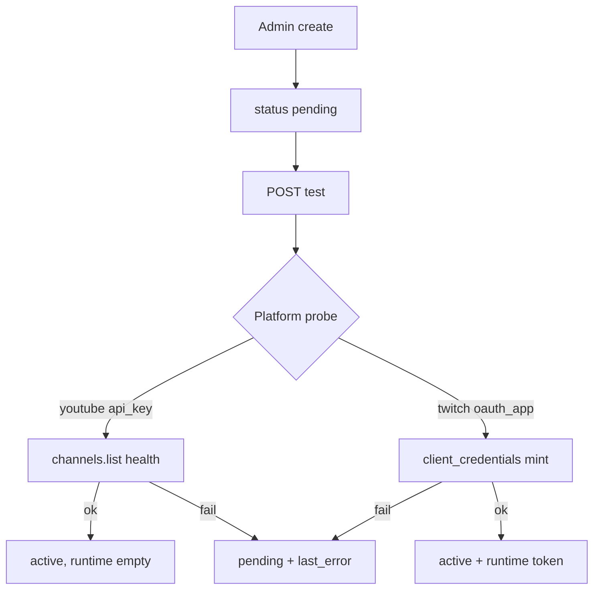

# vTual — product domain (foundation)

Product domain (`kind => product`, `locked => true`) for **content creator aggregation** (display name **vTual**). Foundation ships creator/management/channel/content schema and CRUD skeleton **without** live YouTube/Twitch/Kick ingestion.

| | |
|--|--|
| Code | `app/Domain/Vtual/` |
| Config | [`config/products.php`](../../../config/products.php) key `Vtual` |
| Registry | [`config/domains.php`](../../../config/domains.php) `Vtual` product locked |
| API | `routes/api/v1/vtual.php` |
| Web | `routes/web/vtual.php` |
| Seeder | `VtualRoleSeeder` (after core `RoleSeeder`; also seeds platforms) |
| Product gate | `product.active:Vtual` middleware (see [Product Activations](../product-activations/README.md)) |
| Menu auto-hide | `vtual.index`, `vtual.profiles.index`, `vtual.claims.*`, credentials routes via `menu_routes`; hidden when activation not `active` |
| Legacy audit | [archive/vtual-legacy-audit.md](../../archive/vtual-legacy-audit.md) |

## Concepts

| Concept | Behavior |
|---------|----------|
| Creator | Public profile separate from Identity `User` (`vtual_creators`). Soft delete + `status` active/archived. |
| Creator membership | `vtual_creator_members`: one user may own/edit/view **many** creators (`owner` \| `editor` \| `viewer`). Self-create inserts actor as `owner`. Staff `createOrphan` seeds **no** members (claimable). |
| Creator claim (phase 1) | `vtual_creator_claims`: claim **orphan** (no owner member) via channel bio token or staff **Accept Anyway**. On success: `CreatorMember` owner + Spatie product role `Vtual vTuber`. Losing pendings stay as audit log (`cancelled` + `closed_reason=superseded`). |
| Channel claim | **Non-staff only:** `vtual_channel_claims` attach via bio token (`vtual-ch-…`) or staff **Accept Anyway** on a pending claim. Channel row only after success. Config: `config/vtual.php` `channel_claim.*`. |
| Management | Talent org (`vtual_managements`), not core Spatie role `Management`. |
| Management staff | `vtual_management_members` (`owner` \| `admin` \| `staff`). |
| Creator assignment | `vtual_management_creators` with `joined_at` / `left_at` (historical leave without hard delete). |
| Platform | Seeded catalog: youtube, twitch, **kick** (kick `enabled = false`). |
| Platform credential | Child table `vtual_platform_credentials`: multi-key per platform, envelope-encrypted `secret_payload`, mask-only API. |
| Channel | External channel on a creator; unique `(platform_id, external_id)`. **Dual path on** `POST creators/{id}/channels`: (1) **Staff** (`manage any vtual resource`) → `ChannelService::seedForStaff` resolve + insert **active** immediately (orphan proof-channel seed; no claim row). (2) **Owner/editor** → `ChannelClaimService::start` pending + bio token; verify / Accept Anyway → `activateFromDto`. Snapshot: `description`, `avatar_url`, `banner_url`, `platform_created_at`. Refresh re-syncs; soft remove = **`archived`**. |
| Content | Canonical platform item (`vtual_contents`): **one row** per `(platform_id, external_id)`. `channel_id`/`creator_id` = **primary host** (API truth). Extra channels via **appearances** — not multi-ownership. Sync workers still foundation-only. Content manage UI **out of scope** this phase. |
| External links | Morph `vtual_external_links` for creator (and management) social/donation/website URLs. Creator-scoped CRUD via `ExternalLinkService` + API under `/creators/{id}/links` and `/links/{id}`. |
| User vs vTuber Profile | **User** = Identity login (`users`). **vTuber Profile** = `vtual_creators` (public-facing bio, links, channels, content). Membership is **private**: product UI must not expose that two profiles share the same User. |

### Identity model (locked product decision)

```text
User (Identity) 1 --- N CreatorMember --- N Creator
Management 1 --- N ManagementMember --- N User
Management 1 --- N ManagementCreator --- N Creator  (left_at nullable)
Creator 1 --- N Channel
Channel 1 --- N Content (primary host via contents.channel_id)
Content 1 --- N ContentAppearance --- N Channel  (primary | collaborator | network)
**Glossary (do not conflate):**

| Term | Means | Does **not** mean |
|------|--------|-------------------|
| Creator membership `owner` | User role on a creator profile | Channel “owns” content |
| **Primary host channel** | Upload/host from platform API (`snippet.channelId` on YouTube) | Multi equal owners |
| **Appearance** | Extra registered channel linked to the same content row | Second content row / dual ownership |
| Canonical content | One `vtual_contents` row per platform video/stream id | One row per channel that shows the video |

YouTube Data API: `videos.list` returns **one** `snippet.channelId` (host). Multi-channel product UI (collab / network) is modeled as appearances, not multi-owner content.
```

Core role name **Management** (platform H-RBAC ladder) is **unrelated** to `vtual_managements`.

### Creator claim (phase 1 - binding)

**Problem:** chicken-and-egg - staff want registry profiles before a real vtuber account exists; users want to prove they control a platform channel.

| Path | Who | Behavior |
|------|-----|----------|
| Internal seed | Root / Admin / Moderator (`manage any vtual resource`) | `POST /api/v1/vtual/creators/orphan` creates creator **without** owner membership; then register channels as usual. Staff UI: `/vtual/admin/registry` (orphan form only — do not self-bind staff as owner; use a separate account if staff is also a vtuber) |
| External claim Existing | User with `claim vtual creator` | Pick claimable creator + proof channel, receive token `vtual-claim-...`, put token in YouTube About / Twitch bio, then `POST .../claims/{id}/verify` re-fetches description via production `ChannelProfileResolver` |
| Accept Anyway | Staff + `VTUAL_CLAIM_ACCEPT_ANYWAY` | Skip bio check (QA / local default **ON**) |
| Staff pending queue | `manage any` | `GET /api/v1/vtual/claims/pending` + web `/vtual/admin/registry` |

**On verify success:** insert `vtual_creator_members` role `owner` for claimant; assign product role **`Vtual vTuber`** (level 2250, own perms similar to Editor); **close all other pending claims** for that creator (`status=cancelled`, `closed_reason=superseded`). Rows are **kept as audit log** (no hard-delete this phase).

**Race / already owned:** `verify` / `acceptAnyway` check claimable **before** burning rate-limit attempts; if already owned, claim closes as superseded. Winner path uses creator row lock + `closeCompetingClaims`.

**Spam soft-guard:** `vtual.claim.max_pending_per_user` (default 5) + cooldown + max attempts. Restarting the same creator cancels the user's prior pending for that creator (`closed_reason=user_cancel`) and does not double-count against the cap.

**Not claimable:** creators that already have an `owner` member. Double-owner race fails hard (no silent steal).

**Web surfaces (split):**

| Surface | Route | Audience |
|---------|-------|----------|
| Overview hub | `/vtual` | All product users — creators list + "Where to go" cards |
| My vTuber profiles | `/vtual/profiles` | Membership list (staff with view/manage any: all active); Manage CTA |
| Manage profile | `/vtual/profiles/{id}` | Edit profile meta, external links CRUD, channel add / verify-refresh / archive. Content section stub only. Legacy `/vtual/creators/{id}` uses same controller. |
| Claim as vTuber | `/vtual/claims` | Users — claimable list + my pending; **no** orphan create, **no** management |
| Registry + pending | `/vtual/admin/registry` | Staff — orphan seed + pending claims table (platform + handle on proof channel; **Claim expires** = request TTL) + Accept Anyway |
| Claim detail | `/vtual/claims/{id}` | Claimant or staff — shows **Claimant name/email** before Accept Anyway bypass |
| Platform credentials | `/vtual/admin/platform-credentials` | Root/Admin |

**Privacy:** Manage UI never shows "same User owns these profiles" to third parties. List scope is actor-accessible only.

**In-page nav:** shared partial `resources/views/adminlte4/vtual/partials/nav.blade.php` (Overview / My profiles / Claim / Registry / Credentials).

**Sidebar:** Products → **vTual** parent with children Overview, My profiles, Claim as vTuber, Registry & pending (staff roles). `MenuSeeder` upgrades existing tree idempotently via `ensureVtualMenuBranch()`; re-run `php artisan db:seed --class=MenuSeeder` then `php artisan menu:flush-cache` on existing installs.

**Out of scope (this phase):** management product UI, survey form, Add New approval queue, appeal / permanent reject, multi-profile merge, OAuth login proof, auto-purge of old cancelled rows, stripping core `User` `create vtual creator` (API legacy self-create still exists; staff Blade seeds orphans only).

### Content primary host and appearances

Canonical content is **not** multi-owned. Same platform video may **appear** on multiple registered channels.

| Piece | Role |
|-------|------|
| `vtual_contents` | One row per `(platform_id, external_id)`; `channel_id` + `creator_id` = primary host |
| `vtual_content_appearances` | Pivot: `content_id` + `channel_id` + denormalized `creator_id` + `role` |
| `ContentAppearanceRole` | `primary` (host), `collaborator` (official collab when known), `network` (sibling/brand) |
| `ContentService` | Worker foundation: `upsertFromPrimary`, `attachAppearance`, `detachAppearance`, `setPrimary`, `listForChannel` / `listForCreator` |

**Example (validated):** [youtube.com/watch?v=aVlelUsoFkY](https://www.youtube.com/watch?v=aVlelUsoFkY)

| | |
|--|--|
| `external_id` | `aVlelUsoFkY` |
| Primary host | Neuron `UCEMMrXP3_WeKiOunPYixMfA` (API / oEmbed author) |
| Network appearance | Hipotesa `UCKAV3scmhfcH5Ozc6ICZGRQ` (product association; not a second host row) |

**API limitation (no collab partner list):** `fetchVideos` / `PlatformVideoDto` expose a single host `channelExternalId` (`snippet.channelId` on YouTube; one `user_id` on Twitch). Data API does **not** return a list of "also appears on" channels. YouTube `brandPartner` is Creator Initiated Brand Partner Access — **not** multi-channel collab/network UI. Therefore **auto-detect / log / backfill appearances from platform HTTP is cancelled by design** (no safe signal).

**Late-join channel (ops path):** host channel + content exist first; a second channel (e.g. Hipotesa) is registered later.

1. `ChannelService::activateFromDto` (post-claim) only inserts the channel row — it does **not** touch `vtual_contents` or appearances.
2. Until someone calls `ContentService::attachAppearance`, `listForChannel` for the new channel is empty for that video (expected).
3. Explicit attach (`network` or `collaborator`) then shows the same canonical content row on both feeds; primary host stays the API host.

**Not implemented / cancelled:** auto-discovery of network/collab from description, scrape, or "API log"; public Content REST CRUD. Attach is explicit (worker/admin) only.

**Forbidden wording in product copy:** “owned by multiple channels”, “multi-owner content”. Use primary host + appearance.


## Activation

```php
// config/products.php
'Vtual' => [
    'activation_type' => 'implicit',
    'fulfillment_target' => null,
    'menu_routes' => [
        'vtual.index',
        'vtual.profiles.index',
        'vtual.claims.index',
        'vtual.claims.staff',
        'vtual.admin.credentials.index',
    ],
],
```

- Register hook activates all implicit products (including Vtual).
- `product.active:Vtual` lazy-creates missing implicit rows on first API hit.
- No paid Service SKU yet (`fulfillment_target` null).

## Authorization

Middleware stack:

```text
auth:api → product.active:Vtual → permission:<perm> → Policy → service resource checks
```

### Permissions (`domain_kind = product`)

Own (granted to core `User` + product roles):

```text
view vtual creator | create vtual creator | edit vtual creator | delete vtual creator
view vtual management | create vtual management | edit vtual management
view vtual channel | create vtual channel | claim vtual creator
```

Any (internal core roles Root/Admin/Moderator/Management + product Admin):

```text
view any vtual resource
manage any vtual resource
```

Product roles (levels 2100–2300): `Vtual Admin`, `Vtual Editor`, `Vtual vTuber` (2250), `Vtual Viewer`. Permission `claim vtual creator` on User / Viewer / vTuber / Editor / Admin (+ staff via manage any).

Resource scope:

- Creator view/mutate via membership role or `* any vtual resource`.
- Management assign creators requires management assign role **and** creator mutate on that creator.
- Channel ops scoped through parent creator access.

### Platform credentials (core perms — Root/Admin only)

Separate from product RBAC. Seeded in core `RoleSeeder` (`domain_kind = core`):

```text
view vtual platform credentials
manage vtual platform credentials
```

| Role | Access |
|------|--------|
| Root, Admin | view + manage |
| Moderator, Management, User, product Vtual roles | none |

Policy `PlatformCredentialPolicy` re-checks the same permissions (defense in depth).

## Platform credentials

Multi-credential child of `vtual_platforms` for future YouTube/Twitch sync rotation. **Not** live API clients yet.

### Schema (`vtual_platform_credentials`)

| Column | Notes |
|--------|-------|
| `platform_id` | FK to `vtual_platforms`, cascade delete |
| `label` | Admin name; unique per platform |
| `type` | `api_key` \| `oauth_app` \| `bearer` |
| `secret_payload` | Envelope-encrypted admin secrets (`EnvelopeEncryptedArray`, purpose `vtual`) |
| `runtime_payload` | Envelope-encrypted **system** runtime (Twitch app token etc.); never from admin FormRequest |
| `secret_fingerprint` | HMAC blind index of canonical admin payload (not reversible) |
| `secret_hint` | Last 4 of primary secret field (safe to show) |
| `priority` | Lower preferred for `pickActive()` (default 100) |
| `status` | `pending` \| `active` \| `disabled` \| `revoked` |
| `verified_at` | Set on successful manual Test |
| `last_used_at` / `last_error_*` | Workers + Test |

### Lifecycle (Test gate)

1. Admin creates credential → **`pending`** (client `status=active` ignored).
2. Workers / `pickActive()` ignore pending.
3. Admin presses **Test** (`POST .../credentials/{id}/test`) → platform probe.
4. Success → `active`, `verified_at=now()`, clear errors; Twitch `oauth_app` also writes `runtime_payload`.
5. Failure → stay `pending` (or leave disabled/revoked untouched if already), `last_error_*` set.
6. Secret rotate on update → back to `pending`, clear `runtime_payload` + `verified_at` (must re-Test).
7. Admin cannot promote to `active` without Test (`status_active_requires_test`).



### Type payload keys

| Type | Required (admin `secret_payload`) | Optional | Notes |
|------|-----------------------------------|----------|-------|
| `api_key` | `api_key` | — | YouTube Data API key |
| `oauth_app` | `client_id`, `client_secret` | — | Twitch app; **do not** paste app access token in admin UI |
| `bearer` | `access_token` | `refresh_token`, `expires_at` | Admin-pasted; Test validates only |

**`runtime_payload` shape** (system-written, Twitch app token):

```json
{
  "access_token": "...",
  "token_type": "bearer",
  "expires_at": "2026-09-01T12:00:00+00:00",
  "minted_at": "2026-07-22T03:00:00+00:00"
}
```

### Mask policy

- List/show/update/test responses: metadata + `secret_hint` + `has_secret` + `has_runtime` + `runtime_expires_at` + `verified_at` only.
- **Never** return `secret_payload`, `runtime_payload`, tokens, or fingerprint.
- Update without `secret` keeps encrypted blob; with `secret` re-encrypts, refreshes hint/fingerprint, resets to pending.
- No reveal-plaintext endpoint.

### Workers

| Method | Behavior |
|--------|----------|
| `pickActive(Platform, excludeIds?)` | First eligible `active` by priority ASC; skips soft-demoted; pending never selected |
| `resolvePayload($c)` | Decrypt admin secrets (decrypt cache) |
| `getAppAccessToken($c)` | Twitch `oauth_app` only: reuse `runtime_payload` if `expires_at > now + skew` (default 300s); else re-mint under cache lock `vtual.cred.token.{id}` |
| `markUsed` / `markFailed` / `recordAuthFailure` | Use clears failover state; auth path increments counter + optional soft demote; `markFailed` forgets decrypt cache |

Config: `config/vtual.php` → `credential_test.*` (`youtube_probe_channel_id`, `twitch_token_skew_seconds`, `http_timeout`).

### Decrypt cache (KMS billing)

Not 1 read = 1 KMS. Cast → `EnvelopeEncryptionService::decrypt` → `DecryptedValueCache`.

| Rule | Behavior |
|------|----------|
| resourceType | `vtual_platform_credentials` (covers **both** `secret_payload` and `runtime_payload` fields) |
| TTL | **0** (forever until invalidate) via `encryption.decrypted_cache_ttl_by_resource_type` |
| Other envelope fields | Still use global `ENCRYPTION_DECRYPTED_CACHE_MAX_TTL` (default 86400) |
| Healthy use | `resolvePayload()` + `markUsed()` — **no** cache forget |
| Failure | `markFailed` stamps `last_error_*` and forgets secret + runtime decrypt caches |
| Secret/runtime rewrite | Cast `set` / encrypt already forgets that field's cache |
| Delete | `delete()` forgets caches then removes row |

**Twitch `expires_at` is not a decrypt-cache TTL.** It is token validity for Helix. Cached plaintext DEK unwrap stays until rotate, disable, delete, or `markFailed`. Re-mint rewrites `runtime_payload` only (admin secrets unchanged).

Workers must call `PlatformCredentialService` helpers so invalidate paths stay consistent.

See also [payment-gateway/encryption.md](../payment-gateway/encryption.md).

## API (`/api/v1/vtual/*`)

| Method | Path | Permission | Purpose |
|--------|------|------------|---------|
| GET | `/platforms` | view vtual creator | Platform catalog (includes disabled Kick) — **no credentials** |
| GET/POST | `/creators` | view / create | List (scoped) / create (actor becomes owner) |
| GET/PATCH/DELETE | `/creators/{id}` | view / edit / delete | Show / update / archive |
| GET/POST | `/creators/{id}/channels` | view channel / edit creator | List (non-archived) / register channel (`active` after resolve) |
| GET | `/channels/{id}` | view channel | Show channel |
| POST | `/channels/{id}/refresh` | edit creator | Re-resolve by `external_id`; set `active` |
| POST | `/channels/{id}/archive` | edit creator | Soft archive (`archived`) |
| GET/POST | `/creators/{id}/links` | view / edit creator | List / create external links |
| PATCH/DELETE | `/links/{id}` | edit creator | Update / delete external link |
| GET/POST | `/managements` | view / create | List / create management |
| GET/PATCH | `/managements/{id}` | view / edit | Show / update |
| POST | `/managements/{id}/creators` | edit management | Assign creator |
| DELETE | `/managements/{id}/creators/{creatorId}` | edit management | Unassign (`left_at`) |
| GET | `/admin/platforms/{id}/credentials` | view vtual platform credentials | List credentials (masked) |
| POST | `/admin/platforms/{id}/credentials` | manage vtual platform credentials | Create credential (`pending`) |
| GET/PATCH/DELETE | `/admin/credentials/{id}` | view / manage | Show / update / delete |
| POST | `/admin/credentials/{id}/disable` | manage | Set status `disabled` |
| POST | `/admin/credentials/{id}/test` | manage | Manual Test gate; returns masked credential + `test.{ok,message,platform}` |

## Web Blade

| Route | View |
|-------|------|
| `GET vtual` (`vtual.index`) | Creators + managements lists + create forms + platform badges |
| `GET vtual/creators/{id}` | Creator detail + channel register form |
| `GET vtual/admin/platform-credentials` | Admin platform list → drill into credentials |
| `GET vtual/admin/platforms/{id}/credentials` | Credential table + create/update/Test (mask only; no app tokens) |
| `POST vtual/admin/credentials/{id}/test` | Forward Test to API |
| Mutations | POST/PATCH/DELETE forward via `ConsumesApi` to versioned API |

Layout: `resources/views/{WEB_LAYOUT}/vtual/` (default `adminlte4`).

## Seeders

1. `RoleSeeder` — core perms `view/manage vtual platform credentials` for Root/Admin.
2. `VtualRoleSeeder` — product roles/permissions + `PlatformService::seedDefaults()`.
3. `MenuSeeder` — Products → **vTual** leaf (`vtual.index`); Administration → **vTual platform credentials** (Root/Admin menu RBAC).
4. `DatabaseSeeder` calls `VtualRoleSeeder` after `FileHostingRoleSeeder`.

## Kick strategy (foundation)

- Platform row exists with `enabled = false`.
- `ChannelClaimService::start` / platform resolve rejects disabled platforms (no scrape path); Kick has no profile resolve.
- Re-enable only after official API decision (see archive audit).

## Platform HTTP clients (manual fetch)

Worker-facing foundation for **pull** reads against YouTube Data API v3 and Twitch Helix. No WebSub/EventSub, no `vtual_contents` persistence in this layer.

### Layout

```
app/Domain/Vtual/Integrations/
  PlatformApiGateway.php          # public facade
  PlatformClientRegistry.php
  Youtube/YoutubeDataApiClient.php
  Twitch/TwitchHelixClient.php
  Contracts/{PlatformClient,FetchesVideos,FetchesChannels,ResolvesChannel,FetchesStreams}.php
  Dto/{PlatformVideoDto,PlatformChannelDto,PlatformStreamDto,YoutubeParts}.php
  Support/{BatchIdChunker,PlatformHttp,ChannelProfileInput,ChannelProfileInputParser,ChannelProfileResolver}.php
  Enums/PlatformApiOperation.php
```

### Channel profile identity (canonical vs handle)

| Platform | `external_id` (stable, unique) | `handle` (mutable, display) |
|----------|--------------------------------|-----------------------------|
| YouTube | Channel id `UC…` | bare handle (no `@`) from `customUrl` |
| Twitch | Numeric user id | lowercase login |

**Register** (`POST /api/v1/vtual/creators/{id}/channels`): body `{ platform_key, profile }`. `profile` accepts:

- YouTube: `UC…`, `@handle`, `youtube.com/@handle`, `youtube.com/channel/UC…`
- Twitch: numeric id, login, `twitch.tv/login`

Requires **active** platform credential (same as gateway). Parser → `ChannelProfileResolver` → `fetchChannels` or `resolveChannel` → persist DTO.

**Create** (`POST /api/v1/vtual/creators/{id}/channels`): body `{ platform_key, profile }`. Successful platform resolve stores canonical identity and status **`active`** (no second verify click required).

**Profile snapshot columns** (intersection YouTube + Twitch from existing channel/user endpoints; auto-filled on create/refresh):

| Column | YouTube | Twitch | Notes |
|--------|---------|--------|-------|
| `description` | `snippet.description` | `description` | channel bio |
| `avatar_url` | best `snippet.thumbnails` (high→medium→default) | `profile_image_url` | DTO `thumbnailUrl` |
| `banner_url` | `brandingSettings.image.bannerExternalUrl` | `offline_image_url` | Twitch offline banner ≠ YT banner pixel-perfect |
| `platform_created_at` | `snippet.publishedAt` | `created_at` | platform account/channel birth |

Not shared this phase (no dual-platform signal without extra APIs): subscriber/follower counts, video_count, view_count (Twitch deprecated), country, broadcaster_type. Existing rows: click **Verify / refresh** to backfill snapshot.


**Refresh / verify** (`POST /api/v1/vtual/channels/{id}/refresh`): re-fetch by stored `external_id` only; updates `handle`, `display_name`, `url`, `last_synced_at`, sets status **`active`**. Does not change `external_id`. Rejects archived channels.

**Archive** (`POST /api/v1/vtual/channels/{id}/archive`): soft-remove (`status=archived`); hidden from default list. No hard-delete this phase.

**External links** (`ExternalLinkService`): creator-scoped CRUD gated by `CreatorAccessService` (membership mutate or `manage any`). Kinds: `social` | `donation` | `website` | `other`.

**Workers:** always call streams/videos APIs with stored `external_id` (Twitch `user_id`, YT channel id) — never login/handle as batch id.

### Credential flow

1. `PlatformApiGateway` resolves `Platform` by key; rejects disabled (Kick).
2. `PlatformCredentialService::pickActive` — only `status=active` (post-Test).
3. YouTube: `resolvePayload` → `key=` query param.
4. Twitch: `getAppAccessToken` + `Client-Id` + `Authorization: Bearer`.
5. Success → `markUsed` (clears failover counters). HTTP 401/403 → `recordAuthFailure` (last_error + consecutive counter; soft demote when failover enabled).

### ErrorLog for platform HTTP failures

`PlatformApiException` extends `BusinessRuleException`, so uncaught `report()` / `recordException` **skip** it (intentional API noise filter). Platform upstream failures are **ops signals** (bad key, quota, outage) and must still land in `error_logs` for manual credential decisions.

| Path | Writes `error_logs`? | Notes |
|------|----------------------|-------|
| `PlatformHttp::get` non-2xx / connection fail | **Yes** via `PlatformErrorLogger` → `ErrorLogRecorder::recordLog` | Context: `domain=vtual`, `component=platform_http`, `platform`, `upstream_status`, `url_host` + `url_path` only (never query/`key=`/tokens), optional `credential_id` + `operation` |
| HTTP 401/403 → `markFailed` | Credential `last_error_*` + ErrorLog from **PlatformHttp only** | `markFailed(..., logToErrorLog: false)` avoids double row |
| Credential **Test** / Twitch token mint fail → `markFailed` | **Yes** (`component=platform_credential`, `event=credential_mark_failed`) | Incomplete secret / probe reject with no HTTP client path |
| Auto-rotate on log | **No** hard rotate | Soft failover is separate (config flag); ErrorLog is audit only |

Do **not** reclassify all BRE as reportable. Do **not** put secrets in message/context.
### Soft credential failover

Default **OFF** (`config/vtual.php` → `credential.failover`, env `VTUAL_CREDENTIAL_FAILOVER_ENABLED`).

| Rule | Behavior |
|------|----------|
| Trigger | Upstream **401/403** only (`recordAuthFailure`) |
| Soft demote | Status stays `active`; `consecutive_auth_failures++`; at threshold set `failover_skip_until` |
| `pickActive` | Skips rows with future `failover_skip_until`; optional `excludeIds`; priority ASC |
| Gateway retry | `PlatformApiGateway` fetch* methods: max `max_retries_per_call` (default 1) alternate credential |
| Clear | `markUsed` / successful **Test** zero counter and clear skip |
| Not trigger | 429, 5xx, connection errors, business 4xx |
| Never | Auto-promote `pending`; hard `disabled` on auth fail; pool burn |

Workers should call gateway `fetch*` / `resolveChannel` (failover). Direct `client()` is single-pick only.


### Shared operations (interchangeable)

| Method | YouTube | Twitch | Batch max |
|--------|---------|--------|-----------|
| `fetchVideos(ids, parts?)` | `GET /videos?id=&part=` | `GET /helix/videos?id=` (repeated `id`) | **50** |
| `fetchChannels(ids, parts?)` | `GET /channels?id=&part=` | `GET /helix/users?id=` | **50** |
| `resolveChannel(handle)` | `channels?forHandle=` | `users?login=` | 1 |

`parts` is YouTube-only (whitelist in `config/vtual.php` → `youtube.allowed_*_parts`). Twitch ignores parts.

Batch rules (`config/vtual.http.batch`):

- Hard-fail if caller passes more than max on single `fetch*` (no silent multi-request).
- `fetchVideosChunked` auto-splits for large lists.

Product flags `supports_live` / `supports_vod` gate **ingestion policy**, not raw HTTP capability. Twitch still implements `fetchVideos` (Helix past broadcasts) even when `supports_vod=false`.

### Platform-specific (no god-method)

| Method | Platform | Notes |
|--------|----------|-------|
| `fetchStreamsByUserIds` | Twitch only | `GET /helix/streams?user_id=` (max 100). Throws `UnsupportedPlatformOperation` on YouTube. |
| Channel catalog / uploads playlist | — | Not implemented (YT `playlistItems` / Twitch `videos?user_id=` differ). |
| Live discovery via `search.list` | — | Documented only; separate quota bucket — avoid as primary path. |

### Normalized DTOs

Workers consume `PlatformVideoDto` / `PlatformChannelDto` / `PlatformStreamDto` (stable fields toward `vtual_contents` / `vtual_channels`). Mappers are per-client; no shared raw JSON shape.

### Config

See `config/vtual.php`: `http.timeout`, `http.batch.*`, `youtube.default_*_parts`, `youtube.allowed_*_parts`, `twitch.helix_base_url`.

### Usage

```php
$gateway = app(\App\Domain\Vtual\Integrations\PlatformApiGateway::class);

$videos = $gateway->fetchVideos(\App\Domain\Vtual\Enums\PlatformKey::Youtube, ['dQw4w9WgXcQ']);
$videos = $gateway->fetchVideos(\App\Domain\Vtual\Enums\PlatformKey::Twitch, ['9001']);

$streams = $gateway->fetchStreamsByUserIds(\App\Domain\Vtual\Enums\PlatformKey::Twitch, ['12345']);
```

### Admin probe (permanent Root/Admin debug)

Permanent debug surface for **production** `PlatformApiGateway` — **not** temporary. Root/Admin only (`manage vtual platform credentials`). Uses the **active** credential; hits live YouTube/Twitch (or `Http::fake` in tests). No secrets in response.

| Surface | Method | Path |
|---------|--------|------|
| Web form | GET/POST | `/vtual/admin/platform-api-probe` |
| API | POST | `/api/v1/vtual/admin/platform-api/probe` |

**Methods:** `fetch_videos`, `fetch_videos_chunked`, `fetch_channels`, `resolve_channel`, `fetch_streams` (Twitch only).

#### Agent rule — production mirror (mandatory)

Probe **must** exercise the same production paths workers use. Results must represent real gateway method output (same clients, credentials, DTOs, errors).

| Allowed | Forbidden |
|---------|-----------|
| Call `PlatformApiGateway` methods only | Duplicate Helix/YouTube HTTP clients or alternate query builders |
| Input validation + optional profile normalize via **existing** production helpers (`ChannelProfileInputParser` / `ChannelProfileResolver`) | Probe-only business rules or fake success shapes |
| Serialize gateway DTOs (`PlatformDtoSerializer`) for display | Alternate DTO mapping that diverges from production clients |

Flow:

```text
Probe form/API
  → PlatformApiProbeService (input parse / optional profile normalize)
  → PlatformApiGateway (credential + client + capability)
  → YoutubeDataApiClient / TwitchHelixClient
  → DTO serialize → JSON
```

When **adding, removing, or renaming** a worker-facing gateway method that should be manually testable, update in the **same PR**:

1. `PlatformApiProbeService::METHODS` + `run()` match arm
2. `PlatformApiProbeRequest` validation (`Rule::in`)
3. Web labels/help in `lang/{en,id,ja}/web/vtual.php` (`probe.method_*`, `ids_help`)
4. Feature tests (`PlatformApiProbeApiTest` / `PlatformApiProbeWebTest`)
5. This README section (methods table + notes)

Video/VOD ids stay raw (no profile resolve). Channel/stream profile normalize is the shared production resolver used by channel register — not probe-only logic.

#### Profile normalization

Same `ChannelProfileInputParser` + `ChannelProfileResolver` as channel register:

| Method | IDs field | Behavior |
|--------|-----------|----------|
| `fetch_streams` | user id, login, `@handle`, or profile URL | Normalize → canonical `user_id` → gateway `fetchStreamsByUserIds` |
| `fetch_channels` | channel/user id, handle/login, or URL | Normalize → canonical id → gateway `fetchChannels` |
| `fetch_videos` / `fetch_videos_chunked` | raw video/VOD ids | **No** profile resolve → gateway as-is |
| `resolve_channel` | `handle` (or single id) | Gateway `resolveChannel` |

Example: Twitch `ids=2xrakai` on `fetch_streams` resolves to `997729120` then streams. Response includes `resolved: [{ input, external_id, handle }]` for debug transparency.

**Body (API / form):**

| Field | Required | Notes |
|-------|----------|-------|
| `platform` | yes | `youtube` \| `twitch` |
| `method` | yes | see above |
| `ids` | for multi-id methods | array or comma/space string; max 50 videos/channels, 100 streams |
| `handle` | for `resolve_channel` | YouTube `@handle` or Twitch login |
| `parts` | optional | YouTube only; comma list or array |
| `chunked` | optional | if true and method is `fetch_videos`, maps to `fetch_videos_chunked` |

Web UI: link from credentials index → **API probe**.

### Tests

`tests/Domain/Vtual/Unit/Integrations/PlatformApiGatewayTest.php`, `BatchIdChunkerTest.php` — `Http::fake`, batch caps, parts whitelist, auth headers, 401 → `markFailed` + ErrorLog (no secrets), unsupported ops.

`PlatformApiProbeApiTest` / `PlatformApiProbeWebTest` — admin probe gate, multi-id path, Twitch streams/channels profile normalize (login → user_id).

## Known limitations (deferred)

| Item | Status |
|------|--------|
| YouTube WebSub / PubSubHubbub | Not implemented (manual HTTP clients ready) |
| YouTube/Twitch content upsert into `vtual_contents` | `ContentService::upsertFromPrimary` foundation (no sync workers) |
| Twitch EventSub | Not implemented |
| Live poll scheduler / CCV snapshots | Not implemented (`fetchStreamsByUserIds` ready for workers) |
| Soft credential failover (401/403) | Implemented default **OFF** (`VTUAL_CREDENTIAL_FAILOVER_ENABLED`) |
| Reveal plaintext credential endpoint | Explicitly out of scope |
| Kick integration | Deferred; disabled seed |
| Content lifecycle sync + CCV snapshots | Table + appearances model; no live sync workers |
| Auto collab/network appearance discovery | **Cancelled** (no platform partner list; explicit `attachAppearance` only) |
| Creator claim Existing (bio token) | **Phase 1 implemented** (orphan seed + verify + Accept Anyway) |
| Channel claim (attach channel) | **Implemented** dual path: staff seed instant active; non-staff pending claim + bio / Accept Anyway |
| Claim Add New + survey + appeal + merge | Not implemented (phase 2+) |
| Ideal Viewer-only until claim (strip User create creator) | Follow-up; not in phase 1 |
| Multi-stream session correlation | Not implemented |
| Public homepage / SEO creator & management profiles | Not implemented |
| Paid Service catalog SKUs for Vtual | Not implemented |
| Data migration from broadercastv2 | Not planned in foundation |

## Tests

```bash
composer test -- --filter=Vtual
composer test -- --filter=PlatformCredential
```

| Suite | Coverage |
|-------|----------|
| `SlugGeneratorTest` | Slugify + unique suffix |
| `CreatorMemberRoleTest` | Mutate / manage members matrix |
| `CreatorServiceTest` | Multi-creator ownership, slug collision, archive |
| `ManagementServiceTest` | Owner membership, assign/unassign `left_at` |
| `ChannelServiceTest` | `seedForStaff` (manage any), non-staff denied, `activateFromDto`, refresh/archive |
| `ChannelClaimServiceTest` | Start pending only; verify bio token; Accept Anyway; taken external_id blocked |
| `ChannelProfileInputParserTest` / `ChannelProfileResolverTest` | Parse matrix YT/Twitch; handle → canonical id via Http::fake |
| `PlatformCredentialSecretsTest` | Payload normalize / fingerprint / reject unknown keys |
| `PlatformCredentialServiceTest` | pending create, pickActive, Test YT/Twitch, getAppAccessToken reuse/remint, secret rotate reset, forever decrypt cache |
| `ContentServiceTest` | Primary host + network appearance, late-join no auto-attach, listForChannel/Creator, detach/setPrimary invariants |
| `CreatorClaimServiceTest` | Orphan create, claimable list, bio verify Http::fake, cooldown, Accept Anyway, already-owned (no attempt burn), winner supersedes other pending, max_pending_per_user, staff listPending |
| `PlatformApiGatewayTest` / `BatchIdChunkerTest` | Manual HTTP clients: multi-id, batch max, parts, auth, 401 markFailed + ErrorLog + soft failover (no secrets) |
| `PlatformCredentialApiTest` | Masked CRUD + Test, RBAC, Root/Admin OK, User/Moderator 403, validation 422 |
| `DecryptedValueCacheTest` | vtual resource TTL 0 past global cap; non-mapped type still expires |
| `VtualApiTest` | CRUD API, user channel claim path, staff seed active channel, product gate, peer isolation |
| `RegisterVtualActivationTest` | Register creates implicit Vtual activation |


## Future: merge / reparent (not implemented)

One User may own many Creators; each Creator has its own channels. Ops sometimes need to consolidate.

**Recommended later (no code yet):**

1. **Channel reparent (same owner)** — move `channel.creator_id` from profile A → B when actor owns both (or staff). Respect global unique `(platform_id, external_id)`; re-point primary host / appearances carefully. Lowest risk; product copy: “Move channel to another of my profiles.”
2. **Profile absorb** — target takes source channels + external links; re-point contents; archive source; cancel open claims; audit log. Explicit confirm only.
3. **No auto-merge across different Users** without dual ownership proof or staff override.

**Do not:** silent merge by email; transfer without audit; dual primary hosts for one video.

## Related

- [product-activations/README.md](../product-activations/README.md) — runtime gate
- [file-hosting/README.md](../file-hosting/README.md) — sibling product domain pattern
- [identity/README.md](../identity/README.md) — User hub, product RBAC `domain_kind`
- [platform/architecture.md](../../platform/architecture.md) — domain registry
- [archive/vtual-legacy-audit.md](../../archive/vtual-legacy-audit.md) — broadercast claim ledger
