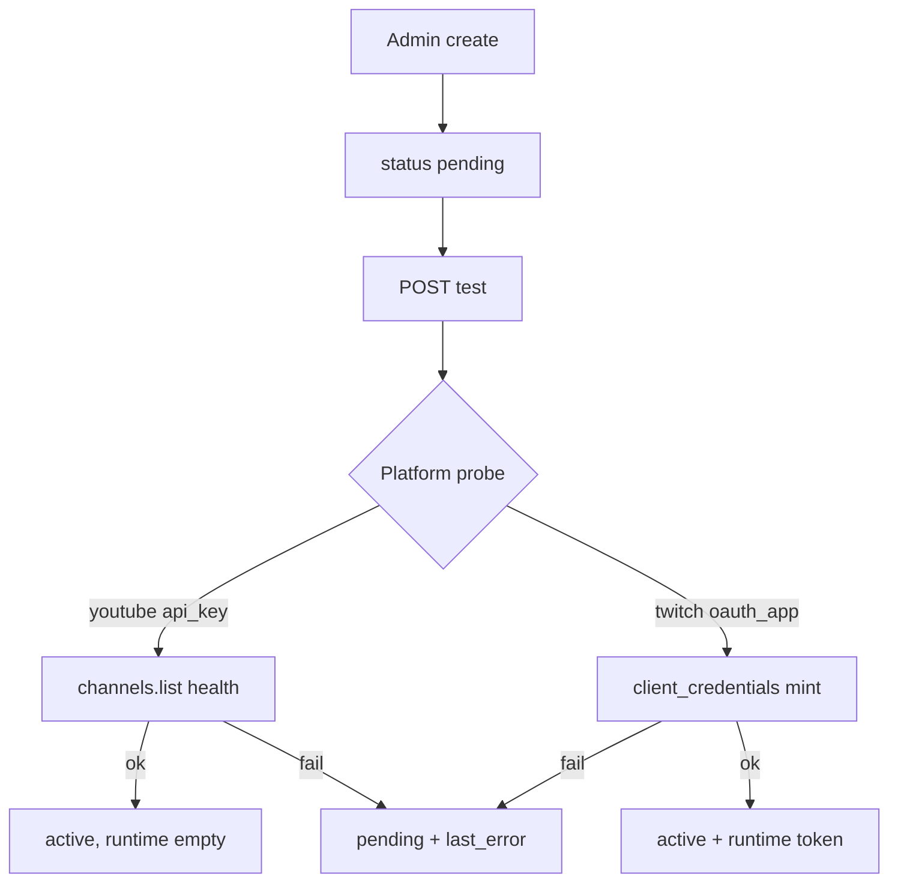

# vTual — product domain (foundation)

Product domain (`kind => product`, `locked => true`) for **content creator aggregation** (display name **vTual**). Foundation ships creator/management/channel/content schema and CRUD skeleton **without** live YouTube/Twitch/Kick ingestion.

| | |
|--|--|
| Code | `app/Domain/Vtual/` |
| Config | [`config/products.php`](../../../config/products.php) key `Vtual` |
| Registry | [`config/domains.php`](../../../config/domains.php) `Vtual` product locked |
| API | `routes/api/v1/vtual.php` |
| Web | `routes/web/vtual.php` |
| Seeder | `VtualRoleSeeder` (after core `RoleSeeder`; also seeds platforms) |
| Product gate | `product.active:Vtual` middleware (see [Product Activations](../product-activations/README.md)) |
| Menu auto-hide | `vtual.index` via `menu_routes`; hidden when activation not `active` |
| Legacy audit | [archive/vtual-legacy-audit.md](../../archive/vtual-legacy-audit.md) |

## Concepts

| Concept | Behavior |
|---------|----------|
| Creator | Public profile separate from Identity `User` (`vtual_creators`). Soft delete + `status` active/archived. |
| Creator membership | `vtual_creator_members`: one user may own/edit/view **many** creators (`owner` \| `editor` \| `viewer`). Create always inserts actor as `owner`. |
| Management | Talent org (`vtual_managements`), not core Spatie role `Management`. |
| Management staff | `vtual_management_members` (`owner` \| `admin` \| `staff`). |
| Creator assignment | `vtual_management_creators` with `joined_at` / `left_at` (historical leave without hard delete). |
| Platform | Seeded catalog: youtube, twitch, **kick** (kick `enabled = false`). |
| Platform credential | Child table `vtual_platform_credentials`: multi-key per platform, envelope-encrypted `secret_payload`, mask-only API. |
| Channel | External channel on a creator; unique `(platform_id, external_id)`; status starts `pending`. |
| Content | Normalized shell table (`vtual_contents`) for live/archive/vod — **no sync workers in foundation**. |
| External links | Morph `vtual_external_links` for creator/management social/donation URLs (schema ready; minimal API in foundation). |

### Identity model (locked product decision)

```text
User (Identity) 1 --- N CreatorMember --- N Creator
Management 1 --- N ManagementMember --- N User
Management 1 --- N ManagementCreator --- N Creator  (left_at nullable)
Creator 1 --- N Channel --- N Content
```

Core role name **Management** (platform H-RBAC ladder) is **unrelated** to `vtual_managements`.

## Activation

```php
// config/products.php
'Vtual' => [
    'activation_type' => 'implicit',
    'fulfillment_target' => null,
    'menu_routes' => ['vtual.index'],
],
```

- Register hook activates all implicit products (including Vtual).
- `product.active:Vtual` lazy-creates missing implicit rows on first API hit.
- No paid Service SKU yet (`fulfillment_target` null).

## Authorization

Middleware stack:

```text
auth:api → product.active:Vtual → permission:<perm> → Policy → service resource checks
```

### Permissions (`domain_kind = product`)

Own (granted to core `User` + product roles):

```text
view vtual creator | create vtual creator | edit vtual creator | delete vtual creator
view vtual management | create vtual management | edit vtual management
view vtual channel | create vtual channel
```

Any (internal core roles Root/Admin/Moderator/Management + product Admin):

```text
view any vtual resource
manage any vtual resource
```

Product roles (levels 2100–2300): `Vtual Admin`, `Vtual Editor`, `Vtual Viewer`.

Resource scope:

- Creator view/mutate via membership role or `* any vtual resource`.
- Management assign creators requires management assign role **and** creator mutate on that creator.
- Channel ops scoped through parent creator access.

### Platform credentials (core perms — Root/Admin only)

Separate from product RBAC. Seeded in core `RoleSeeder` (`domain_kind = core`):

```text
view vtual platform credentials
manage vtual platform credentials
```

| Role | Access |
|------|--------|
| Root, Admin | view + manage |
| Moderator, Management, User, product Vtual roles | none |

Policy `PlatformCredentialPolicy` re-checks the same permissions (defense in depth).

## Platform credentials

Multi-credential child of `vtual_platforms` for future YouTube/Twitch sync rotation. **Not** live API clients yet.

### Schema (`vtual_platform_credentials`)

| Column | Notes |
|--------|-------|
| `platform_id` | FK to `vtual_platforms`, cascade delete |
| `label` | Admin name; unique per platform |
| `type` | `api_key` \| `oauth_app` \| `bearer` |
| `secret_payload` | Envelope-encrypted admin secrets (`EnvelopeEncryptedArray`, purpose `vtual`) |
| `runtime_payload` | Envelope-encrypted **system** runtime (Twitch app token etc.); never from admin FormRequest |
| `secret_fingerprint` | HMAC blind index of canonical admin payload (not reversible) |
| `secret_hint` | Last 4 of primary secret field (safe to show) |
| `priority` | Lower preferred for `pickActive()` (default 100) |
| `status` | `pending` \| `active` \| `disabled` \| `revoked` |
| `verified_at` | Set on successful manual Test |
| `last_used_at` / `last_error_*` | Workers + Test |

### Lifecycle (Test gate)

1. Admin creates credential → **`pending`** (client `status=active` ignored).
2. Workers / `pickActive()` ignore pending.
3. Admin presses **Test** (`POST .../credentials/{id}/test`) → platform probe.
4. Success → `active`, `verified_at=now()`, clear errors; Twitch `oauth_app` also writes `runtime_payload`.
5. Failure → stay `pending` (or leave disabled/revoked untouched if already), `last_error_*` set.
6. Secret rotate on update → back to `pending`, clear `runtime_payload` + `verified_at` (must re-Test).
7. Admin cannot promote to `active` without Test (`status_active_requires_test`).



### Type payload keys

| Type | Required (admin `secret_payload`) | Optional | Notes |
|------|-----------------------------------|----------|-------|
| `api_key` | `api_key` | — | YouTube Data API key |
| `oauth_app` | `client_id`, `client_secret` | — | Twitch app; **do not** paste app access token in admin UI |
| `bearer` | `access_token` | `refresh_token`, `expires_at` | Admin-pasted; Test validates only |

**`runtime_payload` shape** (system-written, Twitch app token):

```json
{
  "access_token": "...",
  "token_type": "bearer",
  "expires_at": "2026-09-01T12:00:00+00:00",
  "minted_at": "2026-07-22T03:00:00+00:00"
}
```

### Mask policy

- List/show/update/test responses: metadata + `secret_hint` + `has_secret` + `has_runtime` + `runtime_expires_at` + `verified_at` only.
- **Never** return `secret_payload`, `runtime_payload`, tokens, or fingerprint.
- Update without `secret` keeps encrypted blob; with `secret` re-encrypts, refreshes hint/fingerprint, resets to pending.
- No reveal-plaintext endpoint.

### Workers

| Method | Behavior |
|--------|----------|
| `pickActive(Platform)` | First `status=active` by priority ASC (pending never selected) |
| `resolvePayload($c)` | Decrypt admin secrets (decrypt cache) |
| `getAppAccessToken($c)` | Twitch `oauth_app` only: reuse `runtime_payload` if `expires_at > now + skew` (default 300s); else re-mint under cache lock `vtual.cred.token.{id}` |
| `markUsed` / `markFailed` | Stamp use / error; `markFailed` forgets decrypt cache for secret + runtime |

Config: `config/vtual.php` → `credential_test.*` (`youtube_probe_channel_id`, `twitch_token_skew_seconds`, `http_timeout`).

### Decrypt cache (KMS billing)

Not 1 read = 1 KMS. Cast → `EnvelopeEncryptionService::decrypt` → `DecryptedValueCache`.

| Rule | Behavior |
|------|----------|
| resourceType | `vtual_platform_credentials` (covers **both** `secret_payload` and `runtime_payload` fields) |
| TTL | **0** (forever until invalidate) via `encryption.decrypted_cache_ttl_by_resource_type` |
| Other envelope fields | Still use global `ENCRYPTION_DECRYPTED_CACHE_MAX_TTL` (default 86400) |
| Healthy use | `resolvePayload()` + `markUsed()` — **no** cache forget |
| Failure | `markFailed` stamps `last_error_*` and forgets secret + runtime decrypt caches |
| Secret/runtime rewrite | Cast `set` / encrypt already forgets that field's cache |
| Delete | `delete()` forgets caches then removes row |

**Twitch `expires_at` is not a decrypt-cache TTL.** It is token validity for Helix. Cached plaintext DEK unwrap stays until rotate, disable, delete, or `markFailed`. Re-mint rewrites `runtime_payload` only (admin secrets unchanged).

Workers must call `PlatformCredentialService` helpers so invalidate paths stay consistent.

See also [payment-gateway/encryption.md](../payment-gateway/encryption.md).

## API (`/api/v1/vtual/*`)

| Method | Path | Permission | Purpose |
|--------|------|------------|---------|
| GET | `/platforms` | view vtual creator | Platform catalog (includes disabled Kick) — **no credentials** |
| GET/POST | `/creators` | view / create | List (scoped) / create (actor becomes owner) |
| GET/PATCH/DELETE | `/creators/{id}` | view / edit / delete | Show / update / archive |
| GET/POST | `/creators/{id}/channels` | view channel / edit creator | List / register channel |
| GET | `/channels/{id}` | view channel | Show channel |
| GET/POST | `/managements` | view / create | List / create management |
| GET/PATCH | `/managements/{id}` | view / edit | Show / update |
| POST | `/managements/{id}/creators` | edit management | Assign creator |
| DELETE | `/managements/{id}/creators/{creatorId}` | edit management | Unassign (`left_at`) |
| GET | `/admin/platforms/{id}/credentials` | view vtual platform credentials | List credentials (masked) |
| POST | `/admin/platforms/{id}/credentials` | manage vtual platform credentials | Create credential (`pending`) |
| GET/PATCH/DELETE | `/admin/credentials/{id}` | view / manage | Show / update / delete |
| POST | `/admin/credentials/{id}/disable` | manage | Set status `disabled` |
| POST | `/admin/credentials/{id}/test` | manage | Manual Test gate; returns masked credential + `test.{ok,message,platform}` |

## Web Blade

| Route | View |
|-------|------|
| `GET vtual` (`vtual.index`) | Creators + managements lists + create forms + platform badges |
| `GET vtual/creators/{id}` | Creator detail + channel register form |
| `GET vtual/admin/platform-credentials` | Admin platform list → drill into credentials |
| `GET vtual/admin/platforms/{id}/credentials` | Credential table + create/update/Test (mask only; no app tokens) |
| `POST vtual/admin/credentials/{id}/test` | Forward Test to API |
| Mutations | POST/PATCH/DELETE forward via `ConsumesApi` to versioned API |

Layout: `resources/views/{WEB_LAYOUT}/vtual/` (default `adminlte4`).

## Seeders

1. `RoleSeeder` — core perms `view/manage vtual platform credentials` for Root/Admin.
2. `VtualRoleSeeder` — product roles/permissions + `PlatformService::seedDefaults()`.
3. `MenuSeeder` — Products → **vTual** leaf (`vtual.index`); Administration → **vTual platform credentials** (Root/Admin menu RBAC).
4. `DatabaseSeeder` calls `VtualRoleSeeder` after `FileHostingRoleSeeder`.

## Kick strategy (foundation)

- Platform row exists with `enabled = false`.
- `ChannelService::create` rejects disabled platforms (no scrape path).
- Re-enable only after official API decision (see archive audit).

## Known limitations (deferred)

| Item | Status |
|------|--------|
| YouTube WebSub / Data API adapters | Not implemented (`pickActive` + Test gate ready) |
| Twitch EventSub / Helix live poll | Not implemented |
| Automatic credential rotation on 401 | Not implemented |
| Reveal plaintext credential endpoint | Explicitly out of scope |
| Kick integration | Deferred; disabled seed |
| Content lifecycle sync + CCV snapshots | Table only |
| Multi-stream session correlation | Not implemented |
| Public homepage / SEO creator & management profiles | Not implemented |
| Paid Service catalog SKUs for Vtual | Not implemented |
| Data migration from broadercastv2 | Not planned in foundation |

## Tests

```bash
composer test -- --filter=Vtual
composer test -- --filter=PlatformCredential
```

| Suite | Coverage |
|-------|----------|
| `SlugGeneratorTest` | Slugify + unique suffix |
| `CreatorMemberRoleTest` | Mutate / manage members matrix |
| `CreatorServiceTest` | Multi-creator ownership, slug collision, archive |
| `ManagementServiceTest` | Owner membership, assign/unassign `left_at` |
| `ChannelServiceTest` | Pending channel, Kick disabled, duplicate external id |
| `PlatformCredentialSecretsTest` | Payload normalize / fingerprint / reject unknown keys |
| `PlatformCredentialServiceTest` | pending create, pickActive, Test YT/Twitch, getAppAccessToken reuse/remint, secret rotate reset, forever decrypt cache |
| `PlatformCredentialApiTest` | Masked CRUD + Test, RBAC, Root/Admin OK, User/Moderator 403, validation 422 |
| `DecryptedValueCacheTest` | vtual resource TTL 0 past global cap; non-mapped type still expires |
| `VtualApiTest` | CRUD API, product gate, lazy activation, peer isolation |
| `RegisterVtualActivationTest` | Register creates implicit Vtual activation |

## Related

- [product-activations/README.md](../product-activations/README.md) — runtime gate
- [file-hosting/README.md](../file-hosting/README.md) — sibling product domain pattern
- [identity/README.md](../identity/README.md) — User hub, product RBAC `domain_kind`
- [platform/architecture.md](../../platform/architecture.md) — domain registry
- [archive/vtual-legacy-audit.md](../../archive/vtual-legacy-audit.md) — broadercast claim ledger
