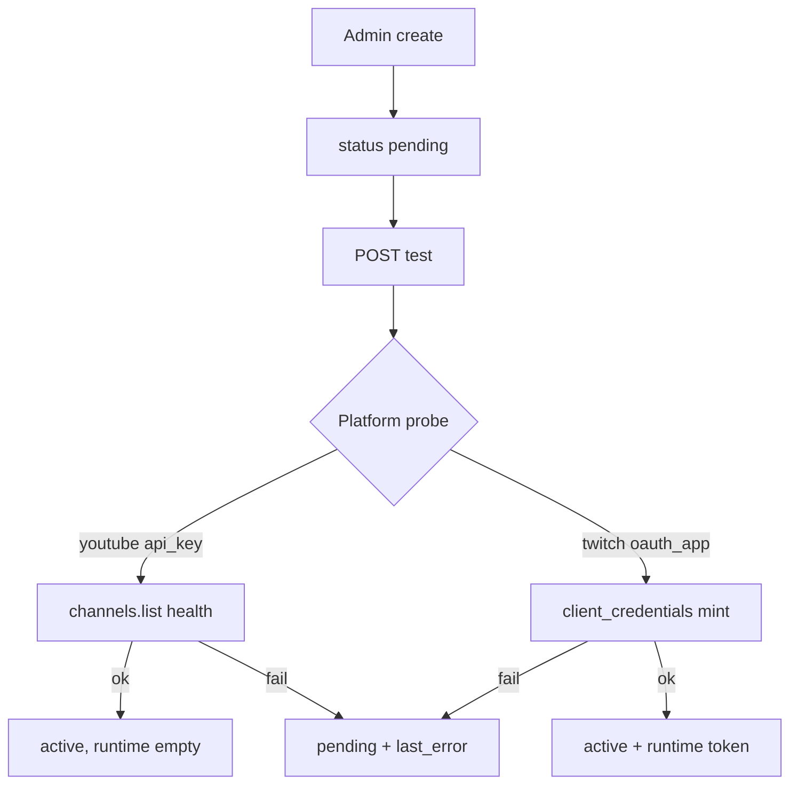

# vTual — product domain

> **UI:** Admin screens live in **Monolith-Vue-Workers** (`/apps/vtual/*`). Blade web controllers and views are removed — see [web/blade-admin.md](../../web/blade-admin.md) and [ui-archive.md](ui-archive.md).

> **Deep dives:** [reference-api.md](reference-api.md) - API + SPA surfaces · [reference-ingestion.md](reference-ingestion.md) - platform clients, pools, ops · [reference-classification.md](reference-classification.md) - music layer, cover detection, merge.

## Agent entry

Open the rest of this deep dive only when changing vTual **behavior**. For a one-file fix, read the file under edit plus its test. Do not load [implementation-status.md](implementation-status.md) unless tracking progress.

| Need | Path |
|------|------|
| SPA auth | `/apps/vtual/*` (`config/spa-routes.php` `vtual.*`) |
| SPA public | `/vtual`, `/vtual/vtubers/:slug`, `/vtual/managements/:slug` — landing is **FROZEN** |
| FormRequest DRY | `Http/Requests/Concerns/VtualRequestRules` (store vs update field maps; keep Store/Update classes) |
| List N+1 | `CreatorResourceCollection` / `ManagementResourceCollection` prime membership + claimable maps per request |
| Do not | `Read` this whole guide, archive assessments, all locale JSON files, or FROZEN `VkStr1*` components without explicit user permission |

Realtime channels: [vue-workers-spa.md — Channel/event reference](../../integration/reference-vue-workers-spa.md#channelevent-reference). Menu dual-placement: [navigation README](../navigation/README.md).

Product domain (`kind => product`, `locked => true`) for **content creator aggregation** (display name **vTual**). Ships creator/management/channel/content schema, claims, platform credentials, **manual** YouTube/Twitch HTTP clients, channel fetch pool (refresh/resync), and API surfaces. **Active SPA screens (authenticated):** staff **orphan** admin (`/apps/vtual/orphans`), **platform credentials** (`/apps/vtual/platform-credentials`, Root/Admin), **owned profiles list + manage** (`/apps/vtual/profiles`, Products sidebar), **claims hub** (`/apps/vtual/claims` — own claims + staff queue in one screen), **managements** (`/apps/vtual/managements`, member-only plus a Root/Admin branch), **events** (`/apps/vtual/events`, member-only), **read-only vTuber profile** + interactive claim (`/apps/vtual/vtubers/{slug}`, login required). **Public SPA:** guest landing `/vtual` (directory + content feed) + two-column public profile `/vtual/vtubers/{slug}` (filterable content grid: platform / type / sort chips, live-first unless `sort=oldest`) + guest management profile `/vtual/managements/{slug}` (aggregate `stats` + roster LIVE badge) — all Valkivid3; claim CTA on guest profile visible to authenticated viewers only; OG/SEO meta injected client-side via SPA `useHeadMeta` composable — no Worker function. The former Blade hub, standalone claims, and registry UIs are gone — history in [ui-archive.md](ui-archive.md). **Scheduled content ingestion** (feed poll, content pool, live CCV), **YouTube WebSub push**, and **Twitch EventSub push** (webhook + live marking) are implemented — see [implementation-status.md](implementation-status.md).

| | |
|--|--|
| Registry | [`config/domains.php`](../../../config/domains.php) `Vtual` product locked |
| Web | None. vTual has no server `web` routes; all UI is SPA. |
| SPA routes | Vue Router names in [`config/spa-routes.php`](../../../config/spa-routes.php): `vtual.orphans.*` → **`/apps/vtual/orphans`**; `vtual.platform-credentials.*` → **`/apps/vtual/platform-credentials`** (Root/Admin); `vtual.profiles.index` / `vtual.profiles.show` → **`/apps/vtual/profiles`** + **`/apps/vtual/profiles/{slug}`** manage (Products sidebar); `vtual.claims.index` → **`/apps/vtual/claims`** (claims hub: own claims + staff queue; Products sidebar + Administration sidebar); `vtual.managements.index/create/edit` → **`/apps/vtual/managements`** (Products sidebar, member-only) + `vtual.events.index/create/edit` → **`/apps/vtual/events`** (Products sidebar, member-only); `vtual.invites.respond` → **`/apps/vtual/invites/respond`** (member + creator-invite accept/decline); `vtual.vtuber.index` → **`/apps/vtual/vtuber`** (product hub) + `vtual.vtuber.show` → **`/apps/vtual/vtubers/{slug}`** (read-only profile; singular `/apps/vtual/vtuber/{slug}` redirects); public `vtual.public` / `vtual.public.vtuber` / `vtual.public.management` → **`/vtual`**, **`/vtual/vtubers/{slug}`**, **`/vtual/managements/{slug}`**. Removed Blade history: [ui-archive.md](ui-archive.md) |
| Product gate | `product.active:Vtual` middleware (see [Product Activations](../product-activations/README.md)) |
| Menu visibility | Dual placement of "Managements": Products sidebar → **vTual** (parent `vtual.profiles.index`): My vTuber profiles (Vtual roles) + **My claims** (`vtual.claims.index`, Vtual roles — same route as the staff node, the view gates the queue tab on `manage any vtual resource`) + **Managements** (`vtual.managements.index`, **no stored roles** — member-only via `MenuRepository` rule 6) + **Events** (`vtual.events.index`, same rule-6 member-only pattern). Administration → **vTual** (`vtual.orphans.index`): Orphan vTubers (Root/Admin/Moderator) + **Claims queue** (`vtual.claims.index`, internal staff roles) + **Managements** (`vtual.managements.index`, Root/Admin — staff manage orgs; members never see this branch because the parent route is not in `MANAGEMENT_MEMBER_ROUTES`) + Platform credentials (Root/Admin). Staff who are also org members see both Managements entries. See [navigation README](../navigation/README.md) |
| Progress tracker | [implementation-status.md](implementation-status.md) — done / not done / next |
| Vue island assessment | [archive/vtual-vue-island-assessment.md](../../archive/vtual-vue-island-assessment.md) — archived 2026-08 assessment (historical; all surfaces are SPA now) |
| Ops assessments | [archive/vtual-youtube-stability-assessment-2026-08-07.md](../../archive/vtual-youtube-stability-assessment-2026-08-07.md) |
| Legacy audit | [archive/vtual-legacy-audit.md](../../archive/vtual-legacy-audit.md) |

## Concepts

| Concept | Behavior |
|---------|----------|
| Creator | Public profile separate from Identity `User` (`vtual_creators`). Soft delete + `status` active/archived. |
| Creator membership | `vtual_creator_members`: one user may own/edit/view **many** creators (`owner` \| `editor` \| `viewer`). Self-create inserts actor as `owner`. Staff `createOrphan` seeds **no** members (claimable). |
| Creator claim (phase 1) | `vtual_creator_claims`: claim **orphan** (no owner member) via channel bio token or staff **Accept Anyway**. On success: `CreatorMember` owner + Spatie product role `Vtual vTuber`. Losing pendings stay as audit log (`cancelled` + `closed_reason=superseded`). |
| Channel claim | **Owner/editor members** (including staff who also have membership): `vtual_channel_claims` attach via bio token (`vtual-ch-…`) or staff **Accept Anyway** on a pending claim. Channel row only after success. Config: `config/vtual.php` `channel_claim.*`. **API:** live `token` is claim-owner only (`CreatorClaimResource` / `ChannelClaimResource`). Member emails (`CreatorMemberResource` / `ManagementMemberResource`) are owner/manager/staff (`view any` / `manage any` vtual) or the member viewing themselves. |
| Management | Talent org (`vtual_managements`), not core Spatie role `Management`. See [naming-conventions.md](naming-conventions.md). **Archiving (soft delete, `DELETE /managements/{id}`)** is reserved to org members with Owner/Admin via a real `vtual_management_members` row (`ManagementAccessService::canArchive`) — internal staff (`manage any vtual resource`) **without** membership never gets archive power, no superuser bypass. |
| Management staff | `vtual_management_members` (`owner` \| `admin` \| `staff`). Member list/update: `GET/PATCH /managements/{id}/members[/{memberId}]` — gated by Spatie perm `manage vtual management members` **plus** org role Owner/Admin (`ManagementMemberRole::canManageMembers`); `manage any vtual resource` staff bypass. Rules: roles assignable via endpoint = `admin`/`staff` only (owner comes from org create), no self edit, last-owner guard (422 `last_owner`). **Member removal is unified through the invite endpoint** — `DELETE /managements/{id}/invites/{inviteId}` on an accepted invite removes the membership and marks the invite `revoked` in one transaction (pending → `cancelled`); no separate `DELETE /members/{memberId}` endpoint exists. **Onboarding is invite-only** (privacy: no user-listing endpoint): owner/admin types an email → `POST /managements/{id}/invites` creates a `pending` `vtual_management_invites` row (48-char token, 7-day expiry, statuses `pending/accepted/declined/cancelled/revoked/expired`) and notifies the invitee twice — `ManagementMemberInvited` mail (SPA link `/apps/vtual/invites/respond?token=…`) + in-app `ActivityNotification` (`vtual_management_invite_received`, `action_route=vtual.invites.respond`). MVP is registered-only: unknown email 404 `invite_user_not_found`; self-invite 422; existing member 422; duplicate pending 422. Invitee responds at `GET/POST /vtual/invites/respond/{token}[/accept|/decline]` (any authenticated user; gated by case-insensitive email match — wrong account 403). Accept creates the `ManagementMember` (idempotent); decline marks `declined`. Token never appears in API listings. |
| Creator assignment | `vtual_management_creators` with `joined_at` / `left_at` (historical leave without hard delete). Backend `POST/DELETE /managements/{id}/creators` endpoints remain; the SPA assignment UI was **removed** — profiles are now linked exclusively through the invite flow above. |
| Events | `vtual_events` — management-submitted events (`title`, `slug` unique, `starts_at`/`ends_at`, `timezone`, `status` `VtualEventStatus` `scheduled|live|ended|cancelled`, `is_featured`, optional `creator_id` host credit). **Create** by org Owner/Admin (`POST /managements/{id}/events`, `assertCanAssignCreators` — staff bypass `manage any vtual resource`); publishes direct (no moderation). **Update** (`PATCH /managements/{id}/events/{id}`) with the same gate, only while `scheduled|live` (ended/cancelled are immutable → 422 `event_not_actionable`); fires `ManagementUpdated` `kind=event` action `updated`. **Cancel** (`DELETE /managements/{id}/events/{id}`) only while `scheduled|live`. Public surface: the landing payload's `events[]` (scheduled/live + future only, via `VtuberProfileService::upcomingEvents`; forever-cached with the landing payload — `VtualEvent` model is in the `PublicLandingCache` flush list). The standalone `GET /vtual/public/events` route was deleted in milestone 57 (a strict subset of `landing`, no SPA caller). SPA: standalone page `/apps/vtual/events` (`vtual.events.*` routes; `ManagementEventController::index` cross-management list — staff sees all, members see their active orgs' events; row actions edit + cancel via `VtualEventQueryRowActions`) + `VkStr1SectionEvents` renders `landing.events` events-first, falling back to the derived scheduled-streams view when empty. |
| Management claim (orphan → Owner handover) | Staff create owner-less orgs via `POST /managements/orphan` (`manage any vtual resource`) — no `Owner` member row; `ManagementResource.is_claimable` = active + no Owner. Handover is an **Owner-role invite** (`POST /managements/{id}/invites` with `role=owner`), allowed **only while** the org is claimable and only by staff (`manage any vtual resource`); accept copies the role into a real member row (org stops being claimable). Staff may archive a still-claimable orphan (`ManagementAccessService::canArchive` staff+claimable branch). |
| Creator invites (vTuber linking) | `vtual_creator_management_invites` (`mode=existing|new`, reuse of `ManagementInviteStatus`). Invite flow (privacy: email-based, no user listing): `POST /managements/{id}/creator-invites` (org Owner/Admin or staff) — mode `existing` pins a `creator_id` **owned by the invitee** (verified both at send and accept); mode `new` mints an **orphan profile + Owner membership + Spatie `Vtual vTuber` + implicit activation** for the invitee on accept. Either mode ends with an ACTIVE `vtual_management_creators` assignment. Candidate list `GET /managements/{id}/creator-invite-candidates?email=` (org managers only; profiles owned by the account behind the email). Respond endpoints `GET/POST /vtual/creator-invites/respond/{token}[/accept|/decline]` (any authenticated user; case-insensitive email match — wrong account 403). Notification: `ManagementCreatorInvited` mail + in-app `vtual_management_creator_invite_received` (`action_route=vtual.invites.respond`, `kind=creator`). Accept/decline/cancel fires `ManagementUpdated` (`kind=creator_invite`) realtime + presented-menu refresh. |
| Authority over linked profiles | Management members with an ACTIVE assignment to a creator get access via `CreatorAccessService::managementRoleForCreator`: org `Owner`/`Admin` → **view + mutate** the profile (policy allow without Spatie `edit vtual creator`); org `Staff` → **view only**. Route gates use pipe-OR: `GET creators/{id}` = `permission:view vtual creator|view vtual management`; `PATCH` = `permission:edit vtual creator|view vtual management`. `CreatorResource.my_management_role` exposes the resolved role to the SPA. Direct `vtual_creator_members` semantics are untouched (`roleFor()` unchanged). |
| Platform | Seeded catalog: youtube, twitch, **kick** (kick `enabled = false`). |
| Platform credential | Child table `vtual_platform_credentials`: multi-key per platform, envelope-encrypted `secret_payload`, mask-only API. |
| Channel | External channel on a creator; unique `(platform_id, external_id)`. **`visibility`** `public` \| `private` — public profile, feed poll, and WebSub only include `public`; Discord discovery may bind **private** rows (`discovery_source=discord_connection`) until owner **promote**. **Dual path on** `POST creators/{id}/channels` (membership first): (1) **Actual owner/editor member** (`CreatorAccessService::memberRoleFor` — not the staff `roleFor` override) → `ChannelClaimService::start` pending claim + bio token; verify / Accept Anyway → `activateFromDto`. (2) Else **staff** (`manage any vtual resource`, no mutate membership — typically orphans) → `ChannelService::registerPendingForStaff` stores raw `profile_input` as **pending** (no immediate API resolve); batch activation via `ChannelRegistrationFlushService` (50 per platform or 15 min). Pending rows are **deleted** (`DELETE /channels/{id}`, `forceDelete`), not archived. `seedForStaff` remains for instant bind paths (e.g. Accept Anyway). Snapshot: `description`, `avatar_url`, `banner_url`, `platform_created_at`, `subscriber_count` (YouTube). Refresh **enqueues** channel fetch pool (batch 50 / max wait 15m); soft remove = **`archived`** — WebSub + feed poll **continue** (stub ingest only); **restore** → `active` + **WebSub resubscribe** + **`RunChannelStubContentBackfillJob`**; archive/restore **rate-limited** (429). See Archive/Restore in Content ingestion section below. Migration: `2026_08_07_200001_add_discord_discovery_columns_to_vtual`. |
| Channel registration pool | Staff orphan channel adds: pending rows with `profile_input` + placeholder `external_id` (`pending:{uuid}`). Same threshold/wait as fetch pool, per platform. Flushed by `vtual:flush-channel-pool` (registration phase before fetch pool). Discard with `DELETE /channels/{id}` (not archive). |
| Content | Canonical platform item (`vtual_contents`): **one row** per `(platform_id, external_id)`. `channel_id`/`creator_id` = **primary host** (API truth). Extra channels via **appearances** — not multi-ownership. **`hydrated_at`**: null = **stub** (archived-channel feed/WebSub ingest, no API quota); set on full API hydrate. **`status=unavailable` + `first_unavailable_at`**: tombstone when the platform stops returning the id (WebSub `at:deleted-entry` or `videos.list` omission); successful hydrate clears it. Public vTuber profile + directory listings hide archived-primary-channel rows **and** unavailable rows. Content manage UI **out of scope** this phase. |
| External links | Morph `vtual_external_links` for creator (and management) social/donation/website URLs. Creator-scoped CRUD via `ExternalLinkService` + API under `/creators/{id}/links` and `/links/{id}`. |
| Profile merge | Absorb source Creator into destination (same owner or manage-any). Source archived. See [Profile merge](reference-classification.md#profile-merge-absorb--implemented). |
| Channel fetch pool | Non-interactive channel snapshot batch: refresh + scheduled resync. Threshold 50 or max wait 15m. **Creator claim bio verify** uses separate `claim_verify_pool` (same 50 / 15m gate). Accept Anyway stays sync. |
| User vs vTuber Profile | **User** = Identity login (`users`). **vTuber Profile** = `vtual_creators` (public-facing bio, links, channels, content). Membership is **private**: product UI must not expose that two profiles share the same User. |

### Identity model (locked product decision)

```text
User (Identity) 1 --- N CreatorMember --- N Creator
Management 1 --- N ManagementMember --- N User
Management 1 --- N ManagementCreator --- N Creator  (left_at nullable)
Creator 1 --- N Channel
Channel 1 --- N Content (primary host via contents.channel_id)
Content 1 --- N ContentAppearance --- N Channel  (primary | collaborator | network)
**Glossary (do not conflate):**

| Term | Means | Does **not** mean |
|------|--------|-------------------|
| Creator membership `owner` | User role on a creator profile | Channel “owns” content |
| **Primary host channel** | Upload/host from platform API (`snippet.channelId` on YouTube) | Multi equal owners |
| **Appearance** | Extra registered channel linked to the same content row | Second content row / dual ownership |
| Canonical content | One `vtual_contents` row per platform video/stream id | One row per channel that shows the video |

YouTube Data API: `videos.list` returns **one** `snippet.channelId` (host). Multi-channel product UI (collab / network) is modeled as appearances, not multi-owner content.
```

Core role name **Management** (platform H-RBAC ladder) is **unrelated** to `vtual_managements`. Full disambiguation: [naming-conventions.md](naming-conventions.md).

### Creator claim (phase 1 - binding)

**Problem:** chicken-and-egg - staff want registry profiles before a real vtuber account exists; users want to prove they control a platform channel.

| Path | Who | Behavior |
|------|-----|----------|
| Internal seed | Root / Admin / Moderator (`manage any vtual resource`) | `POST /api/v1/vtual/creators/orphan` creates creator **without** owner membership; then register channels as usual. Staff UI: `/apps/vtual/orphans` (do not self-bind staff as owner; use a separate account if staff is also a vtuber) |
| External claim Existing | User with `claim vtual creator` | Pick claimable creator + proof channel. **Bio:** token bound to the selected proof channel only → `POST .../claims/{id}/verify` (queued batch pool checks that channel’s description). **Discord:** connect at `/apps/profile/connections` (full snapshot on `identity_oauth_accounts`); `POST .../claims/{id}/verify-discord` runs `DiscordConnectionDiscoveryService` — matches public profile channels or binds new YouTube/Twitch as **private** discovered rows (no backfill); sets `verified_channel_id` contract channel; upserts external links from other Discord connection types. Channel attach uses snapshot-first verify but matches one target `external_id`. (`verified_via=discord_connection`). Private discovered channels: owner **promote** → public + fetch pool + content backfill (`POST channels/{id}/promote`). Both routes sit behind `permission:claim vtual creator`; claimant/pending checks are enforced in `CreatorClaimService` (no separate claim policy middleware). Claim page WebSocket `claim.progress` when broadcast configured. Staff **Accept Anyway** stays synchronous. |
| Accept Anyway | Staff + `vtual.claim.accept_anyway_enabled` (Settings → vTual) | Skip bio check (QA / local default **ON**) |
| Staff pending queue | `manage any` | SPA claims hub, queue tab (`/apps/vtual/claims`) → `GET /api/v1/vtual/claims/pending` (paged envelope + `actions[]`); live-pings on `private-vtual.claims` |

**Claim row contract (Discord):** `channel_id` = bio proof channel (when bio path); `verified_channel_id` = contract channel when `verified_via=discord_connection`. `CreatorClaimResource` exposes `verified_channel_id` + nested `verified_channel` (platform eager-loaded) on list/show and `.claim.progress` realtime; the claim wizard renders the verified channel next to the proof channel.

**On verify success:** insert `vtual_creator_members` role `owner` for claimant; assign product role **`Vtual vTuber`** (level 2250, own perms similar to Editor); **close all other pending claims** for that creator (`status=cancelled`, `closed_reason=superseded`). Rows are **kept as audit log** (no hard-delete this phase).

**Race / already owned:** `verify` / `acceptAnyway` check claimable **before** burning rate-limit attempts; if already owned, claim closes as superseded. Winner path uses creator row lock + `closeCompetingClaims`.

**Spam soft-guard:** `vtual.claim.max_pending_per_user` (default 5) + cooldown + **max attempts (default 3)**. After max failed verify attempts, claim closes (`closed_reason=max_attempts`) and user is **blocked 24h** per creator (`vtual_creator_claim_blocks`). Restarting the same creator cancels the user's prior pending for that creator (`closed_reason=user_cancel`) and does not double-count against the cap.

**Not claimable:** creators that already have an `owner` member. Double-owner race fails hard (no silent steal).

**Web surfaces:**

| Surface | Route | Audience |
|---------|-------|----------|
| Public landing (SPA) | `/vtual` | Guests — Valkivid3 `str1` one-pager (hero with API-driven spotlight + sponsors + live-now strip + countdown event from `vtual.landing.event.*` + platform stats + directory `#vtubers` + all-creator content feed `#contents` + about + events section (`landing.events[]` management-submitted events first, derived `landing.schedule` as fallback) + claim banner). Header switcher owns `html.dark` (class `dark:` variant, `str1-color-theme` localStorage, inline FOUC-prevention script). OG/SEO meta injected client-side via SPA `useHeadMeta` composable (no Worker function). |
| Public vTuber profile (SPA) | `/vtual/vtubers/{slug}` | Guests — two-column profile from `GET /api/v1/vtual/public/vtubers/{slug}` (banner, sidebar stats/channels/links, featured live + **paginated, filterable** video grid with Prev/Next pager; `contents: { items, pagination, filters }`, `?page`/`?per_page`; `?platform` / `?type` / `?sort` — unknown values clamp to the default, never 422, and `sort=oldest` drops the live-first pinning). Chip filter bar (platform chips derived from the loaded channels, type row, newest/oldest row) + a filtered empty state distinct from "no content at all". Claim CTA in the sidebar is **visible to authenticated viewers only**; wizard stays at `/apps/vtual/vtubers/{slug}/claim`. The applied filter tuple and page are **mirrored into the URL** (`?platform=&type=&sort=&page=`) by `useVtualProfileQuery` — `router.replace` with normalization, and the view seeds from `route.query` on mount — so a filtered grid is linkable and back/forward restores it; `sort=newest` and `page=1` stay out of the URL. OG/SEO meta injected client-side via SPA `useHeadMeta` composable (no Worker function). |
| Public management profile (SPA) | `/vtual/managements/{slug}` | Guests — `GET /api/v1/vtual/public/managements/{slug}`: logo header, description, external links, aggregate `stats` (`creators` / `live` / `channels` / `subscribers_total`), roster grid of **publicly listed** creators (active + ≥1 active public channel) with a LIVE badge driven by `LiveContentScope::applyIsLiveSelect()` (same predicate as the directory cards; content on an archived primary channel never counts, appearance rows do). Singular `/vtual/management/{slug}` redirects to plural. OG/SEO meta via `useHeadMeta` (type `profile`). |
| Orphan vTubers (staff) | `/apps/vtual/orphans` | Internal (Root/Admin/Moderator) — claimable profiles only; Vue `DataTable` + `display_mode=query` + CRUD |
| vTual product hub | `/apps/vtual/vtuber` | Any logged-in user — SPA hub card (`web.vtual-vtuber.hub_title` / `hub_subtitle`) linking three product surfaces: my profiles, orphan creators, platform credentials. Managements and Events are sidebar-reachable but not linked here |
| Owned vTuber profiles | `/apps/vtual/profiles` | `Vtual vTuber` / Editor / Admin with active Vtual activation — owned list (`GET api/v1/vtual/creators/owned`) emits `actions[]` (`edit` → `vtual.profiles.show`, `view` → public `profile_url` `_blank`); SPA maps into `RowActions`; row-click follows `edit`; Products sidebar under the vTual parent |
| Manage claimed profile | `/apps/vtual/profiles/{id}` | Owner/editor — meta, links, merge, channel add (member path starts a **claim**; verify above the channel table; leftover pending rows use **Delete**) |
| Managements (SPA) | `/apps/vtual/managements` | Org members — org CRUD + **member management** (invite-only by email; invites notify by mail + in-app bell → accept/decline page; cancel pending / revoke accepted; role-change/remove gated by `manage vtual management members` + org Owner/Admin role; guards: assignable roles only, no self-edit, last-owner protection). vTuber linking is invite-only (`/apps/vtual/invites/respond`). Root/Admin reach the same screens under Administration → vTual |
| Events (SPA) | `/apps/vtual/events` | Org members — cross-management event list (staff sees all, members scoped to their active orgs) with row actions edit + cancel; create and edit at `/apps/vtual/events/create` and `/apps/vtual/events/{id}/edit`. Create, update and cancel are org Owner/Admin (`assertCanAssignCreators`; staff bypass) and publish direct — no moderation. Ended/cancelled events are immutable |
| vTuber profile (read) | `/apps/vtual/vtubers/{slug}` | Any logged-in user — SPA two-column read view; **Claim** button when `is_claimable` (orphan). Canonical plural path; the singular `/apps/vtual/vtuber/{slug}` redirects onto it |
| Claim process (interactive) | `/apps/vtual/vtubers/{slug}/claim` | Any logged-in user — SPA wizard: channel pick → token → queued verify (`POST /api/v1/vtual/claims/*`); **one proof channel owns the whole orphan profile** (do not claim every listed channel); the active claim shows the proof channel and progresses over realtime `claim.progress` on `private-vtual.claim.{id}` (`useVtualClaimRealtime`) — no polling; `verified` refreshes `auth/me` and the sidebar/navbar navigation before redirecting to `/apps/vtual/profiles/{id}`; Discord and Accept Anyway use the same redirect; `verify_failed` clears the queue status (the pool is finalized before the broadcast) and shows an inline failed banner; orphan only — a non-claimable/owned profile falls back to the read view |
| Claims hub (SPA) | `/apps/vtual/claims` | Any logged-in user — one screen, two tabs. **My claims** (`claims/mine`, gated `claim vtual creator` via the role that owns the node): own pending claims with the bio token, row actions `verify` / `cancel` / `view_profile` from the backend `actions[]`, and a per-claim `claim.progress` subscription so a row leaves `pending` without polling. **Claims queue** (`claims/pending`, tab visible only with `manage any vtual resource`): staff moderation queue with claimant identity, `accept_anyway` (when the setting is on) and the same verify / cancel actions. Paged DataTable (`per_page` 10/15/25, `has_more`), `useEchoResync` recovery, and the staff ping channel `private-vtual.claims` (ids + action + status only — never a claim snapshot) |
| Platform credentials | `/apps/vtual/platform-credentials` | Root/Admin — platform index table + per-platform credential CRUD; API probe at `/probe` |
| *Archived* | hub, standalone claims, registry (`_archive/` Blade only) | See [ui-archive.md](ui-archive.md) — **not** `/apps/vtual/profiles` (rebuilt active) |

**Privacy:** Manage UI never shows "same User owns these profiles" to third parties. List scope is actor-accessible only.

**Sidebar:** Products → **vTual** (`vtual.profiles.index`): My vTuber profiles; **My claims** (`vtual.claims.index`, the owner tab of the claims hub); **Managements** (`vtual.managements.index`, rule-7 member-only); **Events** (`vtual.events.index`, rule-7 member-only). Administration → **vTual** (`vtual.orphans.index`): Orphan vTubers (Root/Admin/Moderator); **Claims queue** (`vtual.claims.index`, same route — the view shows the queue tab only with `manage any vtual resource`); **Managements** (`vtual.managements.index`, Root/Admin — staff manage orgs); Platform credentials (Root/Admin). Staff who are also org members see both Managements entries. Legacy external/internal Blade UIs archived — see [ui-archive.md](ui-archive.md).

**Out of scope (claim UI phase leftovers):** survey form, **Add New** approval queue, appeal / permanent reject, Discord-as-login (connected accounts are for claim proof only), auto-purge of old cancelled rows. (Management product UI shipped — invites, claim handover, archive, events; see [implementation-status.md](implementation-status.md). Legacy casual `POST /creators` self-create **stripped** 2026-09-03 — `CreatorPolicy::create` staff-gated.)

**Shipped later (do not list as missing):** [profile merge (absorb)](reference-classification.md#profile-merge-absorb--implemented), channel archive/restore, [channel fetch pool](reference-ingestion.md#platform-http-clients-manual-fetch) (refresh/resync). Full matrix: [implementation-status.md](implementation-status.md).

### Content primary host and appearances

Canonical content is **not** multi-owned. Same platform video may **appear** on multiple registered channels.

| Piece | Role |
|-------|------|
| `vtual_contents` | One row per `(platform_id, external_id)`; `channel_id` + `creator_id` = primary host. Carries the two classification layers: `content_type` (music layer) + `content_category` / `content_category_detail`, plus the region hint `region_allowed` / `region_blocked` |
| `vtual_content_ai_audit` | AI audit work queue (one row per content): `status` pending/processing/done/failed, `attempts`, `requested_at`, `processed_at`, `error`. Written on hydrate, drained by `vtual:audit-content-ai` |
| `vtual_content_appearances` | Pivot: `content_id` + `channel_id` + denormalized `creator_id` + `role` |
| `ContentAppearanceRole` | `primary` (host), `collaborator` (official collab when known), `network` (sibling/brand) |
| `ContentService` | Worker foundation: `upsertFromPrimary`, `attachAppearance`, `detachAppearance`, `setPrimary`, `listForChannel` / `listForCreator` |

**Example (validated):** [youtube.com/watch?v=aVlelUsoFkY](https://www.youtube.com/watch?v=aVlelUsoFkY)

| | |
|--|--|
| `external_id` | `aVlelUsoFkY` |
| Primary host | Neuron `UCEMMrXP3_WeKiOunPYixMfA` (API / oEmbed author) |
| Network appearance | Hipotesa `UCKAV3scmhfcH5Ozc6ICZGRQ` (product association; not a second host row) |

**API limitation (no collab partner list):** `fetchVideos` / `PlatformVideoDto` expose a single host `channelExternalId` (`snippet.channelId` on YouTube; one `user_id` on Twitch). Data API does **not** return a list of "also appears on" channels. YouTube `brandPartner` is Creator Initiated Brand Partner Access — **not** multi-channel collab/network UI. Therefore **auto-detect / log / backfill appearances from platform HTTP is cancelled by design** (no safe signal).

**Late-join channel (ops path):** host channel + content exist first; a second channel (e.g. Hipotesa) is registered later.

1. `ChannelService::activateFromDto` (post-claim) only inserts the channel row — it does **not** touch `vtual_contents` or appearances.
2. Until someone calls `ContentService::attachAppearance`, `listForChannel` for the new channel is empty for that video (expected).
3. Explicit attach (`network` or `collaborator`) then shows the same canonical content row on both feeds; primary host stays the API host.

**Not implemented / cancelled:** auto-discovery of network/collab from description, scrape, or "API log"; public Content REST CRUD. Attach is explicit (worker/admin) only.

**Forbidden wording in product copy:** “owned by multiple channels”, “multi-owner content”. Use primary host + appearance.

**Region restriction (YouTube).** `contentDetails.regionRestriction.allowed` / `.blocked` are read at hydrate time (`YoutubeDataApiClient::mapVideo()`) into two nullable JSON columns on `vtual_contents` (migration `2026_09_25_000001`) and exposed on every content payload as `region_allowed` / `region_blocked` — ISO 3166-1 alpha-2 codes, an empty list normalized to `null` so "no restriction" and "restriction cleared upstream" look identical. The rule is **expose, never hide**: the row stays listed on every public surface and the SPA card renders a notice (`web.vtual.public.video.region_blocked` / `region_allowed`). Hiding restricted rows would make content vanish for a global audience with no visible cause, which reads as a bug. Twitch has no equivalent field — Twitch rows stay `null`. It is a hint, not an entitlement check: it is not evaluated against the visitor's location.


## Activation

```php
// config/products.php
'Vtual' => [
    'activation_type' => 'implicit',
    'fulfillment_target' => null,
    'menu_routes' => [
        'vtual.orphans.index',
        'vtual.claims.index',
        'vtual.platform-credentials.index',
        'vtual.profiles.index',
        'vtual.profiles.show',
    ],
],
```

`menu_routes` is the **activation gate**: `ProductRegistry::productKeyByMenuRoute()` reverse-maps a node's route to its product and `MenuRepository` hides the node while the viewer's activation is not Active. The membership-gated children (`vtual.managements.index`, `vtual.events.index`) are deliberately absent — they are granted through `MANAGEMENT_MEMBER_ROUTES` (rule 6) and are not activation-gated.

- Register hook activates all implicit products (including Vtual).
- `product.active:Vtual` lazy-creates missing implicit rows on first API hit.
- No paid Service SKU yet (`fulfillment_target` null).

## Authorization

Middleware stack:

```text
auth:api → product.active:Vtual → permission:<perm> → Policy → service resource checks
```

### Permissions (`domain_kind = product`)

Own (granted to core `User` + product roles):

```text
view vtual creator | create vtual creator | edit vtual creator | delete vtual creator
view vtual management | create vtual management | edit vtual management
view vtual channel | create vtual channel | claim vtual creator
```

Any (internal core roles Root/Admin/Moderator/Management + product Admin):

```text
view any vtual resource
manage any vtual resource
```

Product roles (levels 2100–2300): `Vtual Admin`, `Vtual Editor`, `Vtual vTuber` (2250), `Vtual Viewer`. Permission `claim vtual creator` on User / Viewer / vTuber / Editor / Admin (+ staff via manage any).

Resource scope:

- Creator view/mutate via membership role or `* any vtual resource`.
- Management assign creators requires management assign role **and** creator mutate on that creator.
- Channel ops scoped through parent creator access.

### Platform credentials (core perms — Root/Admin only)

Separate from product RBAC. Seeded in core `RoleSeeder` (`domain_kind = core`):

```text
view vtual platform credentials
manage vtual platform credentials
```

| Role | Access |
|------|--------|
| Root, Admin | view + manage |
| Moderator, Management, User, product Vtual roles | none |

Policy `PlatformCredentialPolicy` re-checks the same permissions (defense in depth).

## Platform credentials

Multi-credential child of `vtual_platforms` for future YouTube/Twitch sync rotation. **Not** live API clients yet.

### Schema (`vtual_platform_credentials`)

| Column | Notes |
|--------|-------|
| `platform_id` | FK to `vtual_platforms`, cascade delete |
| `label` | Admin name; unique per platform |
| `type` | `api_key` \| `oauth_app` \| `bearer` |
| `secret_payload` | Envelope-encrypted admin secrets (`EnvelopeEncryptedArray`, purpose `vtual`) |
| `runtime_payload` | Envelope-encrypted **system** runtime (Twitch app token etc.); never from admin FormRequest |
| `secret_fingerprint` | HMAC blind index of canonical admin payload (not reversible) |
| `secret_hint` | Last 4 of primary secret field (safe to show) |
| `priority` | Lower preferred for `pickActive()` (default 100) |
| `status` | `pending` \| `active` \| `revoked` |
| `verified_at` | Set on successful manual Test |
| `last_used_at` / `last_error_*` | Workers + Test |

### Lifecycle (Test gate)

1. Admin creates credential → **`pending`** (client `status=active` ignored).
2. Workers / `pickActive()` ignore pending.
3. Admin presses **Test** (`POST .../credentials/{id}/test`) → platform probe.
4. Success → `active`, `verified_at=now()`, clear errors; Twitch `oauth_app` also writes `runtime_payload`.
5. Failure → stay `pending` (or leave `revoked` untouched if already), `last_error_*` set.
6. Any edit (label/priority/secret) → `pending`, clear `runtime_payload` + `verified_at` (must re-Test).
7. **Revoke** (`POST .../revoke`) on `active` → `revoked` (workers stop; row kept for audit).
8. **Delete** hard-removes `pending` or `revoked` rows; `active` must be revoked first.
9. Status is not editable via form — only Test / Revoke / Delete buttons change lifecycle (except edit demotes to pending).

**SPA acting tab:** `POST .../test` returns `{ credential, test }`. The Vue client unwraps `data.credential` and patches the row by `id` (status + `verified_at`) without a full reload. SweetAlert uses the local `web.vtual.credentials.test_passed` key and is independent of that unwrap.

**Staff realtime:** after successful create / update / test / test_failed / revoke / delete, `PlatformCredentialService` fires `PlatformCredentialChanged` (`ShouldBroadcastNow`) when `BroadcastConnection::isConfigured()`. Channel `private-vtual.platform-credentials`, event `.platform.credential.changed`. Payload is ids + `action` + `status` only (no secrets / runtime tokens). Channel auth requires `view vtual platform credentials`. SPA `useVtualRealtime.ts` silent-refetches the matching platform list and index counts; `useListingLiveUpdate` catches Echo reconnect. Empty Pusher key leaves the HTTP unwrap as the only acting-tab update (no polling).

**Creator snapshot realtime:** `ChannelFetchPoolService::flushPlatform` aggregates updated channels per creator and fires one `ChannelSnapshotUpdated` per creator (`ShouldBroadcastNow`, gated by `BroadcastConnection::isConfigured()`). Channel `private-vtual.creator.{creatorId}`, event `.channel.snapshot.updated`, payload ids-only `{creator_id, channel_ids[]}`. Channel auth via `CreatorAccessService::canView` (members + staff). SPA `useVtualRealtime.ts` `subscribeCreatorSnapshots` wires the manage page: on push it shows an info toast and refetches active + archived channels; a manual **Refresh** button on the channels card does the same refetch on demand.

**Management realtime:** `ManagementService` fires `ManagementUpdated` (`ShouldBroadcastNow`, gated by `BroadcastConnection::isConfigured()`) after successful create / update / creator assign+unassign / member role update / invite create+cancel+accept+decline. Channel `private-vtual.management.{managementId}`, event `.management.updated`, payload ids-only `{management_id, kind (management|member|invite|creator), ref_id, action}`. Channel auth via `ManagementAccessService::canView` (members + `* any vtual resource` staff). SPA `useVtualRealtime.ts` `subscribeManagement` wires `VtualManagementEditView`: on push it silent-refetches `fetchOne` + `listInvites` and applies only `creators` / `members` / `my_role` / `invites` — form fields are never overwritten while the actor may be typing. The management list view is not subscribed (multi-viewer need is rare; manual reload suffices).

**Management membership → dynamic menu refresh (targeted):** membership changes alter the viewer's navigation grants (see [navigation README — visibility rule 6](../navigation/README.md)). `ManagementService` `acceptInvite` and `cancelInvite` (accepted branch — the **unified removal path**: `DELETE /members/{memberId}` no longer exists, removing a member always cancels their accepted invite) each call `MenuRepository::forgetPresentedTreeForUserId(U)` then `NavigationRealtime::userTreeChanged(U, 'membership')` — a targeted `MenuTreeChanged` broadcast (`event .menu.tree.changed` on the shared channel) carrying `target_user_id: U`. The SPA's `useNavigation` listener filters `.menu.tree.changed` by `target_user_id` against the authenticated user and refetches sidebar/navbar only for that viewer, so a revoked member's vTual menu entries disappear live without a reload. On invite accept the respond view also calls `refetchNavigation()` directly before redirecting to the management page.



### Type payload keys

| Type | Required (admin `secret_payload`) | Optional | Notes |
|------|-----------------------------------|----------|-------|
| `api_key` | `api_key` | — | YouTube Data API key |
| `oauth_app` | `client_id`, `client_secret` | — | Twitch app; **do not** paste app access token in admin UI |
| `bearer` | `access_token` | `refresh_token`, `expires_at` | Admin-pasted; Test validates only |

**`runtime_payload` shape** (system-written, Twitch app token):

```json
{
  "access_token": "...",
  "token_type": "bearer",
  "expires_at": "2026-09-01T12:00:00+00:00",
  "minted_at": "2026-07-22T03:00:00+00:00"
}
```

### Mask policy

- List/show/update/test responses: metadata + `secret_hint` + `has_secret` + `has_runtime` + `runtime_expires_at` + `verified_at` only.
- **Never** return `secret_payload`, `runtime_payload`, tokens, or fingerprint.
- Update without `secret` keeps encrypted blob; with `secret` re-encrypts, refreshes hint/fingerprint; any update demotes to `pending`.
- No reveal-plaintext endpoint.

### Workers

| Method | Behavior |
|--------|----------|
| `pickActive(Platform, excludeIds?)` | First eligible `active` by priority ASC; skips soft-demoted; pending never selected |
| `resolvePayload($c)` | Decrypt admin secrets (decrypt cache) |
| `getAppAccessToken($c)` | Twitch `oauth_app` only: reuse `runtime_payload` if `expires_at > now + skew` (default 300s); else re-mint under cache lock `vtual.cred.token.{id}` |
| `markUsed` / `markFailed` / `recordAuthFailure` | Use clears failover state; auth path increments counter + optional soft demote; `markFailed` forgets decrypt cache |

Config: `config/vtual.php` → `credential_test.*` (`youtube_probe_channel_id`, `twitch_token_skew_seconds`, `http_timeout`).

### Decrypt cache (KMS billing)

Not 1 read = 1 KMS. Cast → `EnvelopeEncryptionService::decrypt` → `DecryptedValueCache`.

| Rule | Behavior |
|------|----------|
| resourceType | `vtual_platform_credentials` (covers **both** `secret_payload` and `runtime_payload` fields) |
| TTL | **0** (forever until invalidate) via `encryption.decrypted_cache_ttl_by_resource_type` |
| Other envelope fields | Still use global `ENCRYPTION_DECRYPTED_CACHE_MAX_TTL` (default `0` = forever until forget) |
| Healthy use | `resolvePayload()` + `markUsed()` — **no** cache forget |
| Failure | `markFailed` stamps `last_error_*` and forgets secret + runtime decrypt caches |
| Secret/runtime rewrite | Cast `set` / encrypt already forgets that field's cache |
| Delete | `delete()` forgets caches then removes row |

**Twitch `expires_at` is not a decrypt-cache TTL.** It is token validity for Helix. Cached plaintext DEK unwrap stays until rotate, revoke, delete, or `markFailed`. Re-mint rewrites `runtime_payload` only (admin secrets unchanged).

Workers must call `PlatformCredentialService` helpers so invalidate paths stay consistent.

See also [envelope-encryption.md](../../platform/envelope-encryption.md).

