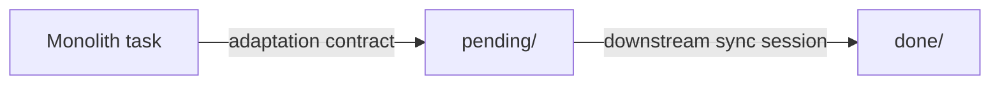

# Downstream changelog

Handoff log for changes made in **Project Monolith** that Gateway and Frontend must eventually implement. Daily agent work stays in Monolith only; downstream repos are updated only when the user's prompt contains the exact keyword **`downstream sync session`**.

This is **not** the Monolith session close-out log. Session documentation archives live in [upstream-changelog/](../upstream-changelog/README.md) and are written only during an **`upstream documentation session`**.

Canonical workspace context: [ai-agent-guide.md](../ai-agent-guide.md).

---

## When to write an entry

Use the [adaptation contract](../internal-monorepo-assessment.md#adaptation-contract-gateway--frontend):

| Change in Monolith | Changelog entry? |
|--------------------|------------------|
| Internal folder / PHP namespace only | **No** |
| Route file split, **same URLs** | **No** |
| API JSON shape change | **Yes** |
| New or changed URL prefix | **Yes** |
| New Laravel route name (menus / DataTable actions) | **Yes** |
| New Gateway aggregate endpoint needed | **Yes** |
| User-facing copy (SPA) | **Yes** — note Monolith `lang/{locale}/` keys; Frontend `src/i18n/` work |

If unsure, write an entry. A false positive costs less than a missed downstream contract change.

### Audit backlog entries

Some `pending/` files come from a **cross-repo desync audit** rather than a single Monolith task. They are marked with:

> **Origin:** cross-repo desync audit (YYYY-MM-DD). Not triggered by a single Monolith PR — backlog discovered retroactively.

| Origin | When to create |
|--------|----------------|
| **Daily Monolith task** | Adaptation contract triggers during implementation |
| **Audit backlog** | Explicit audit session compares Monolith vs Gateway vs Frontend and records gaps |

Both types use the same [TEMPLATE.md](./TEMPLATE.md) and are implemented in a **`downstream sync session`**. Audit entries describe drift against current Monolith behavior (no Monolith code change required to create the entry).

**Audit backlog (2026-07-12) — completed in downstream sync session:**

| File | Priority | Topic |
|------|----------|-------|
| [done/2026-07-12-invoice-checkout-spa-parity.md](./done/2026-07-12-invoice-checkout-spa-parity.md) | **P1** | Invoice page channel checkout / `checkout_session` parity |
| [done/2026-07-12-spa-route-mapping-drift.md](./done/2026-07-12-spa-route-mapping-drift.md) | **P2** | `routeMap.ts` + iPaymu `vue-routes.php` mapping |
| [done/2026-07-12-frontend-breadcrumbs-payment.md](./done/2026-07-12-frontend-breadcrumbs-payment.md) | **P3** | Payment/billing breadcrumb trails |

No open audit backlog entries remain in `pending/`.

---

## Directory layout

```
docs/downstream-changelog/
├── README.md       # This file
├── TEMPLATE.md     # Copy for each new entry
├── pending/        # Not yet implemented in Gateway / Frontend
└── done/           # Completed after a downstream sync session
```

**Entry filename:** `YYYY-MM-DD-<slug>.md` (example: `2026-07-12-users-api-email-field.md`).

---

## Daily Monolith task (agent)

1. Implement and test in Monolith only (`composer test`).
2. Update Monolith `docs/` and `README.md` when behavior changes.
3. If the adaptation contract triggers, copy [TEMPLATE.md](./TEMPLATE.md) into `pending/` and fill every section.
4. **Do not** open, read, or edit `monolith-gateway` or `monolith-frontend` unless the prompt contains **`downstream sync session`**.

---

## Downstream sync session (agent)

Start **only** when the user's prompt contains the exact keyword **`downstream sync session`**. Paraphrases do not qualify.

1. List `pending/` entries (oldest first unless the user prioritizes).
2. Read Monolith references in each entry (routes, resources, commits).
3. Implement Gateway and Frontend changes described in the entry.
4. Run tests in all three repos (`.\scripts\test-workspace.ps1` from Monolith root, or per-repo commands in the entry test plan).
5. Move the entry from `pending/` to `done/` and set **Status** to `done` with the sync date.
6. Update integration docs in the touched downstream repos if needed.

---

## Entry lifecycle



---

## Related docs

- [ai-agent-guide.md](../ai-agent-guide.md) — default scope, session keywords, and workflow
- [upstream-changelog/README.md](../upstream-changelog/README.md) — Monolith session close-out (`upstream documentation session`)
- [spa-gateway-integration.md](../spa-gateway-integration.md) — three-project wiring
- [internal-monorepo-assessment.md](../internal-monorepo-assessment.md) — adaptation contract
