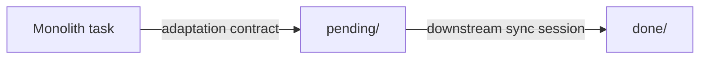

# Downstream changelog

Handoff log for changes made in **Project Monolith** that Gateway and Frontend must eventually implement. Daily agent work stays in Monolith only; downstream repos are updated only when the user's prompt contains the exact keyword **`downstream sync session`**.

Canonical workspace context: [ai-agent-guide.md](../ai-agent-guide.md).

---

## When to write an entry

Use the [adaptation contract](../internal-monorepo-assessment.md#adaptation-contract-gateway--frontend):

| Change in Monolith | Changelog entry? |
|--------------------|------------------|
| Internal folder / PHP namespace only | **No** |
| Route file split, **same URLs** | **No** |
| API JSON shape change | **Yes** |
| New or changed URL prefix | **Yes** |
| New Laravel route name (menus / DataTable actions) | **Yes** |
| New Gateway aggregate endpoint needed | **Yes** |
| User-facing copy (SPA) | **Yes** — note Monolith `lang/{locale}/` keys; Frontend `src/i18n/` work |

If unsure, write an entry. A false positive costs less than a missed downstream contract change.

---

## Directory layout

```
docs/downstream-changelog/
├── README.md       # This file
├── TEMPLATE.md     # Copy for each new entry
├── pending/        # Not yet implemented in Gateway / Frontend
└── done/           # Completed after a downstream sync session
```

**Entry filename:** `YYYY-MM-DD-<slug>.md` (example: `2026-07-12-users-api-email-field.md`).

---

## Daily Monolith task (agent)

1. Implement and test in Monolith only (`composer test`).
2. Update Monolith `docs/` and `README.md` when behavior changes.
3. If the adaptation contract triggers, copy [TEMPLATE.md](./TEMPLATE.md) into `pending/` and fill every section.
4. **Do not** open, read, or edit `monolith-gateway` or `monolith-frontend` unless the prompt contains **`downstream sync session`**.

---

## Downstream sync session (agent)

Start **only** when the user's prompt contains the exact keyword **`downstream sync session`**. Paraphrases do not qualify.

1. List `pending/` entries (oldest first unless the user prioritizes).
2. Read Monolith references in each entry (routes, resources, commits).
3. Implement Gateway and Frontend changes described in the entry.
4. Run tests in all three repos (`.\scripts\test-workspace.ps1` from Monolith root, or per-repo commands in the entry test plan).
5. Move the entry from `pending/` to `done/` and set **Status** to `done` with the sync date.
6. Update integration docs in the touched downstream repos if needed.

---

## Entry lifecycle



---

## Related docs

- [ai-agent-guide.md](../ai-agent-guide.md) — default scope and workflow
- [spa-gateway-integration.md](../spa-gateway-integration.md) — three-project wiring
- [internal-monorepo-assessment.md](../internal-monorepo-assessment.md) — adaptation contract
