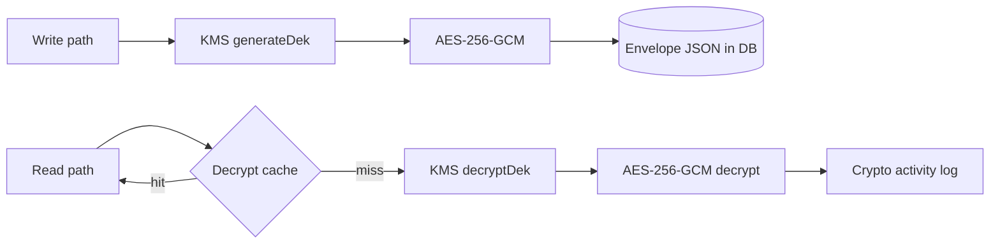

# Envelope encryption (OCI KMS)

Monolith encrypts selected database columns and cache payloads using **envelope encryption**: a per-value data encryption key (DEK) wraps payload bytes with AES-256-GCM, and the DEK itself is wrapped by a single Oracle Cloud KMS master key (KEK).

Prerequisites: working OCI KMS connectivity — see [oci-kms.md](./oci-kms.md).

## Architecture

| Layer | Responsibility |
|-------|----------------|
| `OciKmsClient` / `LocalKmsDekClient` | Generate and unwrap DEKs via OCI KMS (or local stand-in in tests) |
| `EnvelopeEncryptionService` | AES-256-GCM encrypt/decrypt; sole decrypt audit choke point |
| `DecryptedValueCache` | TTL cache for plaintext after decrypt (reduces KMS billing) |
| `EnvelopeEncrypted` / `EnvelopeEncryptedArray` casts | Model integration |
| `CryptoActivityRecorder` | `log_name: crypto`, event `field_decrypted` |



## Billing rules

- **One KEK** — `OCI_KMS_KEY_ID` only; never create a new vault master key per row.
- **Many DEKs** — each encrypted value stores its own KMS-wrapped DEK.
- **Decrypt cache** — `ENCRYPTION_DECRYPTED_CACHE_TTL` (default 900s) caches plaintext after the first successful decrypt per context key `{table}.{column}.{id}`.
- **No KMS retry loops** — IAM/authorization failures stop immediately; debug policy with operators.

## Envelope format (v1)

```json
{
  "v": 1,
  "alg": "AES-256-GCM",
  "kms_key_id": "ocid1.key...",
  "dek_ciphertext": "...",
  "iv": "...",
  "tag": "...",
  "ciphertext": "..."
}
```

Legacy `Crypt::encryptString` values are migrated lazily on read or via `php artisan encryption:migrate-p0`.

## P0 encrypted columns (this release)

| Table | Column | Notes |
|-------|--------|-------|
| `users` | `two_factor_secret` | Replaces APP_KEY `Crypt` |
| `invoices` | `gateway_request_payload`, `gateway_response_payload` | JSON payloads |
| `attachments` | `cached_url` | Presigned URL credential |
| `password_reset_tokens` | `token` + `token_blind_index` | Blind index lookup |
| `sessions` | `payload` | `encrypted_database` session driver |
| `cache` | `value` | Only keys matching `2fa_token:` prefix |

## Environment variables

| Variable | Purpose |
|----------|---------|
| `ENCRYPTION_KMS_ENABLED` | `false` in PHPUnit; `true` in production |
| `ENCRYPTION_DECRYPTED_CACHE_TTL` | Decrypt cache TTL seconds (default `900`) |
| `ENCRYPTION_BLIND_INDEX_PEPPER` | HMAC pepper for blind indexes (required in production) |
| `ENCRYPTION_SESSION_ENABLED` | Use `encrypted_database` session handler when `SESSION_DRIVER=database` |

## Commands

```bash
php artisan encryption:migrate-p0
php artisan encryption:flush-decrypted-cache {context?}
php artisan oci:kms-verify
```

## Decrypt cache and Redis

POC uses the default Laravel cache store (`CACHE_STORE`). When staging/production switch to `redis` (see [octane-readiness.md](./octane-readiness.md)), decrypt cache entries move to Redis automatically with the same key prefix (`encryption.decrypted.*`) and TTL.

Flush a single record context after key rotation or ciphertext update:

```bash
php artisan encryption:flush-decrypted-cache users.two_factor_secret.{uuid}
```

## Activity log

Every decrypt through `EnvelopeEncryptionService` writes a `crypto` log entry (`field_decrypted`) with resource metadata only — never plaintext, ciphertext, or DEK material.

## Sensitive column inventory (deferred Phase 2)

P1 PII columns (`users.email`, `order_master.customer_*`, etc.) will use **blind index** columns before encryption. Infrastructure (`BlindIndex`) is in place; column migrations are deferred.

## Related docs

- [oci-kms.md](./oci-kms.md) — KMS connectivity
- [environment.md](./environment.md) — env catalog
- [activity-log.md](./activity-log.md) — audit namespaces
