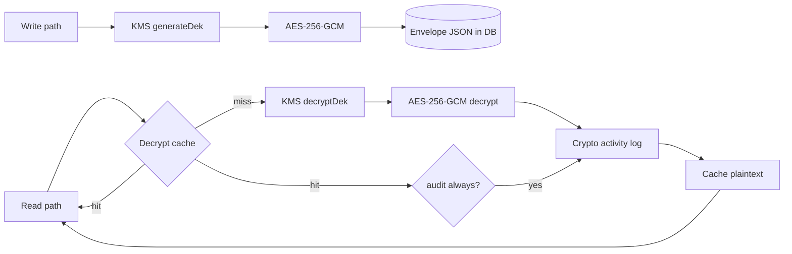
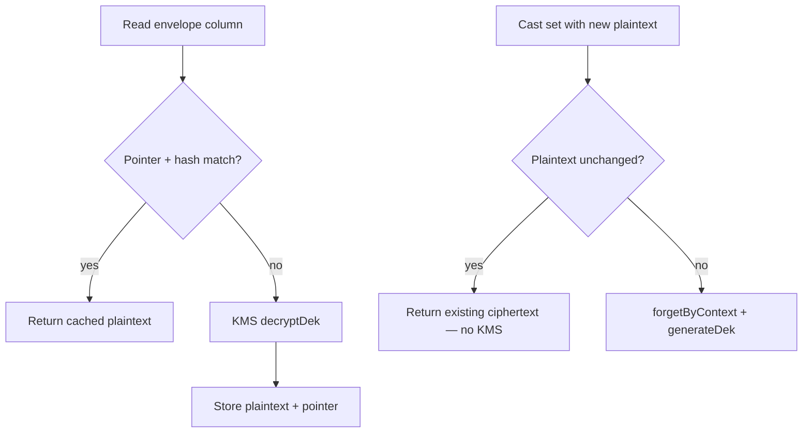

# Envelope encryption (OCI KMS)

Monolith encrypts selected database columns and cache payloads using **envelope encryption**: a per-value data encryption key (DEK) wraps payload bytes with AES-256-GCM, and the DEK itself is wrapped by a single Oracle Cloud KMS master key (KEK).

Prerequisites: working OCI KMS connectivity — see [oci-kms.md](./oci-kms.md).

## Tiered encryption

Monolith uses **two encryption tiers** — pick the right tool for the access pattern:

| Tier | Mechanism | Cost | Use for |
|------|-----------|------|---------|
| **Tier 1 — Laravel** | `SESSION_ENCRYPT=true` + `APP_KEY` ([Laravel encryption](https://laravel.com/docs/13.x/encryption)) | Local CPU only | **Sessions** — read+write every web request (CSRF, flash, interim `two_factor_token`) |
| **Tier 2 — Envelope** | `EnvelopeEncryptionService` + OCI KMS + `DecryptedValueCache` | KMS per column access | User secrets and business-sensitive columns (2FA secret, invoice payloads, attachments, password reset, `2fa_token:` cache) |

**Why not envelope sessions?** Each web request reads and writes the session. Envelope encryption generates a new DEK per write and invalidates the decrypt cache — causing KMS billing spikes and `crypto` activity log noise. Tier 1 encrypts at rest without KMS.

Set `ENCRYPTION_SESSION_ENABLED=false` (default) and `SESSION_ENCRYPT=true` in staging/production. The legacy `encrypted_database` handler remains registered for rollback only.

## Architecture

| Layer | Responsibility |
|-------|----------------|
| `OciKmsClient` / `LocalKmsDekClient` | Generate and unwrap DEKs via OCI KMS (or local stand-in in tests) |
| `EnvelopeEncryptionService` | AES-256-GCM encrypt/decrypt; sole decrypt audit choke point |
| `DecryptedValueCache` | Invalidate-on-change plaintext cache (ciphertext fingerprint + safety cap) |
| `EnvelopeEncrypted` / `EnvelopeEncryptedArray` casts | Model integration |
| `CryptoActivityRecorder` | `log_name: crypto`, event `field_decrypted` |



## Billing rules

- **One KEK** — `OCI_KMS_KEY_ID` only; never create a new vault master key per row.
- **Many DEKs** — each encrypted value stores its own KMS-wrapped DEK.
- **Decrypt cache** — plaintext is cached until the row changes (`forget` on encrypt / cast `set`) or the safety cap expires (`ENCRYPTION_DECRYPTED_CACHE_MAX_TTL`, default **86400**s). Ciphertext fingerprint in the cache key prevents stale hits if DB changes without `forget`.
- **Skip redundant re-encrypt** — `EnvelopeEncrypted*` casts return existing ciphertext when plaintext is unchanged (e.g. invoice sync-status with identical gateway response).
- **No KMS retry loops** — IAM/authorization failures stop immediately; debug policy with operators.

## Envelope format (v1)

```json
{
  "v": 1,
  "alg": "AES-256-GCM",
  "kms_key_id": "ocid1.key...",
  "dek_ciphertext": "...",
  "iv": "...",
  "tag": "...",
  "ciphertext": "..."
}
```

Legacy `Crypt::encryptString` values are migrated lazily on read or via `php artisan encryption:migrate-p0`.

## P0 envelope columns (Tier 2)

| Table | Column | Notes |
|-------|--------|-------|
| `users` | `two_factor_secret` | Replaces APP_KEY `Crypt` |
| `invoices` | `gateway_request_payload`, `gateway_response_payload` | JSON payloads |
| `attachments` | `cached_url` | Presigned URL credential |
| `password_reset_tokens` | `token` + `token_blind_index` | Blind index lookup |
| `cache` | `value` | Only keys matching `2fa_token:` prefix |

**Sessions** use Tier 1 (`SESSION_ENCRYPT`) — not envelope KMS. See [Tiered encryption](#tiered-encryption) above.

## Environment variables

| Variable | Purpose |
|----------|---------|
| `ENCRYPTION_KMS_ENABLED` | `false` in PHPUnit; `true` in production |
| `ENCRYPTION_DECRYPTED_CACHE_MAX_TTL` | Safety cap for decrypt cache (seconds, default `86400`); `0` = no cap (forever until forget) |
| `ENCRYPTION_DECRYPTED_CACHE_TTL` | **Deprecated** — read when `MAX_TTL` unset (backward compat) |
| `ENCRYPTION_AUDIT_DECRYPTS` | `cache_miss` (default) or `always` — decrypt activity log frequency |
| `ENCRYPTION_BLIND_INDEX_PEPPER` | HMAC pepper for blind indexes (required in production) |
| `ENCRYPTION_SESSION_ENABLED` | `false` (default) — set `true` only to re-enable legacy OCI envelope sessions (`encrypted_database` driver) |

## Commands

```bash
php artisan encryption:migrate-p0
php artisan encryption:flush-decrypted-cache {context?}
php artisan oci:kms-verify
```

## Decrypt cache semantics

**Primary invalidation:** `encrypt()` and cast `set()` call `forgetByContext()` when ciphertext actually changes.

**Retention:** Plaintext stays in `CACHE_STORE` until invalidation — not a fixed 15-minute window.

**Safety cap:** `ENCRYPTION_DECRYPTED_CACHE_MAX_TTL` (default 24h) limits how long unchanged plaintext can live in Redis if a row is never touched again. Set `0` for no cap.

**Ciphertext fingerprint:** Cache keys include `hash('xxh128', $storedEnvelopeJson)`. A pointer key (`encryption.decrypted.pointer.{context}`) tracks the active hash; if DB ciphertext changes without going through `forget`, the fingerprint mismatch forces a cache miss.

**Invoice payloads:** Frequent `sync-status` / webhook writes used to invalidate cache and re-encrypt even when the gateway response was identical. Skip re-encrypt avoids spurious `generateDek` calls; unchanged reads after the first decrypt stay cached until payload changes.



## Decrypt cache and Redis

POC uses the default Laravel cache store (`CACHE_STORE`). When staging/production switch to `redis` (see [octane-readiness.md](./octane-readiness.md)), decrypt cache entries move to Redis automatically with the same key prefix (`encryption.decrypted.*`) and safety-cap TTL.

Flush a single record context after key rotation or ciphertext update:

```bash
php artisan encryption:flush-decrypted-cache users.two_factor_secret.{uuid}
```

## Activity log

Decrypts through `EnvelopeEncryptionService` write `crypto` / `field_decrypted` entries with resource metadata only — never plaintext, ciphertext, or DEK material.

| `ENCRYPTION_AUDIT_DECRYPTS` | When rows are written |
|-----------------------------|------------------------|
| `cache_miss` (default) | First decrypt per context + ciphertext fingerprint until invalidation |
| `always` | Every decrypt (`cache_hit` in properties) |

Properties include `envelope_version` and `legacy_ciphertext` for forensics. The activity log API masks `kms_key_id` OCIDs; the database stores the full value.

Full security assessment: [crypto-activity-assessment.md](./crypto-activity-assessment.md).

## Sensitive column inventory (deferred Phase 2)

P1 PII columns (`users.email`, `order_master.customer_*`, etc.) will use **blind index** columns before encryption. Infrastructure (`BlindIndex`) is in place; column migrations are deferred.

## Related docs

- [oci-kms.md](./oci-kms.md) — KMS connectivity
- [environment.md](./environment.md) — env catalog
- [activity-log.md](./activity-log.md) — audit namespaces
- [crypto-activity-assessment.md](./crypto-activity-assessment.md) — security and audit assessment
