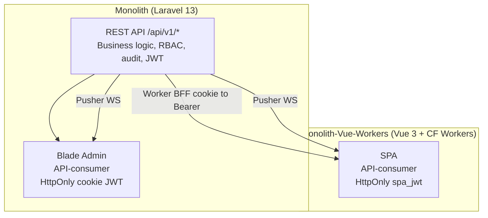

# Project overview — Monolith + Monolith-Vue-Workers

High-level summary of the two projects and their relationship. For the detailed SPA integration contract, see [vue-workers-spa.md](vue-workers-spa.md).

**Monolith-Vue-Workers** (`monolith-vue-workers` sibling) is the **leading SPA frontend**. Backend (this Laravel repo) and that SPA are separate projects; that split is the intended end state. The **Blade admin in this repo** is the current in-repo frontend: keep it until the SPA port is actually done. Do not remove it. It is the reference for appearance and behavior parity.

## Architecture at a glance

Both frontends are **API-consumers** — no business logic lives in either. All validation, CRUD, RBAC, and audit run once in the API. SPA chrome that is still a local decision but does **not** block the product outcome is listed in [vue-workers-spa.md — Non-blocking consumer decision findings](vue-workers-spa.md#non-blocking-consumer-decision-findings).

## Monolith — API-First backend

| Aspect | Detail |
|--------|--------|
| Framework | Laravel 13, PHP 8.3 |
| Architecture | Domain-driven monorepo, `app/Domain/{Domain}/` in one git repo |
| API | REST at `/api/v1/*` — all business logic lives here. Versioned: global (`/api/ping`) vs versioned (`/api/v1/*`), no dual exposure, breaking changes → new version |
| IDs | UUID v7 primary keys end-to-end (no auto-increment integers) |
| Auth | JWT (`php-open-source-saver/jwt-auth`), TOTP 2FA (`pragmarx/google2fa-laravel`), Spatie RBAC with hierarchical roles (H-RBAC) |
| Realtime | Pusher (`pusher/pusher-php-server`) + Laravel Echo |
| Config | `.env` for secrets/infra, `system_settings` (plaintext) for operational knobs, envelope encryption for product-domain secrets |
| i18n | `en` / `id` / `ja` |
| Storage | MySQL/PostgreSQL, S3-compatible via Flysystem |

### Frontend layer (Blade admin)

The Blade admin is a **pure API-consumer** — web controllers forward to `/api/v1/*`, browser auth uses the same JWT wrapped in an HttpOnly cookie and forwarded as `Authorization: Bearer` by the server. No business logic in the web layer.

Stack: AdminLTE 4 / Bootstrap 5 / jQuery 3.7 / Select2 / DataTables 3 via Vite, with Vue islands for complex interactive surfaces (file-hosting SPA shell, direct-upload widget).

**Keep Blade until the Vue-Workers port actually succeeds.** It is not deleted and not deprecated in the meantime — it remains the in-repo frontend and the reference for appearance and behavior parity. It is not the long-term product UI; Vue-Workers is.

See [web/blade-admin.md](../web/blade-admin.md) for Blade internals.

## Monolith-Vue-Workers — leading SPA frontend (also API-consumer)

Leading Vue 3 SPA frontend. Separate project from this Laravel backend; consumes the same `/api/v1/*` API. Lives in the sibling `monolith-vue-workers` repository. Deployed to Cloudflare Workers.

| Aspect | Detail |
|--------|--------|
| Framework | Vue 3 + Vite 8 + TypeScript |
| Deploy | Cloudflare Workers (`@cloudflare/vite-plugin` + `wrangler`). Static SPA assets do not invoke the isolate; only `/api/*` is the Worker function (`run_worker_first`). That function reverse-proxies same-origin `/api/v1/*` to `MONOLITH_API_ORIGIN` (hostname mask + `spa_jwt` BFF). Do not add more Worker logic unless deemed necessary — see [vue-workers-spa.md — Worker invocation vs static assets](vue-workers-spa.md#worker-invocation-vs-static-assets). |
| API | Same `/api/v1/*` endpoints as Blade — second API client, no business logic in SPA |
| Auth | HttpOnly `spa_jwt` on the Vue-Workers origin (Worker BFF). JS does not store the JWT. Direct Monolith `/api/v1` hits without the Worker's `X-SPA-Origin` header are audit-logged and rejected with 403 outside local/testing (`RequireSpaOrigin`). Blade uses HttpOnly `auth_token` on `APP_URL`. |
| Broadcast auth | `POST /api/v1/broadcasting/auth` under `auth:api` middleware (distinct from Blade's web-middleware `/broadcasting/auth` with cookie + CSRF) |
| Invocation budget | `POST /api/v1/batch` read-only fan-in (≤10 sub-requests), Worker cache headers on reference-data GETs, JWT TTL 240 min, polling backoff — see [vue-workers-spa.md — Invocation budget controls](vue-workers-spa.md#invocation-budget-controls) |
| Type alignment | TS types in `src/api/types.ts` match Laravel API Resources exactly — snake_case, no transform layer |
| i18n | `vue-i18n` (`en` / `id` / `ja`) converted from Laravel PHP lang files |
| UI parity | AdminLTE 4 / Bootstrap 5 / jQuery / Select2 (same libraries as Blade) |
| Realtime | Laravel Echo + Pusher, with polling fallback on every surface |

### Auth divergence from Blade

Blade stores the JWT in an HttpOnly `auth_token` cookie on `APP_URL` and the web layer forwards it as Bearer. The SPA uses a **second** HttpOnly cookie, `spa_jwt`, on the Vue-Workers origin. The Worker strips `data.token` from login/register/refresh/2FA-login JSON, sets the cookie, and on later requests copies it to `Authorization: Bearer` toward Laravel (never forwards `Cookie`). XSS cannot read the JWT; it can still session-ride. Mutating cookie requests need `X-Requested-With: XMLHttpRequest`.

Multi-tab: the cookie is shared. `BroadcastChannel('monolith-auth')` only coordinates refresh so one tab calls `auth/refresh` (blacklist race) and broadcasts `logout` — messages do **not** carry the JWT. Hydrate is `GET auth/me`.

Backend `AuthService::refreshFromToken` preserves the `remember` flag via the `rm` custom claim (`jwt.persistent_claims`) so a remember-me session does not silently downgrade on refresh.

### Realtime ported

Two live-update patterns, mirroring Blade:

- **Pattern A — Bell-driven listing reload:** `UserActivityNotificationReceived` on `App.Models.User.{id}` carries a `table_id`; the bell forwards it to `useListingReload` registry; registered listing views refetch. Active on `UsersView` (`users-table`), `InferenceModelCardsView` (`inference-model-cards-table`).
- **Pattern B — Direct channel subscription:** domain-specific private channels via singleton composables — `useFileHostingRealtime.ts` (6 events on `file-hosting.user.{userId}`), `usePaymentRealtime.ts` (invoice status + routing catalog), vTual claim inline.

All surfaces have visibility-gated polling fallback that self-stops when Echo connects.

Cross-tab notification read-state sync: `BroadcastChannel('activity-notifications.{userId}')` mirrors `read-all` / `read` messages across tabs — same pattern as Blade's `bell.js`.

See [vue-workers-spa.md](vue-workers-spa.md) for the full integration contract.

## Porting status

Route coverage matches Blade. Product-surface appearance gaps from waves 1–3 plus D polish (microstock lifecycle, public share wiring, invoice CSV blob, leftover i18n, FH/inference chrome) are closed. What is left vs Blade is accepted divergence (A/B/C), not missing pages.

### What is ported

- Guest + authenticated screens for all 11 domains (identity, navigation, notification, activity/error log, payments, service, inference, file hosting, vTual, product activations, domain access, settings, dashboard)
- **Chrome:** i18n page titles + `{page} | Monolith` tab title, OverlayScrollbars sidebar, API-driven sidebar/navbar, breadcrumbs, DataTable chrome strings
- **Auth:** login/register/forgot/reset/2FA with i18n labels; invisible hCaptcha when `VITE_HCAPTCHA_SITE_KEY` is set (`h-captcha-response`)
- **File Hosting Drive UX:** `.fh-manager` browse (click=select / dblclick=open / shift-range / context / drag-move / search overlay / `FhIcon`); trash/show chrome; FH composables use the shared cookie client (no JWT in JS)
- **Microstock lifecycle:** lock/describe chips, analyze/export/download CSV, review curator modal, `POST microstock/workspaces`, slot CTAs from `GET microstock/slots`
- **Public share:** `/s/d` breadcrumb + file links to `/s/f` (`PublicLayout`)
- **Inference provider rates:** `InferenceProviderShowView` add/edit/remove/save via `PUT inference/providers/{id}/rates` (full replace), gated by `manage inference catalog`
- **Payment channels admin:** `.pc-admin` intro/stats/kind/ranked-route chrome (`src/assets/channels-admin.css`)
- **Admin hygiene:** invoice CSV via `getBlob()` on invoices **and** income (income export sends `status=paid` plus `paid_from`/`paid_to` from the date filters, same as Blade), i18n DataTable labels, 2FA copy keys, payment return stays authenticated at SPA `/payment/return|cancel` (not under `/apps`)
- **Connected accounts:** `GET/DELETE profile/connections` + `GET auth/discord/authorize-url`; Discord callback stays on Monolith web and returns to the SPA when `SPA_URL` is set
- **vTual profile Discord verify:** channel-claim Discord button + OAuth hop when Discord is not connected
- **SPA shell:** authenticated routes under `/apps/*`; auth, `/s/*`, payment bounce at site root; Settings MenuSeeder names registered on the Vue router
- **404:** last-route `/:pathMatch(.*)*` → `NotFoundView` inside `AppLayout` (`requiresAuth`)
- **Realtime:** bell, file hosting (6 events), payments (invoice + routing), vTual claim — all with polling fallback
- **Cross-tab:** auth refresh coordination + notification read-state
- **i18n:** `en` / `id` / `ja`

### Accepted divergences (measured against Blade)

Mimic is appearance + behavior + intent, not a pixel clone. One list API, two presentations (`display_mode=query` for the SPA DataTable, `display_mode=datatable` for Blade Yajra). Query mode is a flat `T[]` unless `page` / `per_page` / `search` are present, then `{ items, pagination }` (default 10). Parse as-is. Row actions are icon-only.

**A — Platform:** HttpOnly `spa_jwt` (Worker BFF; JS does not store the JWT), SPA broadcasting auth via Worker cookie→Bearer, Worker CSRF header, hCaptcha Vite gate, duplicate vue-i18n JSON, CF Workers origin, Worker `/api/v1` hostname mask, breadcrumb config map, guest cannot read `system_settings`, invocation budget controls (`/api/v1/batch`, Worker cache headers, JWT TTL 240, polling backoff).

**B — Intentional:** Vue `DataTable` (not Yajra JS), Select2 only for server-side lookup, navigation from `GET navigation/menus?layout=sidebar`, FH three Vue routes vs Blade island, team as a page vs offcanvas, listing-only move picker, rate save re-fetch (no full reload).

**C — Gray (optional):** live-reload on 2 of 7 catalogs, local row-action chrome vs query-mode `actions[]` (list deletes are wired locally), Laravel plural pipe hack.

## References

- [vue-workers-spa.md](vue-workers-spa.md) — detailed SPA integration contract (API types, i18n, realtime, auth); [non-blocking consumer findings](vue-workers-spa.md#non-blocking-consumer-decision-findings)
- [platform/architecture.md](../platform/architecture.md) — Monolith domain layout, taxonomy, namespaces
- [platform/api-routing.md](../platform/api-routing.md) — versioned API routing design
- [web/blade-admin.md](../web/blade-admin.md) — Blade admin as API-consumer
- [domains/identity/README.md](../domains/identity/README.md) — JWT auth, `rm` claim, RBAC
