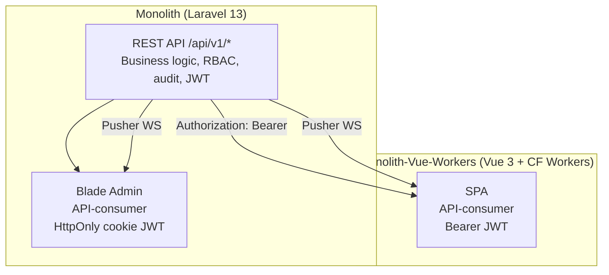

# Project overview — Monolith + Monolith-Vue-Workers

High-level summary of the two projects and their relationship. For the detailed SPA integration contract, see [vue-workers-spa.md](vue-workers-spa.md).

## Architecture at a glance

Both frontends are **API-consumers** — no business logic lives in either. All validation, CRUD, RBAC, and audit run once in the API.

## Monolith — API-First backend

| Aspect | Detail |
|--------|--------|
| Framework | Laravel 13, PHP 8.3 |
| Architecture | Domain-driven monorepo, `app/Domain/{Domain}/` in one git repo |
| API | REST at `/api/v1/*` — all business logic lives here. Versioned: global (`/api/ping`) vs versioned (`/api/v1/*`), no dual exposure, breaking changes → new version |
| IDs | UUID v7 primary keys end-to-end (no auto-increment integers) |
| Auth | JWT (`php-open-source-saver/jwt-auth`), TOTP 2FA (`pragmarx/google2fa-laravel`), Spatie RBAC with hierarchical roles (H-RBAC) |
| Realtime | Pusher (`pusher/pusher-php-server`) + Laravel Echo |
| Config | `.env` for secrets/infra, `system_settings` (plaintext) for operational knobs, envelope encryption for product-domain secrets |
| i18n | `en` / `id` / `ja` |
| Storage | MySQL/PostgreSQL, S3-compatible via Flysystem |

### Frontend layer (Blade admin)

The Blade admin is a **pure API-consumer** — web controllers forward to `/api/v1/*`, browser auth uses the same JWT wrapped in an HttpOnly cookie and forwarded as `Authorization: Bearer` by the server. No business logic in the web layer.

Stack: AdminLTE 4 / Bootstrap 5 / jQuery 3.7 / Select2 / DataTables 3 via Vite, with Vue islands for complex interactive surfaces (file-hosting SPA shell, direct-upload widget).

**The Blade frontend is retained as the reference implementation.** It is not deprecated and not deleted — it stays as the source of truth for appearance and behavior parity.

See [web/blade-admin.md](../web/blade-admin.md) for Blade internals.

## Monolith-Vue-Workers — SPA port (also API-consumer)

Separate Vue 3 SPA that consumes the same `/api/v1/*` API. Lives in a sibling repository. Deployed to Cloudflare Workers.

| Aspect | Detail |
|--------|--------|
| Framework | Vue 3 + Vite 8 + TypeScript |
| Deploy | Cloudflare Workers (`@cloudflare/vite-plugin` + `wrangler`) |
| API | Same `/api/v1/*` endpoints as Blade — second API client, no business logic in SPA |
| Auth | JWT in `localStorage` + `Authorization: Bearer` header (no HttpOnly cookie — that is Blade-only) |
| Broadcast auth | `POST /api/v1/broadcasting/auth` under `auth:api` middleware (distinct from Blade's web-middleware `/broadcasting/auth` with cookie + CSRF) |
| Type alignment | TS types in `src/api/types.ts` match Laravel API Resources exactly — snake_case, no transform layer |
| i18n | `vue-i18n` (`en` / `id` / `ja`) converted from Laravel PHP lang files |
| UI parity | AdminLTE 4 / Bootstrap 5 / jQuery / Select2 (same libraries as Blade) |
| Realtime | Laravel Echo + Pusher, with polling fallback on every surface |

### Auth divergence from Blade

Blade stores the JWT in an HttpOnly cookie and the server forwards it as Bearer. The SPA cannot use HttpOnly cookies cross-origin, so it stores the JWT in `localStorage` and sends it as `Authorization: Bearer` directly. Multi-tab session sync uses three mechanisms in `src/stores/auth.ts`:

1. Always `localStorage` (never `sessionStorage`) — `remember` flag affects TTL only, not storage location.
2. `storage` event listener — syncs token writes across tabs.
3. `BroadcastChannel('monolith-auth')` — coordinates refresh so only one tab calls `auth/refresh`; others wait for `refresh-done`. Prevents the refresh race where two tabs blacklist each other's tokens.

Backend `AuthService::refreshFromToken` preserves the `remember` flag via the `rm` custom claim (`jwt.persistent_claims`) so a remember-me session does not silently downgrade on refresh.

### Realtime ported

Two live-update patterns, mirroring Blade:

- **Pattern A — Bell-driven listing reload:** `UserActivityNotificationReceived` on `App.Models.User.{id}` carries a `table_id`; the bell forwards it to `useListingReload` registry; registered listing views refetch. Active on `UsersView` (`users-table`), `InferenceModelCardsView` (`inference-model-cards-table`).
- **Pattern B — Direct channel subscription:** domain-specific private channels via singleton composables — `useFileHostingRealtime.ts` (6 events on `file-hosting.user.{userId}`), `usePaymentRealtime.ts` (invoice status + routing catalog), vTual claim inline.

All surfaces have visibility-gated polling fallback that self-stops when Echo connects.

Cross-tab notification read-state sync: `BroadcastChannel('activity-notifications.{userId}')` mirrors `read-all` / `read` messages across tabs — same pattern as Blade's `bell.js`.

See [vue-workers-spa.md](vue-workers-spa.md) for the full integration contract.

## Porting status

The SPA port is **in progress** — appearance and behavior are not yet 100% parity with Blade.

### What is ported

- ~95 Vue views, 41 composables, all 11 domains represented
- **Identity:** login, register, forgot/reset password, 2FA challenge, profile (password, 2FA, connections), users CRUD
- **Navigation:** menus CRUD + trashed
- **Notification:** list, audiences CRUD
- **ActivityLog / ErrorLog:** list + show
- **PaymentGateway:** gateways, subscriptions, invoices, payment channels, payments income, return/cancel
- **Service:** services CRUD + show, checkout flow, service purchases show
- **Inference:** model cards, providers, usage events
- **FileHosting:** browse, file show, trash, blocklist, workspaces, microstock usage, public share
- **vTual:** profiles, vtuber (show + claim), orphans CRUD, platform credentials
- **Product Activations, Settings, Domain Access, Dashboard**
- **Realtime:** bell, file hosting (6 events), payments (invoice + routing), vTual claim — all with polling fallback
- **Components:** ConfirmModal, SubmitButton, FormInput, FormSelect2, PaymentStatusHero, PaymentSteps, CheckoutPanel, breadcrumbs
- **Cross-tab auth sync** + **cross-tab notification sync**
- **i18n:** `en` / `id` / `ja` locale files

### What remains

Porting continues toward full parity. Blade stays as the reference implementation — gaps are measured against it. Areas likely still needing work: edge CRUD screens, polish, feature parity gaps not visible from route coverage alone.

## References

- [vue-workers-spa.md](vue-workers-spa.md) — detailed SPA integration contract (API types, i18n, realtime, auth)
- [platform/architecture.md](../platform/architecture.md) — Monolith domain layout, taxonomy, namespaces
- [platform/api-routing.md](../platform/api-routing.md) — versioned API routing design
- [web/blade-admin.md](../web/blade-admin.md) — Blade admin as API-consumer
- [domains/identity/README.md](../domains/identity/README.md) — JWT auth, `rm` claim, RBAC
