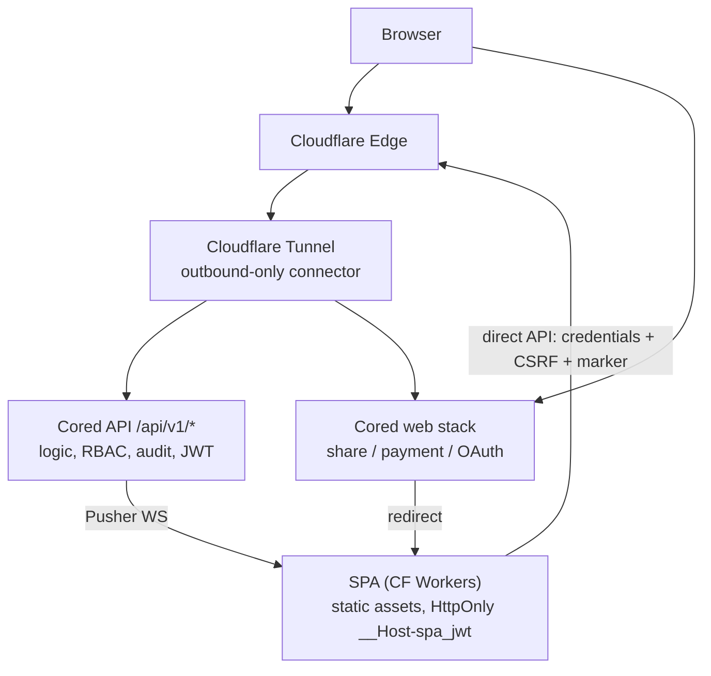

# Project overview — Cored Backend + Cored Frontend

High-level summary of the two projects and their relationship. For the detailed SPA integration contract, see [vue-workers-spa.md](vue-workers-spa.md).

**Cored Frontend** (`cored-frontend` sibling) is the **sole browser UI**. This Laravel repo is API-first plus minimal server `web` endpoints (public share, payment return, OAuth callback). The in-repo Blade admin has been removed — see [web/blade-admin.md](../web/blade-admin.md).

## Architecture at a glance

The SPA is an **API-consumer** — no business logic lives in the frontend. All validation, CRUD, RBAC, and audit run once in the API. The SPA Worker serves static assets and is not an API proxy. The intended API perimeter is Cloudflare Tunnel with closed VM/OCI inbound ports — an external deployment dependency, not configured in either repo. The public marker is replayable metadata, not an authentication boundary.

## Cored Backend — API-first backend

| Aspect | Detail |
|--------|--------|
| Framework | Laravel 13, PHP 8.4 |
| Architecture | Core domains as versioned Composer packages (`vendor/silverspoonmedia/*`, `^1.2`) + host-owned overrides in `app/Domain/{Domain}/` — [core-packages.md](core-packages.md) |
| API | REST at `/api/v1/*` — all business logic lives here. Versioned: global (`/api/ping`) vs versioned (`/api/v1/*`), no dual exposure, breaking changes → new version |
| IDs | UUID v7 primary keys end-to-end (no auto-increment integers) |
| Auth | JWT (`php-open-source-saver/jwt-auth`), TOTP 2FA (`pragmarx/google2fa-laravel`), Spatie RBAC with hierarchical roles (H-RBAC) |
| Realtime | Pusher (`pusher/pusher-php-server`) + Laravel Echo |
| Config | `.env` for secrets/infra, `system_settings` (plaintext) for operational knobs, envelope encryption for product-domain secrets |
| i18n | Supported locales: [platform/localization.md](../platform/localization.md) |
| Storage | MySQL/PostgreSQL, S3-compatible via Flysystem |
| Web stack | `routes/web.php` keeps redirects and provider callbacks only — no Blade views, no JWT cookie bridge ([web/blade-admin.md](../web/blade-admin.md)) |

## Cored Frontend — SPA frontend (API consumer)

Leading Vue 3 SPA frontend. Separate project from this Laravel backend; consumes the same `/api/v1/*` API. Lives in the sibling `cored-frontend` repository. Deployed to Cloudflare Workers.

| Aspect | Detail |
|--------|--------|
| Framework | Vue 3 + Vite 8 + TypeScript |
| Deploy | Cloudflare Workers (`@cloudflare/vite-plugin` + `wrangler`). Three Wrangler environments from one codebase: manual via `npm run deploy:production` → worker `cored-spa-prod` (bakes `.env.production`), `npm run deploy:sandbox` → worker `cored-spa-sandbox` (bakes `.env.sandbox`), `npm run deploy:staging` → worker `cored-spa-staging` (bakes `.env.staging`), or automatic via GitHub Actions branch deploy (push `main` → production, `main-sandbox` → sandbox, `main-staging` → staging — `cored-frontend/docs/deployment.md`). Each path pairs `vite build --mode <env>` with `wrangler deploy --env <env>`. Static SPA assets do not invoke the isolate; current Worker code does not proxy API or auth. **All API traffic goes direct from the browser through the API hostname and Cloudflare Tunnel** (cross-site cookie + CSRF nonce) and does not target this Worker route. Do not add API proxy logic — see [vue-workers-spa.md — Worker invocation vs static assets](reference-vue-workers-spa.md#worker-invocation-vs-static-assets). |
| API | Same `/api/v1/*` endpoints — no business logic in SPA |
| Auth | Cross-site HttpOnly `__Host-spa_jwt` on the API origin (Laravel-minted). JS does not store the JWT; direct data calls use `credentials: 'include'` + double-submit `X-CSRF-Token`. Versioned API calls also carry public `X-SPA-Origin: 1`; `RequireSpaRequestHeader` rejects missing/invalid markers while `OPTIONS` and provider webhooks stay reachable. `RequireSpaOrigin` remains audit-only. Cloudflare Tunnel (external config) protects origin reachability; it does not prove that a request came from the official SPA. |
| Broadcast auth | `POST /api/v1/broadcasting/auth` under `auth:api` + `throttle:broadcast`; path defined once in `App\Support\Broadcasting\BroadcastAuthEndpoint` (route file + `BroadcastConnection::socketClientConfig()`), SPA waits for the CSRF cookie-settle gate before authorizing — [reference-security.md — invariant](../platform/reference-security.md#broadcastingauth-invariant) |
| Invocation budget | `POST /api/v1/batch` read-only fan-in (≤10 sub-requests) covers shell bootstrap and the multi-fetch views; Worker cache headers on reference-data GETs, JWT TTL 240 min — [invocation budget controls](reference-vue-workers-spa.md#invocation-budget-controls) |
| Type alignment | TS types in `src/api/types.ts` match Laravel API Resources exactly — snake_case, no transform layer |
| i18n | `vue-i18n` JSON locales (list: [platform/localization.md](../platform/localization.md)); `npm run check:i18n`; both live codes map one-to-one between SPA and backend; the RTL path is retained for a future right-to-left locale |
| UI | AdminLTE 4 / Bootstrap 5 / jQuery / Select2 (ported from former Blade admin) |
| Realtime | Laravel Echo + Pusher only — no polling fallback; on reconnect the SPA fires a resync bus (unread count + registered listings) |

### Auth model

The SPA uses HttpOnly `__Host-spa_jwt`, minted by Laravel on the API origin (`SameSite=None; Secure`). All API requests go direct from the browser to Laravel. Direct requests authenticate via the cookie and pass a double-submit CSRF nonce on mutations. XSS cannot read the JWT; it can still session-ride.

Multi-tab: the cookie is shared. `BroadcastChannel('cored-auth')` only coordinates refresh so one tab calls `auth/refresh` (blacklist race) and broadcasts `logout` — messages do **not** carry the JWT. Hydrate is `GET auth/me`. Backend `AuthService::refreshFromToken` preserves the `remember` flag via the `rm` custom claim (`jwt.persistent_claims`) so a remember-me session does not silently downgrade on refresh.

### Realtime

Two live-update patterns:

- **Pattern A — Bell-driven listing reload:** `UserActivityNotificationReceived` on `App.Models.User.{id}` carries a `table_id`; the bell forwards it to `useListingReload` registry; registered listing views refetch. Active on `UsersView` (`users-table`), `InferenceModelCardsView` (`inference-model-cards-table`), `ActivityLogsView` (`activity-logs-table`).
- **Pattern B — Direct channel subscription:** domain-specific private channels via singleton composables (`useActivityLogRealtime.ts`, `usePaymentRealtime.ts`, `useAiConnectionsRealtime.ts`, `useMenusRealtime.ts`).

Channel lifecycle is not per-composable: every binding goes through `src/composables/echo/channelRegistry.ts`, ref-counted per channel name, attach deferred until Echo exists. Full channel inventory: [vue-workers-spa.md — Realtime](reference-vue-workers-spa.md#realtime).

## Navigation menus

Menu rows store **SPA Vue Router symbolic route names** (e.g. `dashboard`, `users.index`), validated via `config/spa-routes.php` and `SpaRouteRegistry`. Keep in sync with `MenuSeeder` and `cored-frontend/src/router/index.ts`.

## Environment coupling

| Variable | Cored Backend | Cored Frontend |
|----------|----------|-------------|
| `SPA_URL` | Redirect target for `/`, share links, payment return, OAuth callback — minting matrix: [vue-workers-spa — Production URL minting](reference-vue-workers-spa.md#production-url-minting-spa_url) | SPA origin |
| `APP_URL` | API origin (JWT cookie domain) | `VITE_API_BASE_URL` target |

See [vue-workers-spa.md](vue-workers-spa.md) for the full contract.
