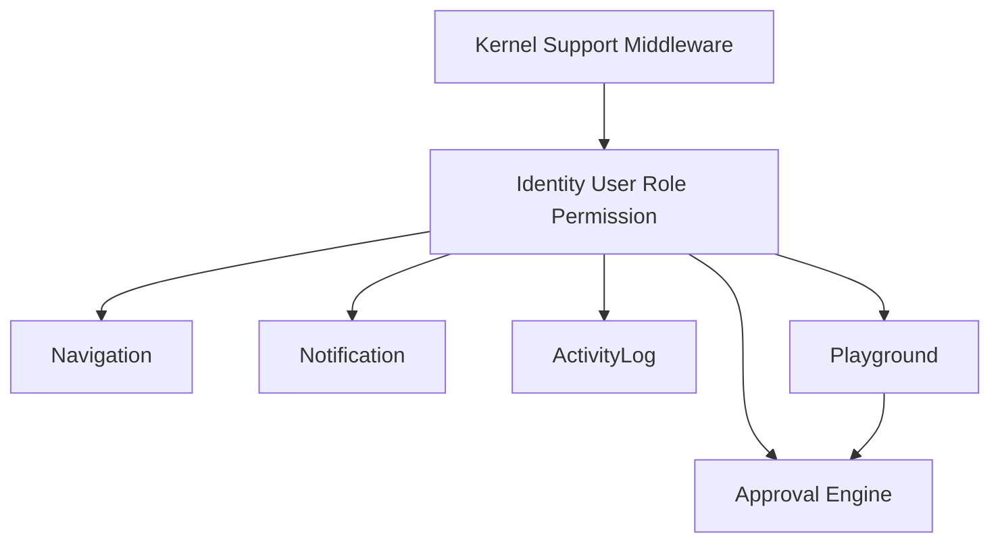

# Internal monorepo assessment — Project Monolith

This document records the assessment, decisions, and outcomes for organizing **Project Monolith** as an internal logical monorepo. Gateway and Frontend remain **separate git repositories** with their own history.

Canonical workspace context: [ai-agent-guide.md](./ai-agent-guide.md).

---

## Scope

| Item | Decision |
|------|----------|
| Monorepo target | **Monolith only** (`app/Domain/*`) |
| Gateway / Frontend | Unchanged repos; adapt only when **HTTP contracts** change |
| Approach | Logical domain folders — **not** Composer path packages (phase 1–3) |
| Composer packages (`packages/*`) | **Deferred** — see [Phase 4 triggers](#phase-4-composer-packages-deferred) |

---

## Why the previous modular attempt likely failed

| Anti-pattern | Risk |
|--------------|------|
| Composer path packages too early | Tooling overhead before boundaries were proven |
| Shared PHP packages across apps | Gateway/Frontend use HTTP, not PHP imports — wasted coupling |
| `nwidart/laravel-modules` | Fights Laravel conventions and existing docs |
| Partial moves (API only, not Web Blade) | Breaks full-stack-in-one-PR policy |
| Split migrations per package before strategy | Laravel migration ordering pain |

The real complexity drivers are **full-stack parity** (API + Web + Blade + 3 locales), **three-repo coordination**, and **approval cross-cutting** — not merely “files in one folder.”

---

## Domain map

| Domain | Kind | Namespace root | Primary models | Public API prefix |
|--------|------|----------------|----------------|-------------------|
| **Identity** | core | `App\Domain\Identity` | `User`, `Role`, `Permission` | `/api/v1/auth/*`, `/api/v1/users`, `/api/v1/lookups/*` |
| **Navigation** | core | `App\Domain\Navigation` | `Menu` | `/api/v1/navigation/menus/*` |
| **Notification** | core | `App\Domain\Notification` | `ActivityNotification`, `NotificationTypeSetting` | `/api/v1/notifications/*` |
| **ActivityLog** | core | `App\Domain\ActivityLog` | (Spatie `activity_log`) | `/api/v1/activity-logs/*` |
| **Approval** | core | `App\Domain\Approval` | 8 approval_* models | `/api/v1/approvals/*`, `/api/v1/admin/approval-workflows/*` |
| **Playground** | removable | `App\Domain\Playground` | `Order`, `OrderDetail`, `Attachment`, `AttachmentUpload` | `/api/playground/*` (non-prod) |
| **Kernel** (shared) | core | `App\Support`, `App\Http\Middleware`, … | — | — |

Core vs removable is enforced by [`config/domains.php`](../config/domains.php) and `php artisan domain:remove` (refuses core). Day-2 tooling: [domain-modules.md](./domain-modules.md).

---

## Dependency graph



- **Identity** is the hub — all domains reference `User` (and often `Role`).
- **Approval** attaches to arbitrary `document_type` (e.g. orders) — extract last if ever packaging.

---

## Adaptation contract (Gateway & Frontend)

| Change in Monolith | Gateway | Frontend |
|--------------------|---------|----------|
| Internal folder / PHP namespace only | None | None |
| Route file split, **same URLs** | None | None |
| API JSON shape change | Proxy/transform update | `src/api/*` update |
| New/changed URL prefix | Route proxy update | `src/api/*`, router |
| New Laravel route name for menus/DataTables | `config/vue-routes.php` | `src/router/index.ts` |
| New aggregate endpoint | Implement BFF aggregate | Consume new endpoint |

Breaking changes should use a new API version (`routes/api/v2.php`) rather than silent URL moves.

---

## Implementation phases (completed)

| Phase | Status | Deliverable |
|-------|--------|-------------|
| 0 — Assessment | Done | This document |
| 1 — Logical `app/Domain/*` | Done | Six domains migrated; tests under `tests/Domain/*` |
| 2 — Route normalization | Done | `routes/api/v1/*.php`, `routes/api/playground.php`; approvals on v1 router file |
| 3 — ServiceProvider split | Done | `app/Providers/Domain/{Identity,Navigation,Notification,ActivityLog,Playground,Approval}ServiceProvider.php`; `AppServiceProvider` kept as kernel-only provider |
| 4 — Composer packages | **Deferred** | See triggers below |

### Bootstrap registrations added

- `bootstrap/app.php` — `withEvents(discover:)` for domain listeners; `withCommands()` for Approval + Navigation artisan commands.
- `bootstrap/providers.php` — registers `AppServiceProvider` (kernel) plus the six per-domain providers under `app/Providers/Domain/`.

### PHPUnit

- New `Domain` testsuite for `tests/Domain/` in `phpunit.xml`.

---

## Test baseline and post-migration results

Recorded **2026-07-09** on Windows / Laragon.

### Pre-migration baseline

| Project | Command | Result |
|---------|---------|--------|
| Monolith | `composer test` | 385 passed, **1 failed** — `LocaleParityTest` (`id/api/common.php` missing `updated`) |
| Gateway | `php artisan test` | 32 passed, **1 failed** — stale `ExampleTest` (expects `/` 200, app returns 404) |
| Frontend | `npm run test:unit -- --run` | **84 passed** |

### Post-migration (Monolith)

| Command | Result |
|---------|--------|
| `composer test` | **386 passed**, 0 failed (locale parity fixed; domain migration complete) |

### Domain management QOL (2026-07-10)

| Command | Result |
|---------|--------|
| `composer test` | **392 passed** (6 new `DomainCommandsTest` cases; porting scripts removed) |

Run all three suites from Monolith:

```powershell
.\scripts\test-workspace.ps1
```

**Workspace script run (post-migration):** Monolith **386 passed**; Gateway **32 passed, 1 failed** (pre-existing stale `ExampleTest` — Gateway has no `/` route); Frontend not reached when Gateway fails first. Monolith-only validation: `composer test` → 386 passed after web route split.

---

## Post-migration cleanup (empty directories)

Recorded **2026-07-09** after domain migration.

### Cause

Phase 1 moved PHP files into `app/Domain/*` but left **empty shell directories** from the old layer-first layout (`app/Models`, `app/Services/*`, `app/Http/Controllers/API/*`, etc.). Eight additional empty folders were created at the **repository root** (`Console/`, `Http/`, `Models/`, …) — likely from a migration script run in the wrong working directory.

Empty folders have **no runtime impact** (routes already use `App\Domain\*`) but clutter IDE navigation.

### Removed (78 directories)

| Category | Count | Examples |
|----------|-------|----------|
| Root stray (migration script bug) | 22 | `Console/`, `Http/`, `Models/`, nested `Http/Controllers/API`, … at repo root |
| `app/` layer-first shells | 47 | `app/Models`, `app/Services/*`, `app/Events`, `app/Http/Controllers/API/*`, `app/Http/Requests/{domain}`, … |
| `tests/` old layout shells | 9 | `tests/Feature/Models`, `tests/Unit/Services/Navigation`, `tests/Unit/Support/Orders`, … |

Post-cleanup verification: `.\scripts\remove-empty-dirs.ps1 -WhatIf` reports **no empty directories in scope**; `composer test` → **386 passed**.

Cleanup script: [`scripts/remove-empty-dirs.ps1`](../scripts/remove-empty-dirs.ps1) (bottom-up delete, file-count guard).

**Follow-up (same day):** the Phase 3 provider split and stray-test relocation (see [internal-monorepo-porting.md](./internal-monorepo-porting.md#remaining-follow-ups-optional)) left 14 more empty shells (`app/Exceptions/Auth`, `tests/Unit/Services/Auth`, `tests/Feature/Auth`, `tests/Feature/Views`, and nested `Http/Controllers/API/*` leaves under `tests/Feature` and `tests/Unit`). Removed the same way; `composer test` → **386 passed** after cleanup.

**Out of scope:** `storage/framework/cache/data/*` (Laravel runtime cache, not porting debris).

### Kernel paths retained (outside `Domain/`)

| Path | Role |
|------|------|
| `app/Http/Controllers/` | Base `Controller`, `Web\Controller`, shared `Concerns/*` |
| `app/Http/Middleware/` | Shared middleware |
| `app/Repositories/Eloquent/EloquentCrudRepository.php` | Generic CRUD base |
| `app/Support/*` | Api client, DataTable, Auth cookie, Web helpers |
| `app/Exceptions/` | `BusinessRuleException` + `Auth/*` (candidate move to Identity later) |
| `app/Http/Requests/Concerns/`, `app/Http/Resources/Concerns/` | Shared request/resource traits |
| `app/Console/Commands/` | Env/locale/key artisan commands |
| `app/Providers/AppServiceProvider.php` | Kernel-only DI bindings (`EloquentCrudRepositoryInterface`, `DataTableResponseFactory`) + Blade component path |
| `app/Providers/Domain/*ServiceProvider.php` | Per-domain bindings, policies, event listeners, view composers |

### Future cleanup (not empty folders)

Closed 2026-07-09:

- ~~`tests/Unit/Services/Auth/`~~ — relocated to `tests/Domain/Identity/Unit/Services/Auth/`, plus 10 more stray Identity/Navigation/Playground test files found and relocated during the audit.
- ~~Duplicate or overlapping tests under `tests/Feature/` vs `tests/Domain/`~~ — audited; no duplicate test classes found, only misplaced ones (now relocated). `tests/Feature/` and `tests/Unit/` retain only kernel/cross-cutting tests (console, middleware, CSRF handling, `Hcaptcha` rule/verifier, locale parity).

---

## Phase 4: Composer packages (deferred)

**Do not start** until at least one trigger is true:

| Trigger | Threshold |
|---------|-----------|
| Codebase size | `app/` PHP files **> ~500** (was ~227 at assessment) |
| Team structure | Separate teams with independent release cycles per domain |
| Reuse goal | Domain extracted for another product (e.g. open-source approval engine) |

**First package candidate (if ever):** `Navigation` — most isolated tables and repositories.

**Do not package first:** Identity, Approval — highest coupling.

---

## Anti-patterns (do not repeat)

1. Merging three git repos into one without a clear win.
2. Shared PHP/TS libraries between Monolith, Gateway, and Frontend.
3. Composer packages before logical domains and tests are stable.
4. Changing public API URLs without Gateway/Frontend updates in the same task.

---

## Related docs

- [domain-modules.md](./domain-modules.md) — conventions and how to add a domain
- [internal-monorepo-porting.md](./internal-monorepo-porting.md) — porting implementation reference (migration order, scripts, gotchas)
- [api-routing.md](./api-routing.md) — global vs versioned API
- [spa-gateway-integration.md](./spa-gateway-integration.md) — three-project wiring
- [ai-agent-guide.md](./ai-agent-guide.md) — agent checklist
