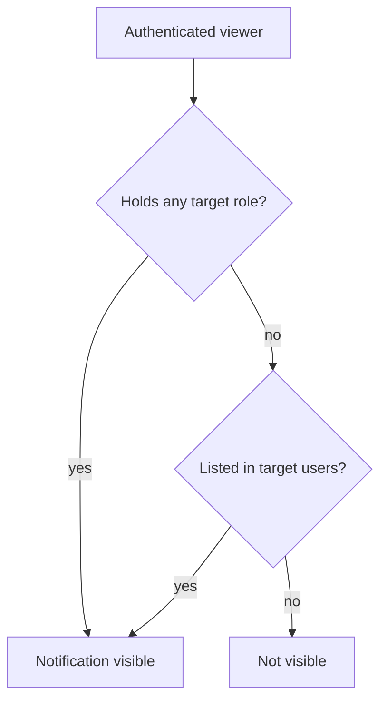
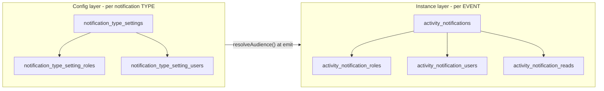
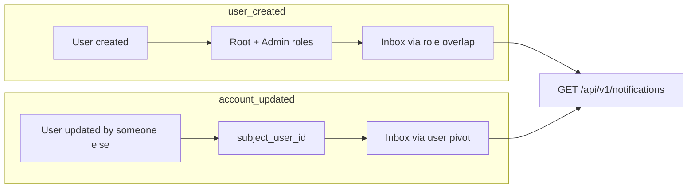
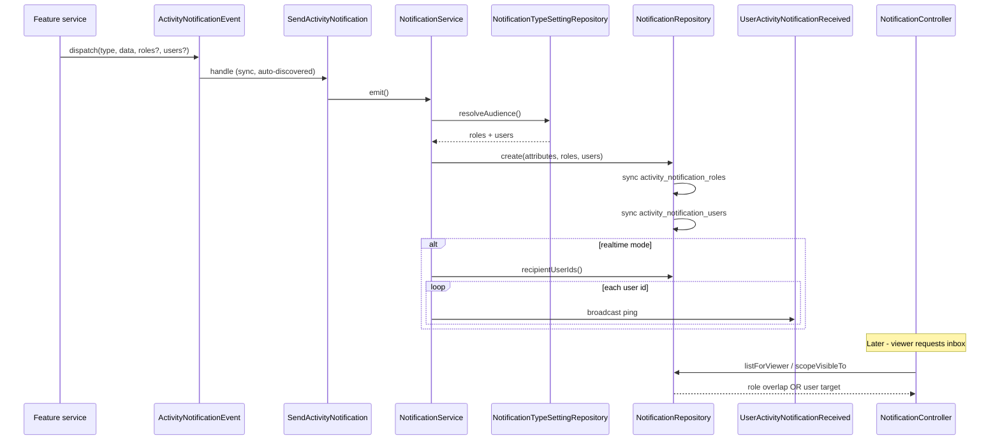
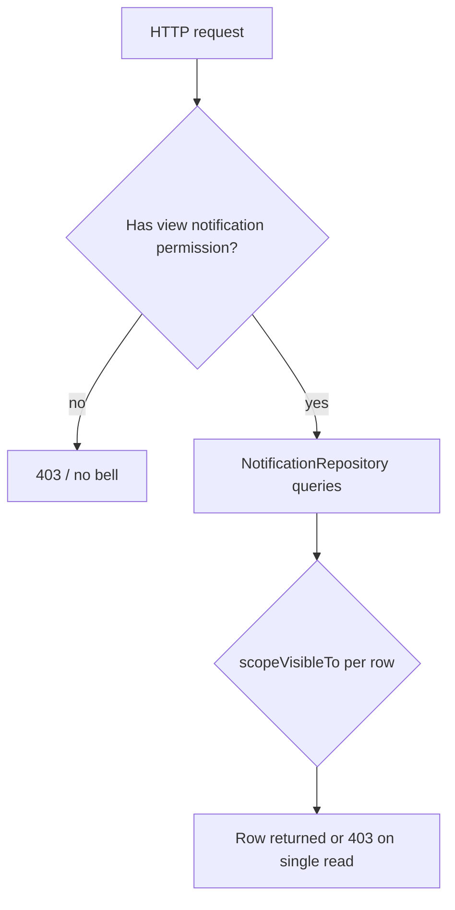

# Role vs User Notification Handling

Reference guide for how **per-role (broadcast)** and **per-user (personal)** targeting work across the activity notification lifecycle. Use this when changing notification flow, audience defaults, or visibility behaviour.

This document covers the **activity notification engine** only — not Laravel's `Notifiable` trait or the framework `notifications` table. See [Activity Notifications](./notifications.md) for full architecture; [Implementation Guide](./notifications-implementation-guide.md) for step-by-step change checklists.

---

## Mental model

A notification is stored **once** in `activity_notifications`. Audience is defined through **two separate pivots**:

| Mode | Instance pivot | Config pivot (per type default) | Semantics |
|------|----------------|----------------------------------|-----------|
| **Per role (broadcast)** | `activity_notification_roles` | `notification_type_setting_roles` | Linked to a **role record**, not to users. Anyone who **currently or later** holds a target role can see past notifications. |
| **Per user (personal)** | `activity_notification_users` | `notification_type_setting_users` + `notify_subject_user` flag | Linked to **explicit user IDs**. Only listed users see it — role promotion does not help. |

**Read state is always per user** (`activity_notification_reads`) — regardless of targeting mode.

A viewer sees a notification when **either** condition is met (OR):



Implementation: `NotificationRepository::scopeVisibleTo()` in [`app/Repositories/Eloquent/NotificationRepository.php`](../app/Repositories/Eloquent/NotificationRepository.php).

---

## Two data layers: config vs instance



### Config layer (`notification_type_settings`)

- Defines **who receives by default** when a given type is emitted.
- Maintained via [`NotificationTypeSettingSeeder`](../database/seeders/NotificationTypeSettingSeeder.php) or a one-off migration — **no admin UI**.
- Cached forever under key `notification_type_settings.snapshot`.
- Important field: `notify_subject_user` (bool) — when `true`, adds `data['subject_user_id']` to the personal audience at emit time.

Current defaults:

| Type | Role broadcast | Personal | `notify_subject_user` |
|------|----------------|----------|----------------------|
| `user_created` | Root + Admin | — | `false` |
| `account_updated` | — | subject user | `true` |

### Instance layer (`activity_notifications`)

- Snapshots audience **at event time** — copied from `resolveAudience()` into instance pivots.
- No per-recipient row fan-out; one row plus role/user pivots.

---

## Shipped notification catalogue

Live inventory of **activity notification types** shipped in this codebase today. Both types are emitted only from [`UserManagementService`](../app/Services/User/UserManagementService.php) (API and Blade share that path).

**Maintenance rule:** update this section in the **same PR** when you add a `NotificationType` case, a `NotificationTypeSettingSeeder` row, or a new `ActivityNotificationEvent::dispatch` call site.

**Out of scope:** Laravel `Notifiable` notifications (approval/auth email on the framework `notifications` table). See [Common pitfalls — item 8](#common-pitfalls-when-changing-flow).

### At a glance



### Master table (per type)

| | `user_created` | `account_updated` |
|---|----------------|-------------------|
| **Targeting mode** | Broadcast (role) | Personal (user) |
| **Default audience** | Root + Admin | Subject user (`notify_subject_user`) |
| **Trigger** | User created via `UserManagementService::create()` | User updated via `UserManagementService::update()` when `actor.id !== user.id` |
| **Skip conditions** | — | Self-edit; no notification on user delete |
| **Emitter** | [`UserManagementService::create()`](../app/Services/User/UserManagementService.php) | [`UserManagementService::update()`](../app/Services/User/UserManagementService.php) |
| **Message key** | `api/notifications.types.user_created` | `api/notifications.types.account_updated` |
| **EN message template** | `A new user :name (:email) was added by :actor.` | `Your account was updated by :actor.` |
| **Other locales** | `lang/id/api/notifications.php`, `lang/ja/api/notifications.php` | same files |
| **`data` placeholders** | `name`, `email`, `actor`, `role` (`role` is stored but **not** interpolated into the message) | `name`, `actor`, `subject_user_id` (last is audience-only) |
| **Icon** | `bi bi-person-plus` | `bi bi-person-gear` |
| **Deep link** | `action_route`: `users.edit`; `action_params`: `{ "user": "<uuid>" }` → web `GET /users/{user}/edit` | None — no `actionRoute` / `actionParams` on dispatch |
| **DataTable reload** | `users-table` | none |

### Per-role visibility matrix

Every role has the `view notification` permission (navbar bell). This table is **inbox content** — what each role sees by default with current seeded audiences.

| Role | `user_created` (broadcast) | `account_updated` (role broadcast) | Personal `account_updated` |
|------|----------------------------|-------------------------------------|----------------------------|
| **Root** | Yes | No | Yes — when this user is the edited subject |
| **Admin** | Yes | No | Yes — when this user is the edited subject |
| **Moderator** | No | No | Yes — when this user is the edited subject |
| **Management** | No | No | Yes — when this user is the edited subject |
| **User** | No | No | Yes — when this user is the edited subject |

Notes:

- `account_updated` has **no role broadcast pivot** — the middle column is always No. Any role holder can still receive it **as the subject user** (right column).
- A user **promoted to Admin later** retroactively sees past `user_created` notifications (broadcast query-time visibility).

### Per-user scenarios

| Scenario | Sees in bell? | Type |
|----------|---------------|------|
| Root or Admin when any user is created | Yes | `user_created` |
| Moderator creates a user | No (unless they also hold Root or Admin) | — |
| User's account edited by someone else | Yes (subject only) | `account_updated` |
| User edits own account | No | — |
| User A tries to see User B's `account_updated` | No | — |
| New Admin promoted tomorrow | Yes — including historical `user_created` | `user_created` |
| User deleted | No activity notification shipped | — |

### Not shipped (activity engine)

| Event | Activity notification |
|-------|---------------------|
| User delete | None |
| Role change only (without profile field update) | None — `account_updated` fires on any `update()` call when actor ≠ subject, including role-only edits |
| Approval workflow | Separate Laravel `Notifiable` mail — not listed here |

---

## Full lifecycle



### 1. Emit (who becomes the audience)

Entry point: [`ActivityNotificationEvent`](../app/Events/ActivityNotificationEvent.php) → [`SendActivityNotification`](../app/Listeners/SendActivityNotification.php) → [`NotificationService::emit()`](../app/Services/Notification/NotificationService.php).

**Audience resolution** (`NotificationTypeSettingRepository::resolveAudience()`) — merge order:

1. **Explicit override** from emitter: `$roles !== null` uses those roles; `$users` from the event is always merged.
2. **DB settings**: role names from `notification_type_setting_roles`; user IDs from `notification_type_setting_users`.
3. **`notify_subject_user`**: when `true`, append `data['subject_user_id']`.
4. **Enum fallback**: `NotificationType::defaultRoles()` when no settings row exists.

**Service API by intent:**

| Method | Role pivot | User pivot | When to use |
|--------|------------|------------|-------------|
| `emit($type, $data, $roles, $users, …)` | resolved | resolved | Generic; `$roles = null` → DB; `$roles = []` → user-only |
| `broadcastToRoles(…)` | resolved | `[]` explicit | Pure broadcast |
| `sendToUsers(…)` | `[]` explicit | explicit users | Pure personal |

**Critical:** `null` vs `[]` for `$roles` means different things:

- `null` → load from DB settings (or enum fallback).
- `[]` → **no role broadcast** (user-only notification).

### 2. Persist (role vs user in DB)

`NotificationRepository::create()`:

- `roles()->sync()` → `activity_notification_roles` (resolves id/name, `api` guard).
- `targetUsers()->sync()` → `activity_notification_users`.

Roles are **not** stored as a user list — only role IDs. Users are expanded only for websocket fan-out.

### 3. Realtime delivery (role → user expansion)

Websocket delivery is **always per user**, never per role. Channel: private `App.Models.User.{uuid}`.

`recipientUserIds()` expands:

- All users with `whereHas('roles', …)` overlapping target roles **at emit time**.
- Union with user IDs in `activity_notification_users`.

**Flow-change implications:**

- User **promoted** to a target role after emit: **still sees** the broadcast in inbox (query-time visibility), but **does not** get a retroactive websocket ping (ping only goes to role holders at emit).
- User **loses** a target role: no longer sees it in inbox (query-time); read-state pivot rows may remain but are irrelevant.

### 4. Read (always per user)

- `activity_notification_reads`: a row means the user has read it.
- `markAsRead` / `markAllAsRead` are scoped to notifications **visible** to the viewer.
- Roles have **no collective read state** — Root and Admin each have their own `read_at` for the same broadcast notification.

### 5. Consume (API + bell)

- Permission gate: `view notification` (every role has this in `RoleSeeder`).
- Row gate: `scopeVisibleTo()` — role overlap OR user target.
- **Permission ≠ visibility**: a Moderator has `view notification` but **does not** see `user_created` because they are not Root/Admin.

---

## Deep comparison: role handle vs user handle

### Role handle (broadcast)

**What a role "handles":**

- A role is an **audience label**, not an actor and not a recipient record.
- The [`Role`](../app/Models/Role.php) model has **no inverse notification relations**.
- Visibility = **dynamic role overlap** — query compares viewer roles to notification pivots.

**Design strengths:**

- One notification for many people without N inserts.
- Promotion to Admin tomorrow → immediately sees historical `user_created` items.
- No re-emit needed when role membership changes.

**Limitations:**

- No per-user mute for broadcast types.
- No per-role read state — each user reads independently.
- Websocket fan-out snapshots users at emit, not dynamic membership.

**Real example** — [`UserManagementService::create()`](../app/Services/User/UserManagementService.php):

```php
ActivityNotificationEvent::dispatch(
    NotificationType::UserCreated,
    ['name' => $user->name, 'email' => $user->email, 'actor' => $actor->name],
    // roles: null → DB settings → Root + Admin
    actionRoute: 'users.edit',
    actionParams: ['user' => $user->id],
);
```

**Tests that lock behaviour:** `test_moderator_can_access_surface_but_does_not_see_root_admin_broadcast` in [`NotificationTest.php`](../tests/Feature/Http/Controllers/API/V1/NotificationTest.php).

---

### User handle (personal)

**What a user "handles":**

- Explicit user ID in `activity_notification_users`.
- `notify_subject_user` + `subject_user_id` in event data = common pattern for "notify the affected user".
- Visibility = **exact user match** — viewer role is irrelevant.

**Design strengths:**

- Privacy: only the subject knows their account was changed by someone else.
- Can target any user regardless of role.

**Limitations:**

- A new user with the same role does **not** see another user's personal notifications.
- Must pass `subject_user_id` in data when using `notify_subject_user`.
- Self-actions are usually skipped in the emitter (not in the engine).

**Real example** — [`UserManagementService::update()`](../app/Services/User/UserManagementService.php):

```php
if ($actor->id !== $user->id) {
    ActivityNotificationEvent::dispatch(
        NotificationType::AccountUpdated,
        [
            'name' => $user->name,
            'actor' => $actor->name,
            'subject_user_id' => $user->id,  // required for notify_subject_user
        ],
    );
}
```

**Tests:** `test_personal_notification_reaches_only_the_targeted_user`, `test_self_edit_does_not_create_a_personal_notification`.

---

### Combining both modes

A single notification **may** have both roles **and** users. A viewer needs only one match.

Use case: broadcast to Admin **plus** always notify a specific user (via `notification_type_setting_users` or an explicit `$users` override).

Shipped types currently use **one mode each**, but the engine supports hybrid audiences.

---

## Decision matrix when changing flow

| Question | Answer → Action |
|----------|-----------------|
| Who must see **every** future occurrence of this type? | **Role broadcast** → edit `NotificationTypeSettingSeeder` role pivot |
| Only the affected user? | **Personal** → `notify_subject_user = true` + pass `subject_user_id`, or `sendToUsers()` |
| One-off override (not default)? | Pass explicit `$roles` / `$users` in `ActivityNotificationEvent::dispatch()` |
| Disable role broadcast for a personal type | Use `$roles = []` in `sendToUsers()`, or seeder with no role pivot |
| Promoted users must see history? | Use role broadcast; do not fan out per user |
| Need DataTable reload? | `NotificationType::tableId()` — personal types usually `null` |
| Change default audience in production | Seeder or migration + `flushCache()` — not dispatch code |
| Add a new type | Enum + lang + seeder row + dispatch — see [Implementation Guide](./notifications-implementation-guide.md) |

---

## Permission vs visibility vs delivery

Do not conflate these layers:



| Layer | Role involvement | User involvement |
|-------|------------------|------------------|
| **Permission** | Every role has `view notification` | Gates API/bell access |
| **Visibility** | Role overlap on pivot | User ID match on pivot |
| **Read state** | — | Per-user `read_at` |
| **Realtime ping** | Expand role → user IDs at emit | Direct user IDs |
| **Locale** | — | `users.locale` affects message text only |

There are **no per-user preferences** (mute, subscribe per type). Filtering is audience config plus visibility query only.

---

## Common pitfalls when changing flow

1. **`null` vs `[]` for roles** — `null` = DB default; `[]` = no broadcast. Mixing these up creates invisible notifications or wrong audiences.

2. **Missing `subject_user_id`** — `account_updated` with `notify_subject_user = true` but no ID in data → empty personal audience → invisible to everyone.

3. **Notification with no roles and no users** — visible to nobody (by design). `emit()` docblock warns about this.

4. **Settings cache** — changing the seeder without `flushCache()` on an already-seeded environment → stale audience.

5. **Role guard** — all role resolution filters `guard_name = 'api'`. Web-guard roles are excluded.

6. **Websocket vs visibility mismatch** — user gains role after emit: sees item in inbox (polling/API) but no retroactive realtime ping.

7. **Double listener** — do not manually register `SendActivityNotification`; auto-discovery only.

8. **Confusion with Laravel Notifiable** — approval/auth use `$user->notify()` to the framework `notifications` table (email). That is a **separate system**; approval roles are used to **look up users** (`User::role()`), not as broadcast pivots in the activity engine.

---

## Quick file reference

| Concern | File |
|---------|------|
| Visibility query | [`NotificationRepository.php`](../app/Repositories/Eloquent/NotificationRepository.php) |
| Emit + realtime fan-out | [`NotificationService.php`](../app/Services/Notification/NotificationService.php) |
| Audience defaults | [`NotificationTypeSettingRepository.php`](../app/Repositories/Eloquent/NotificationTypeSettingRepository.php) |
| Seeded audiences | [`NotificationTypeSettingSeeder.php`](../database/seeders/NotificationTypeSettingSeeder.php) |
| Type catalogue + fallback | [`NotificationType.php`](../app/Notifications/Activity/NotificationType.php) |
| Model + pivot relations | [`ActivityNotification.php`](../app/Models/ActivityNotification.php) |
| Dispatch examples | [`UserManagementService.php`](../app/Services/User/UserManagementService.php) |
| Behavioural tests | [`NotificationTest.php`](../tests/Feature/Http/Controllers/API/V1/NotificationTest.php) |
| Agent checklist | [`notifications-implementation-guide.md`](./notifications-implementation-guide.md) |

---

## Related documentation

- [Activity Notifications](./notifications.md) — full architecture and runtime behaviour
- [Activity Notifications — Implementation Guide](./notifications-implementation-guide.md) — step-by-step change checklists
- [User Management & H-RBAC](./user-management-hrbac.md) — create/update flows that emit notifications
