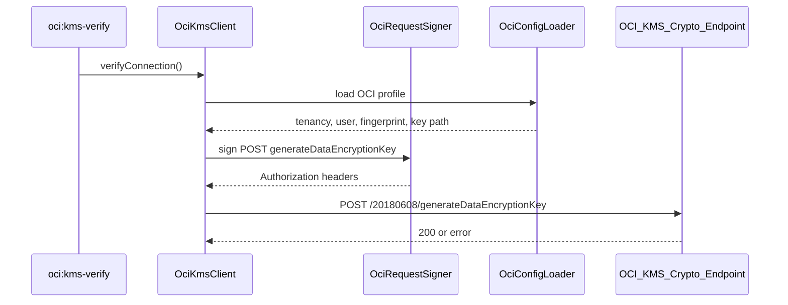

# OCI KMS connectivity

Monolith uses Oracle Cloud Infrastructure (OCI) Key Management as the **KEK** for envelope encryption. Application-level encrypt/decrypt is documented in [envelope-encryption.md](./envelope-encryption.md). This page covers **connectivity verification** and KMS API methods.

## Architecture



| Component | Path |
|-----------|------|
| Config | [`config/oci.php`](../config/oci.php) |
| OCI profile loader | [`app/Support/Oci/OciConfigLoader.php`](../app/Support/Oci/OciConfigLoader.php) |
| Request signer | [`app/Support/Oci/OciRequestSigner.php`](../app/Support/Oci/OciRequestSigner.php) |
| KMS client | [`app/Support/Oci/Kms/OciKmsClient.php`](../app/Support/Oci/Kms/OciKmsClient.php) — `verifyConnection()`, `generateDek()`, `decryptDek()` |
| Verify command | [`app/Console/Commands/OciKmsVerifyCommand.php`](../app/Console/Commands/OciKmsVerifyCommand.php) |

Authentication uses the standard OCI API signing key from the profile referenced by `OCI_CONFIG_FILE` and `OCI_PROFILE`. The private key PEM and config file live under `.oci/` (gitignored).

## Environment variables

| Variable | Purpose |
|----------|---------|
| `OCI_CONFIG_FILE` | Path to OCI SDK config INI (use forward slashes on Windows, e.g. `C:/laragon/www/monolith/.oci/config`) |
| `OCI_PROFILE` | INI profile name (usually `DEFAULT`) |
| `OCI_KMS_KEY_ID` | OCID of the master encryption key |
| `OCI_KMS_CRYPTO_ENDPOINT` | Vault **crypto** endpoint URL (`https://…-crypto.kms.{region}.oraclecloud.com`) |
| `OCI_HTTP_TIMEOUT` | HTTP timeout in seconds (default `15`) |

Quoted Windows paths with backslashes break Laravel dotenv parsing (`\.oci` is treated as an escape sequence). Use forward slashes instead.

### Config cache

OCI settings are read via `config('oci.*')`. When `bootstrap/cache/config.php` exists, Laravel **does not** reload `.env` — stale placeholder values (`xxxxxxxx-crypto…`) cause DNS failures even if `.env` is correct.

After changing `OCI_KMS_*` variables, run `php artisan config:rebuild` (not raw `config:cache`). See [environment.md — Config caching](environment.md#config-caching).

## Verify connectivity

```bash
php artisan oci:kms-verify
```

The command calls `GenerateDataEncryptionKey` against the configured crypto endpoint. Success means authentication, IAM permissions, key ID, and endpoint are all valid.

### Exit codes

| Code | Category | Typical cause |
|------|----------|---------------|
| `0` | Success | KMS responded with a generated key |
| `1` | Configuration | Missing env, bad INI, unreadable API key |
| `2` | Authentication | HTTP 401 / `NotAuthenticated` — wrong fingerprint or PEM |
| `3` | Authorization | HTTP 403 / `NotAuthorizedOrNotFound` — **IAM policy** |
| `4` | Network | Timeout or connection failure |
| `5` | Other | Wrong key/endpoint (404) or unexpected API error |

On exit code `3`, stop and review IAM with your operator. Do not retry in a loop expecting a different result.

### IAM policy example

Grant the API user permission to use the master encryption key:

```text
Allow group <group-name> to use keys in compartment <compartment-name> where target.key.id = '<key-ocid>'
```

Or broader (vault-level):

```text
Allow group <group-name> to use keys in compartment <compartment-name>
```

## Tests

CI-safe unit tests mock HTTP and use fixtures under `tests/Fixtures/Oci/`:

```bash
composer test -- --filter=Oci
```

Optional live integration test (skipped by default):

```bash
OCI_KMS_INTEGRATION_TEST=true composer test -- --group=oci
```

If the integration test fails with authorization, treat it as an IAM issue — share the OCI `code` and policy statement for joint debugging.

## Related docs

- [Environment configuration](environment.md) — env catalog and profile templates
- [AGENTS.md](../AGENTS.md) — agent entry point
