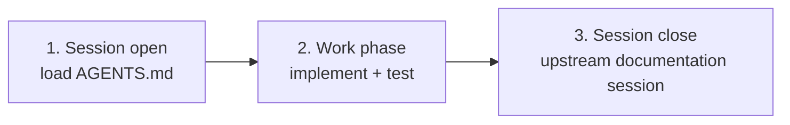
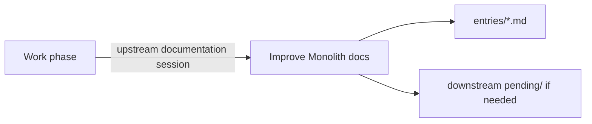

# Upstream changelog

Session close-out log for **Project Monolith** work. Entries record what was implemented, which Monolith docs were improved, and whether a [downstream changelog](../downstream-changelog/README.md) entry is still needed for Gateway / Frontend.

This is **not** the Gateway/Frontend handoff log. Downstream contracts stay in [downstream-changelog/](../downstream-changelog/README.md). This folder is the **session documentation archive** for Monolith-only work.

Canonical workspace context: [ai-agent-guide.md](../ai-agent-guide.md).

---

## Session lifecycle

Monolith agent work follows three phases. Only phases 1 and 3 load [AGENTS.md](../../AGENTS.md) as the ritual entry/exit document; phase 2 is normal implementation.



| Phase | Trigger | Agent action |
|-------|---------|--------------|
| **1. Session open** | User loads [AGENTS.md](../../AGENTS.md) / this guide at the start of a chat | Read architecture context. Default scope: **Monolith only**. Stay ready for work. |
| **2. Work phase** | Any prompt **without** a special session keyword | Implement features/fixes in Monolith. Update docs when behavior changes if practical during the task. **Do not** run the close-out ritual. |
| **3. Session close** | User prompt contains the exact keyword **`upstream documentation session`** | Improve Monolith documentation for work done in this session, then write an entry under [entries/](./entries/). |

### Keyword rules

- **`upstream documentation session`** is the **only** trigger for session close-out documentation. Paraphrases (for example "close session", "write the changelog", "update docs for this work", or "document what we did") do **not** qualify.
- Without that exact phrase, treat the session as still in **phase 2 (work)** even if the user re-loads [AGENTS.md](../../AGENTS.md).
- This keyword is independent of **`downstream sync session`** (cross-repo Gateway/Frontend implementation). Both may appear in different sessions; they never substitute for each other.

| Keyword | Repo scope | Purpose |
|---------|------------|---------|
| *(none)* | Monolith | Daily work (phase 2) |
| **`upstream documentation session`** | Monolith only | Close session: improve docs + write upstream changelog entry |
| **`downstream sync session`** | Monolith + Gateway + Frontend | Implement pending downstream handoff entries |

---

## When to write an entry

Write an entry **only** during an **`upstream documentation session`** (phase 3), after the session's Monolith work is done or paused.

| Situation | Entry? |
|-----------|--------|
| Feature, fix, refactor, or docs-only work completed in the session | **Yes** |
| Session opened but no meaningful work landed | **No** — say so and skip the file |
| Downstream HTTP contract changed during work | **Yes** here **and** ensure a [downstream-changelog/pending/](../downstream-changelog/pending/) entry exists |
| Pure exploratory Q&A with no code/doc changes | **No** |

If unsure whether the work is "meaningful," write a short entry. False positives cost less than lost session context.

---

## Directory layout

```
docs/upstream-changelog/
├── README.md       # This file
├── TEMPLATE.md     # Copy for each new entry
└── entries/        # One file per closed session (or logical close-out)
```

**Entry filename:** `YYYY-MM-DD-<slug>.md` (example: `2026-07-15-blade-dark-mode-docs.md`).

---

## Upstream documentation session (agent)

Start **only** when the user's prompt contains the exact keyword **`upstream documentation session`**. Paraphrases do not qualify.

1. **Confirm keyword** — if absent, stay in work phase; do not invent a close-out.
2. **Inventory session work** — from conversation history, git status/diff, and related files: what changed and why.
3. **Improve documentation** — update every Monolith guide that the session made stale or incomplete:
   - [README.md](../../README.md) living-documentation policy when setup/conventions change
   - Domain guides under [docs/](../) (API, web frontend, auth, payments, etc.)
   - [AGENTS.md](../../AGENTS.md) / [ai-agent-guide.md](../ai-agent-guide.md) when agent workflow itself changed
   - English only (project rule)
4. **Downstream check** — if the [adaptation contract](../internal-monorepo-assessment.md#adaptation-contract-gateway--frontend) triggers and no pending entry exists yet, create one under [downstream-changelog/pending/](../downstream-changelog/pending/) using that folder's template.
5. **Write this changelog** — copy [TEMPLATE.md](./TEMPLATE.md) to `entries/YYYY-MM-DD-<slug>.md` and fill every section that applies.
6. **Do not** open Gateway or Frontend unless the same prompt also contains **`downstream sync session`** (unusual; normally separate sessions).
7. **Summarize for the user** — list docs updated, upstream entry path, and any new/updated downstream pending paths.

### What "improve documentation" means

- Prefer **accurate, scannable updates** to existing guides over dumping raw chat notes.
- Fix contradictions between code and docs discovered during the session.
- Add missing conventions, env vars, routes, or UI behavior the session introduced.
- Do **not** rewrite unrelated docs for vanity. Scope = work from this session + adjacent drift it exposed.

---

## Entry lifecycle



There is no `pending/` → `done/` move for upstream entries. Once written, the file stays in `entries/` as historical record.

---

## Related docs

- [ai-agent-guide.md](../ai-agent-guide.md) — default scope, session keywords, checklists
- [downstream-changelog/README.md](../downstream-changelog/README.md) — Gateway / Frontend handoff log
- [AGENTS.md](../../AGENTS.md) — Monolith agent entry point
